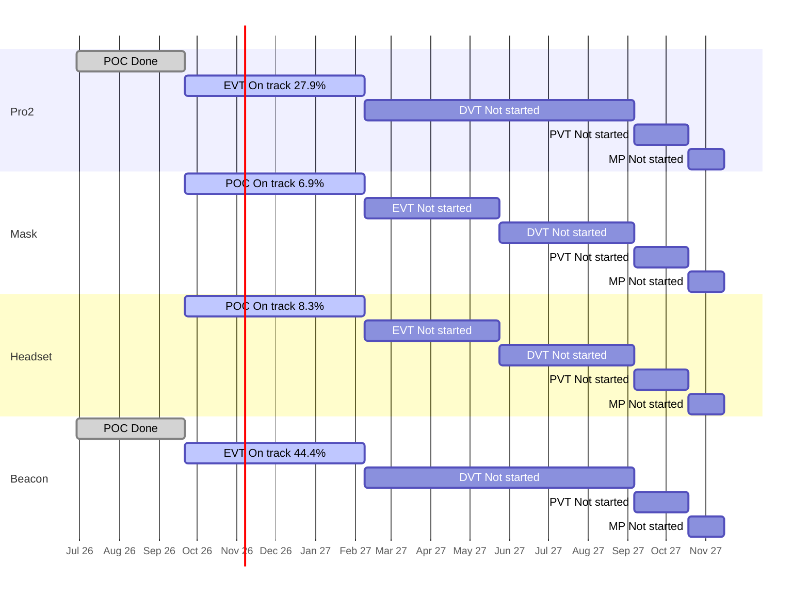

# Portfolio Roll-up — 2026-10-13

Redone 2026-10-13 (replaces the earlier versions of today's roll-up; what changed is in section 8).

Are the four products on course for their stage gates and for the final deadline, the end of mass production (MP) on 2027-11-15? Each product moves through five stages: POC (proof of concept: show the idea can work), EVT (engineering test: does the design meet its specs?), DVT (design test: is the final design ready?), PVT (factory test: can the factory build it?) and MP (mass production). A "gate" is the review at the end of a stage.

**The plan** is the stage schedule in [[reference#Stage schedule (per product)]]. Pro2 and Beacon run from 2026-06-29, Mask and Headset from 2026-09-21, and all four end MP on 2027-11-15. All slip on this page is measured against those planned stage end dates. Re-dating tickets in Jira does not change the plan, so it can't hide slip. All numbers come from `tools/wiki_jira.py rollup`; rules and definitions are in [[portfolio/INDEX]].

## 1. Headline

- Days to final deadline (2027-11-15): 398
- On track for MP: 4 of 4 (ZenaQuiet-Pro2 — low confidence, ZenaQuiet-Mask — low confidence, ZenaQuiet-Headset — low confidence, ZenaQuiet-Beacon — low confidence)
- Worst MP forecast slip: not enough data yet (pace needs more closed Stories or more time)
- Next gate: 2027-02-08 (118d): ZenaQuiet-Pro2 (EVT), ZenaQuiet-Mask (POC), ZenaQuiet-Headset (POC), ZenaQuiet-Beacon (EVT)

All four products are **On track** by the rule, but only at low confidence: every current stage is just 22 days old. **Pro2 and Beacon are ahead**: 28% and 44% of their EVT Stories are Done against 16% of the time used, and at their current pace both would finish EVT before the gate. **Headset and Mask are behind the expected line** (8% and 7% counted against 16%), though still within the 15-point margin; at today's pace their POC would finish about 91 days (Headset) and 179 days (Mask) after the 2027-02-08 gate.

Against the plan, Pro2's POC finished on 2026-10-07, 16 days after the planned 2026-09-21 end, and two Pro2 POC Subtasks are still open. All four products face the same gate on 2027-02-08 with the same small group of engineers.

## 2. Products

| Product | Stage | Gate (days) | Readiness raw / adjusted | Expected | Stage status | Pace forecast for gate | MP outlook | Slip vs schedule | Next stage planned | HIGH / MED | Health |
| --- | --- | --- | --- | --- | --- | --- | --- | --- | --- | --- | --- |
| ZenaQuiet-Pro2 | EVT | 2027-02-08 (118) | 27.9% / 27.9% | 15.7% | On track | 2026-12-09 (-61d), low confidence | On track (early, low confidence), forecast n/a | 2 open items past stage end, max +36d | 0.0% | 2 / 62 | AMBER |
| ZenaQuiet-Mask | POC | 2027-02-08 (118) | 6.9% / 6.9% | 15.7% | On track | 2027-08-06 (+179d), low confidence | On track (early, low confidence), forecast n/a | none past stage end | n/a | 0 / 36 | AMBER |
| ZenaQuiet-Headset | POC | 2027-02-08 (118) | 20.8% / 8.3% | 15.7% | On track | 2027-05-10 (+91d), low confidence | On track (early, low confidence), forecast n/a | none past stage end | 0.0% | 9 / 21 | AMBER |
| ZenaQuiet-Beacon | EVT | 2027-02-08 (118) | 44.4% / 44.4% | 15.7% | On track | 2026-11-10 (-90d), low confidence | On track (early, low confidence), forecast n/a | none past stage end | 0.0% | 0 / 22 | AMBER |

> **What the numbers mean**
> - **Raw:** share of the current stage's Stories (planned pieces of work) marked Done in Jira. Pro2 EVT: 17 of 61 Done = 27.9%.
> - **Adjusted:** Raw, minus Done Stories that don't count as real progress: ones that still have open Subtasks, or were closed before the stage began. Headset POC: 5 Done, but 3 have open Subtasks, so 2 of 24 = 8.3%. Status and the timeline use this number.
> - **Expected:** share of the stage's planned time already used. EVT runs 140 days (2026-09-21 → 2027-02-08); on 2026-10-13 it is day 22, so 22 ÷ 140 = 15.7%. If work were spread evenly, about that much should be Done.
> - Adjusted at or above Expected means ahead; 15–25 points below means At risk; more than 25 below means Behind.

- **Pro2** — 17 of 61 EVT Stories are Done ([PRO2-456](https://epazz.atlassian.net/browse/PRO2-456), [PRO2-467](https://epazz.atlassian.net/browse/PRO2-467) to [PRO2-482](https://epazz.atlassian.net/browse/PRO2-482), closed together on 2026-10-09). 21 open EVT Stories have no Subtasks, and none of the 9 DVT Stories is planned yet. Two POC Acoustic Subtasks are past the planned POC end ([PRO2-397](https://epazz.atlassian.net/browse/PRO2-397) +36d, [PRO2-396](https://epazz.atlassian.net/browse/PRO2-396) +25d). Report: [[ZenaQuiet-Pro2/jira/2026-10-13-jira]].
- **Beacon** — 16 of 36 EVT Stories are Done ([BC-186](https://epazz.atlassian.net/browse/BC-186), [BC-192](https://epazz.atlassian.net/browse/BC-192) to [BC-205](https://epazz.atlassian.net/browse/BC-205), [BC-209](https://epazz.atlassian.net/browse/BC-209)). On 2026-10-13 the cloud-connectivity Epic [BC-106](https://epazz.atlassian.net/browse/BC-106) and the unowned Pro-to-Beacon Stories BC-113, BC-114, BC-115 and BC-117 disappeared from Jira; [BC-233](https://epazz.atlassian.net/browse/BC-233) appeared with BC-117's title, under the firmware Epic, with no dates. Firmware Stories [BC-206](https://epazz.atlassian.net/browse/BC-206) to [BC-210](https://epazz.atlassian.net/browse/BC-210) started today. Report: [[ZenaQuiet-Beacon/jira/2026-10-13-jira]].
- **Headset** — 5 POC Stories are Done, but 3 still have open Subtasks ([HS-100](https://epazz.atlassian.net/browse/HS-100), [HS-124](https://epazz.atlassian.net/browse/HS-124), [HS-418](https://epazz.atlassian.net/browse/HS-418)), so 2 count. 10 POC Stories have no owner, including core voice and noise-cancelling work ([HS-48](https://epazz.atlassian.net/browse/HS-48), [HS-144](https://epazz.atlassian.net/browse/HS-144), [HS-161](https://epazz.atlassian.net/browse/HS-161), [HS-164](https://epazz.atlassian.net/browse/HS-164)). Its 9 HIGH risks are later-stage Stories that run past their Epic's due date, not POC-gate threats. Report: [[ZenaQuiet-Headset/jira/2026-10-13-jira]].
- **Mask** — 2 of 29 POC Stories are Done ([MK-2](https://epazz.atlassian.net/browse/MK-2), [MK-3](https://epazz.atlassian.net/browse/MK-3)). 17 POC Stories have no owner and 27 have no Subtasks, so most of the work isn't broken down yet; this is the slowest pace of the four. No EVT Stories exist. Report: [[ZenaQuiet-Mask/jira/2026-10-13-jira]].

## 3. Stage timeline

Bars are the planned stage windows. Labels show each stage's status and counted readiness.

## 4. Stage detail

### ZenaQuiet-Pro2

| Stage | Planned window | Stories done (adjusted) / total | Expected | Raw | Adjusted | Planned (owner + dated Subtasks) | Status | Slip vs plan |
| --- | --- | --- | --- | --- | --- | --- | --- | --- |
| POC | 2026-06-29 → 2026-09-21 | 18 (15) / 18 | 100.0% | 100.0% | 83.3% | 4/18 | Done | finished 2026-10-07, +16d late |
| EVT | 2026-09-21 → 2027-02-08 | 17 (17) / 61 | 15.7% | 27.9% | 27.9% | 10/61 | On track | forecast -61d (low confidence) |
| DVT | 2027-02-08 → 2027-09-06 | 0 (0) / 9 | 0.0% | 0.0% | 0.0% | 0/9 | Not started | — |
| PVT | 2027-09-06 → 2027-10-18 | 0 (0) / 0 | 0.0% | —% | —% | 0/0 | Not started | — |
| MP | 2027-10-18 → 2027-11-15 | 0 (0) / 0 | 0.0% | —% | —% | 0/0 | Not started | — |

Pace in EVT: 5.41 adjusted Stories/week (low confidence: needs ≥5 closed and ≥28 days in stage).
Open EVT Stories with no owner (2): PRO2-299, PRO2-426.
Open EVT Stories with no Subtasks (21): PRO2-371, PRO2-372, PRO2-423, PRO2-424, PRO2-425, PRO2-426, PRO2-428, PRO2-429, PRO2-430, PRO2-431 ….

### ZenaQuiet-Mask

| Stage | Planned window | Stories done (adjusted) / total | Expected | Raw | Adjusted | Planned (owner + dated Subtasks) | Status | Slip vs plan |
| --- | --- | --- | --- | --- | --- | --- | --- | --- |
| POC | 2026-09-21 → 2027-02-08 | 2 (2) / 29 | 15.7% | 6.9% | 6.9% | 0/29 | On track | forecast +179d (low confidence) |
| EVT | 2027-02-08 → 2027-05-24 | 0 (0) / 0 | 0.0% | —% | —% | 0/0 | Not started | — |
| DVT | 2027-05-24 → 2027-09-06 | 0 (0) / 0 | 0.0% | —% | —% | 0/0 | Not started | — |
| PVT | 2027-09-06 → 2027-10-18 | 0 (0) / 0 | 0.0% | —% | —% | 0/0 | Not started | — |
| MP | 2027-10-18 → 2027-11-15 | 0 (0) / 0 | 0.0% | —% | —% | 0/0 | Not started | — |

Pace in POC: 0.64 adjusted Stories/week (low confidence: needs ≥5 closed and ≥28 days in stage).
Open POC Stories with no owner (17): MK-7, MK-8, MK-9, MK-11, MK-12, MK-13, MK-16, MK-17, MK-20, MK-22 ….
Open POC Stories with no Subtasks (27): MK-4, MK-5, MK-7, MK-8, MK-9, MK-11, MK-12, MK-13, MK-16, MK-17 ….

### ZenaQuiet-Headset

| Stage | Planned window | Stories done (adjusted) / total | Expected | Raw | Adjusted | Planned (owner + dated Subtasks) | Status | Slip vs plan |
| --- | --- | --- | --- | --- | --- | --- | --- | --- |
| POC | 2026-09-21 → 2027-02-08 | 5 (2) / 24 | 15.7% | 20.8% | 8.3% | 6/24 | On track | forecast +91d (low confidence) |
| EVT | 2027-02-08 → 2027-05-24 | 0 (0) / 45 | 0.0% | 0.0% | 0.0% | 0/45 | Not started | — |
| DVT | 2027-05-24 → 2027-09-06 | 0 (0) / 28 | 0.0% | 0.0% | 0.0% | 0/28 | Not started | — |
| PVT | 2027-09-06 → 2027-10-18 | 0 (0) / 9 | 0.0% | 0.0% | 0.0% | 0/9 | Not started | — |
| MP | 2027-10-18 → 2027-11-15 | 0 (0) / 0 | 0.0% | —% | —% | 0/0 | Not started | — |

Not counted in adjusted readiness: 3 Done with open Subtasks.

Pace in POC: 0.64 adjusted Stories/week (low confidence: needs ≥5 closed and ≥28 days in stage).
Open POC Stories with no owner (10): HS-48, HS-117, HS-118, HS-144, HS-161, HS-164, HS-381, HS-385, HS-452, HS-457.

### ZenaQuiet-Beacon

| Stage | Planned window | Stories done (adjusted) / total | Expected | Raw | Adjusted | Planned (owner + dated Subtasks) | Status | Slip vs plan |
| --- | --- | --- | --- | --- | --- | --- | --- | --- |
| POC | 2026-06-29 → 2026-09-21 | 21 (19) / 21 | 100.0% | 100.0% | 90.5% | 2/21 | Done | finished 2026-09-14, on time |
| EVT | 2026-09-21 → 2027-02-08 | 16 (16) / 36 | 15.7% | 44.4% | 44.4% | 3/36 | On track | forecast -90d (low confidence) |
| DVT | 2027-02-08 → 2027-09-06 | 0 (0) / 7 | 0.0% | 0.0% | 0.0% | 0/7 | Not started | — |
| PVT | 2027-09-06 → 2027-10-18 | 0 (0) / 0 | 0.0% | —% | —% | 0/0 | Not started | — |
| MP | 2027-10-18 → 2027-11-15 | 0 (0) / 0 | 0.0% | —% | —% | 0/0 | Not started | — |

Pace in EVT: 5.09 adjusted Stories/week (low confidence: needs ≥5 closed and ≥28 days in stage).
Open EVT Stories with no Subtasks (11): BC-157, BC-158, BC-159, BC-161, BC-162, BC-163, BC-206, BC-207, BC-208, BC-210 ….

## 5. Slip vs schedule and dates moved this week

For each product, the first list is slip against the plan. The second is a warning only: dates moved in Jira since the previous snapshot (2026-10-12). Most of this week's moves are the 2026-10-12 re-plan, which stretched Stories to the full stage window; that isn't slip unless a date goes past the planned stage end.

### ZenaQuiet-Pro2
Open items due after their stage's planned end ([[reference#Stage schedule (per product)]]): 2.
- [PRO2-397](https://epazz.atlassian.net/browse/PRO2-397) (Subtask, POC): due 2026-10-27, plan end 2026-09-21 (+36d)
- [PRO2-396](https://epazz.atlassian.net/browse/PRO2-396) (Subtask, POC): due 2026-10-16, plan end 2026-09-21 (+25d)
Dates moved since 2026-10-12: 61 of 148 open items (41.2%) — BULK RE-DATE; 46 now due later.
- [PRO2-172](https://epazz.atlassian.net/browse/PRO2-172) (Epic): 2027-02-08 → 2027-11-15 (+280d)
- [PRO2-416](https://epazz.atlassian.net/browse/PRO2-416) (Story): 2026-10-09 → 2027-02-08 (+122d)
- [PRO2-483](https://epazz.atlassian.net/browse/PRO2-483) (Story): 2026-10-16 → 2027-02-08 (+115d)
- [PRO2-484](https://epazz.atlassian.net/browse/PRO2-484) (Story): 2026-10-16 → 2027-02-08 (+115d)
- [PRO2-304](https://epazz.atlassian.net/browse/PRO2-304) (Story): 2026-10-19 → 2027-02-08 (+112d)
- + 41 more

### ZenaQuiet-Mask
Open items due after their stage's planned end ([[reference#Stage schedule (per product)]]): none.
Dates moved since 2026-10-12: 35 of 36 open items (97.2%) — BULK RE-DATE; 18 now due later.
- [MK-1](https://epazz.atlassian.net/browse/MK-1) (Epic): 2026-11-30 → 2027-11-15 (+350d)
- [MK-32](https://epazz.atlassian.net/browse/MK-32) (Epic): 2027-05-24 → 2027-11-15 (+175d)
- [MK-4](https://epazz.atlassian.net/browse/MK-4) (Story): 2026-10-20 → 2027-02-08 (+111d)
- [MK-5](https://epazz.atlassian.net/browse/MK-5) (Story): 2026-10-20 → 2027-02-08 (+111d)
- [MK-6](https://epazz.atlassian.net/browse/MK-6) (Epic): 2027-09-06 → 2027-11-15 (+70d)
- + 13 more

### ZenaQuiet-Headset
Open items due after their stage's planned end ([[reference#Stage schedule (per product)]]): none.
Dates moved since 2026-10-12: 89 of 532 open items (16.7%); 9 now due later.
- [HS-641](https://epazz.atlassian.net/browse/HS-641) (Story): 2026-11-02 → 2027-09-06 (+308d)
- [HS-642](https://epazz.atlassian.net/browse/HS-642) (Story): 2026-11-02 → 2027-09-06 (+308d)
- [HS-643](https://epazz.atlassian.net/browse/HS-643) (Story): 2026-11-02 → 2027-09-06 (+308d)
- [HS-644](https://epazz.atlassian.net/browse/HS-644) (Story): 2026-11-02 → 2027-09-06 (+308d)
- [HS-645](https://epazz.atlassian.net/browse/HS-645) (Story): 2026-11-02 → 2027-09-06 (+308d)
- + 4 more

### ZenaQuiet-Beacon
Open items due after their stage's planned end ([[reference#Stage schedule (per product)]]): none.
Dates moved since 2026-10-12: 32 of 52 open items (61.5%) — BULK RE-DATE; 31 now due later.
- [BC-211](https://epazz.atlassian.net/browse/BC-211) (Story): 2026-11-13 → 2027-09-06 (+297d)
- [BC-212](https://epazz.atlassian.net/browse/BC-212) (Story): 2026-11-20 → 2027-09-06 (+290d)
- [BC-213](https://epazz.atlassian.net/browse/BC-213) (Story): 2026-11-20 → 2027-09-06 (+290d)
- [BC-214](https://epazz.atlassian.net/browse/BC-214) (Story): 2026-11-27 → 2027-09-06 (+283d)
- [BC-215](https://epazz.atlassian.net/browse/BC-215) (Story): 2026-11-27 → 2027-09-06 (+283d)
- + 26 more

## 6. Cross-product

- **Shared gate:** all four products have their next gate on 2027-02-08 (118 days): Pro2 and Beacon end EVT, Headset and Mask end POC. All four then share PVT and MP from 2027-09-06 to 2027-11-15.
- **People across products** (open items):

| Person | Open items | By product |
| --- | --- | --- |
| Nguyen Trung Tin | 49 | Beacon 27, Headset 20, Pro2 2 |
| Hung Pham Nguyen | 44 | Pro2 42, Headset 2 |
| Nguyen Minh Thien | 31 | Pro2 16, Beacon 14, Mask 1 |
| Nguyen Manh Tuan | 16 | Headset 10, Beacon 6 |
| Chico Ly | 15 | Headset 5, Beacon 5, Pro2 4, Mask 1 |
| Phong.ngoc.nguyen | 5 | Beacon 3, Mask 1, Headset 1 |

Unassigned open items: Pro2 16, Mask 22, Headset 485, Beacon 4.

- **Research work the products wait on:**

**ZenaQuiet-Research** (snapshot 2026-10-13)
Open 20; linked to a product ticket 0; unlinked 20.
- Due within 14d: [RS-1](https://epazz.atlassian.net/browse/RS-1) due 2026-10-16 — Chip eval + decision
- Due within 14d: [RS-2](https://epazz.atlassian.net/browse/RS-2) due 2026-10-16 — [POC] Evaluate TSE on Imx95 NPU
- Due within 14d: [RS-4](https://epazz.atlassian.net/browse/RS-4) due 2026-10-23 — Survey about good components for ultrasonic loudspeaker and best layout
- Due within 14d: [RS-25](https://epazz.atlassian.net/browse/RS-25) due 2026-10-26 — [POC] Block: Research desk-height screens and partitions to block speech between desks

Candidate links suggested in the Research report: RS-1/RS-2 → [PRO2-486](https://epazz.atlassian.net/browse/PRO2-486), RS-8 → [PRO2-462](https://epazz.atlassian.net/browse/PRO2-462), RS-16 → [HS-51](https://epazz.atlassian.net/browse/HS-51) (inferred, not yet linked in Jira).

## 7. Recommendations

1. **Speed up Mask and Headset POC.** They are the two products whose pace misses the gate. Give owners and Subtasks to Mask's 17 unowned POC Stories (e.g. [MK-7](https://epazz.atlassian.net/browse/MK-7), [MK-8](https://epazz.atlassian.net/browse/MK-8), [MK-22](https://epazz.atlassian.net/browse/MK-22)) and to Headset's voice and noise-cancelling Stories ([HS-144](https://epazz.atlassian.net/browse/HS-144), [HS-164](https://epazz.atlassian.net/browse/HS-164)).
2. **Find out where Beacon's connectivity scope went.** Ask the Beacon lead why [BC-106](https://epazz.atlassian.net/browse/BC-106) and BC-113 to BC-117 were removed, and give [BC-233](https://epazz.atlassian.net/browse/BC-233) an owner and dates.
3. **Plan the next stage early.** None of Pro2's 9 DVT Stories, Beacon's 7 DVT Stories or Headset's 45 EVT Stories has an owner with dated Subtasks yet.
4. **Check load on the shared engineers:** Nguyen Trung Tin (49 open across Beacon, Headset and Pro2), Hung Pham Nguyen (44) and Nguyen Minh Thien (31, three products). Headset has 485 unassigned open items.
5. **Tidy Done Stories with open Subtasks** ([HS-100](https://epazz.atlassian.net/browse/HS-100), [HS-124](https://epazz.atlassian.net/browse/HS-124), [HS-418](https://epazz.atlassian.net/browse/HS-418)), and close or move the late Pro2 POC Subtasks ([PRO2-396](https://epazz.atlassian.net/browse/PRO2-396), [PRO2-397](https://epazz.atlassian.net/browse/PRO2-397)).

## 8. Data Gaps & Assumptions

- **Snapshots:** every product and Research has a 2026-10-13 snapshot from today's run. The Beacon snapshot is the one from today's Beacon redo (132 issues). The Pro2 snapshot was partly rebuilt from 2026-10-12 data for 219 unchanged issues (see its report's Data Gaps).
- **Plan used for slip:** the stage schedule in `reference.md`. A finished stage's finish date is the date its last Story was closed in Jira.
- **Counted readiness:** on 2026-10-13 the human decided that Stories created and closed within one day count as progress (`exclude_same_day_closed: false` in [[portfolio/INDEX]]). Counted readiness now leaves out only Done Stories that still have open Subtasks or were closed before the stage started.
- **Beacon's POC shows "on time" (finished 2026-09-14)** only because BC-82, BC-97 and BC-185, its latest-closing POC Stories, left Jira today with Epic BC-106. Before that it showed +15 days late. Deleting tickets changes history; the earlier figure is kept here on purpose.
- **FLAG lines from the script:** Pro2 61 of 148 open items re-dated since 2026-10-12 (41%); Mask 35 of 36 (97%); Beacon 32 of 52 (62%). All belong to the 2026-10-12 re-plan, and none takes a Story past its planned stage end.
- **All pace forecasts are low confidence:** each current stage is 22 days old (the threshold is 28 days and 5 counted Stories). Low-confidence forecasts are shown but don't change a status: Mask (+179d) and Headset (+91d) still read "On track".
- **MP forecast assumption:** a slip in the current stage carries through to MP, and later stages keep their length.
- **Next stage planned** counts a Story as planned when it has an owner and at least one Subtask with both dates. Mask has no EVT Stories yet (n/a).
- **What changed versus the earlier version today:** with same-day-closed Stories now counted, Pro2 moved from At risk (0% counted) to On track (27.9%), Beacon from 2.8% to 44.4%, and Mask from At risk (0%) to On track (6.9%). Headset is unchanged. "On track for MP" went from 2 of 4 to 4 of 4, all at low confidence.
