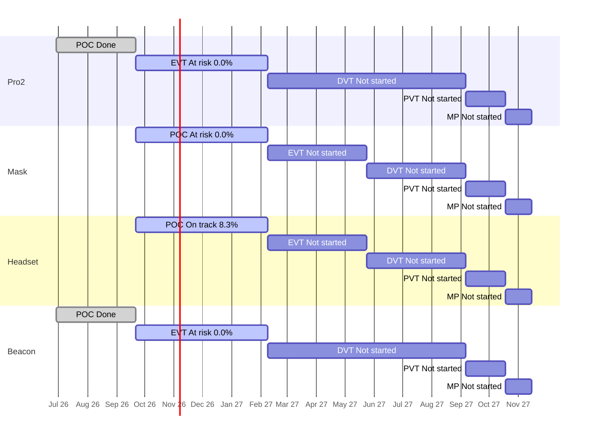

# Portfolio Roll-up — 2026-10-13

Are the four products on course for their stage gates and for the final deadline, the end of mass production (MP) on 2027-11-15? Each product moves through five stages: POC (proof of concept), EVT (engineering test), DVT (design test), PVT (factory test) and MP (mass production). A "gate" is the review at the end of a stage. All numbers come from `tools/wiki_jira.py rollup` on this week's Jira snapshots. Rules and definitions: [[portfolio/INDEX]].

**The plan** is the stage schedule in [[reference#Stage schedule (per product)]]: Pro2 and Beacon run from 2026-06-29, Mask and Headset from 2026-09-21, and all four end MP on 2027-11-15. All slip on this page is measured against those planned stage end dates. Re-dating tickets in Jira does not change the plan, so it can't hide slip. Pace forecasts need a few more weeks of closed work before they mean much.

*Regenerated 2026-10-13: the first version measured slip against a 2026-10-13 Jira snapshot. At the human's request it now uses the stage schedule.*

## 1. Headline

- Days to final deadline (2027-11-15): 398
- On track for MP: 1 of 4 (ZenaQuiet-Headset — low confidence)
- Worst MP forecast slip: not enough data yet (pace needs more closed Stories or more time)
- Next gate: 2027-02-08 (118d): ZenaQuiet-Pro2 (EVT), ZenaQuiet-Mask (POC), ZenaQuiet-Headset (POC), ZenaQuiet-Beacon (EVT)

No product can yet be called on course for 2027-11-15. Pro2, Beacon and Mask are **At risk**: the stage is 16% through its time, but none of the work finished in it counts as tracked progress yet. Every Story closed in Pro2's and Beacon's EVT, and Mask's two closed POC Stories, were created and closed within a day, which looks like logging finished work after the fact (inferred). Headset is **On track only on paper**: 2 of 24 POC Stories count as progress (8%), and at that early pace POC would finish about 3 months late (low confidence). Against the plan, both finished stages ran late: Pro2's POC finished on 2026-10-07 and Beacon's on 2026-10-06, 16 and 15 days after the planned 2026-09-21 end. Two Pro2 POC Subtasks are still open past that end. All four products share the same next gate, 2027-02-08, and the same small group of engineers.

## 2. Products

| Product | Stage | Gate (days) | Readiness raw / adjusted | Expected | Stage status | Pace forecast for gate | MP outlook | Slip vs schedule | Next stage planned | HIGH / MED | Health |
| --- | --- | --- | --- | --- | --- | --- | --- | --- | --- | --- | --- |
| ZenaQuiet-Pro2 | EVT | 2027-02-08 (118) | 27.9% / 0.0% | 15.7% | At risk | no adjusted progress yet | At risk, forecast n/a | 2 open items past stage end, max +36d | 0.0% | 2 / 62 | AMBER |
| ZenaQuiet-Mask | POC | 2027-02-08 (118) | 6.9% / 0.0% | 15.7% | At risk | no adjusted progress yet | At risk, forecast n/a | none past stage end | n/a | 0 / 36 | AMBER |
| ZenaQuiet-Headset | POC | 2027-02-08 (118) | 20.8% / 8.3% | 15.7% | On track | 2027-05-10 (+91d), low confidence | On track (early, low confidence), forecast n/a | none past stage end | 0.0% | 9 / 21 | AMBER |
| ZenaQuiet-Beacon | EVT | 2027-02-08 (118) | 38.5% / 0.0% | 15.7% | At risk | no adjusted progress yet | At risk, forecast n/a | none past stage end | 0.0% | 0 / 26 | AMBER |

- **Pro2** — 17 EVT Stories are Done, but all were created and closed on the same day ([PRO2-456](https://epazz.atlassian.net/browse/PRO2-456), [PRO2-467](https://epazz.atlassian.net/browse/PRO2-467) to [PRO2-482](https://epazz.atlassian.net/browse/PRO2-482)), so adjusted readiness is 0%. 21 open EVT Stories have no Subtasks. Two POC Acoustic Subtasks are still open under Done Stories ([PRO2-396](https://epazz.atlassian.net/browse/PRO2-396), [PRO2-397](https://epazz.atlassian.net/browse/PRO2-397)). Report: [[ZenaQuiet-Pro2/jira/2026-10-13-jira]].
- **Beacon** — 15 EVT Stories Done, all created and closed within a day, on 2026-10-08 or 2026-10-09 ([BC-186](https://epazz.atlassian.net/browse/BC-186), [BC-192](https://epazz.atlassian.net/browse/BC-192) to [BC-205](https://epazz.atlassian.net/browse/BC-205)). Pro-to-Beacon connection work has no owner and no Subtasks ([BC-113](https://epazz.atlassian.net/browse/BC-113), [BC-114](https://epazz.atlassian.net/browse/BC-114), [BC-115](https://epazz.atlassian.net/browse/BC-115), [BC-117](https://epazz.atlassian.net/browse/BC-117)). Report: [[ZenaQuiet-Beacon/jira/2026-10-13-jira]].
- **Headset** — 5 POC Stories are Done, but 3 still have open Subtasks ([HS-100](https://epazz.atlassian.net/browse/HS-100), [HS-124](https://epazz.atlassian.net/browse/HS-124), [HS-418](https://epazz.atlassian.net/browse/HS-418)). 10 POC Stories have no owner, including core voice and noise-cancelling work ([HS-144](https://epazz.atlassian.net/browse/HS-144), [HS-161](https://epazz.atlassian.net/browse/HS-161), [HS-164](https://epazz.atlassian.net/browse/HS-164), [HS-48](https://epazz.atlassian.net/browse/HS-48)). Its 9 HIGH risks are later-stage Stories that run past their Epic's due date, not POC-gate threats. Report: [[ZenaQuiet-Headset/jira/2026-10-13-jira]].
- **Mask** — 2 of 29 POC Stories Done ([MK-2](https://epazz.atlassian.net/browse/MK-2), [MK-3](https://epazz.atlassian.net/browse/MK-3)), both created and closed within a day. 17 POC Stories have no owner and 27 have no Subtasks, so the work isn't broken down yet. No EVT Stories exist. Report: [[ZenaQuiet-Mask/jira/2026-10-13-jira]].

## 3. Stage timeline

Bars are the stage windows from [[reference#Stage schedule (per product)]]. Labels show the stage status and adjusted readiness.

## 4. Stage detail

### ZenaQuiet-Pro2

| Stage | Planned window | Stories done (adjusted) / total | Expected | Raw | Adjusted | Planned (owner + dated Subtasks) | Status | Slip vs plan |
| --- | --- | --- | --- | --- | --- | --- | --- | --- |
| POC | 2026-06-29 → 2026-09-21 | 18 (15) / 18 | 100.0% | 100.0% | 83.3% | 4/18 | Done | finished 2026-10-07, +16d late |
| EVT | 2026-09-21 → 2027-02-08 | 17 (0) / 61 | 15.7% | 27.9% | 0.0% | 10/61 | At risk | no forecast yet |
| DVT | 2027-02-08 → 2027-09-06 | 0 (0) / 9 | 0.0% | 0.0% | 0.0% | 0/9 | Not started | — |
| PVT | 2027-09-06 → 2027-10-18 | 0 (0) / 0 | 0.0% | —% | —% | 0/0 | Not started | — |
| MP | 2027-10-18 → 2027-11-15 | 0 (0) / 0 | 0.0% | —% | —% | 0/0 | Not started | — |

Not counted in adjusted readiness: 17 created and closed within a day (logged after the fact).

Pace in EVT: 0.0 adjusted Stories/week (low confidence: needs ≥5 closed and ≥28 days in stage).
Open EVT Stories with no owner (2): PRO2-299, PRO2-426.
Open EVT Stories with no Subtasks (21): PRO2-371, PRO2-372, PRO2-423, PRO2-424, PRO2-425, PRO2-426, PRO2-428, PRO2-429, PRO2-430, PRO2-431 ….

### ZenaQuiet-Mask

| Stage | Planned window | Stories done (adjusted) / total | Expected | Raw | Adjusted | Planned (owner + dated Subtasks) | Status | Slip vs plan |
| --- | --- | --- | --- | --- | --- | --- | --- | --- |
| POC | 2026-09-21 → 2027-02-08 | 2 (0) / 29 | 15.7% | 6.9% | 0.0% | 0/29 | At risk | no forecast yet |
| EVT | 2027-02-08 → 2027-05-24 | 0 (0) / 0 | 0.0% | —% | —% | 0/0 | Not started | — |
| DVT | 2027-05-24 → 2027-09-06 | 0 (0) / 0 | 0.0% | —% | —% | 0/0 | Not started | — |
| PVT | 2027-09-06 → 2027-10-18 | 0 (0) / 0 | 0.0% | —% | —% | 0/0 | Not started | — |
| MP | 2027-10-18 → 2027-11-15 | 0 (0) / 0 | 0.0% | —% | —% | 0/0 | Not started | — |

Not counted in adjusted readiness: 2 created and closed within a day (logged after the fact).

Pace in POC: 0.0 adjusted Stories/week (low confidence: needs ≥5 closed and ≥28 days in stage).
Open POC Stories with no owner (17): MK-7, MK-8, MK-9, MK-11, MK-12, MK-13, MK-16, MK-17, MK-20, MK-22 ….
Open POC Stories with no Subtasks (27): MK-4, MK-5, MK-7, MK-8, MK-9, MK-11, MK-12, MK-13, MK-16, MK-17 ….

### ZenaQuiet-Headset

| Stage | Planned window | Stories done (adjusted) / total | Expected | Raw | Adjusted | Planned (owner + dated Subtasks) | Status | Slip vs plan |
| --- | --- | --- | --- | --- | --- | --- | --- | --- |
| POC | 2026-09-21 → 2027-02-08 | 5 (2) / 24 | 15.7% | 20.8% | 8.3% | 6/24 | On track | forecast +91d (low confidence) |
| EVT | 2027-02-08 → 2027-05-24 | 0 (0) / 45 | 0.0% | 0.0% | 0.0% | 0/45 | Not started | — |
| DVT | 2027-05-24 → 2027-09-06 | 0 (0) / 28 | 0.0% | 0.0% | 0.0% | 0/28 | Not started | — |
| PVT | 2027-09-06 → 2027-10-18 | 0 (0) / 9 | 0.0% | 0.0% | 0.0% | 0/9 | Not started | — |
| MP | 2027-10-18 → 2027-11-15 | 0 (0) / 0 | 0.0% | —% | —% | 0/0 | Not started | — |

Not counted in adjusted readiness: 3 Done with open Subtasks.

Pace in POC: 0.64 adjusted Stories/week (low confidence: needs ≥5 closed and ≥28 days in stage).
Open POC Stories with no owner (10): HS-48, HS-117, HS-118, HS-144, HS-161, HS-164, HS-381, HS-385, HS-452, HS-457.

### ZenaQuiet-Beacon

| Stage | Planned window | Stories done (adjusted) / total | Expected | Raw | Adjusted | Planned (owner + dated Subtasks) | Status | Slip vs plan |
| --- | --- | --- | --- | --- | --- | --- | --- | --- |
| POC | 2026-06-29 → 2026-09-21 | 24 (16) / 24 | 100.0% | 100.0% | 66.7% | 2/24 | Done | finished 2026-10-06, +15d late |
| EVT | 2026-09-21 → 2027-02-08 | 15 (0) / 39 | 15.7% | 38.5% | 0.0% | 3/39 | At risk | no forecast yet |
| DVT | 2027-02-08 → 2027-09-06 | 0 (0) / 7 | 0.0% | 0.0% | 0.0% | 0/7 | Not started | — |
| PVT | 2027-09-06 → 2027-10-18 | 0 (0) / 0 | 0.0% | —% | —% | 0/0 | Not started | — |
| MP | 2027-10-18 → 2027-11-15 | 0 (0) / 0 | 0.0% | —% | —% | 0/0 | Not started | — |

Not counted in adjusted readiness: 15 created and closed within a day (logged after the fact).

Pace in EVT: 0.0 adjusted Stories/week (low confidence: needs ≥5 closed and ≥28 days in stage).
Open EVT Stories with no owner (4): BC-113, BC-114, BC-115, BC-117.
Open EVT Stories with no Subtasks (15): BC-113, BC-114, BC-115, BC-117, BC-157, BC-158, BC-159, BC-161, BC-162, BC-163 ….

## 5. Slip vs schedule and dates moved this week

The first list per product is slip against the plan. The second is a warning only: dates moved in Jira since the previous snapshot. Most of this week's moves are the 2026-10-12 re-plan, which stretched Stories to the full stage window. That doesn't count as slip unless a date goes past the planned stage end.

### ZenaQuiet-Pro2
Open items due after their stage's planned end ([[reference#Stage schedule (per product)]]): 2.
- [PRO2-397](https://epazz.atlassian.net/browse/PRO2-397) (Subtask, POC): due 2026-10-27, plan end 2026-09-21 (+36d)
- [PRO2-396](https://epazz.atlassian.net/browse/PRO2-396) (Subtask, POC): due 2026-10-16, plan end 2026-09-21 (+25d)
Dates moved since 2026-10-12: 61 of 148 open items (41.2%) — BULK RE-DATE; 46 now due later.
- [PRO2-172](https://epazz.atlassian.net/browse/PRO2-172) (Epic): 2027-02-08 → 2027-11-15 (+280d)
- [PRO2-416](https://epazz.atlassian.net/browse/PRO2-416) (Story): 2026-10-09 → 2027-02-08 (+122d)
- [PRO2-483](https://epazz.atlassian.net/browse/PRO2-483) (Story): 2026-10-16 → 2027-02-08 (+115d)
- [PRO2-484](https://epazz.atlassian.net/browse/PRO2-484) (Story): 2026-10-16 → 2027-02-08 (+115d)
- [PRO2-304](https://epazz.atlassian.net/browse/PRO2-304) (Story): 2026-10-19 → 2027-02-08 (+112d)
- + 41 more

### ZenaQuiet-Mask
Open items due after their stage's planned end ([[reference#Stage schedule (per product)]]): none.
Dates moved since 2026-10-12: 35 of 36 open items (97.2%) — BULK RE-DATE; 18 now due later.
- [MK-1](https://epazz.atlassian.net/browse/MK-1) (Epic): 2026-11-30 → 2027-11-15 (+350d)
- [MK-32](https://epazz.atlassian.net/browse/MK-32) (Epic): 2027-05-24 → 2027-11-15 (+175d)
- [MK-4](https://epazz.atlassian.net/browse/MK-4) (Story): 2026-10-20 → 2027-02-08 (+111d)
- [MK-5](https://epazz.atlassian.net/browse/MK-5) (Story): 2026-10-20 → 2027-02-08 (+111d)
- [MK-6](https://epazz.atlassian.net/browse/MK-6) (Epic): 2027-09-06 → 2027-11-15 (+70d)
- + 13 more

### ZenaQuiet-Headset
Open items due after their stage's planned end ([[reference#Stage schedule (per product)]]): none.
Dates moved since 2026-10-12: 89 of 532 open items (16.7%); 9 now due later.
- [HS-641](https://epazz.atlassian.net/browse/HS-641) (Story): 2026-11-02 → 2027-09-06 (+308d)
- [HS-642](https://epazz.atlassian.net/browse/HS-642) (Story): 2026-11-02 → 2027-09-06 (+308d)
- [HS-643](https://epazz.atlassian.net/browse/HS-643) (Story): 2026-11-02 → 2027-09-06 (+308d)
- [HS-644](https://epazz.atlassian.net/browse/HS-644) (Story): 2026-11-02 → 2027-09-06 (+308d)
- [HS-645](https://epazz.atlassian.net/browse/HS-645) (Story): 2026-11-02 → 2027-09-06 (+308d)
- + 4 more

### ZenaQuiet-Beacon
Open items due after their stage's planned end ([[reference#Stage schedule (per product)]]): none.
Dates moved since 2026-10-12: 38 of 58 open items (65.5%) — BULK RE-DATE; 33 now due later.
- [BC-211](https://epazz.atlassian.net/browse/BC-211) (Story): 2026-11-13 → 2027-09-06 (+297d)
- [BC-212](https://epazz.atlassian.net/browse/BC-212) (Story): 2026-11-20 → 2027-09-06 (+290d)
- [BC-213](https://epazz.atlassian.net/browse/BC-213) (Story): 2026-11-20 → 2027-09-06 (+290d)
- [BC-214](https://epazz.atlassian.net/browse/BC-214) (Story): 2026-11-27 → 2027-09-06 (+283d)
- [BC-215](https://epazz.atlassian.net/browse/BC-215) (Story): 2026-11-27 → 2027-09-06 (+283d)
- + 28 more

## 6. Cross-product

- **Shared gate:** all four products have their next gate on 2027-02-08 (118 days): Pro2 and Beacon end EVT, Headset and Mask end POC. All four then share PVT and MP from 2027-09-06 to 2027-11-15.
- **People across products** (open items):

| Person | Open items | By product |
| --- | --- | --- |
| Nguyen Trung Tin | 49 | Beacon 27, Headset 20, Pro2 2 |
| Hung Pham Nguyen | 44 | Pro2 42, Headset 2 |
| Nguyen Minh Thien | 31 | Pro2 16, Beacon 14, Mask 1 |
| Nguyen Manh Tuan | 16 | Headset 10, Beacon 6 |
| Chico Ly | 15 | Headset 5, Beacon 5, Pro2 4, Mask 1 |
| Phong.ngoc.nguyen | 5 | Beacon 3, Mask 1, Headset 1 |

Unassigned open items: Pro2 16, Mask 22, Headset 485, Beacon 9.

- **Research work the products wait on:**

**ZenaQuiet-Research** (snapshot 2026-10-13)
Open 20; linked to a product ticket 0; unlinked 20.
- Due within 14d: [RS-1](https://epazz.atlassian.net/browse/RS-1) due 2026-10-16 — Chip eval + decision
- Due within 14d: [RS-2](https://epazz.atlassian.net/browse/RS-2) due 2026-10-16 — [POC] Evaluate TSE on Imx95 NPU
- Due within 14d: [RS-4](https://epazz.atlassian.net/browse/RS-4) due 2026-10-23 — Survey about good components for ultrasonic loudspeaker and best layout
- Due within 14d: [RS-25](https://epazz.atlassian.net/browse/RS-25) due 2026-10-26 — [POC] Block: Research desk-height screens and partitions to block speech between desks

Candidate links suggested by the Research helper: RS-1/RS-2 → [PRO2-486](https://epazz.atlassian.net/browse/PRO2-486), RS-8 → [PRO2-462](https://epazz.atlassian.net/browse/PRO2-462), RS-16 → [HS-51](https://epazz.atlassian.net/browse/HS-51) (inferred, not yet linked in Jira).

## 7. Recommendations

1. **Confirm how finished work is logged.** Ask the Pro2 and Beacon leads whether [PRO2-467](https://epazz.atlassian.net/browse/PRO2-467) to [PRO2-482](https://epazz.atlassian.net/browse/PRO2-482) and [BC-192](https://epazz.atlassian.net/browse/BC-192) to [BC-205](https://epazz.atlassian.net/browse/BC-205) are real EVT work. If yes, the human can set `exclude_same_day_closed: false` in [[portfolio/INDEX]] and readiness rises to 28% and 38%.
2. **Break down and staff the unplanned work before the shared gate:** Mask's 17 unowned POC Stories, Headset's unowned voice and noise-cancelling Stories ([HS-144](https://epazz.atlassian.net/browse/HS-144), [HS-164](https://epazz.atlassian.net/browse/HS-164)), and Beacon's Pro-to-Beacon Stories ([BC-113](https://epazz.atlassian.net/browse/BC-113) to [BC-117](https://epazz.atlassian.net/browse/BC-117)).
3. **Check load on the shared engineers:** Nguyen Trung Tin (49 open, Beacon and Headset), Hung Pham Nguyen (44) and Nguyen Minh Thien (31, three products) carry most of the open work. Headset has 485 unassigned open items.
4. **Close or reopen Done Stories with open Subtasks** ([HS-100](https://epazz.atlassian.net/browse/HS-100), [HS-124](https://epazz.atlassian.net/browse/HS-124), [HS-418](https://epazz.atlassian.net/browse/HS-418)), so readiness is not overstated.
5. **Link Research to products**, starting with the chip decision RS-1/RS-2 due 2026-10-16.

## 8. Data Gaps & Assumptions

- **Snapshots:** all five projects have a 2026-10-13 snapshot from this week's run. The Pro2 snapshot was partly rebuilt from 2026-10-12 data for 219 unchanged issues (see its report's Data Gaps).
- **Plan used for slip:** the stage schedule in `reference.md` (matches the human's schedule tables for Pro and Beacon, and for Mask and Headset). A finished stage's finish date is the date its last Story was closed in Jira.
- **FLAG lines from the script:** Pro2 61 of 148 open items re-dated since 2026-10-12 (41%); Mask 35 of 36 (97%); Beacon 38 of 58 (66%). All belong to the 2026-10-12 re-plan. None of them takes a Story past its planned stage end.
- **Adjusted readiness** leaves out Done Stories that have open Subtasks, were closed before the stage started, or were created and closed within one day. The last rule is a judgment and can be switched off in the yaml block.
- **Pace forecasts are all low confidence:** every current stage started 2026-09-21 (22 days ago) and no product has 5 adjusted Stories closed in it. Headset's forecast (2027-05-10, +91 days) is shown but not used for the MP outlook.
- **MP forecast assumption:** a slip in the current stage carries through to MP, and later stages keep their length.
- **Next stage planned** counts a Story as planned when it has an owner and at least one Subtask with both dates. Mask has no EVT Stories yet (n/a).
