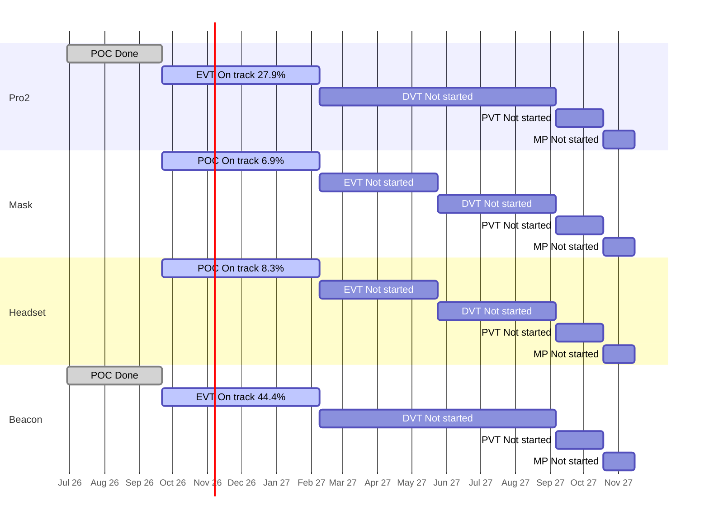

# Portfolio Roll-up — 2026-10-14

Are the four products on course for their stage gates and for the final deadline, the end of mass production (MP) on 2027-11-15? Each product moves through five stages: POC (proof of concept: show the idea can work), EVT (engineering test: does the design meet its specs?), DVT (design test: is the final design ready?), PVT (factory test: can the factory build it?) and MP (mass production). A "gate" is the review at the end of a stage. See [[glossary]].

**The plan** is the stage schedule in [[reference#Stage schedule (per product)]]. Pro2 and Beacon run from 2026-06-29, Mask and Headset from 2026-09-21, and all four end MP on 2027-11-15. All slip on this page is measured against those planned stage end dates. All numbers come from `tools/wiki_jira.py rollup`; rules and definitions are in [[portfolio/INDEX]].

## 1. Headline

- Days to final deadline (2027-11-15): 397
- On track for MP: 4 of 4 (ZenaQuiet-Pro2 — low confidence, ZenaQuiet-Mask — low confidence, ZenaQuiet-Headset — low confidence, ZenaQuiet-Beacon — low confidence)
- Worst MP forecast slip: not enough data yet (pace needs more closed Stories or more time)
- Next gate: 2027-02-08 (117d): ZenaQuiet-Pro2 (EVT), ZenaQuiet-Mask (POC), ZenaQuiet-Headset (POC), ZenaQuiet-Beacon (EVT)

A quiet week: almost nothing changed in Jira since 2026-10-13 (one Beacon Story started, one Beacon Subtask moved 5 days). All four products are **On track** by the rule, but only at low confidence because every current stage is just 23 days old. **Pro2 and Beacon are ahead** of the expected line (27.9% and 44.4% counted against 16.4%). **Headset and Mask are below it** (8.3% and 6.9%), still inside the 15-point margin, but at today's pace their POC would finish about 101 days (Headset) and 193 days (Mask) after the 2027-02-08 gate (inferred from low-confidence forecasts). With no new work closing, those forecasts get worse each day.

## 2. Products

| Product | Stage | Gate (days) | Readiness raw / adjusted | Expected | Stage status | Pace forecast for gate | MP outlook | Slip vs schedule | Next stage planned | HIGH / MED | Health |
| --- | --- | --- | --- | --- | --- | --- | --- | --- | --- | --- | --- |
| ZenaQuiet-Pro2 | EVT | 2027-02-08 (117) | 27.9% / 27.9% | 16.4% | On track | 2026-12-13 (-57d), low confidence | On track (early, low confidence), forecast n/a | 2 open items past stage end, max +36d | 0.0% | 2 / 62 | AMBER |
| ZenaQuiet-Mask | POC | 2027-02-08 (117) | 6.9% / 6.9% | 16.4% | On track | 2027-08-20 (+193d), low confidence | On track (early, low confidence), forecast n/a | none past stage end | n/a | 0 / 36 | AMBER |
| ZenaQuiet-Headset | POC | 2027-02-08 (117) | 20.8% / 8.3% | 16.4% | On track | 2027-05-20 (+101d), low confidence | On track (early, low confidence), forecast n/a | none past stage end | 0.0% | 9 / 21 | AMBER |
| ZenaQuiet-Beacon | EVT | 2027-02-08 (117) | 44.4% / 44.4% | 16.4% | On track | 2026-11-12 (-88d), low confidence | On track (early, low confidence), forecast n/a | none past stage end | 0.0% | 0 / 21 | AMBER |

> **What the numbers mean**
> - **Raw:** share of the current stage's Stories (planned pieces of work) marked Done in Jira. Pro2 EVT: 17 of 61 Done = 27.9%.
> - **Adjusted:** Raw, minus Done Stories that don't count as real progress: ones that still have open Subtasks, or were closed before the stage began. Headset POC: 5 Done, but 3 have open Subtasks, so 2 of 24 = 8.3%. Status and the timeline use this number.
> - **Expected:** share of the stage's planned time already used. EVT runs 140 days (2026-09-21 → 2027-02-08); on 2026-10-14 it is day 23, so 23 ÷ 140 = 16.4%. If work were spread evenly, about that much should be Done.
> - Adjusted at or above Expected means ahead; 15–25 points below means At risk; more than 25 below means Behind.

- **Pro2** — Ahead on counted readiness, but 21 open EVT Stories have no Subtasks (e.g. [PRO2-423](https://epazz.atlassian.net/browse/PRO2-423), [PRO2-426](https://epazz.atlassian.net/browse/PRO2-426)), so the real workload is not yet visible, and none of the 9 DVT Stories is planned. Two Acoustic Subtasks are still open past the planned POC end ([PRO2-397](https://epazz.atlassian.net/browse/PRO2-397) +36d, [PRO2-396](https://epazz.atlassian.net/browse/PRO2-396) +25d). Report: [[ZenaQuiet-Pro2/jira/2026-10-14-jira]].
- **Beacon** — Furthest ahead (16 of 36 EVT Stories Done). Mechanical Stories [BC-160](https://epazz.atlassian.net/browse/BC-160) to [BC-163](https://epazz.atlassian.net/browse/BC-163) are still To Do 23 days after their start, and the power layout [BC-229](https://epazz.atlassian.net/browse/BC-229) moved 5 days later. The Pro–Beacon Epic [BC-107](https://epazz.atlassian.net/browse/BC-107) was renamed but has no owner. Report: [[ZenaQuiet-Beacon/jira/2026-10-14-jira]].
- **Headset** — Below the expected line: 3 of its 5 Done POC Stories still have open Subtasks ([HS-100](https://epazz.atlassian.net/browse/HS-100), [HS-124](https://epazz.atlassian.net/browse/HS-124), [HS-418](https://epazz.atlassian.net/browse/HS-418)), and core POC tests are past their start date with no owner ([HS-48](https://epazz.atlassian.net/browse/HS-48), [HS-144](https://epazz.atlassian.net/browse/HS-144), [HS-161](https://epazz.atlassian.net/browse/HS-161), [HS-164](https://epazz.atlassian.net/browse/HS-164)). Its 9 HIGH risks are later-stage Stories running past their Epic's due date ([HS-142](https://epazz.atlassian.net/browse/HS-142), [HS-640](https://epazz.atlassian.net/browse/HS-640)), not POC-gate threats. Report: [[ZenaQuiet-Headset/jira/2026-10-14-jira]].
- **Mask** — Slowest pace of the four: 2 of 29 POC Stories Done ([MK-2](https://epazz.atlassian.net/browse/MK-2), [MK-3](https://epazz.atlassian.net/browse/MK-3)), 17 POC Stories with no owner (incl. filter, fan, board and battery work: [MK-7](https://epazz.atlassian.net/browse/MK-7), [MK-8](https://epazz.atlassian.net/browse/MK-8), [MK-22](https://epazz.atlassian.net/browse/MK-22), [MK-23](https://epazz.atlassian.net/browse/MK-23)), and no MK ticket updated since 2026-10-12. Report: [[ZenaQuiet-Mask/jira/2026-10-14-jira]].

## 3. Stage timeline

Bars are the planned stage windows. Labels show each stage's status and counted readiness.

## 4. Stage detail

### ZenaQuiet-Pro2

| Stage | Planned window | Stories done (adjusted) / total | Expected | Raw | Adjusted | Planned (owner + dated Subtasks) | Status | Slip vs plan |
| --- | --- | --- | --- | --- | --- | --- | --- | --- |
| POC | 2026-06-29 → 2026-09-21 | 18 (15) / 18 | 100.0% | 100.0% | 83.3% | 4/18 | Done | finished 2026-10-07, +16d late |
| EVT | 2026-09-21 → 2027-02-08 | 17 (17) / 61 | 16.4% | 27.9% | 27.9% | 10/61 | On track | forecast -57d (low confidence) |
| DVT | 2027-02-08 → 2027-09-06 | 0 (0) / 9 | 0.0% | 0.0% | 0.0% | 0/9 | Not started | — |
| PVT | 2027-09-06 → 2027-10-18 | 0 (0) / 0 | 0.0% | —% | —% | 0/0 | Not started | — |
| MP | 2027-10-18 → 2027-11-15 | 0 (0) / 0 | 0.0% | —% | —% | 0/0 | Not started | — |

Pace in EVT: 5.17 adjusted Stories/week (low confidence: needs ≥5 closed and ≥28 days in stage).
Open EVT Stories with no owner (2): PRO2-299, PRO2-426.
Open EVT Stories with no Subtasks (21): PRO2-371, PRO2-372, PRO2-423, PRO2-424, PRO2-425, PRO2-426, PRO2-428, PRO2-429, PRO2-430, PRO2-431 ….

### ZenaQuiet-Mask

| Stage | Planned window | Stories done (adjusted) / total | Expected | Raw | Adjusted | Planned (owner + dated Subtasks) | Status | Slip vs plan |
| --- | --- | --- | --- | --- | --- | --- | --- | --- |
| POC | 2026-09-21 → 2027-02-08 | 2 (2) / 29 | 16.4% | 6.9% | 6.9% | 0/29 | On track | forecast +193d (low confidence) |
| EVT | 2027-02-08 → 2027-05-24 | 0 (0) / 0 | 0.0% | —% | —% | 0/0 | Not started | — |
| DVT | 2027-05-24 → 2027-09-06 | 0 (0) / 0 | 0.0% | —% | —% | 0/0 | Not started | — |
| PVT | 2027-09-06 → 2027-10-18 | 0 (0) / 0 | 0.0% | —% | —% | 0/0 | Not started | — |
| MP | 2027-10-18 → 2027-11-15 | 0 (0) / 0 | 0.0% | —% | —% | 0/0 | Not started | — |

Pace in POC: 0.61 adjusted Stories/week (low confidence: needs ≥5 closed and ≥28 days in stage).
Open POC Stories with no owner (17): MK-7, MK-8, MK-9, MK-11, MK-12, MK-13, MK-16, MK-17, MK-20, MK-22 ….
Open POC Stories with no Subtasks (27): MK-4, MK-5, MK-7, MK-8, MK-9, MK-11, MK-12, MK-13, MK-16, MK-17 ….

### ZenaQuiet-Headset

| Stage | Planned window | Stories done (adjusted) / total | Expected | Raw | Adjusted | Planned (owner + dated Subtasks) | Status | Slip vs plan |
| --- | --- | --- | --- | --- | --- | --- | --- | --- |
| POC | 2026-09-21 → 2027-02-08 | 5 (2) / 24 | 16.4% | 20.8% | 8.3% | 6/24 | On track | forecast +101d (low confidence) |
| EVT | 2027-02-08 → 2027-05-24 | 0 (0) / 45 | 0.0% | 0.0% | 0.0% | 0/45 | Not started | — |
| DVT | 2027-05-24 → 2027-09-06 | 0 (0) / 28 | 0.0% | 0.0% | 0.0% | 0/28 | Not started | — |
| PVT | 2027-09-06 → 2027-10-18 | 0 (0) / 9 | 0.0% | 0.0% | 0.0% | 0/9 | Not started | — |
| MP | 2027-10-18 → 2027-11-15 | 0 (0) / 0 | 0.0% | —% | —% | 0/0 | Not started | — |

Not counted in adjusted readiness: 3 Done with open Subtasks.

Pace in POC: 0.61 adjusted Stories/week (low confidence: needs ≥5 closed and ≥28 days in stage).
Open POC Stories with no owner (10): HS-48, HS-117, HS-118, HS-144, HS-161, HS-164, HS-381, HS-385, HS-452, HS-457.

### ZenaQuiet-Beacon

| Stage | Planned window | Stories done (adjusted) / total | Expected | Raw | Adjusted | Planned (owner + dated Subtasks) | Status | Slip vs plan |
| --- | --- | --- | --- | --- | --- | --- | --- | --- |
| POC | 2026-06-29 → 2026-09-21 | 21 (19) / 21 | 100.0% | 100.0% | 90.5% | 2/21 | Done | finished 2026-09-14, on time |
| EVT | 2026-09-21 → 2027-02-08 | 16 (16) / 36 | 16.4% | 44.4% | 44.4% | 3/36 | On track | forecast -88d (low confidence) |
| DVT | 2027-02-08 → 2027-09-06 | 0 (0) / 7 | 0.0% | 0.0% | 0.0% | 0/7 | Not started | — |
| PVT | 2027-09-06 → 2027-10-18 | 0 (0) / 0 | 0.0% | —% | —% | 0/0 | Not started | — |
| MP | 2027-10-18 → 2027-11-15 | 0 (0) / 0 | 0.0% | —% | —% | 0/0 | Not started | — |

Pace in EVT: 4.87 adjusted Stories/week (low confidence: needs ≥5 closed and ≥28 days in stage).
Open EVT Stories with no Subtasks (11): BC-157, BC-158, BC-159, BC-161, BC-162, BC-163, BC-206, BC-207, BC-208, BC-210 ….

## 5. Slip vs schedule and dates moved this week

For each product, the first list is slip against the plan. The second is a warning only: dates moved in Jira since the previous snapshot (2026-10-13).

### ZenaQuiet-Pro2
Open items due after their stage's planned end ([[reference#Stage schedule (per product)]]): 2.
- [PRO2-397](https://epazz.atlassian.net/browse/PRO2-397) (Subtask, POC): due 2026-10-27, plan end 2026-09-21 (+36d)
- [PRO2-396](https://epazz.atlassian.net/browse/PRO2-396) (Subtask, POC): due 2026-10-16, plan end 2026-09-21 (+25d)
Dates moved since 2026-10-13: 0 of 148 open items (0.0%); 0 now due later.

### ZenaQuiet-Mask
Open items due after their stage's planned end ([[reference#Stage schedule (per product)]]): none.
Dates moved since 2026-10-13: 0 of 36 open items (0.0%); 0 now due later.

### ZenaQuiet-Headset
Open items due after their stage's planned end ([[reference#Stage schedule (per product)]]): none.
Dates moved since 2026-10-13: 0 of 532 open items (0.0%); 0 now due later.

### ZenaQuiet-Beacon
Open items due after their stage's planned end ([[reference#Stage schedule (per product)]]): none.
Dates moved since 2026-10-13: 1 of 60 open items (1.7%); 1 now due later.
- [BC-229](https://epazz.atlassian.net/browse/BC-229) (Subtask): 2026-10-16 → 2026-10-21 (+5d)

## 6. Cross-product

- **Shared gate:** all four products have their next gate on 2027-02-08 (117 days): Pro2 and Beacon end EVT, Headset and Mask end POC. All four then share PVT and MP from 2027-09-06 to 2027-11-15.
- **Placeholder dates hide slip (inferred):** in Pro2, Beacon and Mask, Story due dates were set to the gate date in the 2026-10-12 re-plan, so a Story slip won't show until the gate (e.g. [BC-155](https://epazz.atlassian.net/browse/BC-155), [MK-4](https://epazz.atlassian.net/browse/MK-4), [PRO2-416](https://epazz.atlassian.net/browse/PRO2-416)).
- **People across products** (open items):

| Person | Open items | By product |
| --- | --- | --- |
| Nguyen Trung Tin | 49 | Beacon 27, Headset 20, Pro2 2 |
| Hung Pham Nguyen | 44 | Pro2 42, Headset 2 |
| Nguyen Minh Thien | 31 | Pro2 16, Beacon 14, Mask 1 |
| Nguyen Manh Tuan | 16 | Headset 10, Beacon 6 |
| Chico Ly | 15 | Headset 5, Beacon 5, Pro2 4, Mask 1 |
| Phong.ngoc.nguyen | 5 | Beacon 3, Mask 1, Headset 1 |

Unassigned open items: Pro2 16, Mask 22, Headset 485, Beacon 4.

- **Research work the products wait on:**

**ZenaQuiet-Research** (snapshot 2026-10-14)
Open 20; linked to a product ticket 0; unlinked 20.
- Due within 14d: [RS-1](https://epazz.atlassian.net/browse/RS-1) due 2026-10-16 — Chip eval + decision
- Due within 14d: [RS-2](https://epazz.atlassian.net/browse/RS-2) due 2026-10-16 — [POC] Evaluate TSE on Imx95 NPU
- Due within 14d: [RS-4](https://epazz.atlassian.net/browse/RS-4) due 2026-10-23 — Survey about good components for ultrasonic loudspeaker and best layout
- Due within 14d: [RS-25](https://epazz.atlassian.net/browse/RS-25) due 2026-10-26 — [POC] Block: Research desk-height screens and partitions to block speech between desks

Candidate links from the Research report (inferred from titles, not linked in Jira): RS-1/RS-2 → [PRO2-486](https://epazz.atlassian.net/browse/PRO2-486); RS-16 (sound-masking prototype) → Beacon, overlapping [BC-191](https://epazz.atlassian.net/browse/BC-191); RS-8/RS-22 → Headset.

## 7. Recommendations

1. **Get Mask and Headset POC moving.** Give owners and Subtasks to Mask's unowned POC Stories ([MK-7](https://epazz.atlassian.net/browse/MK-7), [MK-8](https://epazz.atlassian.net/browse/MK-8), [MK-22](https://epazz.atlassian.net/browse/MK-22), [MK-23](https://epazz.atlassian.net/browse/MK-23)) and to Headset's core tests ([HS-144](https://epazz.atlassian.net/browse/HS-144), [HS-161](https://epazz.atlassian.net/browse/HS-161), [HS-164](https://epazz.atlassian.net/browse/HS-164)); Headset Epic [HS-2](https://epazz.atlassian.net/browse/HS-2) also needs an owner.
2. **Close the chip decision on time.** [RS-1](https://epazz.atlassian.net/browse/RS-1)/[RS-2](https://epazz.atlassian.net/browse/RS-2) are due 2026-10-16 and still In Progress; link them to [PRO2-486](https://epazz.atlassian.net/browse/PRO2-486) so Pro2 can see the dependency.
3. **Replace placeholder dates with real ones** on Stories due on the gate date, starting with the Subtask-less Stories in Pro2 (21) and Beacon (11), so slip shows before February.
4. **Check load on shared engineers:** Nguyen Trung Tin (49 open across Beacon, Headset, Pro2; Beacon ME peaks in Nov-26) and Hung Pham Nguyen (44, mostly Pro2).
5. **Tidy closed work:** close or move [PRO2-396](https://epazz.atlassian.net/browse/PRO2-396)/[PRO2-397](https://epazz.atlassian.net/browse/PRO2-397) (open under Done POC Stories) and the open Subtasks under Done Headset Stories [HS-100](https://epazz.atlassian.net/browse/HS-100), [HS-124](https://epazz.atlassian.net/browse/HS-124), [HS-418](https://epazz.atlassian.net/browse/HS-418).

## 8. Data Gaps & Assumptions

- **Snapshots:** every product and Research has a 2026-10-14 snapshot from today's run. Issue counts matched the JQL totals in all five projects (Pro2 329, Mask 38, Headset 558, Beacon 132, Research 20).
- **Plan used for slip:** the stage schedule in `reference.md`. A finished stage's finish date is the date its last Story was closed in Jira.
- **FLAG lines from the script:** none this run.
- **All pace forecasts are low confidence:** each current stage is 23 days old (threshold: 28 days and 5 counted Stories). Low-confidence forecasts don't change a status, so Mask (+193d) and Headset (+101d) still read "On track". From 2026-10-19 the stages pass 28 days; Mask and Headset will then likely turn Behind unless more Stories close (inferred).
- **MP forecast assumption:** a slip in the current stage carries through to MP, and later stages keep their length.
- **Next stage planned** counts a Story as planned when it has an owner and at least one Subtask with both dates. Mask has no EVT Stories yet (n/a).
- **Known script blind spot:** Beacon EE Subtasks BC-218 to BC-232 and Pro2 EE Subtasks PRO2-497 to PRO2-525 have no team prefix or label, so team load and the long-lead check under-count EE work (from the project reports).
- **Same-day re-runs:** the 2026-10-13 and 2026-10-14 runs are one day apart, so "this week" changes cover one day only.
