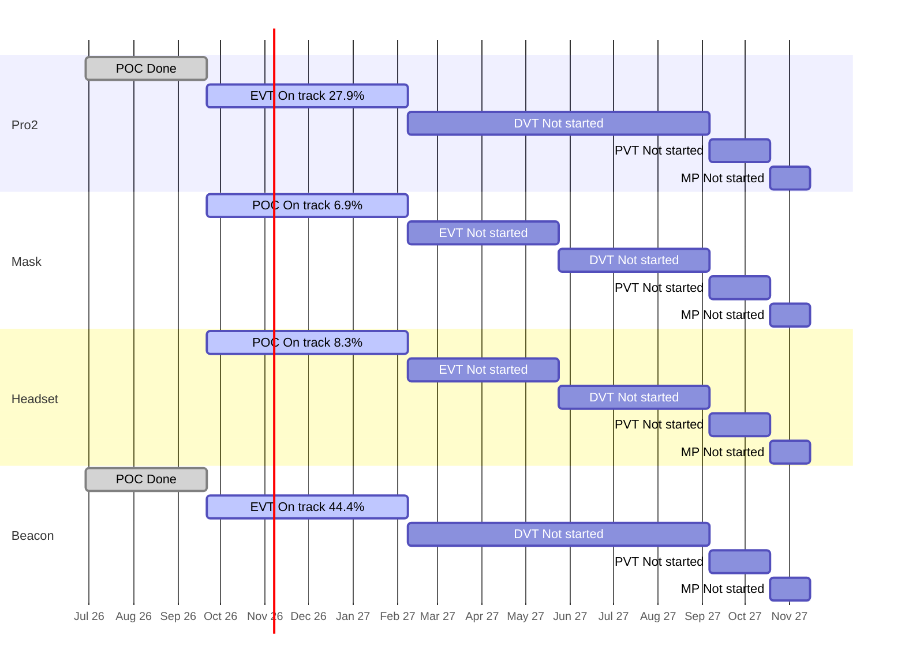

# Portfolio Roll-up — 2026-10-15

Are the four products on course for their stage gates and for the final deadline, the end of mass production (MP) on 2027-11-15? Each product moves through five stages: POC (proof of concept: show the idea can work), EVT (engineering test: does the design meet its specs?), DVT (design test: is the final design ready?), PVT (factory test: can the factory build it?) and MP (mass production). A "gate" is the review at the end of a stage.

**The plan** is the stage schedule in [[reference#Stage schedule (per product)]]. Pro2 and Beacon run from 2026-06-29, Mask and Headset from 2026-09-21, and all four end MP on 2027-11-15. All slip on this page is measured against those planned stage end dates. All numbers come from `tools/wiki_jira.py rollup`; rules and definitions are in [[portfolio/INDEX]]. Previous roll-up: [[portfolio/2026-10-14-rollup]].

## 1. Headline

- Days to final deadline (2027-11-15): 396
- On track for MP: 4 of 4 (ZenaQuiet-Pro2 — low confidence, ZenaQuiet-Mask — low confidence, ZenaQuiet-Headset — low confidence, ZenaQuiet-Beacon — low confidence)
- Worst MP forecast slip: not enough data yet (pace needs more closed Stories or more time)
- Next gate: 2027-02-08 (116d): ZenaQuiet-Pro2 (EVT), ZenaQuiet-Mask (POC), ZenaQuiet-Headset (POC), ZenaQuiet-Beacon (EVT)

**No Story was closed in any product since 2026-10-13.** Pro2, Mask and Headset have had no Jira edits at all since then; only Beacon moved (two Epics started, three EE Subtasks got dates, a new sound-masking Epic). All four still read **On track**, at low confidence, because each is within 15 points of the expected line. But the expected line moves every day while done work stands still: Mask's POC pace forecast went from about +179 days (2026-10-13) to +208 days today, and Headset's from +91 to +112 days. Pro2 and Beacon are still ahead of the expected line (28% and 44% against 17%), but their lead shrinks each day nothing closes.

This roll-up measures progress against elapsed time only. It cannot see task dependencies, so a delay in one team's work does not yet show up as a delay for the teams waiting on it (see section 8).

## 2. Products

| Product | Stage | Gate (days) | Readiness raw / adjusted | Expected | Stage status | Pace forecast for gate | MP outlook | Slip vs schedule | Next stage planned | HIGH / MED | Health |
| --- | --- | --- | --- | --- | --- | --- | --- | --- | --- | --- | --- |
| ZenaQuiet-Pro2 | EVT | 2027-02-08 (116) | 27.9% / 27.9% | 17.1% | On track | 2026-12-16 (-54d), low confidence | On track (early, low confidence), forecast n/a | 2 open items past stage end, max +36d | 0.0% | 2 / 63 | AMBER |
| ZenaQuiet-Mask | POC | 2027-02-08 (116) | 6.9% / 6.9% | 17.1% | On track | 2027-09-04 (+208d), low confidence | On track (early, low confidence), forecast n/a | none past stage end | n/a | 0 / 36 | AMBER |
| ZenaQuiet-Headset | POC | 2027-02-08 (116) | 20.8% / 8.3% | 17.1% | On track | 2027-05-31 (+112d), low confidence | On track (early, low confidence), forecast n/a | none past stage end | 0.0% | 9 / 21 | AMBER |
| ZenaQuiet-Beacon | EVT | 2027-02-08 (116) | 44.4% / 44.4% | 17.1% | On track | 2026-11-14 (-86d), low confidence | On track (early, low confidence), forecast n/a | none past stage end | 0.0% | 0 / 21 | AMBER |

> **What the numbers mean**
> - **Raw:** share of the current stage's Stories (planned pieces of work) marked Done in Jira. Pro2 EVT: 17 of 61 Done = 27.9%.
> - **Adjusted:** Raw, minus Done Stories that don't count as real progress: ones that still have open Subtasks, or were closed before the stage began. Headset POC: 5 Done, but 3 have open Subtasks, so 2 of 24 = 8.3%. Status and the timeline use this number.
> - **Expected:** share of the stage's planned time already used. EVT runs 140 days (2026-09-21 → 2027-02-08); on 2026-10-15 it is day 24, so 24 ÷ 140 = 17.1%. If work were spread evenly, about that much should be Done.
> - Adjusted at or above Expected means ahead; 15–25 points below means At risk; more than 25 below means Behind.

- **Pro2** — No change in Jira since 2026-10-13. 17 of 61 EVT Stories Done. The first overdue item appeared ([PRO2-23](https://epazz.atlassian.net/browse/PRO2-23), 1 day late), and [PRO2-451](https://epazz.atlassian.net/browse/PRO2-451) and [PRO2-452](https://epazz.atlassian.net/browse/PRO2-452) are due 2026-10-16 and not started. Two POC Acoustic Subtasks are still past the planned POC end ([PRO2-397](https://epazz.atlassian.net/browse/PRO2-397) +36d, [PRO2-396](https://epazz.atlassian.net/browse/PRO2-396) +25d). 21 EVT Stories have no Subtasks. Report: [[ZenaQuiet-Pro2/jira/2026-10-15-jira]].
- **Beacon** — 16 of 36 EVT Stories Done, unchanged. Since 2026-10-13: firmware Epic [BC-164](https://epazz.atlassian.net/browse/BC-164) and [BC-142](https://epazz.atlassian.net/browse/BC-142) started; Pro–Beacon Epic [BC-107](https://epazz.atlassian.net/browse/BC-107) was renamed "device management & telemetry" and now has an owner but still no EVT Stories; EE layout Subtasks [BC-220](https://epazz.atlassian.net/browse/BC-220), [BC-223](https://epazz.atlassian.net/browse/BC-223), [BC-226](https://epazz.atlassian.net/browse/BC-226) got a 2026-10-30 due date; [BC-229](https://epazz.atlassian.net/browse/BC-229) moved 5 days later. A new sound-masking Epic [BC-234](https://epazz.atlassian.net/browse/BC-234) was created today with no Stories. The removed cloud scope (BC-106, BC-113 to BC-115, BC-117) has not come back. Report: [[ZenaQuiet-Beacon/jira/2026-10-15-jira]].
- **Headset** — No Jira edits since 2026-10-13. 2 of 24 POC Stories count (3 Done Stories still have open Subtasks: [HS-100](https://epazz.atlassian.net/browse/HS-100), [HS-124](https://epazz.atlassian.net/browse/HS-124), [HS-418](https://epazz.atlassian.net/browse/HS-418)). Core voice and noise-cancelling Stories are 24 days past their start and still To Do ([HS-144](https://epazz.atlassian.net/browse/HS-144), [HS-161](https://epazz.atlassian.net/browse/HS-161), [HS-164](https://epazz.atlassian.net/browse/HS-164), [HS-48](https://epazz.atlassian.net/browse/HS-48)); 485 of 532 open items have no owner. Report: [[ZenaQuiet-Headset/jira/2026-10-15-jira]].
- **Mask** — No Jira edits since 2026-10-12. 2 of 29 POC Stories Done. 17 engineering POC Stories still have no owner and no Subtasks ([MK-7](https://epazz.atlassian.net/browse/MK-7), [MK-8](https://epazz.atlassian.net/browse/MK-8), [MK-22](https://epazz.atlassian.net/browse/MK-22), [MK-23](https://epazz.atlassian.net/browse/MK-23)); Industrial Design rests on one person (10 open Stories). Slowest pace of the four. Report: [[ZenaQuiet-Mask/jira/2026-10-15-jira]].

## 3. Stage timeline

Bars are the planned stage windows. Labels show each stage's status and adjusted readiness.

## 4. Stage detail

### ZenaQuiet-Pro2

| Stage | Planned window | Stories done (adjusted) / total | Expected | Raw | Adjusted | Planned (owner + dated Subtasks) | Status | Slip vs plan |
| --- | --- | --- | --- | --- | --- | --- | --- | --- |
| POC | 2026-06-29 → 2026-09-21 | 18 (15) / 18 | 100.0% | 100.0% | 83.3% | 4/18 | Done | finished 2026-10-07, +16d late |
| EVT | 2026-09-21 → 2027-02-08 | 17 (17) / 61 | 17.1% | 27.9% | 27.9% | 10/61 | On track | forecast -54d (low confidence) |
| DVT | 2027-02-08 → 2027-09-06 | 0 (0) / 9 | 0.0% | 0.0% | 0.0% | 0/9 | Not started | — |
| PVT | 2027-09-06 → 2027-10-18 | 0 (0) / 0 | 0.0% | —% | —% | 0/0 | Not started | — |
| MP | 2027-10-18 → 2027-11-15 | 0 (0) / 0 | 0.0% | —% | —% | 0/0 | Not started | — |

Pace in EVT: 4.96 adjusted Stories/week (low confidence: needs ≥5 closed and ≥28 days in stage).
Open EVT Stories with no owner (2): PRO2-299, PRO2-426.
Open EVT Stories with no Subtasks (21): PRO2-371, PRO2-372, PRO2-423, PRO2-424, PRO2-425, PRO2-426, PRO2-428, PRO2-429, PRO2-430, PRO2-431 ….

### ZenaQuiet-Mask

| Stage | Planned window | Stories done (adjusted) / total | Expected | Raw | Adjusted | Planned (owner + dated Subtasks) | Status | Slip vs plan |
| --- | --- | --- | --- | --- | --- | --- | --- | --- |
| POC | 2026-09-21 → 2027-02-08 | 2 (2) / 29 | 17.1% | 6.9% | 6.9% | 0/29 | On track | forecast +208d (low confidence) |
| EVT | 2027-02-08 → 2027-05-24 | 0 (0) / 0 | 0.0% | —% | —% | 0/0 | Not started | — |
| DVT | 2027-05-24 → 2027-09-06 | 0 (0) / 0 | 0.0% | —% | —% | 0/0 | Not started | — |
| PVT | 2027-09-06 → 2027-10-18 | 0 (0) / 0 | 0.0% | —% | —% | 0/0 | Not started | — |
| MP | 2027-10-18 → 2027-11-15 | 0 (0) / 0 | 0.0% | —% | —% | 0/0 | Not started | — |

Pace in POC: 0.58 adjusted Stories/week (low confidence: needs ≥5 closed and ≥28 days in stage).
Open POC Stories with no owner (17): MK-7, MK-8, MK-9, MK-11, MK-12, MK-13, MK-16, MK-17, MK-20, MK-22 ….
Open POC Stories with no Subtasks (27): MK-4, MK-5, MK-7, MK-8, MK-9, MK-11, MK-12, MK-13, MK-16, MK-17 ….

### ZenaQuiet-Headset

| Stage | Planned window | Stories done (adjusted) / total | Expected | Raw | Adjusted | Planned (owner + dated Subtasks) | Status | Slip vs plan |
| --- | --- | --- | --- | --- | --- | --- | --- | --- |
| POC | 2026-09-21 → 2027-02-08 | 5 (2) / 24 | 17.1% | 20.8% | 8.3% | 6/24 | On track | forecast +112d (low confidence) |
| EVT | 2027-02-08 → 2027-05-24 | 0 (0) / 45 | 0.0% | 0.0% | 0.0% | 0/45 | Not started | — |
| DVT | 2027-05-24 → 2027-09-06 | 0 (0) / 28 | 0.0% | 0.0% | 0.0% | 0/28 | Not started | — |
| PVT | 2027-09-06 → 2027-10-18 | 0 (0) / 9 | 0.0% | 0.0% | 0.0% | 0/9 | Not started | — |
| MP | 2027-10-18 → 2027-11-15 | 0 (0) / 0 | 0.0% | —% | —% | 0/0 | Not started | — |

Not counted in adjusted readiness: 3 Done with open Subtasks.

Pace in POC: 0.58 adjusted Stories/week (low confidence: needs ≥5 closed and ≥28 days in stage).
Open POC Stories with no owner (10): HS-48, HS-117, HS-118, HS-144, HS-161, HS-164, HS-381, HS-385, HS-452, HS-457.

### ZenaQuiet-Beacon

| Stage | Planned window | Stories done (adjusted) / total | Expected | Raw | Adjusted | Planned (owner + dated Subtasks) | Status | Slip vs plan |
| --- | --- | --- | --- | --- | --- | --- | --- | --- |
| POC | 2026-06-29 → 2026-09-21 | 21 (19) / 21 | 100.0% | 100.0% | 90.5% | 2/21 | Done | finished 2026-09-14, on time |
| EVT | 2026-09-21 → 2027-02-08 | 16 (16) / 36 | 17.1% | 44.4% | 44.4% | 3/36 | On track | forecast -86d (low confidence) |
| DVT | 2027-02-08 → 2027-09-06 | 0 (0) / 7 | 0.0% | 0.0% | 0.0% | 0/7 | Not started | — |
| PVT | 2027-09-06 → 2027-10-18 | 0 (0) / 0 | 0.0% | —% | —% | 0/0 | Not started | — |
| MP | 2027-10-18 → 2027-11-15 | 0 (0) / 0 | 0.0% | —% | —% | 0/0 | Not started | — |

Pace in EVT: 4.67 adjusted Stories/week (low confidence: needs ≥5 closed and ≥28 days in stage).
Open EVT Stories with no Subtasks (11): BC-157, BC-158, BC-159, BC-161, BC-162, BC-163, BC-206, BC-207, BC-208, BC-210 ….

## 5. Slip vs schedule and dates moved this week

For each product, the first list is slip against the plan; the second is a warning only (dates moved in Jira since the previous snapshot, 2026-10-14).

### ZenaQuiet-Pro2
Open items due after their stage's planned end ([[reference#Stage schedule (per product)]]): 2.
- [PRO2-397](https://epazz.atlassian.net/browse/PRO2-397) (Subtask, POC): due 2026-10-27, plan end 2026-09-21 (+36d)
- [PRO2-396](https://epazz.atlassian.net/browse/PRO2-396) (Subtask, POC): due 2026-10-16, plan end 2026-09-21 (+25d)
Dates moved since 2026-10-14: 0 of 148 open items (0.0%); 0 now due later.

### ZenaQuiet-Mask
Open items due after their stage's planned end ([[reference#Stage schedule (per product)]]): none.
Dates moved since 2026-10-14: 0 of 36 open items (0.0%); 0 now due later.

### ZenaQuiet-Headset
Open items due after their stage's planned end ([[reference#Stage schedule (per product)]]): none.
Dates moved since 2026-10-14: 0 of 532 open items (0.0%); 0 now due later.

### ZenaQuiet-Beacon
Open items due after their stage's planned end ([[reference#Stage schedule (per product)]]): none.
Dates moved since 2026-10-14: 3 of 60 open items (5.0%); 0 now due later.

## 6. Cross-product

- **Shared gate:** all four products have their next gate on 2027-02-08 (116 days): Pro2 and Beacon end EVT, Headset and Mask end POC. All four then share PVT and MP from 2027-09-06 to 2027-11-15.
- **Sound masking is split across products and teams with no clear owner:** Beacon Epic [BC-234](https://epazz.atlassian.net/browse/BC-234) (Acoustic, created today, no Stories), Beacon EE Story [BC-191](https://epazz.atlassian.net/browse/BC-191) (EVT-1, Subtasks due 2026-10-30) and Research [RS-16](https://epazz.atlassian.net/browse/RS-16) (POC due 2026-10-30, linked to BC-234 but not to BC-191). EE may pick parts before the acoustic requirements exist (inferred).
- **People across products** (open product items; Huỳnh Thái Hòa also holds 13 open Research items):

| Person | Open items | By product |
| --- | --- | --- |
| Nguyen Trung Tin | 49 | Beacon 27, Headset 20, Pro2 2 |
| Hung Pham Nguyen | 44 | Pro2 42, Headset 2 |
| Nguyen Minh Thien | 32 | Pro2 16, Beacon 15, Mask 1 |
| Nguyen Manh Tuan | 16 | Headset 10, Beacon 6 |
| Chico Ly | 15 | Headset 5, Beacon 5, Pro2 4, Mask 1 |
| Phong.ngoc.nguyen | 5 | Beacon 3, Mask 1, Headset 1 |
| Huỳnh Thái Hòa | 2 | Mask 1, Beacon 1 |

Unassigned open items: Pro2 16, Mask 22, Headset 485, Beacon 3.

- **Research work the products wait on:**

**ZenaQuiet-Research** (snapshot 2026-10-15)
Open 20; linked to a product ticket 1; unlinked 19.
- Due within 14d: [RS-1](https://epazz.atlassian.net/browse/RS-1) due 2026-10-16 — Chip eval + decision
- Due within 14d: [RS-2](https://epazz.atlassian.net/browse/RS-2) due 2026-10-16 — [POC] Evaluate TSE on Imx95 NPU
- Due within 14d: [RS-4](https://epazz.atlassian.net/browse/RS-4) due 2026-10-23 — Survey about good components for ultrasonic loudspeaker and best layout
- Due within 14d: [RS-25](https://epazz.atlassian.net/browse/RS-25) due 2026-10-26 — [POC] Block: Research desk-height screens and partitions to block speech between desks

The chip decision RS-1/RS-2 is due tomorrow and still In Progress. The first Research-to-product link exists ([RS-16](https://epazz.atlassian.net/browse/RS-16) → [BC-234](https://epazz.atlassian.net/browse/BC-234)); candidates still unlinked: RS-1/RS-2 → [PRO2-486](https://epazz.atlassian.net/browse/PRO2-486), RS-8 → [PRO2-462](https://epazz.atlassian.net/browse/PRO2-462), RS-16 → [BC-191](https://epazz.atlassian.net/browse/BC-191) and [HS-51](https://epazz.atlassian.net/browse/HS-51) (inferred).

## 7. Recommendations

1. **Ask Pro2, Headset and Mask leads for a status update this week.** Nothing has moved in their Jira projects since 2026-10-13, so either work isn't being logged or it has paused; the roll-up can't tell which.
2. **Speed up Mask and Headset POC.** Their pace forecasts get worse every day (Mask +208d, Headset +112d). Give owners and Subtasks to Mask's unowned POC Stories ([MK-7](https://epazz.atlassian.net/browse/MK-7), [MK-8](https://epazz.atlassian.net/browse/MK-8), [MK-22](https://epazz.atlassian.net/browse/MK-22), [MK-23](https://epazz.atlassian.net/browse/MK-23)) and to Headset's voice and noise-cancelling Stories ([HS-144](https://epazz.atlassian.net/browse/HS-144), [HS-164](https://epazz.atlassian.net/browse/HS-164)).
3. **Name one owner for sound masking** across [BC-234](https://epazz.atlassian.net/browse/BC-234), [BC-191](https://epazz.atlassian.net/browse/BC-191) and [RS-16](https://epazz.atlassian.net/browse/RS-16), and link them.
4. **Close the chip decision** ([RS-1](https://epazz.atlassian.net/browse/RS-1), [RS-2](https://epazz.atlassian.net/browse/RS-2), due 2026-10-16) and link it to the Pro2 ticket that needs it.
5. **Plan the next stage early:** none of Pro2's 9 DVT Stories, Beacon's 7 DVT Stories or Headset's 45 EVT Stories has an owner with dated Subtasks yet.

## 8. Data Gaps & Assumptions

- **Snapshots:** all five projects have a 2026-10-15 snapshot from today's run. Week-on-week comparisons use the newest earlier snapshot, 2026-10-14 (a run the day before); helpers also checked against 2026-10-13 and found the same result.
- **Raw pages:** Pro2 and Headset each had one Jira page returned inline instead of as a file; both helpers re-queried that range and saved it complete (see their reports' Data Gaps). Counts match the JQL totals for all five projects.
- **Plan used for slip:** the stage schedule in `reference.md`. A finished stage's finish date is the date its last Story was closed in Jira. Beacon's POC shows "on time" only because BC-82, BC-97 and BC-185 left Jira on 2026-10-13; it showed +15 days late before.
- **Counted readiness:** Stories created and closed within one day count as progress (human's decision, 2026-10-13). Done Stories with open Subtasks, or closed before the stage started, don't count.
- **FLAG lines from the script:** none this run.
- **All pace forecasts are low confidence** (each current stage is 24 days old; threshold 28 days and 5 counted Stories). Low-confidence forecasts don't change a status, which is why Mask (+208d) and Headset (+112d) still read "On track".
- **No task dependencies:** Jira has almost no "blocks" links, and Stories are dated to their whole stage window, so this roll-up can't trace how one team's delay pushes the next. The human has raised this; a dependency plan (key tasks, durations, predecessors, the fixed design sign-off date before PVT) would be needed.
- **MP forecast assumption:** a slip in the current stage carries through to MP, and later stages keep their length.
