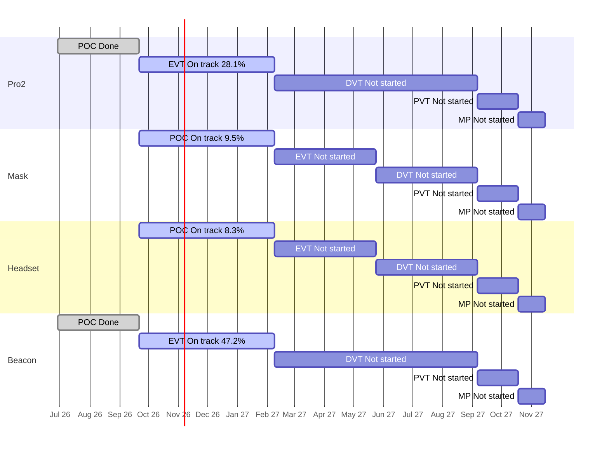

# Portfolio Roll-up — 2026-10-19

Redone 2026-10-19 (risks from team chats and meetings now shown as plain sentences; replaces this morning's version, see section 8).

Are the four products on course for their stage gates and for the final deadline, the end of mass production (MP) on 2027-11-15? Each product moves through five stages: POC (proof of concept: show the idea can work), EVT (engineering test: does the design meet its specs?), DVT (design test: is the final design ready?), PVT (factory test: can the factory build it?) and MP (mass production). A "gate" is the review at the end of a stage.

**The plan** is the stage schedule in [[reference#Stage schedule (per product)]]. All slip is measured against those planned stage end dates. Jira numbers come from `tools/wiki_jira.py rollup`; risks from team chats and meetings come from each project's `sources` step. Rules: [[portfolio/INDEX]]. Previous roll-up: [[portfolio/2026-10-15-rollup]].

## 1. Headline

- Days to final deadline (2027-11-15): 392
- On track for MP: 4 of 4 (ZenaQuiet-Pro2, ZenaQuiet-Mask — low confidence, ZenaQuiet-Headset — low confidence, ZenaQuiet-Beacon)
- Worst MP forecast slip: none
- Next gate: 2027-02-08 (112d): ZenaQuiet-Pro2 (EVT), ZenaQuiet-Mask (POC), ZenaQuiet-Headset (POC), ZenaQuiet-Beacon (EVT)

**Jira says all four products are on track; the team's chats and meetings say otherwise.** Pro2 and Beacon are ahead of the expected line with confidence (28% and 47% done against 20%), and Mask and Headset are behind it at low confidence. But two products are **RED**:

- **Headset** (from chats and meetings): its prototype boards are stuck at the supplier because the wrong option was paid for. The board work that Firmware needs starts about **35 working days late**.
- **Beacon** (from Jira): a design Subtask with DVT dates ([BC-141](https://epazz.atlassian.net/browse/BC-141)) sits under an EVT Story, so on paper the EVT gate slips 210 days. Its description says it belongs to DVT, so this is probably a filing problem (inferred); moving it would make Beacon AMBER.

The other big risks are outside Jira too: an open chip decision affecting boards already paid for, one mechanical engineer shared across three products, and demos promised for the CTO visit (around 29–30 Oct or 2 Nov) without the hardware to show.

## 2. Products

| Product | Stage | Gate (days) | Readiness raw / adjusted | Expected | Stage status | Pace forecast for gate | MP outlook | Slip vs schedule | Next stage planned | HIGH / MED | Health |
| --- | --- | --- | --- | --- | --- | --- | --- | --- | --- | --- | --- |
| ZenaQuiet-Pro2 | EVT | 2027-02-08 (112) | 29.7% / 28.1% | 20.0% | On track | 2026-12-28 (-42d) | On track, MP 2027-11-15 | 2 open items past stage end, max +36d | 0.0% | 2 / 56 | AMBER |
| ZenaQuiet-Mask | POC | 2027-02-08 (112) | 9.5% / 9.5% | 20.0% | On track | 2027-07-12 (+154d), low confidence | On track (early, low confidence), forecast n/a | none past stage end | n/a | 0 / 30 | AMBER |
| ZenaQuiet-Headset | POC | 2027-02-08 (112) | 20.8% / 8.3% | 20.0% | On track | 2027-07-12 (+154d), low confidence | On track (early, low confidence), forecast n/a | none past stage end | 0.0% | 9 / 20 | AMBER |
| ZenaQuiet-Beacon | EVT | 2027-02-08 (112) | 47.2% / 47.2% | 20.0% | On track | 2026-11-19 (-81d) | On track, MP 2027-11-15 | 1 open items past stage end, max +210d | 0.0% | 1 / 24 | RED |

> **What the numbers mean**
> - **Raw:** share of the current stage's Stories (planned pieces of work) marked Done in Jira. Pro2 EVT: 19 of 64 Done = 29.7%.
> - **Adjusted:** Raw, minus Done Stories that don't count as real progress: ones that still have open Subtasks, or were closed before the stage began. Headset POC: 5 Done, but 3 have open Subtasks, so 2 of 24 = 8.3%. Status and the timeline use this number.
> - **Expected:** share of the stage's planned time already used. EVT runs 140 days (2026-09-21 → 2027-02-08); on 2026-10-19 it is day 28, so 28 ÷ 140 = 20.0%. If work were spread evenly, about that much should be Done.
> - Adjusted at or above Expected means ahead; 15–25 points below means At risk; more than 25 below means Behind.
> - **Health** in the table is from Jira only. Adding risks from chats and meetings turns Headset RED as well (section 6b).

- **Pro2** — 19 of 64 EVT Stories Done. Jira changed a lot today: 21 tickets added since 2026-10-15, 18 items closed, EE Subtasks dated for the first time, and six new mechanical analyses ([PRO2-541](https://epazz.atlassian.net/browse/PRO2-541) to [PRO2-546](https://epazz.atlassian.net/browse/PRO2-546), due 2026-10-30). Hinge samples arrive after the hinge bench test starts (6b). Which Pro version goes into EVT-1 is decided on 2026-10-20. Report: [[ZenaQuiet-Pro2/jira/2026-10-19-jira]].
- **Beacon** — 17 of 36 EVT Stories Done, ahead of plan. **RED in Jira** because of the misfiled [BC-141](https://epazz.atlassian.net/browse/BC-141) (see headline). The sound-masking demo for the CTO visit has no hardware, and mechanical load peaks at 27 open Subtasks in November. Report: [[ZenaQuiet-Beacon/jira/2026-10-19-jira]].
- **Headset** — 2 of 24 POC Stories count (3 Done Stories still have open Subtasks). **RED with chats and meetings** because of the stuck PCBs. Core voice and noise-cancelling Stories are 28 days past their start ([HS-144](https://epazz.atlassian.net/browse/HS-144), [HS-161](https://epazz.atlassian.net/browse/HS-161), [HS-164](https://epazz.atlassian.net/browse/HS-164), [HS-48](https://epazz.atlassian.net/browse/HS-48)). Report: [[ZenaQuiet-Headset/jira/2026-10-19-jira]].
- **Mask** — 2 of 21 POC Stories Done. The first circuit board was ordered outside Jira; the processor choice conflicts with Jira's phone-based design ([MK-22](https://epazz.atlassian.net/browse/MK-22), [MK-13](https://epazz.atlassian.net/browse/MK-13)); 17 engineering Stories have no owner. Report: [[ZenaQuiet-Mask/jira/2026-10-19-jira]].

## 3. Stage timeline

Bars are the planned stage windows. Labels show each stage's status and adjusted readiness.

## 4. Stage detail

### ZenaQuiet-Pro2

| Stage | Planned window | Stories done (adjusted) / total | Expected | Raw | Adjusted | Planned (owner + dated Subtasks) | Status | Slip vs plan |
| --- | --- | --- | --- | --- | --- | --- | --- | --- |
| POC | 2026-06-29 → 2026-09-21 | 18 (15) / 18 | 100.0% | 100.0% | 83.3% | 4/18 | Done | finished 2026-10-07, +16d late |
| EVT | 2026-09-21 → 2027-02-08 | 19 (18) / 64 | 20.0% | 29.7% | 28.1% | 25/64 | On track | forecast -42d |
| DVT | 2027-02-08 → 2027-09-06 | 0 (0) / 9 | 0.0% | 0.0% | 0.0% | 0/9 | Not started | — |
| PVT | 2027-09-06 → 2027-10-18 | 0 (0) / 0 | 0.0% | —% | —% | 0/0 | Not started | — |
| MP | 2027-10-18 → 2027-11-15 | 0 (0) / 0 | 0.0% | —% | —% | 0/0 | Not started | — |

Not counted in adjusted readiness: 1 Done with open Subtasks.

Pace in EVT: 4.5 adjusted Stories/week.
Open EVT Stories with no owner (2): PRO2-299, PRO2-426.
Open EVT Stories with no Subtasks (21): PRO2-371, PRO2-372, PRO2-423, PRO2-424, PRO2-425, PRO2-426, PRO2-428, PRO2-429, PRO2-430, PRO2-431 ….

### ZenaQuiet-Mask

| Stage | Planned window | Stories done (adjusted) / total | Expected | Raw | Adjusted | Planned (owner + dated Subtasks) | Status | Slip vs plan |
| --- | --- | --- | --- | --- | --- | --- | --- | --- |
| POC | 2026-09-21 → 2027-02-08 | 2 (2) / 21 | 20.0% | 9.5% | 9.5% | 1/21 | On track | forecast +154d (low confidence) |
| EVT | 2027-02-08 → 2027-05-24 | 0 (0) / 0 | 0.0% | —% | —% | 0/0 | Not started | — |
| DVT | 2027-05-24 → 2027-09-06 | 0 (0) / 0 | 0.0% | —% | —% | 0/0 | Not started | — |
| PVT | 2027-09-06 → 2027-10-18 | 0 (0) / 0 | 0.0% | —% | —% | 0/0 | Not started | — |
| MP | 2027-10-18 → 2027-11-15 | 0 (0) / 0 | 0.0% | —% | —% | 0/0 | Not started | — |

Pace in POC: 0.5 adjusted Stories/week (low confidence: needs ≥5 closed and ≥28 days in stage).
Open POC Stories with no owner (17): MK-7, MK-8, MK-9, MK-11, MK-12, MK-13, MK-16, MK-17, MK-20, MK-22 ….
Open POC Stories with no Subtasks (18): MK-5, MK-7, MK-8, MK-9, MK-11, MK-12, MK-13, MK-16, MK-17, MK-20 ….

### ZenaQuiet-Headset

| Stage | Planned window | Stories done (adjusted) / total | Expected | Raw | Adjusted | Planned (owner + dated Subtasks) | Status | Slip vs plan |
| --- | --- | --- | --- | --- | --- | --- | --- | --- |
| POC | 2026-09-21 → 2027-02-08 | 5 (2) / 24 | 20.0% | 20.8% | 8.3% | 8/24 | On track | forecast +154d (low confidence) |
| EVT | 2027-02-08 → 2027-05-24 | 0 (0) / 45 | 0.0% | 0.0% | 0.0% | 0/45 | Not started | — |
| DVT | 2027-05-24 → 2027-09-06 | 0 (0) / 28 | 0.0% | 0.0% | 0.0% | 0/28 | Not started | — |
| PVT | 2027-09-06 → 2027-10-18 | 0 (0) / 9 | 0.0% | 0.0% | 0.0% | 0/9 | Not started | — |
| MP | 2027-10-18 → 2027-11-15 | 0 (0) / 0 | 0.0% | —% | —% | 0/0 | Not started | — |

Not counted in adjusted readiness: 3 Done with open Subtasks.

Pace in POC: 0.5 adjusted Stories/week (low confidence: needs ≥5 closed and ≥28 days in stage).
Open POC Stories with no owner (10): HS-48, HS-117, HS-118, HS-144, HS-161, HS-164, HS-381, HS-385, HS-452, HS-457.

### ZenaQuiet-Beacon

| Stage | Planned window | Stories done (adjusted) / total | Expected | Raw | Adjusted | Planned (owner + dated Subtasks) | Status | Slip vs plan |
| --- | --- | --- | --- | --- | --- | --- | --- | --- |
| POC | 2026-06-29 → 2026-09-21 | 21 (20) / 21 | 100.0% | 100.0% | 95.2% | 3/21 | Done | finished 2026-09-14, on time |
| EVT | 2026-09-21 → 2027-02-08 | 17 (17) / 36 | 20.0% | 47.2% | 47.2% | 10/36 | On track | forecast -81d |
| DVT | 2027-02-08 → 2027-09-06 | 0 (0) / 7 | 0.0% | 0.0% | 0.0% | 0/7 | Not started | — |
| PVT | 2027-09-06 → 2027-10-18 | 0 (0) / 0 | 0.0% | —% | —% | 0/0 | Not started | — |
| MP | 2027-10-18 → 2027-11-15 | 0 (0) / 0 | 0.0% | —% | —% | 0/0 | Not started | — |

Pace in EVT: 4.25 adjusted Stories/week.
Open EVT Stories with no Subtasks (8): BC-158, BC-159, BC-161, BC-163, BC-206, BC-208, BC-210, BC-233.

## 5. Slip vs schedule and dates moved this week

For each product, the first list is slip against the plan; the second is a warning only (dates moved in Jira since the previous snapshot, 2026-10-15).

### ZenaQuiet-Pro2
Open items due after their stage's planned end ([[reference#Stage schedule (per product)]]): 2.
- [PRO2-397](https://epazz.atlassian.net/browse/PRO2-397) (Subtask, POC): due 2026-10-27, plan end 2026-09-21 (+36d)
- [PRO2-396](https://epazz.atlassian.net/browse/PRO2-396) (Subtask, POC): due 2026-10-16, plan end 2026-09-21 (+25d)
Dates moved since 2026-10-15: 32 of 120 open items (26.7%) — BULK RE-DATE; 5 now due later.
- [PRO2-451](https://epazz.atlassian.net/browse/PRO2-451) (Subtask): 2026-10-16 → 2026-11-30 (+45d)
- [PRO2-157](https://epazz.atlassian.net/browse/PRO2-157) (Subtask): 2026-10-19 → 2026-11-13 (+25d)
- [PRO2-159](https://epazz.atlassian.net/browse/PRO2-159) (Subtask): 2026-10-20 → 2026-11-13 (+24d)
- [PRO2-329](https://epazz.atlassian.net/browse/PRO2-329) (Subtask): 2026-10-30 → 2026-11-13 (+14d)
- [PRO2-23](https://epazz.atlassian.net/browse/PRO2-23) (Subtask): 2026-10-14 → 2026-10-27 (+13d)

### ZenaQuiet-Mask
Open items due after their stage's planned end ([[reference#Stage schedule (per product)]]): none.
Dates moved since 2026-10-15: 1 of 36 open items (2.8%); 0 now due later.

### ZenaQuiet-Headset
Open items due after their stage's planned end ([[reference#Stage schedule (per product)]]): none.
Dates moved since 2026-10-15: 2 of 527 open items (0.4%); 0 now due later.

### ZenaQuiet-Beacon
Open items due after their stage's planned end ([[reference#Stage schedule (per product)]]): 1.
- [BC-141](https://epazz.atlassian.net/browse/BC-141) (Subtask, EVT): due 2027-09-06, plan end 2027-02-08 (+210d)
Dates moved since 2026-10-15: 10 of 57 open items (17.5%); 0 now due later.

## 6. Cross-product

- **Shared gate:** all four products have their next gate on 2027-02-08 (112 days): Pro2 and Beacon end EVT, Headset and Mask end POC. Lunar New Year (Tết) is assumed to fall 2027-02-04 → 2027-02-12, on top of that gate ([[reference#Holidays]]).
- **People across products** (open product items):

| Person | Open items | By product |
| --- | --- | --- |
| Nguyen Trung Tin | 56 | Beacon 39, Headset 15, Pro2 2 |
| Hung Pham Nguyen | 33 | Pro2 31, Headset 2 |
| Nguyen Minh Thien | 31 | Pro2 16, Beacon 14, Mask 1 |
| Nguyen Manh Tuan | 16 | Headset 10, Beacon 6 |
| Phi Tuong | 15 | Headset 8, Pro2 7 |
| Chico Ly | 13 | Headset 5, Beacon 4, Pro2 3, Mask 1 |
| Phong.ngoc.nguyen | 7 | Beacon 4, Headset 2, Mask 1 |
| Huỳnh Thái Hòa | 2 | Mask 1, Beacon 1 |

Unassigned open items: Pro2 9, Mask 22, Headset 484, Beacon 2.

- **Research work the products wait on:**

**ZenaQuiet-Research** (snapshot 2026-10-19)
Open 19; linked to a product ticket 1; unlinked 18.
- Due within 14d: [RS-1](https://epazz.atlassian.net/browse/RS-1) due 2026-10-20 — Chip eval + decision
- Due within 14d: [RS-2](https://epazz.atlassian.net/browse/RS-2) due 2026-10-19 — [POC] Evaluate TSE on Imx95 NPU
- Due within 14d: [RS-4](https://epazz.atlassian.net/browse/RS-4) due 2026-10-23 — Survey about good components for ultrasonic loudspeaker and best layout
- Due within 14d: [RS-16](https://epazz.atlassian.net/browse/RS-16) due 2026-10-30 — [POC] Cover: Prototype pink/white noise sound masking in the Beacon
- Due within 14d: [RS-21](https://epazz.atlassian.net/browse/RS-21) due 2026-11-02 — [POC] Absorb: Research sound-absorbing materials (ceiling tiles, wall panels, workstation covers)
- Due within 14d: [RS-22](https://epazz.atlassian.net/browse/RS-22) due 2026-11-02 — [POC] ANC in the personal headset
- Due within 14d: [RS-23](https://epazz.atlassian.net/browse/RS-23) due 2026-11-02 — [POC] Block: Research office layout and seating plan to reduce noise
- Due within 14d: [RS-24](https://epazz.atlassian.net/browse/RS-24) due 2026-11-02 — [POC] Measure baseline floor acoustics before treatment
- Due within 14d: [RS-25](https://epazz.atlassian.net/browse/RS-25) due 2026-10-26 — [POC] Block: Research desk-height screens and partitions to block speech between desks

## 6b. Risks from team threads

From the purchase chat (`threads/2026-10-19-purchase.md`) and the meeting transcripts. Delays are in working days; standard purchasing lead time is 14 (CTO approval) + 3 (Purchasing) + 5 (supplier) working days ([[reference#Purchasing lead times]]). Each project report has the full list with sources.

| # | Product | What's at risk | Root cause | What would fix it | Level |
| --- | --- | --- | --- | --- | --- |
| 1 | Headset | The POC board work Firmware needs ([HS-144](https://epazz.atlassian.net/browse/HS-144)) starts **about 35 working days late**: planned 2026-09-21, boards arrive around 2026-11-09 if paid now. | In Purchasing: the paid order used the wrong PCB option, so the supplier stopped until about $35 extra is paid; who pays isn't decided. | Pay the difference this week, ask for express delivery, and log the order as an EE Subtask under HS-144. | High |
| 2 | Mask | The main circuit board POC ([MK-22](https://epazz.atlassian.net/browse/MK-22)) starts **about 25 working days late**: planned 2026-09-21, arrives around 2026-10-26. | Ordered outside Jira, so no order or delivery date is recorded. | Create the PCB Subtask under MK-22 with order and delivery dates. | Medium |
| 3 | Pro2 | The hinge bench test ([PRO2-420](https://epazz.atlassian.net/browse/PRO2-420)) starts **16–26 working days late**: planned 2026-11-02, samples arrive 2026-11-24 → 2026-12-08. | Supplier lead time: quoted 5–7 weeks after payment; approved 2026-10-15, payment not recorded. | Pay and order this week, then move the bench test to after the samples arrive. | Medium |
| 4 | Headset, Beacon, Pro2 | The CTO-visit demos (29–30 Oct or 2 Nov) may have **nothing working to show**. | Headset's demo needs the stuck PCBs; Beacon's masking demo has no board and the Raspberry Pi stand-in has no purchase request; none of the demos or the EVT spec sign-off is in Jira. | Decide this week what each product shows, raise the Pi request now, and add dated demo and sign-off tickets. | Medium |
| 5 | Headset, Mask | Boards already paid for may need rework; **delay unknown** until the chip is chosen. | Open decision: POC boards use the i.MX95; Firmware proposes an XMOS chip that needs an eval board and a ~$4,000 licence (not requested). Review on 2026-10-20 ([RS-1](https://epazz.atlassian.net/browse/RS-1)). | Decide on 2026-10-20, record it in RS-1, MK-22 and HS-164, and file any purchase request the same day. | Medium |
| 6 | All four products | Mechanical work across Beacon, Headset, Pro and Mask; **delay unknown**. | Capacity: Nguyen Trung Tin holds 56 open items (Beacon 39, Headset 15) and agreed to support the Pro desk version; Pro's mechanical engineer (59 open Pro2 items) also covers Mask. | Agree in writing how many days each product gets, and re-date the tasks that move. | Medium |
| 7 | Pro2 | Speaker test fixture ([PRO2-453](https://epazz.atlassian.net/browse/PRO2-453)) is **on time only if ordered this week**: needed 2026-11-02, arrives around 2026-10-27 on the standard supplier time. | In Purchasing: transducers approved, but the chosen part and the order aren't recorded. | Record the part, send the order to Purchasing, and ask the supplier for a delivery date. | Medium |
| 8 | Pro2 | EVT-1 design ([PRO2-416](https://epazz.atlassian.net/browse/PRO2-416), [PRO2-437](https://epazz.atlassian.net/browse/PRO2-437), [PRO2-455](https://epazz.atlassian.net/browse/PRO2-455)); **delay unknown**. | Open decision: only one Pro version can be designed at a time. | Decide at the 2026-10-20 meeting and close or re-date the dropped Stories. | Medium |
| 9 | Beacon, Pro2, Research | Masking speaker design ([BC-153](https://epazz.atlassian.net/browse/BC-153), [RS-16](https://epazz.atlassian.net/browse/RS-16), [PRO2-150](https://epazz.atlassian.net/browse/PRO2-150)); **delay unknown**. | Open decision: the CTO wants a desk option, research recommends above the ceiling, the Beacon design hangs a speaker below it; also whether the Beacon stays after EVT. | Put speaker placement and "keep the Beacon" on the CTO-visit agenda and record both decisions. | Medium |
| 10 | Mask | 17 engineering Stories without an owner; **delay unknown**. | The mask spec isn't written (queued after the Pro and Beacon EVT spec), and the material research ([MK-11](https://epazz.atlassian.net/browse/MK-11)) has no owner. | Set a date for the mask spec and assign MK-11. | Medium |
| 11 | Headset | Arc masking scope ([HS-51](https://epazz.atlassian.net/browse/HS-51); Stories still running though marked "to be removed"); **delay unknown**. | Open decision: tests cut speech by 1–2 dB against an 8–12 dB target. | Agree the Arc scope at the CTO visit, then close or re-scope the Stories. | Medium |
| 12 | Research | Drone noise experiment results promised to the CTO ([RS-7](https://epazz.atlassian.net/browse/RS-7), inferred); **delay unknown**. | Not planned in Jira: the Epic is empty and the chat gives no date for "1–2 weeks". | Add a dated Story under RS-7. | Medium |

*Not placed yet:* GPU rental for TSE training ($226, `threads/2026-10-19-purchase.md` · REQUEST 1). The chat names no product; the 2026-10-15 meeting calls it "for the pro".

## 7. Recommendations

1. **Unstick the Headset PCBs this week** (row 1): pay the difference, ask for express delivery, and track the order in Jira.
2. **Decide the chip on 2026-10-20** (row 5) and record what it means for the boards already paid for.
3. **Agree a plan for the CTO visit** (row 4): what each product demonstrates, given the hardware that will actually be there.
4. **Split mechanical capacity explicitly** (row 6) before more Pro work moves to the Beacon/Headset engineer.
5. **Re-file [BC-141](https://epazz.atlassian.net/browse/BC-141) under a DVT Story** if it is DVT work; Beacon would go back to AMBER.

## 8. Data Gaps & Assumptions

- **Redo:** this page replaces this morning's version. All five projects were re-read from Jira this afternoon (snapshots `data/<project>/2026-10-19.json` rewritten). Since the morning: Pro2 344 → 350 issues and 18 items closed; Beacon's [BC-141](https://epazz.atlassian.net/browse/BC-141) re-dated into DVT, which turns Beacon RED; Headset closed five mechanical Subtasks; Mask's MK-31 and Research's RS-8 got dates. Risks from chats and meetings went from 27 to 29 (two new Headset items: EE tickets missing, mechanical capacity), now with root cause and fix. The Headset PCB forecast moved from 2026-11-12 to about 2026-11-09 (the order is paid, now waiting on the extra charge).
- **Source files read:** `raw/threads/2026-10-19-purchase.md`; `raw/transcripts/` 2026-09-16, 2026-09-30, 2026-10-12, 2026-10-15 and 2026-10-19.
- **Purchase dates:** the purchase chat has no dates. Approval dates come from the 2026-10-15 meeting where stated; otherwise the standard lead times from today. Links from purchases to Jira tickets are inferred from titles unless a source says so.
- **FLAG from the script:** Pro2 re-dated 32 of 120 open items since 2026-10-15 (27%). These are first-time dates on EE Subtasks and new dates for PRO2-153 to PRO2-160 (planning, not a bulk reset); 5 items are now due later.
- **Health:** the Products table shows Jira-only health. Health with chats and meetings: Headset RED; Pro2, Beacon (RED from Jira), Mask AMBER.
- **Sourcing rule:** at the 2026-10-15 meeting the CTO allowed components from China and Hong Kong "for these products"; `reference.md` still says "no components from China". Waiting for the human's OK.
- **Pace forecasts:** confident for Pro2 and Beacon; low confidence for Mask and Headset (fewer than 5 counted Stories).
- **Holidays:** Tết 2027-02-04 → 2027-02-12 is an assumption until HR confirms.
- **No task dependencies:** the roll-up still can't trace how one team's delay pushes the next, except where the chats and meetings say so (e.g. PCBs → firmware → demo).
- **MP forecast assumption:** a slip in the current stage carries through to MP, and later stages keep their length.
