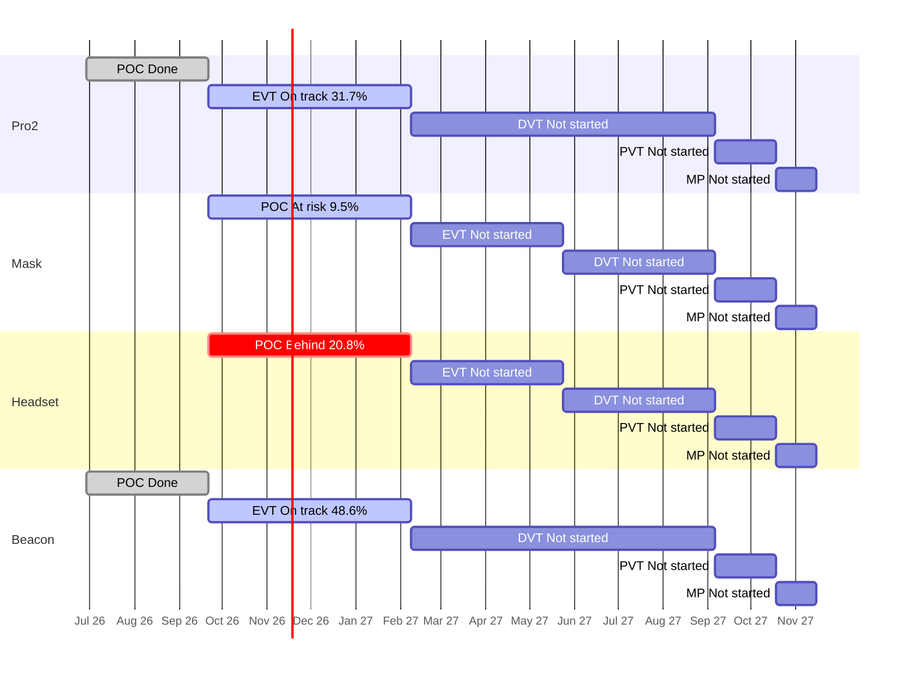

# Portfolio Roll-up — 2026-10-26

Are the four products on course for their stage gates and for the final deadline, the end of mass production (MP) on 2027-11-15? Each product moves through five stages: POC (proof of concept: show the idea can work), EVT (engineering test: does the design meet its specs?), DVT (design test: is the final design ready?), PVT (factory test: can the factory build it?) and MP (mass production). A "gate" is the review at the end of a stage.

**The plan** is the stage schedule in [[reference#Stage schedule (per product)]]. All slip is measured against those planned stage end dates. Jira numbers come from `tools/wiki_jira.py rollup`; risks from team chats and meetings come from each project's `sources` step; direction changes come from Jira comments. Rules: [[portfolio/INDEX]]. Previous roll-up: [[portfolio/2026-10-19-rollup]].

## 1. Headline

- Days to final deadline (2027-11-15): 385
- On track for MP: 2 of 4 (ZenaQuiet-Pro2, ZenaQuiet-Beacon)
- Worst MP forecast slip: ZenaQuiet-Headset +7d
- Next gate: 2027-02-08 (105d): ZenaQuiet-Pro2 (EVT), ZenaQuiet-Mask (POC), ZenaQuiet-Headset (POC), ZenaQuiet-Beacon (EVT)

**Two of four products are on track for the final deadline; two are not.** Pro2 and Beacon are ahead of the expected line (31.7% and 48.6% of current-stage work done against 25.0% expected). **Headset is now Behind**: at its current pace the POC gate lands about 7 days late, and its prototype boards are still held at the supplier (RED with chats and meetings). **Mask is At risk**: 9.5% done against 25.0% expected, with 17 of its 21 POC Stories still unowned. Beacon is **RED** in Jira only because one design task with DVT dates sits under an EVT Story ([BC-141](https://epazz.atlassian.net/browse/BC-141)), as last week.

**One High direction change cuts across three products:** Research proposes the Rockchip RK3576 chip for the voice-isolation model ([RS-2](https://epazz.atlassian.net/browse/RS-2), 2026-10-23) instead of the i.MX95 that Pro2's EVT-1 work, Headset's chip Story and Mask's first board assume, and it conflicts with the "No components from China" sourcing rule (section 6c). Most open decisions (chip, where sound masking lives, Pro2 housing material, keeping the Beacon, Headset arc) now point at the CTO's visit from 2026-11-02.

## 2. Products

| Product | Stage | Gate (days) | Readiness raw / adjusted | Expected | Stage status | Pace forecast for gate | MP outlook | Slip vs schedule | Next stage planned | HIGH / MED | Health |
| --- | --- | --- | --- | --- | --- | --- | --- | --- | --- | --- | --- |
| ZenaQuiet-Pro2 | EVT | 2027-02-08 (105) | 33.3% / 31.7% | 25.0% | On track | 2027-01-08 (-31d) | On track, MP 2027-11-15 | 2 open items past stage end, max +36d | 0.0% | 2 / 33 | AMBER |
| ZenaQuiet-Mask | POC | 2027-02-08 (105) | 9.5% / 9.5% | 25.0% | At risk | 2027-09-23 (+227d), low confidence | At risk, forecast n/a | none past stage end | n/a | 0 / 30 | AMBER |
| ZenaQuiet-Headset | POC | 2027-02-08 (105) | 33.3% / 20.8% | 25.0% | Behind | 2027-02-15 (+7d) | Behind, MP 2027-11-22 | none past stage end | 0.0% | 9 / 20 | AMBER |
| ZenaQuiet-Beacon | EVT | 2027-02-08 (105) | 48.6% / 48.6% | 25.0% | On track | 2026-12-02 (-68d) | On track, MP 2027-11-15 | 1 open items past stage end, max +210d | 0.0% | 1 / 22 | RED |

> **What the numbers mean**
> - **Raw:** share of the current stage's Stories (planned pieces of work) marked Done in Jira. Pro2 EVT: 20 of 60 Done = 33.3%.
> - **Adjusted:** Raw, minus Done Stories that don't count as real progress: ones that still have open Subtasks, or were closed before the stage began. Headset POC: 8 Done, but 3 still have open Subtasks, so 5 of 24 = 20.8%. Status and the timeline use this number.
> - **Expected:** share of the stage's planned time already used. All four current stages run 2026-09-21 → 2027-02-08 (140 days); 2026-10-26 is day 35, so 35 ÷ 140 = 25.0%. If work were spread evenly, about that much should be Done.
> - Adjusted at or above Expected means ahead; 15–25 points below means At risk; more than 25 below, or a confident pace forecast past the gate, means Behind.
> - **Health** in the table is from Jira only. Adding risks from chats and meetings turns Headset RED as well (section 6b).

- **Pro2** — 20 of 60 EVT Stories Done, ahead of plan. Health AMBER: two acoustic tasks are stranded under closed POC Stories ([PRO2-396](https://epazz.atlassian.net/browse/PRO2-396), [PRO2-397](https://epazz.atlassian.net/browse/PRO2-397)); the hinge is still not settled and Revision B is being redesigned for an alternative hinge ([PRO2-416](https://epazz.atlassian.net/browse/PRO2-416)); six mechanical tasks due this week haven't started. Report: [[ZenaQuiet-Pro2/jira/2026-10-26-jira]].
- **Beacon** — 18 of 37 EVT Stories Done, furthest ahead. **RED in Jira** only because of the misfiled [BC-141](https://epazz.atlassian.net/browse/BC-141). Sound-masking hardware ([BC-230](https://epazz.atlassian.net/browse/BC-230) to BC-232, due 2026-10-30) hasn't started and mechanical load peaks at 34 open Subtasks in November. Report: [[ZenaQuiet-Beacon/jira/2026-10-26-jira]].
- **Headset** — 5 of 24 POC Stories count; **Behind** (confident forecast +7 days) and **RED with chats and meetings**: the prototype PCBs are still held at the supplier over a ~$35 payment, so board work for [HS-144](https://epazz.atlassian.net/browse/HS-144) starts about 40 working days late. 482 open items have no owner since team tags were removed from titles. Report: [[ZenaQuiet-Headset/jira/2026-10-26-jira]].
- **Mask** — 2 of 21 POC Stories Done; **At risk** (15.5 points behind). No engineering work has started; the first board was ordered outside Jira and the processor choice is not recorded ([MK-22](https://epazz.atlassian.net/browse/MK-22), [MK-13](https://epazz.atlassian.net/browse/MK-13)). Report: [[ZenaQuiet-Mask/jira/2026-10-26-jira]].

## 3. Stage timeline

Bars are the planned stage windows. Labels show each stage's status and adjusted readiness.

## 4. Stage detail

### ZenaQuiet-Pro2

| Stage | Planned window | Stories done (adjusted) / total | Expected | Raw | Adjusted | Planned (owner + dated Subtasks) | Status | Slip vs plan |
| --- | --- | --- | --- | --- | --- | --- | --- | --- |
| POC | 2026-06-29 → 2026-09-21 | 18 (15) / 18 | 100.0% | 100.0% | 83.3% | 4/18 | Done | finished 2026-10-07, +16d late |
| EVT | 2026-09-21 → 2027-02-08 | 20 (19) / 60 | 25.0% | 33.3% | 31.7% | 25/60 | On track | forecast -31d |
| DVT | 2027-02-08 → 2027-09-06 | 0 (0) / 9 | 0.0% | 0.0% | 0.0% | 0/9 | Not started | — |
| PVT | 2027-09-06 → 2027-10-18 | 0 (0) / 0 | 0.0% | —% | —% | 0/0 | Not started | — |
| MP | 2027-10-18 → 2027-11-15 | 0 (0) / 0 | 0.0% | —% | —% | 0/0 | Not started | — |

Not counted in adjusted readiness: 1 Done with open Subtasks.

Pace in EVT: 3.8 adjusted Stories/week.
Open EVT Stories with no Subtasks (17): PRO2-300, PRO2-423, PRO2-424, PRO2-425, PRO2-426, PRO2-429, PRO2-430, PRO2-434, PRO2-435, PRO2-436 ….

### ZenaQuiet-Mask

| Stage | Planned window | Stories done (adjusted) / total | Expected | Raw | Adjusted | Planned (owner + dated Subtasks) | Status | Slip vs plan |
| --- | --- | --- | --- | --- | --- | --- | --- | --- |
| POC | 2026-09-21 → 2027-02-08 | 2 (2) / 21 | 25.0% | 9.5% | 9.5% | 1/21 | At risk | forecast +227d (low confidence) |
| EVT | 2027-02-08 → 2027-05-24 | 0 (0) / 0 | 0.0% | —% | —% | 0/0 | Not started | — |
| DVT | 2027-05-24 → 2027-09-06 | 0 (0) / 0 | 0.0% | —% | —% | 0/0 | Not started | — |
| PVT | 2027-09-06 → 2027-10-18 | 0 (0) / 0 | 0.0% | —% | —% | 0/0 | Not started | — |
| MP | 2027-10-18 → 2027-11-15 | 0 (0) / 0 | 0.0% | —% | —% | 0/0 | Not started | — |

Pace in POC: 0.4 adjusted Stories/week (low confidence: needs ≥5 closed and ≥28 days in stage).
Open POC Stories with no owner (17): MK-7, MK-8, MK-9, MK-11, MK-12, MK-13, MK-16, MK-17, MK-20, MK-22 ….
Open POC Stories with no Subtasks (18): MK-5, MK-7, MK-8, MK-9, MK-11, MK-12, MK-13, MK-16, MK-17, MK-20 ….

### ZenaQuiet-Headset

| Stage | Planned window | Stories done (adjusted) / total | Expected | Raw | Adjusted | Planned (owner + dated Subtasks) | Status | Slip vs plan |
| --- | --- | --- | --- | --- | --- | --- | --- | --- |
| POC | 2026-09-21 → 2027-02-08 | 8 (5) / 24 | 25.0% | 33.3% | 20.8% | 9/24 | Behind | forecast +7d |
| EVT | 2027-02-08 → 2027-05-24 | 0 (0) / 45 | 0.0% | 0.0% | 0.0% | 0/45 | Not started | — |
| DVT | 2027-05-24 → 2027-09-06 | 0 (0) / 28 | 0.0% | 0.0% | 0.0% | 0/28 | Not started | — |
| PVT | 2027-09-06 → 2027-10-18 | 0 (0) / 9 | 0.0% | 0.0% | 0.0% | 0/9 | Not started | — |
| MP | 2027-10-18 → 2027-11-15 | 0 (0) / 0 | 0.0% | —% | —% | 0/0 | Not started | — |

Not counted in adjusted readiness: 3 Done with open Subtasks.

Pace in POC: 1.0 adjusted Stories/week.
Open POC Stories with no owner (10): HS-48, HS-117, HS-118, HS-144, HS-161, HS-164, HS-381, HS-385, HS-452, HS-457.

### ZenaQuiet-Beacon

| Stage | Planned window | Stories done (adjusted) / total | Expected | Raw | Adjusted | Planned (owner + dated Subtasks) | Status | Slip vs plan |
| --- | --- | --- | --- | --- | --- | --- | --- | --- |
| POC | 2026-06-29 → 2026-09-21 | 21 (20) / 21 | 100.0% | 100.0% | 95.2% | 3/21 | Done | finished 2026-09-14, on time |
| EVT | 2026-09-21 → 2027-02-08 | 18 (18) / 37 | 25.0% | 48.6% | 48.6% | 14/37 | On track | forecast -68d |
| DVT | 2027-02-08 → 2027-09-06 | 0 (0) / 7 | 0.0% | 0.0% | 0.0% | 0/7 | Not started | — |
| PVT | 2027-09-06 → 2027-10-18 | 0 (0) / 0 | 0.0% | —% | —% | 0/0 | Not started | — |
| MP | 2027-10-18 → 2027-11-15 | 0 (0) / 0 | 0.0% | —% | —% | 0/0 | Not started | — |

Pace in EVT: 3.6 adjusted Stories/week.
Open EVT Stories with no Subtasks (5): BC-158, BC-163, BC-206, BC-208, BC-233.

## 5. Slip vs schedule and dates moved this week

### ZenaQuiet-Pro2
Open items due after their stage's planned end ([[reference#Stage schedule (per product)]]): 2.
- [PRO2-397](https://epazz.atlassian.net/browse/PRO2-397) (Subtask, POC): due 2026-10-27, plan end 2026-09-21 (+36d)
- [PRO2-396](https://epazz.atlassian.net/browse/PRO2-396) (Subtask, POC): due 2026-10-16, plan end 2026-09-21 (+25d)
Dates moved since 2026-10-23: 0 of 105 open items (0.0%); 0 now due later.

### ZenaQuiet-Mask
Open items due after their stage's planned end ([[reference#Stage schedule (per product)]]): none.
Dates moved since 2026-10-19: 0 of 33 open items (0.0%); 0 now due later.

### ZenaQuiet-Headset
Open items due after their stage's planned end ([[reference#Stage schedule (per product)]]): none.
Dates moved since 2026-10-19: 1 of 519 open items (0.2%); 1 now due later.
- [HS-330](https://epazz.atlassian.net/browse/HS-330) (Subtask): 2026-10-19 → 2026-10-30 (+11d)

### ZenaQuiet-Beacon
Open items due after their stage's planned end ([[reference#Stage schedule (per product)]]): 1.
- [BC-141](https://epazz.atlassian.net/browse/BC-141) (Subtask, EVT): due 2027-09-06, plan end 2027-02-08 (+210d)
Dates moved since 2026-10-19: 0 of 66 open items (0.0%); 0 now due later.

Pro2 is compared with its 2026-10-23 snapshot (3 days); the others with 2026-10-19. No product re-dated more than 0.2% of its open items this week.

## 6. Cross-product

- **Shared gates:** all four products have their next gate on 2027-02-08 (Pro2 and Beacon EVT → DVT; Mask and Headset POC → EVT), 105 days away.
- **People across products:**

  | Person | Open items | By product |
  | --- | --- | --- |
  | Nguyen Trung Tin | 66 | Beacon 51, Headset 11, Pro2 4 |
  | Nguyen Minh Thien | 28 | Pro2 16, Beacon 11, Mask 1 |
  | Hung Pham Nguyen | 16 | Pro2 14, Headset 2 |
  | Phi Tuong | 15 | Headset 8, Pro2 7 |
  | Nguyen Manh Tuan | 15 | Headset 10, Beacon 5 |
  | Chico Ly | 12 | Pro2 5, Headset 3, Beacon 3, Mask 1 |
  | Phong.ngoc.nguyen | 7 | Beacon 4, Headset 2, Mask 1 |
  | Huỳnh Thái Hòa | 4 | Beacon 2, Pro2 1, Mask 1 |
  
  Unassigned open items: Pro2 3, Mask 22, Headset 482, Beacon 2.

  Nguyen Trung Tin, the second mechanical engineer, holds 66 open items (51 Beacon, 11 Headset, 4 Pro2), and the Mask report proposes giving him the Mask mechanical Stories too. Duy Nguyen's Pro2 mechanical load is about ten times its monthly average in November. No time split between products is recorded (6b). The 482 unowned Headset items are a Jira gap, not idle work: team tags were removed from titles on 2026-10-20.
- **Research and other support work products wait on:**

  ### ZenaQuiet-Research (snapshot 2026-10-26)
  Open 19; linked to a product ticket 2; unlinked 17.
  - Overdue: [RS-1](https://epazz.atlassian.net/browse/RS-1) due 2026-10-20 — Chip eval + decision
  - Overdue: [RS-4](https://epazz.atlassian.net/browse/RS-4) due 2026-10-23 — Survey about good components for ultrasonic loudspeaker and best layout
  - Due within 14d: [RS-2](https://epazz.atlassian.net/browse/RS-2) due 2026-10-29 — [POC] Evaluate TSE on Imx95 NPU
  - Due within 14d: [RS-16](https://epazz.atlassian.net/browse/RS-16) due 2026-10-30 — [POC] Cover: Prototype pink/white noise sound masking in the Beacon
  - Due within 14d: [RS-21](https://epazz.atlassian.net/browse/RS-21) due 2026-11-02 — [POC] Absorb: Research sound-absorbing materials (ceiling tiles, wall panels, workstation covers)
  - Due within 14d: [RS-22](https://epazz.atlassian.net/browse/RS-22) due 2026-11-02 — [POC] ANC in the personal headset
  - Due within 14d: [RS-23](https://epazz.atlassian.net/browse/RS-23) due 2026-11-02 — [POC] Block: Research office layout and seating plan to reduce noise
  - Due within 14d: [RS-24](https://epazz.atlassian.net/browse/RS-24) due 2026-11-02 — [POC] Measure baseline floor acoustics before treatment
  - Due within 14d: [RS-25](https://epazz.atlassian.net/browse/RS-25) due 2026-10-26 — [POC] Block: Research desk-height screens and partitions to block speech between desks

  The chip decision [RS-1](https://epazz.atlassian.net/browse/RS-1) is overdue (due 2026-10-20). Pro2 Stories [PRO2-461](https://epazz.atlassian.net/browse/PRO2-461) and [PRO2-486](https://epazz.atlassian.net/browse/PRO2-486) now link to RS-2 (new since 2026-10-19), and RS-16 links to Beacon BC-233 and BC-234: link coverage 2 of 19.

## 6b. Risks from team threads

One row per risk, highest impact first. Rows that describe the same risk in several products are merged. No new chat or meeting files arrived since 2026-10-19; each project carried its items over and re-checked the cited lines, and added items from Jira comments.

| # | Product | What's at risk | Root cause | What would fix it | Level |
| --- | --- | --- | --- | --- | --- |
| 1 | Headset | POC board work that Firmware needs ([HS-144](https://epazz.atlassian.net/browse/HS-144)) starts about 40 working days late: planned 21 Sep, boards around 16 Nov (a week later than last week's forecast). The CTO-visit headset demo will have no working board (inferred). | In Purchasing: the wrong PCB option was paid, so the supplier stopped until about $35 extra is paid; no update in Jira since 2026-10-19 | Pay the difference this week, ask for express delivery, log the order in an EE Subtask under HS-144; show the printed mock-up plus the Pro's TSE demo at the visit | High |
| 2 | Mask | First circuit board for the mask ([MK-22](https://epazz.atlassian.net/browse/MK-22), inferred) starts about 30 working days late: planned 21 Sep, arrival around 2 Nov (default lead time, no order date recorded). | Other: board designed and ordered outside Jira; the ticket agreed on 2026-10-19 doesn't exist | Create the board Subtask under MK-22 with order and delivery dates | Medium |
| 3 | Pro2 | Hinge bench test ([PRO2-420](https://epazz.atlassian.net/browse/PRO2-420)) starts 16–26 working days late by the quoted lead time (planned 2 Nov, arrival 24 Nov → 8 Dec); Jira comments say most parts reached the sourcing agent the week of 19 Oct, so the real delay is likely about a week (inferred). | Supplier lead time: 5–7 weeks after payment; payment and order date not recorded; one hinge model (HG-VH8-D3) still not shipped | Record the order, move PRO2-420 to after arrival, finish Revision B around the alternative hinge | Medium |
| 4 | Pro2 | Touch-plate thickness check ([PRO2-327](https://epazz.atlassian.net/browse/PRO2-327)) starts 6–10 working days late: planned 19 Oct, plates around 27 Oct → 2 Nov. | In Purchasing: copper plates bought locally, due-date move requested in a comment but not made | Re-date PRO2-327 when the plates arrive | Medium |
| 5 | Pro2, Headset, Mask (Research) | AI-chip choice for the voice-isolation model: Pro2 accelerator and NPU work ([PRO2-461](https://epazz.atlassian.net/browse/PRO2-461), [PRO2-486](https://epazz.atlassian.net/browse/PRO2-486)), Headset chip Story ([HS-164](https://epazz.atlassian.net/browse/HS-164)) and Mask board/processor ([MK-22](https://epazz.atlassian.net/browse/MK-22), [MK-13](https://epazz.atlassian.net/browse/MK-13)): delay unknown (waiting on a decision). The RK3576 evaluation kit ([RS-2](https://epazz.atlassian.net/browse/RS-2)) is not late by the rules but has no cost or approval. | Open decision: RS-1 overdue since 20 Oct; XMOS ruled out on 22 Oct; candidates now RK3576 and Qualcomm IQ-8275/QCS6490; the kit request is only in a Jira comment; Headset also needs a ~$4,000 licence not yet requested | Decide the chip with the CTO this week, record it in RS-1, HS-164 and MK-22, and file the purchase requests in the purchase chat | Medium |
| 6 | Pro2, Beacon (Research) | Where sound masking lives: Pro2 baffling and masking checks ([PRO2-150](https://epazz.atlassian.net/browse/PRO2-150), PRO2-160), Beacon masking hardware and speaker housing ([BC-191](https://epazz.atlassian.net/browse/BC-191), BC-230 to BC-232, [BC-250](https://epazz.atlassian.net/browse/BC-250), BC-153) and the masking prototype ([RS-16](https://epazz.atlassian.net/browse/RS-16)): delay unknown (waiting on a decision). | Open decision: Pro or Beacon, and speaker in the Beacon vs above the ceiling; Beacon masking hardware not even requested yet (no board, no purchase request for the Raspberry Pi stand-in) | Decide Pro vs Beacon and speaker placement at the CTO visit; raise the stand-in purchase request and start BC-230 this week | Medium |
| 7 | Pro2, Beacon, Headset, Mask | Mechanical work in every product (Pro2 [PRO2-8](https://epazz.atlassian.net/browse/PRO2-8), Beacon BC-243 to BC-271, Headset HS-6, Mask MK-16, MK-17, MK-20): delay unknown (no one has time set aside for it). | Capacity: two mechanical engineers cover four products; the second also agreed on 19 Oct to support the Pro desk version; no split agreed | Agree in writing each engineer's days per product and re-date the mechanical Stories that move | Medium |
| 8 | Pro2, Beacon, Headset (Research) | Demos and EVT spec sign-off for the CTO visit (no Jira item in Pro2 or Beacon; Headset demo has no board; Beacon masking demo [BC-234](https://epazz.atlassian.net/browse/BC-234) has no Stories): delay unknown (no date in the sources). | Other: visit from 2 Nov (Pro2 comment); demo readiness and sign-off are tracked only in chat | Add one dated "visit readiness" ticket per product with the demo and the spec sign-off | Medium |
| 9 | Pro2 | EVT-1 version ([PRO2-416](https://epazz.atlassian.net/browse/PRO2-416), PRO2-437): delay unknown (waiting on a decision). | Open decision: outcome of the 20 Oct version meeting not recorded | Record the decision and close or re-date PRO2-437 | Medium |
| 10 | Beacon | Beacon scope after EVT (all Beacon Epics): delay unknown (waiting on a decision). | Open decision: "keep the Beacon" (30 Sep) vs "decide later" (19 Oct) | Put keep/drop on the CTO-visit agenda | Medium |
| 11 | Headset | Arc directional-masking scope ([HS-51](https://epazz.atlassian.net/browse/HS-51)): delay unknown (waiting on a decision). | Open decision: tests gave at most 1–2 dB against an 8–12 dB target; HS-86 and HS-127 closed while titled "[TO BE REMOVED]" | Agree Arc scope at the visit, then close or re-scope HS-78 and HS-89 | Medium |
| 12 | Headset | Headset board, connectivity and ports work (HS-144, HS-451): delay unknown (no date in the sources). | Other: EE tickets promised on 19 Oct still not created | Create the EE Subtasks with dates this week | Medium |
| 13 | Mask | 17 mask engineering Stories: delay unknown (no date in the sources). | Other: mask technical spec not written; queued after the Pro/Beacon EVT spec | Set a dated spec ticket | Medium |
| 14 | Mask (Research) | Passive voice-dampening material research ([MK-11](https://epazz.atlassian.net/browse/MK-11)): delay unknown (no one has time set aside for it). | Capacity: moved to Acoustic on 12 Oct without a ticket; third on Acoustic's priority list | Assign MK-11 with a start date, or create a dated RS Story | Medium |
| 15 | Beacon | LED ring and board-size changes on the Beacon (BC-153, BC-155): delay unknown (no date in the sources). | Other: new LED 360 design attached, no dated Subtask | Add dated ME and EE Subtasks | Medium |
| 16 | Pro2 | Ultrasonic speaker test fixture ([PRO2-453](https://epazz.atlassian.net/browse/PRO2-453)) is not delayed: needed 2 Nov, parts around 27 Oct (default lead time). | In Purchasing: chosen part and order not recorded | Record the part and hand the order to Purchasing | Medium |
| 17 | Research | Drone propeller noise experiment (RS-7, inferred): delay unknown (no date in the sources). | Other: not planned in Jira | Add a dated Story under RS-7 | Medium |

*Not placed yet:* `threads/2026-10-19-purchase.md · REQUEST 1`, GPU rental for TSE model training ($226, approved), names no product (third week running).

## 6c. Direction changes from engineering discussion

One row per change and affected product, High first. Rules: [[portfolio/INDEX]] Section 4b. Product matching: linked = Jira link; named = product named in the comment or ticket; (inferred) = the part being replaced appears in that product's tickets or meetings.

| # | Change (status) | Product (how matched) | Cost | Time | Technical | Teams | Who decides | Level | Source |
| --- | --- | --- | --- | --- | --- | --- | --- | --- | --- |
| 1 | Use the Rockchip RK3576 instead of the i.MX95 for the voice-isolation model (proposed; evaluation kit requested) | Pro2 (linked: PRO2-461, PRO2-486 → RS-2) | unit price not stated ("low cost compared with Qualcomm"); kit price not stated | i.MX95 work in PRO2-461, PRO2-486, PRO2-483 to PRO2-488 would need redoing; slip not measurable yet; before the EVT gate 2027-02-08 | whole model compiles to the NPU (simulation only); 600 ms per 3 s chunk on one core; i.MX95 measured 1,500 ms for the same model and 250 ms for the small one; meeting the ≤150 ms latency target is open | EE, FW, AI | CTO (purchase approval; sourcing rule) | High | RS-2, Nguyen Binh Minh, 2026-10-23 |
| 2 | Same chip change (proposed) | Headset (inferred: i.MX 95 in HS-164, HS-165, HS-166) | as above; Headset candidate also needs a ~$4,000 licence (meeting) | chip Story HS-164 still To Do 35 days past start; before the POC gate 2027-02-08 | as above | EE, FW | CTO | High | RS-2, Nguyen Binh Minh, 2026-10-23; transcripts/2026-10-12-standup.md · [23:30]–[24:31] |
| 3 | Same chip change (proposed) | Mask (inferred: IMX95 on the first mask board, MK-22) | as above | MK-22 board already ordered on the i.MX95 design; before the POC gate | Jira's MK-13 says "no AI chip on the mask, TSE on the phone" — conflicts with any on-mask chip | EE, FW | CTO | High | RS-2, 2026-10-23; transcripts/2026-10-19-biweekly.md · [07:13]–[11:43] |
| 4 | Drop the CTO's die-cast aluminium chassis; injection-moulded ABS/ABS-PC body (decided) | Pro2 (named: PRO2-425) | not stated; engineering bill of materials with per-part costs still to be built | affects PRO2-425 before the EVT gate | lighter, cheaper to tool (inferred); look and feel to be checked by ID | ME, ID | CTO (original spec owner; no approval recorded) | High | PRO2-425, Duy Nguyen, 2026-10-23 |
| 5 | EVT-1 Revision B redesigned around an alternative torque hinge (decided) | Pro2 (named: PRO2-416) | not stated | about 1 week of design and printing; bench test PRO2-420 and lock PRO2-300 wait on it | alternatives HG-TE03 / HG-TE08; HG-VH8-D3 still not shipped | ME, ID | not stated | High | PRO2-416, Duy Nguyen, 2026-10-22/23 |
| 6 | No audio or voiceprint ever leaves the Pro; only commands and status go to the cloud or Beacon (decided) | Beacon (named) | not stated | none seen; consistent with BC-233 ("Beacon only senses and directs") | old upload code still in the dev build (PRO2-549) | FW | decided in the ticket | High | PRO2-474, PRO2-528, Nguyen Minh Thien, 2026-10-21 |
| 7 | Stainless-steel plate behind the Kensington slot in the plastic Beacon enclosure (decided) | Beacon (named: BC-261) | not stated | affects BC-261 before the EVT gate | wall 2.5–4.0 mm per the Kensington spec | ME | not stated | High | BC-261, Nguyen Trung Tin, 2026-10-22 |
| 8 | Encrypted over-the-air firmware updates on the Beacon (decided; code not committed) | Beacon (named: BC-249) | not stated | BC-249 marked Done while the comment says the code isn't committed | on-target rollback test passed with development keys; production keys still to set up | FW | not stated | High | BC-249, Nguyen Minh Thien, 2026-10-20 |
| 9 | Move sound masking from the Pro to the Beacon (proposed) | Pro2 (named: PRO2-150); Beacon (named) | not stated | decision expected the week of 2026-11-02; PRO2-150, PRO2-160 vs BC-250, BC-191 | Beacon already drafting a separate ceiling-speaker housing (row 10) | AC, ME, EE | CTO | Medium | PRO2-150, Duy Nguyen 2026-10-19, Cang Le 2026-10-21 |
| 10 | Separate modular ceiling-speaker housing for masking, sized for an off-the-shelf 63 × 48 mm board (proposed / under test) | Beacon (named: BC-250, BC-252, BC-253) | not stated | BC-250 due 2026-11-06 | board size unconfirmed by EE (vs 120 × 193 mm POC board) | ME, EE | Nguyen Manh Tuan (EE) to confirm size | Medium | BC-252, BC-253, Nguyen Trung Tin, 2026-10-22 |
| 11 | Qualcomm IQ-8275 or a fixed QCS6490 as the alternative chip (proposed) | Headset, Mask (inferred, as rows 2–3) | IQ-8275 devkit about $300 | not stated | small model 37.7 ms, large model 148 ms (8-bit) on QCS8550/IQ-8275; QCS6490 times out today; Qualcomm NDA called "too difficult" (RS-2) | FW, EE | CTO | Medium | RS-1, Nguyen Binh Minh, 2026-10-22 |
| 12 | Beacon connector panel with or without a DC barrel jack beside PoE+ (proposed) | Beacon (named: BC-256) | not stated | not stated | two versions drawn | ME, EE | not stated | Medium | BC-256, Nguyen Trung Tin, 2026-10-22 |
| 13 | Three-fan cooling layout; cooling test needs the EVT-1 board and firmware limits for chip temperature (under test) | Pro2 (named: PRO2-344) | not stated | waits on the EVT-1 board | no proper airflow or temperature equipment | ME, FW | not stated | Medium | PRO2-344, Duy Nguyen, 2026-10-22 |
| 14 | XMOS XU316 ruled out as the AI chip (0.75 s per 1 s of audio) (rejected) | Headset, Mask (inferred: XMOS proposed for them at the 19 Oct meeting) | — | — | kept as an option for other sound processing | FW | — | Low | RS-1, Nguyen Binh Minh, 2026-10-22 |

**Conflicts (flagged, not resolved):**

- Sourcing: [[reference#Sourcing rules]] says "No components from China (CTO)"; the RS-2 comment of 2026-10-23 says a Chinese chip "is acceptable now (said by Sajjad)", and on 2026-10-15 the CTO allowed China/Hong Kong parts "for these products" (`transcripts/2026-10-15-biweekly.md · [26:56]`).
- Which product the chip is for: meetings say Headset and Mask (`transcripts/2026-10-12-standup.md · [3:17]–[3:20]`); Jira links RS-2 to Pro2 (PRO2-461, PRO2-486).
- XMOS: announced as the chip at the 2026-10-19 meeting ([07:37]); ruled out in RS-1 on 2026-10-22.
- Mask processor: MK-13 / MK-22 say no AI chip on the mask; the meetings plan an on-mask processor.
- Pro2 housing material: PRO2-425 drops the CTO's die-cast aluminium spec; no source records the CTO agreeing.
- Sound masking: Pro2 still plans masking work (PRO2-150) while Beacon builds for it (BC-250, BC-153) and Research recommends speakers above the ceiling; a Pro2 comment says the CTO already chose the Beacon (Cang Le, 2026-10-21).

*Not placed yet:* none.

## 7. Recommendations

1. **Turn the CTO visit (from 2026-11-02) into one recorded decision session.** Agenda: AI chip and the China sourcing rule (RS-1, RS-2, HS-164, MK-22), where sound masking lives (PRO2-150, BC-234, BC-250, RS-16), the Pro2 plastic housing (PRO2-425), keeping the Beacon after EVT, and Headset Arc scope (HS-51). Record each decision in its ticket the same week. Owner: Cang Le.
2. **Unblock the Headset boards this week.** Pay the ~$35 difference, ask for express delivery, and log the order under HS-144. Owners: Pham Nguyen Ngoc, Purchasing.
3. **Agree the mechanical engineers' time split in writing.** Nguyen Trung Tin has 66 open items across Beacon, Headset and Pro2 and is proposed for Mask; Duy Nguyen's Pro2 November load is about ten times average. Re-date what moves. Owners: Cang Le with Duy Nguyen and Nguyen Trung Tin.
4. **Fix the Jira gaps that distort status.** Move BC-141 to a DVT Story (Beacon would turn AMBER); give owners to Headset's 482 unowned items; re-file PRO2-396 and PRO2-397 under an open EVT-1 Story; create the agreed Mask board ticket (MK-22) and Headset EE tickets (HS-144, HS-451). Owners: Nguyen Manh Tuan / Beacon EE lead, Headset leads, Nguyen Binh Minh, Mask and Headset EE.
5. **Put every purchase in the purchase chat with a cost.** RK3576 kit (RS-2), Headset chip licence, Beacon masking stand-in (BC-230), Pro2 copper plates (PRO2-327). Owners: Nguyen Binh Minh, Hoa Huynh, Duy Nguyen.

## 8. Data Gaps & Assumptions

- Snapshots used: `data/<project>/2026-10-26.json` for all four products and Research (all from this run). Rollup printed no `FLAG:` lines.
- Plan: the stage schedule in [[reference#Stage schedule (per product)]]. MP forecast assumes later stages keep their planned length.
- Low confidence: Mask's pace forecast (only 2 adjusted Stories closed). Headset's forecast is confident (1.0 Stories/week) and shows +7 days.
- Health in section 2 is Jira only; with chats and meetings: Pro2 AMBER, Beacon RED, Headset RED, Mask AMBER, Research AMBER.
- Sources: no new files in `raw/threads/` or `raw/transcripts/` since 2026-10-19; every project carried its items over and re-checked the cited lines. Pro2 re-cited its masking item to `transcripts/2026-09-30-biweekly.md · [07:53]–[11:23]` because the 2026-10-19 transcript never mentions masking.
- Comments: each project read its Jira comments; direction changes come from `comment_signals.json` (Pro2 7, Beacon 5, Research 7, Headset 0, Mask 0).
- Tool notes from the project runs: the `sources` step tags every non-purchase item S1 even when a Jira ticket matches (Headset); a Mask helper first wrote a note into `open_question`, which the script read as P3 (blocked) and turned HIGH; it was corrected before the report. The Headset `diff` does not see sprint moves (55 POC tickets moved one sprint later).
- Research's linked-ticket file was saved without icon and avatar URLs (all fields the script uses kept); no FALLBACK.
