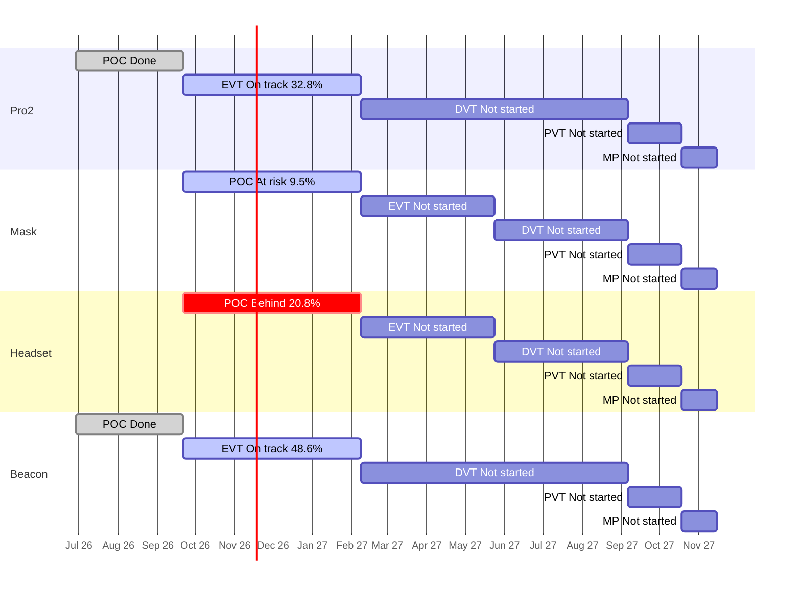

write weekly status reports---
type: portfolio-rollup
date: 2026-11-02
slip_reference: reference.md ## Stage schedule
sources: data/ZenaQuiet-Pro2/2026-11-02.json, data/ZenaQuiet-Beacon/2026-11-02.json, data/ZenaQuiet-Headset/2026-11-02.json, data/ZenaQuiet-Mask/2026-11-02.json, data/ZenaQuiet-Research/2026-11-02.json; raw/threads/, raw/transcripts/; Jira comments (comment_signals from each project run)

---

# Portfolio Roll-up — 2026-11-02

Are the four products on course for their stage gates and for the final deadline, the end of mass production (MP) on 2027-11-15? Each product moves through five stages: POC (proof of concept: show the idea can work), EVT (engineering test: does the design meet its specs?), DVT (design test: is the final design ready?), PVT (factory test: can the factory build it?) and MP (mass production). A "gate" is the review at the end of a stage.

**The plan** is the stage schedule in [[reference#Stage schedule (per product)]]. All slip is measured against those planned stage end dates. Jira numbers come from `tools/wiki_jira.py rollup`; risks from team chats and meetings come from each project's `sources` step; direction changes come from Jira comments. Rules: [[portfolio/INDEX]]. Previous roll-up: [[portfolio/2026-10-26-rollup]].

## 1. Headline

- Days to final deadline (2027-11-15): 378
- On track for MP: 2 of 4 (ZenaQuiet-Pro2, ZenaQuiet-Beacon)
- Worst MP forecast slip: ZenaQuiet-Headset +36d
- Next gate: 2027-02-08 (98d): ZenaQuiet-Pro2 (EVT), ZenaQuiet-Mask (POC), ZenaQuiet-Headset (POC), ZenaQuiet-Beacon (EVT)

**Still two of four products on track for the final deadline, and Headset's slip has grown.** Pro2 and Beacon stay ahead of the expected line (32.8% and 48.6% of current-stage work done against 30.0% expected). **Headset is Behind with a confident forecast of the POC gate 36 days late** (+7 days last week), which pushes its MP forecast to 2027-12-21; its prototype boards are still held at the supplier two weeks after the problem was found. **Mask is At risk** and falling further behind (20.5 points, was 15.5): no engineering work has started.

**Two products show RED for Jira filing reasons, not real slip:** Beacon because of [BC-141](https://epazz.atlassian.net/browse/BC-141) (third week), and now Pro2 because a new task, [PRO2-553](https://epazz.atlassian.net/browse/PRO2-553), is due 2028-02-08, a year after the gate and probably a typo for 2027-02-08 (inferred). Fixing both dates would make them AMBER.

**The CTO visit starts today.** None of the decisions waiting for it (AI chip, sound masking Pro vs Beacon, Pro2 plastic housing, keeping the Beacon, Headset arc) is recorded in Jira yet. Research's RK3576 chip proposal is unchanged and still conflicts with the "No components from China" sourcing rule (section 6c).

## 2. Products

| Product           | Stage | Gate (days)     | Readiness raw / adjusted | Expected | Stage status | Pace forecast for gate             | MP outlook              | Slip vs schedule                       | Next stage planned | HIGH / MED | Health |
| ----------------- | ----- | --------------- | ------------------------ | -------- | ------------ | ---------------------------------- | ----------------------- | -------------------------------------- | ------------------ | ---------- | ------ |
| ZenaQuiet-Pro2    | EVT   | 2027-02-08 (98) | 34.4% / 32.8%            | 30.0%    | On track     | 2027-01-25 (-14d)                  | On track, MP 2027-11-15 | 3 open items past stage end, max +365d | 0.0%               | 3 / 44     | RED    |
| ZenaQuiet-Mask    | POC   | 2027-02-08 (98) | 9.5% / 9.5%              | 30.0%    | At risk      | 2027-12-06 (+301d), low confidence | At risk, forecast n/a   | none past stage end                    | n/a                | 0 / 29     | AMBER  |
| ZenaQuiet-Headset | POC   | 2027-02-08 (98) | 33.3% / 20.8%            | 30.0%    | Behind       | 2027-03-16 (+36d)                  | Behind, MP 2027-12-21   | none past stage end                    | 0.0%               | 9 / 21     | AMBER  |
| ZenaQuiet-Beacon  | EVT   | 2027-02-08 (98) | 48.6% / 48.6%            | 30.0%    | On track     | 2026-12-16 (-54d)                  | On track, MP 2027-11-15 | 1 open items past stage end, max +210d | 0.0%               | 1 / 29     | RED    |

> **What the numbers mean**
>
> - **Raw:** share of the current stage's Stories (planned pieces of work) marked Done in Jira. Pro2 EVT: 21 of 61 Done = 34.4%.
> - **Adjusted:** Raw, minus Done Stories that don't count as real progress: ones that still have open Subtasks, or were closed before the stage began. Headset POC: 8 Done, but 3 still have open Subtasks, so 5 of 24 = 20.8%. Status and the timeline use this number.
> - **Expected:** share of the stage's planned time already used. All four current stages run 2026-09-21 → 2027-02-08 (140 days); 2026-11-02 is day 42, so 42 ÷ 140 = 30.0%. If work were spread evenly, about that much should be Done.
> - Adjusted at or above Expected means ahead; 15–25 points below means At risk; more than 25 below, or a confident pace forecast past the gate, means Behind.
> - **Health** in the table is from Jira only. Adding risks from chats and meetings turns Headset RED as well (section 6b).

- **Pro2** — 21 of 61 EVT Stories Done, ahead of plan. **RED in Jira** only because of PRO2-553's 2028 due date (see headline). Real issues: six mechanical tasks due 27–30 Oct ([PRO2-542](https://epazz.atlassian.net/browse/PRO2-542) to PRO2-546, PRO2-23) haven't started; no hinge delivery is recorded and the bench test [PRO2-420](https://epazz.atlassian.net/browse/PRO2-420) is due 6 Nov; 12 electronics tasks ([PRO2-501](https://epazz.atlassian.net/browse/PRO2-501) to PRO2-512) were reopened and moved to 27 Nov with no reason recorded. Report: [[ZenaQuiet-Pro2/jira/2026-11-02-jira]].
- **Beacon** — 18 of 37 EVT Stories Done, furthest ahead; a quiet week (two status changes). **RED in Jira** only because of BC-141. Sound-masking electronics ([BC-230](https://epazz.atlassian.net/browse/BC-230) to BC-232) and three board layouts ([BC-220](https://epazz.atlassian.net/browse/BC-220), BC-223, BC-226) are 3 days overdue and not started. Report: [[ZenaQuiet-Beacon/jira/2026-11-02-jira]].
- **Headset** — 5 of 24 POC Stories count; **Behind** (+36 days) and **RED with chats and meetings**: no payment recorded for the held PCBs, arrival now around 23 Nov, so board work for [HS-144](https://epazz.atlassian.net/browse/HS-144) starts about 45 working days late. A test confirmed the passive arc can't meet its target ([HS-79](https://epazz.atlassian.net/browse/HS-79)). 482 of 516 open items still have no owner. Report: [[ZenaQuiet-Headset/jira/2026-11-02-jira]].
- **Mask** — 2 of 21 POC Stories Done; **At risk**. Industrial design closed three more tasks (MK-33, MK-35, MK-38), some before their inputs exist; engineering, the mask spec, the board ticket and the processor decision are all still missing. Report: [[ZenaQuiet-Mask/jira/2026-11-02-jira]].

## 3. Stage timeline

Bars are the planned stage windows. Labels show each stage's status and adjusted readiness.

## 4. Stage detail

### ZenaQuiet-Pro2

| Stage | Planned window          | Stories done (adjusted) / total | Expected | Raw    | Adjusted | Planned (owner + dated Subtasks) | Status      | Slip vs plan                   |
| ----- | ----------------------- | ------------------------------- | -------- | ------ | -------- | -------------------------------- | ----------- | ------------------------------ |
| POC   | 2026-06-29 → 2026-09-21 | 18 (15) / 18                    | 100.0%   | 100.0% | 83.3%    | 4/18                             | Done        | finished 2026-10-07, +16d late |
| EVT   | 2026-09-21 → 2027-02-08 | 21 (20) / 61                    | 30.0%    | 34.4%  | 32.8%    | 26/61                            | On track    | forecast -14d                  |
| DVT   | 2027-02-08 → 2027-09-06 | 0 (0) / 9                       | 0.0%     | 0.0%   | 0.0%     | 0/9                              | Not started | —                              |
| PVT   | 2027-09-06 → 2027-10-18 | 0 (0) / 0                       | 0.0%     | —%     | —%       | 0/0                              | Not started | —                              |
| MP    | 2027-10-18 → 2027-11-15 | 0 (0) / 0                       | 0.0%     | —%     | —%       | 0/0                              | Not started | —                              |

Not counted in adjusted readiness: 1 Done with open Subtasks.

Pace in EVT: 3.33 adjusted Stories/week.
Open EVT Stories with no Subtasks (17): PRO2-300, PRO2-423, PRO2-424, PRO2-425, PRO2-426, PRO2-429, PRO2-430, PRO2-434, PRO2-435, PRO2-436 ….

### ZenaQuiet-Mask

| Stage | Planned window          | Stories done (adjusted) / total | Expected | Raw  | Adjusted | Planned (owner + dated Subtasks) | Status      | Slip vs plan                    |
| ----- | ----------------------- | ------------------------------- | -------- | ---- | -------- | -------------------------------- | ----------- | ------------------------------- |
| POC   | 2026-09-21 → 2027-02-08 | 2 (2) / 21                      | 30.0%    | 9.5% | 9.5%     | 1/21                             | At risk     | forecast +301d (low confidence) |
| EVT   | 2027-02-08 → 2027-05-24 | 0 (0) / 0                       | 0.0%     | —%   | —%       | 0/0                              | Not started | —                               |
| DVT   | 2027-05-24 → 2027-09-06 | 0 (0) / 0                       | 0.0%     | —%   | —%       | 0/0                              | Not started | —                               |
| PVT   | 2027-09-06 → 2027-10-18 | 0 (0) / 0                       | 0.0%     | —%   | —%       | 0/0                              | Not started | —                               |
| MP    | 2027-10-18 → 2027-11-15 | 0 (0) / 0                       | 0.0%     | —%   | —%       | 0/0                              | Not started | —                               |

Pace in POC: 0.33 adjusted Stories/week (low confidence: needs ≥5 closed and ≥28 days in stage).
Open POC Stories with no owner (17): MK-7, MK-8, MK-9, MK-11, MK-12, MK-13, MK-16, MK-17, MK-20, MK-22 ….
Open POC Stories with no Subtasks (18): MK-5, MK-7, MK-8, MK-9, MK-11, MK-12, MK-13, MK-16, MK-17, MK-20 ….

### ZenaQuiet-Headset

| Stage | Planned window          | Stories done (adjusted) / total | Expected | Raw   | Adjusted | Planned (owner + dated Subtasks) | Status      | Slip vs plan  |
| ----- | ----------------------- | ------------------------------- | -------- | ----- | -------- | -------------------------------- | ----------- | ------------- |
| POC   | 2026-09-21 → 2027-02-08 | 8 (5) / 24                      | 30.0%    | 33.3% | 20.8%    | 9/24                             | Behind      | forecast +36d |
| EVT   | 2027-02-08 → 2027-05-24 | 0 (0) / 45                      | 0.0%     | 0.0%  | 0.0%     | 0/45                             | Not started | —             |
| DVT   | 2027-05-24 → 2027-09-06 | 0 (0) / 28                      | 0.0%     | 0.0%  | 0.0%     | 0/28                             | Not started | —             |
| PVT   | 2027-09-06 → 2027-10-18 | 0 (0) / 9                       | 0.0%     | 0.0%  | 0.0%     | 0/9                              | Not started | —             |
| MP    | 2027-10-18 → 2027-11-15 | 0 (0) / 0                       | 0.0%     | —%    | —%       | 0/0                              | Not started | —             |

Not counted in adjusted readiness: 3 Done with open Subtasks.

Pace in POC: 0.83 adjusted Stories/week.
Open POC Stories with no owner (10): HS-48, HS-117, HS-118, HS-144, HS-161, HS-164, HS-381, HS-385, HS-452, HS-457.

### ZenaQuiet-Beacon

| Stage | Planned window          | Stories done (adjusted) / total | Expected | Raw    | Adjusted | Planned (owner + dated Subtasks) | Status      | Slip vs plan                 |
| ----- | ----------------------- | ------------------------------- | -------- | ------ | -------- | -------------------------------- | ----------- | ---------------------------- |
| POC   | 2026-06-29 → 2026-09-21 | 21 (20) / 21                    | 100.0%   | 100.0% | 95.2%    | 3/21                             | Done        | finished 2026-09-14, on time |
| EVT   | 2026-09-21 → 2027-02-08 | 18 (18) / 37                    | 30.0%    | 48.6%  | 48.6%    | 14/37                            | On track    | forecast -54d                |
| DVT   | 2027-02-08 → 2027-09-06 | 0 (0) / 7                       | 0.0%     | 0.0%   | 0.0%     | 0/7                              | Not started | —                            |
| PVT   | 2027-09-06 → 2027-10-18 | 0 (0) / 0                       | 0.0%     | —%     | —%       | 0/0                              | Not started | —                            |
| MP    | 2027-10-18 → 2027-11-15 | 0 (0) / 0                       | 0.0%     | —%     | —%       | 0/0                              | Not started | —                            |

Pace in EVT: 3.0 adjusted Stories/week.
Open EVT Stories with no Subtasks (5): BC-158, BC-163, BC-206, BC-208, BC-233.

## 5. Slip vs schedule and dates moved this week

### ZenaQuiet-Pro2

Open items due after their stage's planned end ([[reference#Stage schedule (per product)]]): 3.

- [PRO2-553](https://epazz.atlassian.net/browse/PRO2-553) (Story, EVT): due 2028-02-08, plan end 2027-02-08 (+365d)
- [PRO2-397](https://epazz.atlassian.net/browse/PRO2-397) (Subtask, POC): due 2026-10-27, plan end 2026-09-21 (+36d)
- [PRO2-396](https://epazz.atlassian.net/browse/PRO2-396) (Subtask, POC): due 2026-10-16, plan end 2026-09-21 (+25d)
  Dates moved since 2026-10-26: 12 of 114 open items (10.5%); 12 now due later.
- [PRO2-501](https://epazz.atlassian.net/browse/PRO2-501) (Subtask): 2026-10-09 → 2026-11-27 (+49d)
- [PRO2-502](https://epazz.atlassian.net/browse/PRO2-502) (Subtask): 2026-10-09 → 2026-11-27 (+49d)
- [PRO2-503](https://epazz.atlassian.net/browse/PRO2-503) (Subtask): 2026-10-09 → 2026-11-27 (+49d)
- [PRO2-504](https://epazz.atlassian.net/browse/PRO2-504) (Subtask): 2026-10-09 → 2026-11-27 (+49d)
- [PRO2-505](https://epazz.atlassian.net/browse/PRO2-505) (Subtask): 2026-10-09 → 2026-11-27 (+49d)
- - 7 more

### ZenaQuiet-Mask

Open items due after their stage's planned end ([[reference#Stage schedule (per product)]]): none.
Dates moved since 2026-10-26: 0 of 30 open items (0.0%); 0 now due later.

### ZenaQuiet-Headset

Open items due after their stage's planned end ([[reference#Stage schedule (per product)]]): none.
Dates moved since 2026-10-26: 2 of 516 open items (0.4%); 2 now due later.

- [HS-93](https://epazz.atlassian.net/browse/HS-93) (Subtask): 2026-10-27 → 2026-12-01 (+35d)
- [HS-584](https://epazz.atlassian.net/browse/HS-584) (Subtask): 2026-10-27 → 2026-11-16 (+20d)

### ZenaQuiet-Beacon

Open items due after their stage's planned end ([[reference#Stage schedule (per product)]]): 1.

- [BC-141](https://epazz.atlassian.net/browse/BC-141) (Subtask, EVT): due 2027-09-06, plan end 2027-02-08 (+210d)
  Dates moved since 2026-10-26: 0 of 78 open items (0.0%); 0 now due later.

Pro2's PRO2-553 (+365 days) is the likely typo above. Pro2 re-dated 10.5% of its open items this week, all twelve reopened electronics tasks; this stays under the 20% bulk re-plan flag.

## 6. Cross-product

- **Shared gates:** all four products have their next gate on 2027-02-08 (Pro2 and Beacon EVT → DVT; Mask and Headset POC → EVT), 98 days away.
- **People across products:**

  | Person            | Open items | By product                          |
  | ----------------- | ---------- | ----------------------------------- |
  | Nguyen Trung Tin  | 62         | Beacon 50, Headset 8, Pro2 4        |
  | Nguyen Minh Thien | 28         | Pro2 16, Beacon 11, Mask 1          |
  | Hung Pham Nguyen  | 27         | Pro2 25, Headset 2                  |
  | Nguyen Manh Tuan  | 15         | Headset 10, Beacon 5                |
  | Phi Tuong         | 14         | Headset 8, Pro2 6                   |
  | Chico Ly          | 12         | Pro2 5, Headset 3, Beacon 3, Mask 1 |
  | Phong.ngoc.nguyen | 7          | Beacon 4, Headset 2, Mask 1         |
  | Huỳnh Thái Hòa    | 4          | Beacon 2, Pro2 1, Mask 1            |

  Unassigned open items: Pro2 3, Mask 22, Headset 482, Beacon 2.

  Nguyen Trung Tin, the second mechanical engineer, still holds 62 open items (50 Beacon, 8 Headset, 4 Pro2); Hung Pham Nguyen's Pro2 load rose from 14 to 25 with the reopened electronics tasks. No time split between products is recorded (6b). Headset's 482 unowned items are unchanged.

- **Research and other support work products wait on:**

  ### ZenaQuiet-Research (snapshot 2026-11-02)

  Open 19; linked to a product ticket 2; unlinked 17.
  - Overdue: [RS-1](https://epazz.atlassian.net/browse/RS-1) due 2026-10-20 — Chip eval + decision
  - Overdue: [RS-2](https://epazz.atlassian.net/browse/RS-2) due 2026-10-29 — [POC] Evaluate TSE on Imx95 NPU
  - Overdue: [RS-4](https://epazz.atlassian.net/browse/RS-4) due 2026-10-23 — Survey about good components for ultrasonic loudspeaker and best layout
  - Overdue: [RS-16](https://epazz.atlassian.net/browse/RS-16) due 2026-10-30 — [POC] Cover: Prototype pink/white noise sound masking in the Beacon
  - Overdue: [RS-25](https://epazz.atlassian.net/browse/RS-25) due 2026-10-26 — [POC] Block: Research desk-height screens and partitions to block speech between desks
  - Due within 14d: [RS-21](https://epazz.atlassian.net/browse/RS-21) due 2026-11-02 — [POC] Absorb: Research sound-absorbing materials (ceiling tiles, wall panels, workstation covers)
  - Due within 14d: [RS-22](https://epazz.atlassian.net/browse/RS-22) due 2026-11-02 — [POC] ANC in the personal headset
  - Due within 14d: [RS-23](https://epazz.atlassian.net/browse/RS-23) due 2026-11-02 — [POC] Block: Research office layout and seating plan to reduce noise
  - Due within 14d: [RS-24](https://epazz.atlassian.net/browse/RS-24) due 2026-11-02 — [POC] Measure baseline floor acoustics before treatment

  Five Research items are overdue (two last week). The chip decision [RS-1](https://epazz.atlassian.net/browse/RS-1) is 13 days late. A new link ties finished research RS-3 to Pro2's beamforming speaker PRO2-463.

## 6b. Risks from team threads

One row per risk, highest impact first; rows describing the same risk in several products are merged. No new chat or meeting files arrived since 2026-10-19; each project carried its items over, re-checked the cited lines and added what Jira comments say.

| #   | Product                          | What's at risk                                                                                                                                                                                                                                                                                                                                                                                                                                                                                                                            | Root cause                                                                                                                                                                                         | What would fix it                                                                                                                                    | Level  |
| --- | -------------------------------- | ----------------------------------------------------------------------------------------------------------------------------------------------------------------------------------------------------------------------------------------------------------------------------------------------------------------------------------------------------------------------------------------------------------------------------------------------------------------------------------------------------------------------------------------- | -------------------------------------------------------------------------------------------------------------------------------------------------------------------------------------------------- | ---------------------------------------------------------------------------------------------------------------------------------------------------- | ------ |
| 1   | Headset                          | POC board work that Firmware needs ([HS-144](https://epazz.atlassian.net/browse/HS-144)) starts about 45 working days late: planned 21 Sep, boards around 23 Nov (a week later again). No working headset for the CTO visit.                                                                                                                                                                                                                                                                                                              | In Purchasing: wrong PCB option paid; the supplier waits for about $35 extra; still no payment recorded                                                                                            | Confirm payment today, get a written ship date, log the order in an EE Subtask under HS-144; show the mock-up plus the Pro's voice demo at the visit | High   |
| 2   | Mask                             | First mask circuit board ([MK-22](https://epazz.atlassian.net/browse/MK-22), inferred) starts about 35 working days late: planned 21 Sep, arrival around 9 Nov (default lead time; the forecast moves out a week every week because no order date is recorded).                                                                                                                                                                                                                                                                           | Other: board ordered outside Jira; the ticket agreed on 2026-10-19 still doesn't exist                                                                                                             | Create the board Subtask under MK-22 with order and delivery dates                                                                                   | Medium |
| 3   | Pro2                             | Hinge bench test ([PRO2-420](https://epazz.atlassian.net/browse/PRO2-420), due 6 Nov) starts 16–26 working days late by the quoted lead time; no hinge delivery is recorded.                                                                                                                                                                                                                                                                                                                                                              | Supplier lead time: 5–7 weeks after payment; payment, order and arrival dates not recorded; Revision B redesigned around an alternative hinge                                                      | Record the hinges that arrived in PRO2-416 and re-date PRO2-420                                                                                      | Medium |
| 4   | Pro2, Headset, Mask (Research)   | AI-chip choice for the voice-isolation model: Pro2 [PRO2-461](https://epazz.atlassian.net/browse/PRO2-461), [PRO2-486](https://epazz.atlassian.net/browse/PRO2-486); Headset [HS-164](https://epazz.atlassian.net/browse/HS-164) and its NXP-based board plan; Mask [MK-22](https://epazz.atlassian.net/browse/MK-22), [MK-13](https://epazz.atlassian.net/browse/MK-13): delay unknown (waiting on a decision). RK3576 kit ([RS-2](https://epazz.atlassian.net/browse/RS-2)) not late against Pro2 but already past RS-2's own due date. | Open decision: RS-1 13 days overdue; options Qualcomm IQ-8275/QCS6490 or RK3576; kit request only in a Jira comment, no cost, waiting for CTO approval 6 of 14 working days; China rule unresolved | Decide at the CTO visit, record it in RS-1, HS-164, MK-22; file the kit and licence requests in the purchase chat                                    | Medium |
| 5   | Pro2, Beacon (Research)          | Where sound masking lives: Pro2 baffling and masking checks ([PRO2-150](https://epazz.atlassian.net/browse/PRO2-150), PRO2-160; 7 baffle tasks start today), Beacon masking electronics and speaker housing ([BC-191](https://epazz.atlassian.net/browse/BC-191), BC-230 to BC-232 overdue, [BC-250](https://epazz.atlassian.net/browse/BC-250)), masking prototype [RS-16](https://epazz.atlassian.net/browse/RS-16) (3 days overdue): delay unknown (waiting on a decision).                                                            | Open decision: Pro vs Beacon and speaker in the Beacon vs above the ceiling; Beacon masking hardware not requested; no demo board                                                                  | Record the CTO's decision this week in PRO2-150 and BC-234, then close or re-scope the other side's tasks                                            | Medium |
| 6   | Pro2, Beacon, Headset, Mask      | Mechanical work in every product (Pro2 PRO2-8 incl. the overdue static analyses, Beacon BC-160 to BC-163 and thermal/antenna/panel work, Headset HS-6 with HS-93 and HS-584 moved out, Mask MK-16, MK-17, MK-20): delay unknown (no one has time set aside for it).                                                                                                                                                                                                                                                                       | Capacity: two mechanical engineers for four products; no agreed split                                                                                                                              | Agree each engineer's days per product in writing and re-date what moves                                                                             | Medium |
| 7   | Pro2, Beacon, Headset (Research) | Demos and EVT spec sign-off for the CTO visit that starts today (no Jira item in Pro2 or Beacon; no Headset board; Beacon masking Epic [BC-234](https://epazz.atlassian.net/browse/BC-234) has no Stories): delay unknown (no date in the sources).                                                                                                                                                                                                                                                                                       | Other: readiness and sign-off tracked only in chat                                                                                                                                                 | Record what was shown and signed off, with one dated ticket per product for follow-ups                                                               | Medium |
| 8   | Pro2                             | Housing material ([PRO2-425](https://epazz.atlassian.net/browse/PRO2-425)) and Revision B: delay unknown (waiting on a decision). New this week.                                                                                                                                                                                                                                                                                                                                                                                          | Open decision: plastic instead of the CTO's die-cast aluminium, no approval recorded                                                                                                               | Confirm with the CTO this week                                                                                                                       | Medium |
| 9   | Pro2                             | EVT-1 version ([PRO2-416](https://epazz.atlassian.net/browse/PRO2-416), PRO2-437): delay unknown (waiting on a decision).                                                                                                                                                                                                                                                                                                                                                                                                                 | Open decision: outcome of the 20 Oct meeting still not recorded                                                                                                                                    | Record it and close or re-date PRO2-437                                                                                                              | Medium |
| 10  | Headset                          | Arc directional masking ([HS-51](https://epazz.atlassian.net/browse/HS-51); HS-78, HS-89, HS-93): delay unknown (waiting on a decision).                                                                                                                                                                                                                                                                                                                                                                                                  | Open decision: HS-79 test (27 Oct) confirms the passive target can't be met; HS-51 target unchanged                                                                                                | Agree Arc scope with the CTO, then re-scope or close                                                                                                 | Medium |
| 11  | Headset                          | EE board work under HS-144 and HS-451: delay unknown (no date in the sources).                                                                                                                                                                                                                                                                                                                                                                                                                                                            | Other: EE tickets promised on 19 Oct still not created; EE size inputs HS-336, HS-337, HS-130, HS-131 have no owner                                                                                | Create the EE Subtasks with owners this week                                                                                                         | Medium |
| 12  | Beacon                           | Beacon scope after EVT (all Beacon Epics): delay unknown (waiting on a decision).                                                                                                                                                                                                                                                                                                                                                                                                                                                         | Open decision: "keep" (30 Sep) vs "decide later" (19 Oct)                                                                                                                                          | Record keep/drop from the visit                                                                                                                      | Medium |
| 13  | Mask                             | 17 mask engineering Stories: delay unknown (no date in the sources).                                                                                                                                                                                                                                                                                                                                                                                                                                                                      | Other: mask spec not written                                                                                                                                                                       | Date the spec and track it in Jira                                                                                                                   | Medium |
| 14  | Mask (Research)                  | Voice-dampening material research ([MK-11](https://epazz.atlassian.net/browse/MK-11)): delay unknown (no one has time set aside for it).                                                                                                                                                                                                                                                                                                                                                                                                  | Capacity: not on Acoustic's priority list, no owner                                                                                                                                                | Assign MK-11 or create a dated RS Story                                                                                                              | Medium |
| 15  | Beacon                           | LED ring and board-size changes (BC-153): delay unknown (no date in the sources).                                                                                                                                                                                                                                                                                                                                                                                                                                                         | Other: no dated Subtask                                                                                                                                                                            | Add dated ME and EE Subtasks                                                                                                                         | Medium |
| 16  | Pro2                             | Ultrasonic speaker test fixture ([PRO2-453](https://epazz.atlassian.net/browse/PRO2-453)): not delayed on paper (counted from the 15 Oct approval).                                                                                                                                                                                                                                                                                                                                                                                       | In Purchasing: part and order not recorded                                                                                                                                                         | Record the part and order date                                                                                                                       | Medium |
| 17  | Research                         | Drone propeller noise experiment (RS-7, inferred): delay unknown (no date in the sources).                                                                                                                                                                                                                                                                                                                                                                                                                                                | Other: not planned in Jira                                                                                                                                                                         | Add a dated Story under RS-7                                                                                                                         | Medium |

Closed this week: Pro2's copper plates for the touch test arrived and were tested (PRO2-327, Duy Nguyen, 2026-11-02).

_Not placed yet:_ `threads/2026-10-19-purchase.md · REQUEST 1`, GPU rental for TSE model training ($226, approved), names no product (fourth week; question to the human below).

## 6c. Direction changes from engineering discussion

One row per change and affected product, High first. Rules: [[portfolio/INDEX]] Section 4b. Matching: linked = Jira link; named = product named in the comment or ticket; (inferred) = the replaced part appears in that product's tickets or meetings. Few new comments this week; rows 1–8 and 10–13 are unchanged from [[portfolio/2026-10-26-rollup]] and still open.

| #   | Change (status)                                                                                                                              | Product (how matched)                                                         | Cost                                                          | Time                                                                                                                     | Technical                                                                                            | Teams      | Who decides                   | Level  | Source                                  |
| --- | -------------------------------------------------------------------------------------------------------------------------------------------- | ----------------------------------------------------------------------------- | ------------------------------------------------------------- | ------------------------------------------------------------------------------------------------------------------------ | ---------------------------------------------------------------------------------------------------- | ---------- | ----------------------------- | ------ | --------------------------------------- |
| 1   | Use the Rockchip RK3576 instead of the i.MX95 for the voice-isolation model (proposed; evaluation kit requested)                             | Pro2 (linked: PRO2-461, PRO2-486 → RS-2)                                      | unit and kit price not stated                                 | i.MX95 work in PRO2-461, PRO2-486, PRO2-483 to PRO2-488 would need redoing; slip not measurable yet; before the EVT gate | whole model compiles to the NPU (simulation only); 600 ms per 3 s chunk; ≤150 ms latency target open | EE, FW, AI | CTO (approval; sourcing rule) | High   | RS-2, Nguyen Binh Minh, 2026-10-23      |
| 2   | Same chip change (proposed)                                                                                                                  | Headset (inferred: i.MX 95 in HS-164, HS-154, HS-155, HS-162, HS-165, HS-166) | as above; ~$4,000 licence for the Headset candidate (meeting) | HS-164 not started; before the POC gate                                                                                  | as above                                                                                             | EE, FW     | CTO                           | High   | RS-2, 2026-10-23                        |
| 3   | Same chip change (proposed)                                                                                                                  | Mask (inferred: IMX95 on the first mask board, MK-22)                         | as above                                                      | MK-22 board ordered on an i.MX95 design; before the POC gate                                                             | MK-13 says no AI chip on the mask at all                                                             | EE, FW     | CTO                           | High   | RS-2, 2026-10-23                        |
| 4   | Passive Arc can't reach the 8–12 dB / NRC ≥0.70 target at the planned size (decided test result)                                             | Headset (named: HS-79, HS-51)                                                 | not stated                                                    | HS-78, HS-89, HS-93 continue against a target the test says is out of reach; before the POC gate                         | same result as the earlier Halo geometry                                                             | ME, AC     | CTO (Arc scope)               | High   | HS-79, 2026-10-27                       |
| 5   | Revision B of the EVT-1 Pro around an alternative torque hinge (decided)                                                                     | Pro2 (named: PRO2-416)                                                        | not stated                                                    | about 1 week of redesign; PRO2-420, PRO2-423, PRO2-300 wait on it                                                        | HG-TE03 / HG-TE08                                                                                    | ME, ID     | not stated                    | High   | PRO2-416, Duy Nguyen, 2026-10-22/23     |
| 6   | No audio or voiceprint ever leaves the Pro (decided)                                                                                         | Beacon (named)                                                                | —                                                             | none seen; consistent with BC-233                                                                                        | upload code removal tracked in PRO2-549                                                              | FW         | decided                       | High   | PRO2-474, Nguyen Minh Thien, 2026-10-21 |
| 7   | Stainless-steel plate behind the Beacon's Kensington slot (decided)                                                                          | Beacon (named: BC-261)                                                        | not stated                                                    | before the EVT gate                                                                                                      | wall 2.5–4.0 mm                                                                                      | ME         | —                             | High   | BC-261, 2026-10-22                      |
| 8   | Encrypted over-the-air updates on the Beacon (decided; code not committed)                                                                   | Beacon (named: BC-249)                                                        | —                                                             | BC-249 Done while the code isn't committed                                                                               | production keys still to set up                                                                      | FW         | —                             | High   | BC-249, 2026-10-20                      |
| 9   | Pro2 housing from die-cast aluminium to ABS / ABS-PC plastic, with costs tracked in an engineering BOM (proposed; last week read as decided) | Pro2 (named: PRO2-425, PRO2-553)                                              | per-part cost to be tracked in PRO2-553                       | before the EVT gate                                                                                                      | look and feel to be checked by ID                                                                    | ME, ID     | CTO (original spec)           | Medium | PRO2-425, Duy Nguyen, 2026-10-23        |
| 10  | Move sound masking from the Pro to the Beacon (proposed)                                                                                     | Pro2 (named: PRO2-150); Beacon (named)                                        | —                                                             | CTO decision expected this week                                                                                          | Beacon drafting a separate ceiling-speaker housing (row 11)                                          | AC, ME, EE | CTO                           | Medium | PRO2-150, 2026-10-19/21                 |
| 11  | Separate ceiling-speaker housing for masking, sized for a 63 × 48 mm board (proposed / under test)                                           | Beacon (named: BC-250, BC-252, BC-253)                                        | —                                                             | BC-250 due 2026-11-06                                                                                                    | board size not confirmed by EE                                                                       | ME, EE     | EE to confirm                 | Medium | BC-252, BC-253, 2026-10-22              |
| 12  | Qualcomm IQ-8275 or a fixed QCS6490 as the alternative chip (proposed)                                                                       | Headset, Mask (inferred)                                                      | IQ-8275 devkit about $300                                     | —                                                                                                                        | 37.7 ms / 148 ms (8-bit) on QCS8550/IQ-8275                                                          | FW, EE     | CTO                           | Medium | RS-1, 2026-10-22                        |
| 13  | XMOS ruled out as the AI chip (rejected)                                                                                                     | Headset, Mask (inferred)                                                      | —                                                             | —                                                                                                                        | 0.75 s per 1 s of audio                                                                              | FW         | —                             | Low    | RS-1, 2026-10-22                        |

**Conflicts (flagged, not resolved):**

- Sourcing: [[reference#Sourcing rules]] says "No components from China (CTO)"; the RS-2 comment (2026-10-23) and the CTO on 2026-10-15 (`transcripts/2026-10-15-biweekly.md · [26:56]`) say Chinese parts are acceptable. Waiting on the human (question below).
- Which product the chip is for: meetings say Headset and Mask; Jira links RS-2 to Pro2.
- Headset and Mask Jira still plan the NXP i.MX 95; the 19 Oct meeting proposed XMOS; Research ruled XMOS out and proposed RK3576.
- Mask processor: MK-13 says no AI chip on the mask; meetings plan one.
- Pro2 housing: plastic replaces the CTO's aluminium spec with no recorded approval.
- Sound masking: Pro2 baffle tasks start today while Beacon builds for masking; a Pro2 comment says the CTO already chose the Beacon.
- Headset arc: HS-79 says the target is out of reach; HS-51 keeps it.

_Not placed yet:_ none.

## 7. Recommendations

1. **Record every CTO-visit decision in its ticket by Friday 2026-11-06.** Chip and China rule (RS-1, RS-2, HS-164, MK-22), sound masking (PRO2-150, BC-234, RS-16), Pro2 housing (PRO2-425), keep/drop the Beacon, Headset arc scope (HS-51). Owner: Cang Le.
2. **Pay for the Headset boards today.** Two weeks on, the ~$35 is still unpaid in every record; get a written ship date and log it under HS-144. Owners: Pham Nguyen Ngoc, Purchasing.
3. **Fix the two dates that make products RED.** PRO2-553 due 2028-02-08 (likely 2027-02-08) and BC-141 (DVT task under an EVT Story). Both products would show AMBER. Owners: Duy Nguyen (PRO2-553), Beacon ID owner (BC-141).
4. **Agree the mechanical time split in writing.** Six Pro2 mechanical tasks are overdue, Beacon's mechanical owner has 50 items, Headset moved two dates out, Mask has none started. Owners: Cang Le with Duy Nguyen and Nguyen Trung Tin.
5. **Explain the reopened Pro2 electronics tasks and create the missing tickets.** Add a reason to PRO2-501 to PRO2-512; create the Mask board ticket (MK-22) and the Headset EE tickets (HS-144, HS-451) with owners. Owners: Hung Pham Nguyen, Mask and Headset EE leads.

## 8. Data Gaps & Assumptions

- Snapshots used: `data/<project>/2026-11-02.json` for all four products and Research (this run). Rollup printed no `FLAG:` lines.
- Plan: [[reference#Stage schedule (per product)]]. MP forecast assumes later stages keep their planned length; Headset's confident +36 days carries to MP 2027-12-21.
- Low confidence: Mask's pace forecast (only 2 adjusted Stories closed).
- Health in section 2 is Jira only; with chats and meetings: Pro2 RED (PRO2-553 date), Beacon RED (BC-141), Headset RED (PCBs), Mask AMBER, Research AMBER.
- Sources: no new files in `raw/threads/` or `raw/transcripts/` since 2026-10-19; items carried over with cited lines re-checked. No CTO-visit outcome is in Jira or `raw/` yet.
- Comments: few new comments this week (Pro2 PRO2-327, PRO2-329, PRO2-26; Headset HS-79; none new in Beacon, Mask, Research). Direction changes come from each project's `comment_signals.json`.
- Mask cleared `open_question` on its processor and spec items so the script doesn't treat them as blocked orders (severity unchanged).
- The Headset `diff` does not see sprint moves; HS-164 and HS-48 are still in POC Sprint 3, which ended 2026-11-01.
