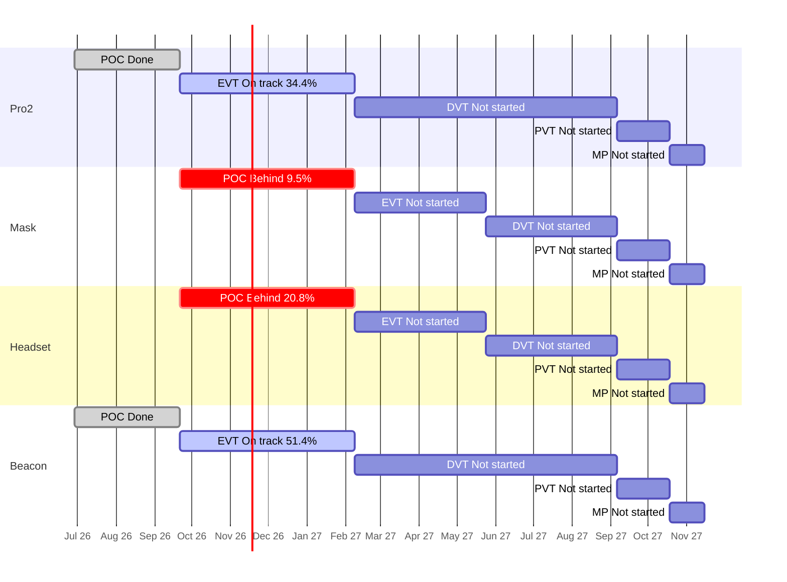

# Portfolio Roll-up — 2026-11-09

Are the four products on course for their stage gates and for the final deadline, the end of mass production (MP) on 2027-11-15? Each product moves through five stages: POC (proof of concept: show the idea can work), EVT (engineering test: does the design meet its specs?), DVT (design test: is the final design ready?), PVT (factory test: can the factory build it?) and MP (mass production). A "gate" is the review at the end of a stage.

**The plan** is the stage schedule in [[reference#Stage schedule (per product)]]. All slip is measured against those planned stage end dates. Jira numbers come from `tools/wiki_jira.py rollup`; risks from team chats and meetings come from each project's `sources` step; direction changes come from Jira comments. Rules: [[portfolio/INDEX]]. Previous weekly roll-up: [[portfolio/2026-11-02-rollup]] (and the extra run [[portfolio/2026-11-03-rollup]]).

## 1. Headline

- Days to final deadline (2027-11-15): 371
- On track for MP: 2 of 4 (ZenaQuiet-Pro2, ZenaQuiet-Beacon)
- Worst MP forecast slip: ZenaQuiet-Headset +66d
- Next gate: 2027-02-08 (91d): ZenaQuiet-Pro2 (EVT), ZenaQuiet-Mask (POC), ZenaQuiet-Headset (POC), ZenaQuiet-Beacon (EVT)

**Two of four products are still on track for the final deadline, but the gap is widening for the other two and Pro2's margin has gone.** Beacon is well ahead (51.4% of EVT work done against 35.0% expected). Pro2 is only just on the line (34.4% against 35.0%): at its current pace it reaches the EVT gate exactly on 2027-02-08, with no margin left (14 days early a week ago). **Headset's POC gate is now forecast 66 days late** (+36 last week), pushing its MP forecast to 2028-01-20; its prototype boards have been held at the supplier for three weeks over a ~$35 payment, now expected around 30 Nov. **Mask has moved from At risk to Behind**: 9.5% done against 35.0% expected, and engineering still hasn't started.

**Every project shows RED this week**, for different reasons. Real problems: Headset (stuck boards), Mask (25.5 points behind plan), Beacon (three circuit-board layouts 10 days late: [BC-220](https://epazz.atlassian.net/browse/BC-220), BC-223, BC-226) and Research (the Beacon masking prototype [RS-16](https://epazz.atlassian.net/browse/RS-16) 10 days late). Filing problems that are still not fixed: Pro2's [PRO2-553](https://epazz.atlassian.net/browse/PRO2-553) due in 2028 (probably 2027) and Beacon's misfiled [BC-141](https://epazz.atlassian.net/browse/BC-141).

**The CTO visit week left nothing in Jira.** No decision is recorded on the AI chip, where sound masking lives, the Pro2 plastic housing, the Pro version, keeping the Beacon, or the Headset arc. The only trace is one Beacon comment citing a "project owner clarification" on 6 Nov about all-plastic mounting parts (BC-236). The chip options narrowed: Hailo 8L was ruled out (RS-2, 3 Nov), and the Research evaluation ticket RS-2 was closed without a recorded choice.

## 2. Products

| Product | Stage | Gate (days) | Readiness raw / adjusted | Expected | Stage status | Pace forecast for gate | MP outlook | Slip vs schedule | Next stage planned | HIGH / MED | Health |
| --- | --- | --- | --- | --- | --- | --- | --- | --- | --- | --- | --- |
| ZenaQuiet-Pro2 | EVT | 2027-02-08 (91) | 36.1% / 34.4% | 35.0% | On track | 2027-02-08 (0d) | On track, MP 2027-11-15 | 2 open items past stage end, max +365d | 0.0% | 4 / 48 | RED |
| ZenaQuiet-Mask | POC | 2027-02-08 (91) | 9.5% / 9.5% | 35.0% | Behind | 2028-02-18 (+375d), low confidence | Behind, forecast n/a | none past stage end | n/a | 0 / 29 | RED |
| ZenaQuiet-Headset | POC | 2027-02-08 (91) | 33.3% / 20.8% | 35.0% | Behind | 2027-04-15 (+66d) | Behind, MP 2028-01-20 | none past stage end | 0.0% | 9 / 20 | AMBER |
| ZenaQuiet-Beacon | EVT | 2027-02-08 (91) | 51.4% / 51.4% | 35.0% | On track | 2026-12-25 (-45d) | On track, MP 2027-11-15 | 1 open items past stage end, max +210d | 0.0% | 4 / 25 | RED |

> **What the numbers mean**
> - **Raw:** share of the current stage's Stories (planned pieces of work) marked Done in Jira. Pro2 EVT: 22 of 61 Done = 36.1%.
> - **Adjusted:** Raw, minus Done Stories that don't count as real progress: ones that still have open Subtasks, or were closed before the stage began. Headset POC: 8 Done, but 3 still have open Subtasks, so 5 of 24 = 20.8%. Status and the timeline use this number.
> - **Expected:** share of the stage's planned time already used. All four current stages run 2026-09-21 → 2027-02-08 (140 days); 2026-11-09 is day 49, so 49 ÷ 140 = 35.0%. If work were spread evenly, about that much should be Done.
> - Adjusted at or above Expected means ahead; 15–25 points below means At risk; more than 25 below, or a confident pace forecast past the gate, means Behind.
> - **Health** in the table is from Jira only. Adding risks from chats and meetings turns Headset RED as well (section 6b).

- **Pro2** — 22 of 61 EVT Stories Done; on track, but the pace forecast now lands exactly on the gate. **RED in Jira** because of PRO2-553's 2028 date; the three other HIGH items are stranded POC leftovers and two mechanical analyses ([PRO2-542](https://epazz.atlassian.net/browse/PRO2-542), PRO2-543) now 10 days late. No hinge delivery is recorded and the bench test [PRO2-420](https://epazz.atlassian.net/browse/PRO2-420) passed its 6 Nov due date unstarted. A new Story for a second build ([PRO2-556](https://epazz.atlassian.net/browse/PRO2-556), "PRO V5b for EVT-2") suggests the portable V5 line goes ahead (inferred). Report: [[ZenaQuiet-Pro2/jira/2026-11-09-jira]].
- **Beacon** — 19 of 37 EVT Stories Done, furthest ahead; seven items closed this week, including the masking board's parts and schematic and the speaker housing. **RED in Jira**: three board layouts are 10 days late (one with no owner), plus BC-141. Report: [[ZenaQuiet-Beacon/jira/2026-11-09-jira]].
- **Headset** — 5 of 24 POC Stories count; **Behind** (+66 days) and **RED with chats and meetings**: no payment recorded for the held PCBs, so board work for [HS-144](https://epazz.atlassian.net/browse/HS-144) starts about 50 working days late. Almost nothing moved in Jira this week (one date, a few sprint moves). Report: [[ZenaQuiet-Headset/jira/2026-11-09-jira]].
- **Mask** — 2 of 21 POC Stories Done; **Behind** (25.5 points under the expected line; the pace forecast is low confidence). Two items started (MK-5 prototype, MK-11 material research, which has no owner); the board ordered outside Jira and the processor choice are still not recorded. Report: [[ZenaQuiet-Mask/jira/2026-11-09-jira]].

## 3. Stage timeline

Bars are the planned stage windows. Labels show each stage's status and adjusted readiness.

## 4. Stage detail

### ZenaQuiet-Pro2

| Stage | Planned window | Stories done (adjusted) / total | Expected | Raw | Adjusted | Planned (owner + dated Subtasks) | Status | Slip vs plan |
| --- | --- | --- | --- | --- | --- | --- | --- | --- |
| POC | 2026-06-29 → 2026-09-21 | 18 (16) / 18 | 100.0% | 100.0% | 88.9% | 4/18 | Done | finished 2026-10-07, +16d late |
| EVT | 2026-09-21 → 2027-02-08 | 22 (21) / 61 | 35.0% | 36.1% | 34.4% | 26/61 | On track | forecast 0d |
| DVT | 2027-02-08 → 2027-09-06 | 0 (0) / 9 | 0.0% | 0.0% | 0.0% | 0/9 | Not started | — |
| PVT | 2027-09-06 → 2027-10-18 | 0 (0) / 0 | 0.0% | —% | —% | 0/0 | Not started | — |
| MP | 2027-10-18 → 2027-11-15 | 0 (0) / 0 | 0.0% | —% | —% | 0/0 | Not started | — |

Not counted in adjusted readiness: 1 Done with open Subtasks.

Pace in EVT: 3.0 adjusted Stories/week.
Open EVT Stories with no Subtasks (17): PRO2-300, PRO2-423, PRO2-424, PRO2-425, PRO2-426, PRO2-429, PRO2-430, PRO2-434, PRO2-435, PRO2-436 ….

### ZenaQuiet-Mask

| Stage | Planned window | Stories done (adjusted) / total | Expected | Raw | Adjusted | Planned (owner + dated Subtasks) | Status | Slip vs plan |
| --- | --- | --- | --- | --- | --- | --- | --- | --- |
| POC | 2026-09-21 → 2027-02-08 | 2 (2) / 21 | 35.0% | 9.5% | 9.5% | 1/21 | Behind | forecast +375d (low confidence) |
| EVT | 2027-02-08 → 2027-05-24 | 0 (0) / 0 | 0.0% | —% | —% | 0/0 | Not started | — |
| DVT | 2027-05-24 → 2027-09-06 | 0 (0) / 0 | 0.0% | —% | —% | 0/0 | Not started | — |
| PVT | 2027-09-06 → 2027-10-18 | 0 (0) / 0 | 0.0% | —% | —% | 0/0 | Not started | — |
| MP | 2027-10-18 → 2027-11-15 | 0 (0) / 0 | 0.0% | —% | —% | 0/0 | Not started | — |

Pace in POC: 0.29 adjusted Stories/week (low confidence: needs ≥5 closed and ≥28 days in stage).
Open POC Stories with no owner (17): MK-7, MK-8, MK-9, MK-11, MK-12, MK-13, MK-16, MK-17, MK-20, MK-22 ….
Open POC Stories with no Subtasks (18): MK-5, MK-7, MK-8, MK-9, MK-11, MK-12, MK-13, MK-16, MK-17, MK-20 ….

### ZenaQuiet-Headset

| Stage | Planned window | Stories done (adjusted) / total | Expected | Raw | Adjusted | Planned (owner + dated Subtasks) | Status | Slip vs plan |
| --- | --- | --- | --- | --- | --- | --- | --- | --- |
| POC | 2026-09-21 → 2027-02-08 | 8 (5) / 24 | 35.0% | 33.3% | 20.8% | 9/24 | Behind | forecast +66d |
| EVT | 2027-02-08 → 2027-05-24 | 0 (0) / 45 | 0.0% | 0.0% | 0.0% | 0/45 | Not started | — |
| DVT | 2027-05-24 → 2027-09-06 | 0 (0) / 28 | 0.0% | 0.0% | 0.0% | 0/28 | Not started | — |
| PVT | 2027-09-06 → 2027-10-18 | 0 (0) / 9 | 0.0% | 0.0% | 0.0% | 0/9 | Not started | — |
| MP | 2027-10-18 → 2027-11-15 | 0 (0) / 0 | 0.0% | —% | —% | 0/0 | Not started | — |

Not counted in adjusted readiness: 3 Done with open Subtasks.

Pace in POC: 0.71 adjusted Stories/week.
Open POC Stories with no owner (10): HS-48, HS-117, HS-118, HS-144, HS-161, HS-164, HS-381, HS-385, HS-452, HS-457.

### ZenaQuiet-Beacon

| Stage | Planned window | Stories done (adjusted) / total | Expected | Raw | Adjusted | Planned (owner + dated Subtasks) | Status | Slip vs plan |
| --- | --- | --- | --- | --- | --- | --- | --- | --- |
| POC | 2026-06-29 → 2026-09-21 | 21 (20) / 21 | 100.0% | 100.0% | 95.2% | 3/21 | Done | finished 2026-09-14, on time |
| EVT | 2026-09-21 → 2027-02-08 | 19 (19) / 37 | 35.0% | 51.4% | 51.4% | 14/37 | On track | forecast -45d |
| DVT | 2027-02-08 → 2027-09-06 | 0 (0) / 7 | 0.0% | 0.0% | 0.0% | 0/7 | Not started | — |
| PVT | 2027-09-06 → 2027-10-18 | 0 (0) / 0 | 0.0% | —% | —% | 0/0 | Not started | — |
| MP | 2027-10-18 → 2027-11-15 | 0 (0) / 0 | 0.0% | —% | —% | 0/0 | Not started | — |

Pace in EVT: 2.71 adjusted Stories/week.
Open EVT Stories with no Subtasks (5): BC-158, BC-163, BC-206, BC-208, BC-233.

## 5. Slip vs schedule and dates moved this week

### ZenaQuiet-Pro2
Open items due after their stage's planned end ([[reference#Stage schedule (per product)]]): 2.
- [PRO2-553](https://epazz.atlassian.net/browse/PRO2-553) (Story, EVT): due 2028-02-08, plan end 2027-02-08 (+365d)
- [PRO2-397](https://epazz.atlassian.net/browse/PRO2-397) (Subtask, POC): due 2026-11-05, plan end 2026-09-21 (+45d)
Dates moved since 2026-11-03: 7 of 111 open items (6.3%); 6 now due later.
- [PRO2-545](https://epazz.atlassian.net/browse/PRO2-545) (Subtask): 2026-10-30 → 2026-11-20 (+21d)
- [PRO2-544](https://epazz.atlassian.net/browse/PRO2-544) (Subtask): 2026-10-30 → 2026-11-13 (+14d)
- [PRO2-546](https://epazz.atlassian.net/browse/PRO2-546) (Subtask): 2026-10-30 → 2026-11-13 (+14d)
- [PRO2-397](https://epazz.atlassian.net/browse/PRO2-397) (Subtask): 2026-10-27 → 2026-11-05 (+9d)
- [PRO2-538](https://epazz.atlassian.net/browse/PRO2-538) (Subtask): 2026-12-15 → 2026-12-24 (+9d)
- + 1 more

### ZenaQuiet-Mask
Open items due after their stage's planned end ([[reference#Stage schedule (per product)]]): none.
Dates moved since 2026-11-03: 0 of 30 open items (0.0%); 0 now due later.

### ZenaQuiet-Headset
Open items due after their stage's planned end ([[reference#Stage schedule (per product)]]): none.
Dates moved since 2026-11-03: 1 of 516 open items (0.2%); 1 now due later.
- [HS-330](https://epazz.atlassian.net/browse/HS-330) (Subtask): 2026-10-30 → 2026-11-27 (+28d)

### ZenaQuiet-Beacon
Open items due after their stage's planned end ([[reference#Stage schedule (per product)]]): 1.
- [BC-141](https://epazz.atlassian.net/browse/BC-141) (Subtask, EVT): due 2027-09-06, plan end 2027-02-08 (+210d)
Dates moved since 2026-11-03: 2 of 71 open items (2.8%); 2 now due later.
- [BC-238](https://epazz.atlassian.net/browse/BC-238) (Subtask): 2026-11-06 → 2026-12-21 (+45d)
- [BC-232](https://epazz.atlassian.net/browse/BC-232) (Subtask): 2026-10-30 → 2026-11-06 (+7d)

PRO2-553 (+365 days) is the likely typo, uncorrected for the second week. PRO2-397 now starts on 2026-12-04 but is due 2026-11-05, so its dates contradict each other. Beacon moved BC-238 out 45 days.

## 6. Cross-product

### 6.1 Shared deadlines

| Product | Stage | Next gate | Days left | Stage status | MP outlook |
| --- | --- | --- | --- | --- | --- |
| Pro2 | EVT | 2027-02-08 | 91 | On track | On track |
| Mask | POC | 2027-02-08 | 91 | Behind (+375d forecast) | Behind |
| Headset | POC | 2027-02-08 | 91 | Behind (+66d forecast) | Behind |
| Beacon | EVT | 2027-02-08 | 91 | On track | On track |

All four products face their next gate on 2027-02-08, 91 days away. Headset and Mask are forecast to miss it; Pro2 has no margin left.

### 6.2 Who carries the work

| Person | Pro2 | Mask | Headset | Beacon | Research | Total | Overdue | Due ≤14d |
| --- | --- | --- | --- | --- | --- | --- | --- | --- |
| Nguyen Trung Tin ⚠ | 4 | – | 8 | 45 | – | 57 | 0 | 4 |
| Duy Nguyen ⚠ | 43 | – | – | – | – | 43 | 4 | 14 |
| Nguyen Minh Thien ⚠ | 16 | 1 | – | 11 | – | 28 | 0 | 4 |
| Hung Pham Nguyen | 25 | – | 2 | – | – | 27 | 0 | 0 |
| Huỳnh Thái Hòa ⚠ | 1 | 1 | – | 2 | 12 | 16 | 7 | 0 |
| Chico Ly ⚠ | 6 | 1 | 3 | 3 | – | 13 | 0 | 3 |
| Phi Tuong | 5 | – | 8 | – | – | 13 | 0 | 0 |
| Nguyen Manh Tuan | – | – | 10 | 3 | – | 13 | 1 | 0 |
| Phong.ngoc.nguyen ⚠ | – | 1 | 2 | 5 | – | 8 | 2 | 0 |
| Nguyen Binh Minh | 1 | – | – | – | 5 | 6 | 2 | 0 |
| KhuongNguyen | 4 | – | – | – | 1 | 5 | 0 | 0 |
| Elly Nhi Nguyen | – | 4 | – | – | – | 4 | 0 | 0 |
| Cang Le | 3 | – | – | – | – | 3 | 0 | 0 |
| Bui Minh Tuan (Steve .Bui) | – | – | 1 | – | – | 1 | 0 | 0 |
| Huynh Minh Tuan | – | – | – | 1 | – | 1 | 0 | 0 |

⚠ = works on 3 or more projects, or holds more than 40 open tickets. Open tickets only (not Done); counts are tickets assigned. Ticket lists per person, and who created the open tickets: Appendix.

Nguyen Trung Tin still carries the most open work (57 tickets across Beacon, Headset and Pro2). Duy Nguyen has 43 open Pro2 tickets with 14 due in the next two weeks. The most overdue sit with Huỳnh Thái Hòa (7, Research office acoustics) and Duy Nguyen (4). No time split between products is recorded (6b).

### 6.3 Work with no owner

| Project | Epic | Story/Task | Subtask | Total |
| --- | --- | --- | --- | --- |
| Pro2 | 2 | 2 | 0 | 4 |
| Mask | 5 | 17 | 0 | 22 |
| Headset | 7 | 75 | 400 | 482 |
| Beacon | 0 | 0 | 1 | 1 |

Ticket lists: Appendix D of each project report.

Unowned work is still almost all Headset (482 tickets, 400 of them Subtasks), unchanged for three weeks.

### 6.4 Research items products wait on

Research (snapshot 2026-11-09): 18 open, 1 linked to a product ticket, 17 not linked.

| Key | What | Due | Status | Waiting product |
| --- | --- | --- | --- | --- |
| [RS-4](https://epazz.atlassian.net/browse/RS-4) | Survey about good components for ultrasonic loudspeaker and best layou | 2026-10-23 | overdue 17d | not linked |
| [RS-25](https://epazz.atlassian.net/browse/RS-25) | [POC] Block: Research desk-height screens and partitions to block spee | 2026-10-26 | overdue 14d | not linked |
| [RS-16](https://epazz.atlassian.net/browse/RS-16) | [POC] Cover: Prototype pink/white noise sound masking in the Beacon | 2026-10-30 | overdue 10d | Beacon |
| [RS-21](https://epazz.atlassian.net/browse/RS-21) | [POC] Absorb: Research sound-absorbing materials (ceiling tiles, wall  | 2026-11-02 | overdue 7d | not linked |
| [RS-22](https://epazz.atlassian.net/browse/RS-22) | [POC] ANC in the personal headset | 2026-11-02 | overdue 7d | not linked |
| [RS-23](https://epazz.atlassian.net/browse/RS-23) | [POC] Block: Research office layout and seating plan to reduce noise | 2026-11-02 | overdue 7d | not linked |
| [RS-24](https://epazz.atlassian.net/browse/RS-24) | [POC] Measure baseline floor acoustics before treatment | 2026-11-02 | overdue 7d | not linked |
| [RS-1](https://epazz.atlassian.net/browse/RS-1) | Chip eval + decision | 2026-11-06 | overdue 3d | not linked |

Eight Research items are overdue. With RS-2 closed, the only open Research item linked to a product is the Beacon masking prototype RS-16; the chip decision RS-1 has no product link, so Pro2's PRO2-461 and PRO2-486 now point only at the closed RS-2.

## 6b. Risks from team threads

One row per risk, highest impact first; rows describing the same risk in several products are merged. No new chat or meeting files arrived since 2026-10-19; each project carried its items over, re-checked the cited lines and added what Jira comments say.

| # | Product | What's at risk | Root cause | What would fix it | Level |
| --- | --- | --- | --- | --- | --- |
| 1 | Headset | POC board work that Firmware needs ([HS-144](https://epazz.atlassian.net/browse/HS-144)) starts about 50 working days late: planned 21 Sep, boards around 30 Nov (another week later). | In Purchasing: wrong PCB option paid; the supplier waits for about $35 extra; three weeks on, no payment is recorded | Confirm payment today, get a written ship date, log the order in an EE Subtask under HS-144 | High |
| 2 | Mask | First mask circuit board ([MK-22](https://epazz.atlassian.net/browse/MK-22), inferred) starts about 40 working days late: planned 21 Sep, arrival around 16 Nov (default lead time; moves out every week because no order date is recorded). | Other: board ordered outside Jira; the agreed ticket still doesn't exist | Create the board Subtask under MK-22 with order and delivery dates | Medium |
| 3 | Pro2 | Hinge bench test ([PRO2-420](https://epazz.atlassian.net/browse/PRO2-420)) is past its 6 Nov due date and unstarted; by the quoted lead time it starts 16–26 working days late. | Supplier lead time: 5–7 weeks after payment; no payment, order or delivery recorded | Record the hinges that arrived in PRO2-416 and re-date PRO2-420 | Medium |
| 4 | Pro2, Headset, Mask (Research) | AI-chip choice for the voice-isolation model: Pro2 [PRO2-461](https://epazz.atlassian.net/browse/PRO2-461), [PRO2-486](https://epazz.atlassian.net/browse/PRO2-486), [PRO2-397](https://epazz.atlassian.net/browse/PRO2-397) ("new chip"); Headset [HS-164](https://epazz.atlassian.net/browse/HS-164); Mask [MK-22](https://epazz.atlassian.net/browse/MK-22), [MK-13](https://epazz.atlassian.net/browse/MK-13): delay unknown (waiting on a decision). | Open decision: RS-1 missed its new 6 Nov date; XMOS and Hailo 8L ruled out; Qualcomm vs RK3576 open; RK3576 kit request still only in a comment, no cost, 11 of 14 working days waiting for approval; China rule unresolved | Record the chip in RS-1 with a date, link RS-1 to the product tickets, file the kit request in the purchase chat | Medium |
| 5 | Pro2, Beacon (Research) | Where sound masking lives: Pro2 baffle and masking checks ([PRO2-150](https://epazz.atlassian.net/browse/PRO2-150), PRO2-153 to PRO2-160, 7 days past start), Beacon masking board layout ([BC-232](https://epazz.atlassian.net/browse/BC-232), 3 days late) and Epic [BC-234](https://epazz.atlassian.net/browse/BC-234) (no Stories), masking prototype [RS-16](https://epazz.atlassian.net/browse/RS-16) (10 days late): delay unknown (waiting on a decision). | Open decision: Pro vs Beacon, built-in vs above-ceiling speaker; nothing recorded after the CTO visit | Record the decision in PRO2-150 and BC-234, then close or re-scope the other side's tasks | Medium |
| 6 | Pro2, Beacon, Headset, Mask | Mechanical work in every product (Pro2 PRO2-542/543 10 days late, Beacon BC-160 to BC-163 and thermal/antenna/fixture work, Headset HS-6 with HS-584 due 16 Nov, Mask MK-16, MK-17, MK-20): delay unknown (no one has time set aside for it). | Capacity: two mechanical engineers for four products; no agreed split | Agree each engineer's days per product in writing and re-date what moves | Medium |
| 7 | Pro2, Beacon, Headset (Research) | Outcomes of the CTO visit (demos, EVT spec sign-off, decisions): delay unknown (nothing recorded). | Other: readiness, sign-off and decisions tracked only in chat or not at all | Write the visit outcomes into the tickets and add one dated follow-up ticket per product | Medium |
| 8 | Pro2 | Housing material ([PRO2-425](https://epazz.atlassian.net/browse/PRO2-425)) and Revision B: delay unknown (waiting on a decision). | Open decision: plastic instead of the CTO's die-cast aluminium; Beacon's project owner confirmed all-plastic mounts on 6 Nov (BC-236), but nothing for Pro2 | Record the CTO's answer in PRO2-425 | Medium |
| 9 | Pro2 | EVT-1 version ([PRO2-416](https://epazz.atlassian.net/browse/PRO2-416), PRO2-437): delay unknown (waiting on a decision). | Open decision: not recorded; the new PRO2-556 (V5b for EVT-2) hints at V5 (inferred) | Record it and close or re-date PRO2-437 | Medium |
| 10 | Headset | Arc directional masking ([HS-51](https://epazz.atlassian.net/browse/HS-51); HS-78, HS-89 carried into Sprint 4): delay unknown (waiting on a decision). | Open decision: HS-79 test says the passive target can't be met; HS-51 target unchanged | Agree Arc scope, then re-scope or close | Medium |
| 11 | Headset | EE board work under HS-144 and HS-451: delay unknown (no date in the sources). | Other: EE tickets promised on 19 Oct still not created after three weeks; size inputs HS-336, HS-337, HS-130, HS-131 have no owner | Create the EE Subtasks with owners this week | Medium |
| 12 | Beacon | Beacon scope after EVT (all Beacon Epics): delay unknown (waiting on a decision). | Open decision: "keep" (30 Sep) vs "decide later" (19 Oct); not recorded after the visit | Record keep/drop in Jira | Medium |
| 13 | Mask | 17 unowned mask engineering Stories: delay unknown (no date in the sources). | Other: mask spec not written | Date the spec and track it in Jira | Medium |
| 14 | Mask (Research) | Voice-dampening material research ([MK-11](https://epazz.atlassian.net/browse/MK-11)), started 3 Nov with no owner: delay unknown (no one has time set aside for it). | Capacity: Jira labels it Mechanical, the 12 Oct meeting gave it to Acoustic, Acoustic's list leaves it out | Name the owner and an end date | Medium |
| 15 | Beacon | LED ring and board-size changes (BC-153; 63 × 48 mm board in BC-253 unconfirmed): delay unknown (no date in the sources). | Other: no dated Subtask | Add dated ME and EE Subtasks | Medium |
| 16 | Pro2 | Ultrasonic speaker test fixture ([PRO2-453](https://epazz.atlassian.net/browse/PRO2-453), due 13 Nov, To Do): not delayed on paper. | In Purchasing: part and order not recorded | Record the part and order date | Medium |
| 17 | Research | Drone propeller noise experiment (RS-7, inferred): delay unknown (no date in the sources). | Other: not planned in Jira | Add a dated Story under RS-7 | Medium |

*Not placed yet:* `threads/2026-10-19-purchase.md · REQUEST 1`, GPU rental for TSE model training ($226, approved), names no product (fifth week; question to the human below).

## 6c. Direction changes from engineering discussion

One row per change and affected product, High first. Rules: [[portfolio/INDEX]] Section 4b. Matching: linked = Jira link; named = product named in the comment or ticket; (inferred) = the replaced part appears in that product's tickets or meetings. Rows marked "new" come from comments since 2026-11-03; the others are still open from earlier weeks.

| # | Change (status) | Product (how matched) | Cost | Time | Technical | Teams | Who decides | Level | Source |
| --- | --- | --- | --- | --- | --- | --- | --- | --- | --- |
| 1 | Use the Rockchip RK3576 instead of the i.MX95 for the voice-isolation model (proposed; evaluation kit requested) | Pro2 (linked: PRO2-461, PRO2-486 → RS-2, now closed) | unit and kit price not stated | i.MX95 work in PRO2-461, PRO2-486, PRO2-483 to PRO2-488 would need redoing; before the EVT gate | whole model compiles to the NPU (simulation only); ≤150 ms latency target open | EE, FW, AI | CTO (approval; sourcing rule) | High | RS-2, Nguyen Binh Minh, 2026-10-23 |
| 2 | Same chip change (proposed) | Headset (inferred: i.MX 95 in HS-164, HS-154, HS-155, HS-162, HS-165, HS-166) | as above; ~$4,000 licence for the Headset candidate (meeting) | HS-164 not started; before the POC gate | as above | EE, FW | CTO | High | RS-2, 2026-10-23 |
| 3 | Same chip change (proposed) | Mask (inferred: IMX95 on the first mask board, MK-22) | as above | MK-22 board ordered on an i.MX95 design; before the POC gate | MK-13 says no AI chip on the mask at all | EE, FW | CTO | High | RS-2, 2026-10-23 |
| 4 | **New:** Parts chosen for the Beacon EVT masking board: ESP32-WROVER controller and TAS5828M amplifier (decided) | Beacon (named: BC-230, BC-231) | not stated | layout BC-232 now 3 days late | schematic posted on BC-231 the same day | EE | — | High | BC-230, 2026-11-03 |
| 5 | **New:** Pro2 cooling: one inlet plus one outlet fan is the minimum layout; 12 W worst case reached 65 °C with 2 fans (decided test result) | Pro2 (named: PRO2-344) | not stated | PRO2-344 closed | relaxes the earlier 3-fan advice; fan noise of about 45 dB(A) not yet weighed against the mic-noise risk in PRO2-555 | ME, AC | — | High | PRO2-344, 2026-11-03 |
| 6 | Passive Arc can't reach the 8–12 dB / NRC ≥0.70 target at the planned size (decided test result) | Headset (named: HS-79, HS-51) | — | HS-78, HS-89 carried into Sprint 4 against an unreachable target | same result as the Halo geometry | ME, AC | CTO (Arc scope) | High | HS-79, 2026-10-27 |
| 7 | Revision B of the EVT-1 Pro around an alternative torque hinge (decided) | Pro2 (named: PRO2-416) | — | PRO2-420 now past due; PRO2-423, PRO2-300 wait | HG-TE03 / HG-TE08 | ME, ID | — | High | PRO2-416, 2026-10-22/23 |
| 8 | No audio or voiceprint ever leaves the Pro (decided) | Beacon (named) | — | consistent with BC-233 | upload code removal tracked in PRO2-549 | FW | decided | High | PRO2-474, 2026-10-21 |
| 9 | **New:** Hailo 8L ruled out as the AI chip (rejected) | Pro2, Headset, Mask (inferred: chip candidates) | — | — | can't fully convert the TSE model | FW | — | Low | RS-2, Nguyen Binh Minh, 2026-11-03 |
| 10 | **New:** Beacon bottom housing in ABS plastic, anodizing step dropped (proposed; ID to confirm) | Beacon (named: BC-237) | not stated | — | BC-157 description still says anodized aluminium | ME, ID | ID | Medium | BC-237, 2026-11-06 |
| 11 | **New:** Beacon top mounting parts all plastic, no steel (proposed; "confirmed by the project owner" 6 Nov) | Beacon (named: BC-236) | — | — | injection moulding; grade not chosen | ME | project owner | Medium | BC-236, 2026-11-06 |
| 12 | **New:** Pro2 outbound voice cleaning to be tested on a "new chip" (proposed dependency) | Pro2 (named: PRO2-397) | — | PRO2-397 dates contradict (start 4 Dec, due 5 Nov) | depends on the chip decision (row 1) | AC, FW | CTO (chip) | Medium | PRO2-397, 2026-11-03 |
| 13 | Pro2 housing from die-cast aluminium to ABS / ABS-PC (proposed) | Pro2 (named: PRO2-425, PRO2-553) | per-part cost to be tracked in PRO2-553 | before the EVT gate | ID to check look and feel | ME, ID | CTO (original spec) | Medium | PRO2-425, 2026-10-23 |
| 14 | Move sound masking from the Pro to the Beacon (proposed) | Pro2 (named: PRO2-150); Beacon (named) | — | CTO decision expected in the visit week; not recorded | — | AC, ME, EE | CTO | Medium | PRO2-150, 2026-10-19/21 |
| 15 | Risk analysis (DFMEA) of the two Pro2 enclosure concepts (proposed) | Pro2 (named: PRO2-555) | — | single-body design not started; Epic has no owner | fan and speaker noise into the mics is the top risk | ME, AC | — | Medium | PRO2-555, 2026-11-02 |
| 16 | Qualcomm IQ-8275 or a fixed QCS6490 as the alternative chip (proposed) | Headset, Mask (inferred) | IQ-8275 devkit about $300 | — | 37.7 ms / 148 ms (8-bit) | FW, EE | CTO | Medium | RS-1, 2026-10-22 |
| 17 | XMOS ruled out as the AI chip (rejected) | Headset, Mask (inferred) | — | — | 0.75 s per 1 s of audio | FW | — | Low | RS-1, 2026-10-22 |

**Conflicts (flagged, not resolved):**

- Sourcing: [[reference#Sourcing rules]] says "No components from China (CTO)"; the RS-2 comment (2026-10-23) and the CTO on 2026-10-15 (`transcripts/2026-10-15-biweekly.md · [26:56]`) say Chinese parts are acceptable. Still waiting on the human (question below).
- Which product the chip is for: meetings say Headset and Mask; Jira linked RS-2 to Pro2, and RS-2 is now closed with no choice recorded.
- Headset and Mask Jira still plan the NXP i.MX 95; Research ruled out XMOS and Hailo 8L and proposed RK3576.
- Mask processor: MK-13 says no AI chip on the mask; meetings plan one.
- Housing materials: Pro2 drops the CTO's aluminium spec with no recorded approval; Beacon's BC-157 says anodized aluminium while BC-237 proposes ABS.
- Sound masking: Pro2 baffle tasks are past their start date while Beacon built the masking board parts and speaker housing; nothing recorded after the visit.
- Headset arc: HS-79 says the target is out of reach; HS-51 keeps it.

*Not placed yet:* none.

## 7. Recommendations

1. **Write the CTO visit's decisions into Jira this week.** Chip and China rule (RS-1, HS-164, MK-22, PRO2-397), sound masking (PRO2-150, BC-234, RS-16), housing materials (PRO2-425, BC-237), Pro version (PRO2-437), keep/drop the Beacon, Headset arc (HS-51). If a decision wasn't made, say so in the ticket with the next date. Owner: Cang Le.
2. **Pay for the Headset boards today.** Three weeks on, the ~$35 is still unpaid in every record; get a written ship date and log it under HS-144. Owners: Pham Nguyen Ngoc, Purchasing.
3. **Unblock the Beacon board layouts.** Give BC-223 an owner and re-date or finish BC-220, BC-223 and BC-226 (10 days late); ME's port and board-fit work waits on them. Owners: Nguyen Manh Tuan, Phong.ngoc.nguyen.
4. **Fix the two dates that make products RED by mistake.** PRO2-553 (2028-02-08, likely 2027-02-08) and BC-141 (DVT task under an EVT Story); also PRO2-397, whose start is after its due date. Owners: Duy Nguyen, Beacon ID owner, Nguyen Binh Minh.
5. **Start Mask engineering or re-plan it.** Mask is now Behind: write the dated spec ticket, create the board ticket under MK-22, give MK-11 an owner, and assign the mechanical Stories. Owners: Cang Le, Mask EE and ME leads.

## 8. Data Gaps & Assumptions

- Snapshots used: `data/<project>/2026-11-09.json` for all four products and Research (this run). Rollup printed no `FLAG:` lines. Week-on-week comparison is against the 2026-11-03 snapshots.
- Plan: [[reference#Stage schedule (per product)]]. MP forecast assumes later stages keep their planned length; Headset's confident +66 days carries to MP 2028-01-20.
- Low confidence: Mask's pace forecast (+375 days) rests on only 2 adjusted Stories closed.
- Health in section 2 is Jira only; with chats and meetings: Pro2 RED (PRO2-553 date), Beacon RED (3 late layouts and BC-141), Headset RED (PCBs), Mask RED (25.5 points behind), Research RED (RS-16 10 days late).
- Sources: no new files in `raw/threads/` or `raw/transcripts/` since 2026-10-19; items carried over with cited lines re-checked. Nothing from the CTO visit is in `raw/` or Jira apart from BC-236's mention of a project-owner clarification on 6 Nov.
- Comments: new since 2026-11-03 in Pro2 (PRO2-344, PRO2-397), Beacon (BC-230, BC-236, BC-237) and Research (RS-2, Hailo 8L); none in Headset; Mask's one new comment is an image only. Signals older than 14 days drop out of the project runs; rows 1–3, 6–8 and 13–17 above are kept from earlier roll-ups because they are still open.
- Beacon's R1 rows show "gate buffer 101d" for items 10 days late, because the buffer is measured from the Story end date (script limit, noted in the Beacon report).

---

## Appendix. Tickets by person (written by the script; do not edit)

Open tickets only (not Done), assigned and reported, one table per person across all projects. The last column lists the assigned tickets that are past their due date, with the date and how many days late. Unassigned tickets are listed in Appendix D of each project report.

#### Nguyen Trung Tin — 57 open assigned

| Product | Role | Type | Tickets | Overdue (due date, days late) |
| --- | --- | --- | --- | --- |
| Pro2 | Assigned | Story/Task | [PRO2-241](https://epazz.atlassian.net/browse/PRO2-241), [PRO2-433](https://epazz.atlassian.net/browse/PRO2-433), [PRO2-434](https://epazz.atlassian.net/browse/PRO2-434) | — |
| Pro2 | Assigned | Subtask | [PRO2-303](https://epazz.atlassian.net/browse/PRO2-303) | — |
| Headset | Assigned | Epic | [HS-6](https://epazz.atlassian.net/browse/HS-6) | — |
| Headset | Assigned | Story/Task | [HS-13](https://epazz.atlassian.net/browse/HS-13), [HS-78](https://epazz.atlassian.net/browse/HS-78), [HS-89](https://epazz.atlassian.net/browse/HS-89), [HS-580](https://epazz.atlassian.net/browse/HS-580) | — |
| Headset | Assigned | Subtask | [HS-67](https://epazz.atlassian.net/browse/HS-67), [HS-93](https://epazz.atlassian.net/browse/HS-93), [HS-584](https://epazz.atlassian.net/browse/HS-584) | — |
| Headset | Reported | Epic | [HS-6](https://epazz.atlassian.net/browse/HS-6) | — |
| Headset | Reported | Story/Task | [HS-13](https://epazz.atlassian.net/browse/HS-13), [HS-48](https://epazz.atlassian.net/browse/HS-48), [HS-50](https://epazz.atlassian.net/browse/HS-50), [HS-52](https://epazz.atlassian.net/browse/HS-52), [HS-53](https://epazz.atlassian.net/browse/HS-53), [HS-54](https://epazz.atlassian.net/browse/HS-54), [HS-55](https://epazz.atlassian.net/browse/HS-55), [HS-56](https://epazz.atlassian.net/browse/HS-56), [HS-78](https://epazz.atlassian.net/browse/HS-78), [HS-87](https://epazz.atlassian.net/browse/HS-87), [HS-88](https://epazz.atlassian.net/browse/HS-88), [HS-89](https://epazz.atlassian.net/browse/HS-89), [HS-90](https://epazz.atlassian.net/browse/HS-90), [HS-91](https://epazz.atlassian.net/browse/HS-91), [HS-92](https://epazz.atlassian.net/browse/HS-92), [HS-120](https://epazz.atlassian.net/browse/HS-120), [HS-121](https://epazz.atlassian.net/browse/HS-121), [HS-128](https://epazz.atlassian.net/browse/HS-128), [HS-144](https://epazz.atlassian.net/browse/HS-144), [HS-146](https://epazz.atlassian.net/browse/HS-146), [HS-147](https://epazz.atlassian.net/browse/HS-147), [HS-149](https://epazz.atlassian.net/browse/HS-149), [HS-150](https://epazz.atlassian.net/browse/HS-150), [HS-151](https://epazz.atlassian.net/browse/HS-151), [HS-161](https://epazz.atlassian.net/browse/HS-161), [HS-185](https://epazz.atlassian.net/browse/HS-185), [HS-191](https://epazz.atlassian.net/browse/HS-191), [HS-197](https://epazz.atlassian.net/browse/HS-197), [HS-203](https://epazz.atlassian.net/browse/HS-203), [HS-209](https://epazz.atlassian.net/browse/HS-209), [HS-235](https://epazz.atlassian.net/browse/HS-235), [HS-241](https://epazz.atlassian.net/browse/HS-241), [HS-268](https://epazz.atlassian.net/browse/HS-268), [HS-274](https://epazz.atlassian.net/browse/HS-274), [HS-338](https://epazz.atlassian.net/browse/HS-338), [HS-343](https://epazz.atlassian.net/browse/HS-343), [HS-346](https://epazz.atlassian.net/browse/HS-346), [HS-350](https://epazz.atlassian.net/browse/HS-350), [HS-354](https://epazz.atlassian.net/browse/HS-354), [HS-358](https://epazz.atlassian.net/browse/HS-358), [HS-363](https://epazz.atlassian.net/browse/HS-363), [HS-367](https://epazz.atlassian.net/browse/HS-367), [HS-372](https://epazz.atlassian.net/browse/HS-372), [HS-376](https://epazz.atlassian.net/browse/HS-376), [HS-580](https://epazz.atlassian.net/browse/HS-580), [HS-593](https://epazz.atlassian.net/browse/HS-593), [HS-599](https://epazz.atlassian.net/browse/HS-599), [HS-609](https://epazz.atlassian.net/browse/HS-609), [HS-617](https://epazz.atlassian.net/browse/HS-617), [HS-624](https://epazz.atlassian.net/browse/HS-624), [HS-630](https://epazz.atlassian.net/browse/HS-630) | — |
| Beacon | Assigned | Epic | [BC-50](https://epazz.atlassian.net/browse/BC-50) | — |
| Beacon | Assigned | Story/Task | [BC-155](https://epazz.atlassian.net/browse/BC-155), [BC-156](https://epazz.atlassian.net/browse/BC-156), [BC-157](https://epazz.atlassian.net/browse/BC-157), [BC-158](https://epazz.atlassian.net/browse/BC-158), [BC-159](https://epazz.atlassian.net/browse/BC-159), [BC-160](https://epazz.atlassian.net/browse/BC-160), [BC-161](https://epazz.atlassian.net/browse/BC-161), [BC-162](https://epazz.atlassian.net/browse/BC-162), [BC-163](https://epazz.atlassian.net/browse/BC-163) | — |
| Beacon | Assigned | Subtask | [BC-167](https://epazz.atlassian.net/browse/BC-167), [BC-168](https://epazz.atlassian.net/browse/BC-168), [BC-169](https://epazz.atlassian.net/browse/BC-169), [BC-170](https://epazz.atlassian.net/browse/BC-170), [BC-172](https://epazz.atlassian.net/browse/BC-172), [BC-173](https://epazz.atlassian.net/browse/BC-173), [BC-174](https://epazz.atlassian.net/browse/BC-174), [BC-175](https://epazz.atlassian.net/browse/BC-175), [BC-176](https://epazz.atlassian.net/browse/BC-176), [BC-177](https://epazz.atlassian.net/browse/BC-177), [BC-180](https://epazz.atlassian.net/browse/BC-180), [BC-181](https://epazz.atlassian.net/browse/BC-181), [BC-182](https://epazz.atlassian.net/browse/BC-182), [BC-183](https://epazz.atlassian.net/browse/BC-183), [BC-184](https://epazz.atlassian.net/browse/BC-184), [BC-238](https://epazz.atlassian.net/browse/BC-238), [BC-239](https://epazz.atlassian.net/browse/BC-239), [BC-240](https://epazz.atlassian.net/browse/BC-240), [BC-241](https://epazz.atlassian.net/browse/BC-241), [BC-242](https://epazz.atlassian.net/browse/BC-242), [BC-243](https://epazz.atlassian.net/browse/BC-243), [BC-244](https://epazz.atlassian.net/browse/BC-244), [BC-245](https://epazz.atlassian.net/browse/BC-245), [BC-246](https://epazz.atlassian.net/browse/BC-246), [BC-247](https://epazz.atlassian.net/browse/BC-247), [BC-248](https://epazz.atlassian.net/browse/BC-248), [BC-262](https://epazz.atlassian.net/browse/BC-262), [BC-263](https://epazz.atlassian.net/browse/BC-263), [BC-265](https://epazz.atlassian.net/browse/BC-265), [BC-266](https://epazz.atlassian.net/browse/BC-266), [BC-267](https://epazz.atlassian.net/browse/BC-267), [BC-268](https://epazz.atlassian.net/browse/BC-268), [BC-269](https://epazz.atlassian.net/browse/BC-269), [BC-270](https://epazz.atlassian.net/browse/BC-270), [BC-271](https://epazz.atlassian.net/browse/BC-271) | — |
| Beacon | Reported | Subtask | [BC-167](https://epazz.atlassian.net/browse/BC-167), [BC-168](https://epazz.atlassian.net/browse/BC-168), [BC-169](https://epazz.atlassian.net/browse/BC-169), [BC-170](https://epazz.atlassian.net/browse/BC-170), [BC-172](https://epazz.atlassian.net/browse/BC-172), [BC-173](https://epazz.atlassian.net/browse/BC-173), [BC-174](https://epazz.atlassian.net/browse/BC-174), [BC-175](https://epazz.atlassian.net/browse/BC-175), [BC-176](https://epazz.atlassian.net/browse/BC-176), [BC-177](https://epazz.atlassian.net/browse/BC-177), [BC-180](https://epazz.atlassian.net/browse/BC-180), [BC-181](https://epazz.atlassian.net/browse/BC-181), [BC-182](https://epazz.atlassian.net/browse/BC-182), [BC-183](https://epazz.atlassian.net/browse/BC-183), [BC-184](https://epazz.atlassian.net/browse/BC-184), [BC-238](https://epazz.atlassian.net/browse/BC-238), [BC-239](https://epazz.atlassian.net/browse/BC-239), [BC-240](https://epazz.atlassian.net/browse/BC-240), [BC-241](https://epazz.atlassian.net/browse/BC-241), [BC-242](https://epazz.atlassian.net/browse/BC-242), [BC-243](https://epazz.atlassian.net/browse/BC-243), [BC-244](https://epazz.atlassian.net/browse/BC-244), [BC-245](https://epazz.atlassian.net/browse/BC-245), [BC-246](https://epazz.atlassian.net/browse/BC-246), [BC-247](https://epazz.atlassian.net/browse/BC-247), [BC-248](https://epazz.atlassian.net/browse/BC-248), [BC-262](https://epazz.atlassian.net/browse/BC-262), [BC-263](https://epazz.atlassian.net/browse/BC-263), [BC-265](https://epazz.atlassian.net/browse/BC-265), [BC-266](https://epazz.atlassian.net/browse/BC-266), [BC-267](https://epazz.atlassian.net/browse/BC-267), [BC-268](https://epazz.atlassian.net/browse/BC-268), [BC-269](https://epazz.atlassian.net/browse/BC-269), [BC-270](https://epazz.atlassian.net/browse/BC-270), [BC-271](https://epazz.atlassian.net/browse/BC-271) | — |

#### Duy Nguyen — 43 open assigned, 4 overdue

| Product | Role | Type | Tickets | Overdue (due date, days late) |
| --- | --- | --- | --- | --- |
| Pro2 | Assigned | Epic | [PRO2-8](https://epazz.atlassian.net/browse/PRO2-8) | — |
| Pro2 | Assigned | Story/Task | [PRO2-22](https://epazz.atlassian.net/browse/PRO2-22), [PRO2-150](https://epazz.atlassian.net/browse/PRO2-150), [PRO2-156](https://epazz.atlassian.net/browse/PRO2-156), [PRO2-191](https://epazz.atlassian.net/browse/PRO2-191), [PRO2-193](https://epazz.atlassian.net/browse/PRO2-193), [PRO2-195](https://epazz.atlassian.net/browse/PRO2-195), [PRO2-196](https://epazz.atlassian.net/browse/PRO2-196), [PRO2-197](https://epazz.atlassian.net/browse/PRO2-197), [PRO2-198](https://epazz.atlassian.net/browse/PRO2-198), [PRO2-300](https://epazz.atlassian.net/browse/PRO2-300), [PRO2-416](https://epazz.atlassian.net/browse/PRO2-416), [PRO2-422](https://epazz.atlassian.net/browse/PRO2-422), [PRO2-423](https://epazz.atlassian.net/browse/PRO2-423), [PRO2-424](https://epazz.atlassian.net/browse/PRO2-424), [PRO2-425](https://epazz.atlassian.net/browse/PRO2-425), [PRO2-430](https://epazz.atlassian.net/browse/PRO2-430), [PRO2-437](https://epazz.atlassian.net/browse/PRO2-437), [PRO2-553](https://epazz.atlassian.net/browse/PRO2-553) | — |
| Pro2 | Assigned | Subtask | [PRO2-15](https://epazz.atlassian.net/browse/PRO2-15), [PRO2-16](https://epazz.atlassian.net/browse/PRO2-16), [PRO2-26](https://epazz.atlassian.net/browse/PRO2-26), [PRO2-27](https://epazz.atlassian.net/browse/PRO2-27), [PRO2-28](https://epazz.atlassian.net/browse/PRO2-28), [PRO2-153](https://epazz.atlassian.net/browse/PRO2-153), [PRO2-154](https://epazz.atlassian.net/browse/PRO2-154), [PRO2-155](https://epazz.atlassian.net/browse/PRO2-155), [PRO2-157](https://epazz.atlassian.net/browse/PRO2-157), [PRO2-158](https://epazz.atlassian.net/browse/PRO2-158), [PRO2-159](https://epazz.atlassian.net/browse/PRO2-159), [PRO2-160](https://epazz.atlassian.net/browse/PRO2-160), [PRO2-333](https://epazz.atlassian.net/browse/PRO2-333), [PRO2-420](https://epazz.atlassian.net/browse/PRO2-420), [PRO2-451](https://epazz.atlassian.net/browse/PRO2-451), [PRO2-452](https://epazz.atlassian.net/browse/PRO2-452), [PRO2-453](https://epazz.atlassian.net/browse/PRO2-453), [PRO2-454](https://epazz.atlassian.net/browse/PRO2-454), [PRO2-541](https://epazz.atlassian.net/browse/PRO2-541), [PRO2-542](https://epazz.atlassian.net/browse/PRO2-542), [PRO2-543](https://epazz.atlassian.net/browse/PRO2-543), [PRO2-544](https://epazz.atlassian.net/browse/PRO2-544), [PRO2-545](https://epazz.atlassian.net/browse/PRO2-545), [PRO2-546](https://epazz.atlassian.net/browse/PRO2-546) | [PRO2-542](https://epazz.atlassian.net/browse/PRO2-542) due 2026-10-30 (10d late); [PRO2-543](https://epazz.atlassian.net/browse/PRO2-543) due 2026-10-30 (10d late); [PRO2-333](https://epazz.atlassian.net/browse/PRO2-333) due 2026-11-06 (3d late); [PRO2-420](https://epazz.atlassian.net/browse/PRO2-420) due 2026-11-06 (3d late) |
| Pro2 | Reported | Story/Task | [PRO2-150](https://epazz.atlassian.net/browse/PRO2-150), [PRO2-156](https://epazz.atlassian.net/browse/PRO2-156), [PRO2-191](https://epazz.atlassian.net/browse/PRO2-191), [PRO2-193](https://epazz.atlassian.net/browse/PRO2-193), [PRO2-195](https://epazz.atlassian.net/browse/PRO2-195), [PRO2-196](https://epazz.atlassian.net/browse/PRO2-196), [PRO2-197](https://epazz.atlassian.net/browse/PRO2-197), [PRO2-198](https://epazz.atlassian.net/browse/PRO2-198), [PRO2-199](https://epazz.atlassian.net/browse/PRO2-199), [PRO2-200](https://epazz.atlassian.net/browse/PRO2-200), [PRO2-241](https://epazz.atlassian.net/browse/PRO2-241), [PRO2-416](https://epazz.atlassian.net/browse/PRO2-416) | — |
| Pro2 | Reported | Subtask | [PRO2-15](https://epazz.atlassian.net/browse/PRO2-15), [PRO2-16](https://epazz.atlassian.net/browse/PRO2-16), [PRO2-26](https://epazz.atlassian.net/browse/PRO2-26), [PRO2-27](https://epazz.atlassian.net/browse/PRO2-27), [PRO2-28](https://epazz.atlassian.net/browse/PRO2-28), [PRO2-153](https://epazz.atlassian.net/browse/PRO2-153), [PRO2-154](https://epazz.atlassian.net/browse/PRO2-154), [PRO2-155](https://epazz.atlassian.net/browse/PRO2-155), [PRO2-157](https://epazz.atlassian.net/browse/PRO2-157), [PRO2-158](https://epazz.atlassian.net/browse/PRO2-158), [PRO2-159](https://epazz.atlassian.net/browse/PRO2-159), [PRO2-160](https://epazz.atlassian.net/browse/PRO2-160), [PRO2-303](https://epazz.atlassian.net/browse/PRO2-303), [PRO2-318](https://epazz.atlassian.net/browse/PRO2-318), [PRO2-333](https://epazz.atlassian.net/browse/PRO2-333), [PRO2-420](https://epazz.atlassian.net/browse/PRO2-420), [PRO2-451](https://epazz.atlassian.net/browse/PRO2-451), [PRO2-452](https://epazz.atlassian.net/browse/PRO2-452), [PRO2-453](https://epazz.atlassian.net/browse/PRO2-453), [PRO2-454](https://epazz.atlassian.net/browse/PRO2-454), [PRO2-541](https://epazz.atlassian.net/browse/PRO2-541), [PRO2-542](https://epazz.atlassian.net/browse/PRO2-542), [PRO2-543](https://epazz.atlassian.net/browse/PRO2-543), [PRO2-544](https://epazz.atlassian.net/browse/PRO2-544), [PRO2-545](https://epazz.atlassian.net/browse/PRO2-545), [PRO2-546](https://epazz.atlassian.net/browse/PRO2-546) | — |
| Mask | Reported | Epic | [MK-6](https://epazz.atlassian.net/browse/MK-6), [MK-10](https://epazz.atlassian.net/browse/MK-10), [MK-14](https://epazz.atlassian.net/browse/MK-14), [MK-19](https://epazz.atlassian.net/browse/MK-19), [MK-21](https://epazz.atlassian.net/browse/MK-21), [MK-24](https://epazz.atlassian.net/browse/MK-24), [MK-29](https://epazz.atlassian.net/browse/MK-29) | — |
| Mask | Reported | Story/Task | [MK-7](https://epazz.atlassian.net/browse/MK-7), [MK-8](https://epazz.atlassian.net/browse/MK-8), [MK-9](https://epazz.atlassian.net/browse/MK-9), [MK-11](https://epazz.atlassian.net/browse/MK-11), [MK-12](https://epazz.atlassian.net/browse/MK-12), [MK-13](https://epazz.atlassian.net/browse/MK-13), [MK-16](https://epazz.atlassian.net/browse/MK-16), [MK-17](https://epazz.atlassian.net/browse/MK-17), [MK-20](https://epazz.atlassian.net/browse/MK-20), [MK-22](https://epazz.atlassian.net/browse/MK-22), [MK-23](https://epazz.atlassian.net/browse/MK-23), [MK-25](https://epazz.atlassian.net/browse/MK-25), [MK-26](https://epazz.atlassian.net/browse/MK-26), [MK-27](https://epazz.atlassian.net/browse/MK-27), [MK-28](https://epazz.atlassian.net/browse/MK-28), [MK-30](https://epazz.atlassian.net/browse/MK-30), [MK-31](https://epazz.atlassian.net/browse/MK-31) | — |
| Headset | Reported | Subtask | [HS-60](https://epazz.atlassian.net/browse/HS-60), [HS-61](https://epazz.atlassian.net/browse/HS-61), [HS-62](https://epazz.atlassian.net/browse/HS-62), [HS-67](https://epazz.atlassian.net/browse/HS-67), [HS-68](https://epazz.atlassian.net/browse/HS-68), [HS-69](https://epazz.atlassian.net/browse/HS-69), [HS-70](https://epazz.atlassian.net/browse/HS-70), [HS-72](https://epazz.atlassian.net/browse/HS-72), [HS-73](https://epazz.atlassian.net/browse/HS-73), [HS-74](https://epazz.atlassian.net/browse/HS-74), [HS-75](https://epazz.atlassian.net/browse/HS-75), [HS-93](https://epazz.atlassian.net/browse/HS-93), [HS-94](https://epazz.atlassian.net/browse/HS-94), [HS-106](https://epazz.atlassian.net/browse/HS-106), [HS-107](https://epazz.atlassian.net/browse/HS-107), [HS-108](https://epazz.atlassian.net/browse/HS-108), [HS-109](https://epazz.atlassian.net/browse/HS-109), [HS-130](https://epazz.atlassian.net/browse/HS-130), [HS-131](https://epazz.atlassian.net/browse/HS-131), [HS-152](https://epazz.atlassian.net/browse/HS-152), [HS-153](https://epazz.atlassian.net/browse/HS-153), [HS-154](https://epazz.atlassian.net/browse/HS-154), [HS-155](https://epazz.atlassian.net/browse/HS-155), [HS-158](https://epazz.atlassian.net/browse/HS-158), [HS-160](https://epazz.atlassian.net/browse/HS-160), [HS-162](https://epazz.atlassian.net/browse/HS-162), [HS-163](https://epazz.atlassian.net/browse/HS-163), [HS-165](https://epazz.atlassian.net/browse/HS-165), [HS-166](https://epazz.atlassian.net/browse/HS-166), [HS-167](https://epazz.atlassian.net/browse/HS-167), [HS-168](https://epazz.atlassian.net/browse/HS-168), [HS-169](https://epazz.atlassian.net/browse/HS-169), [HS-170](https://epazz.atlassian.net/browse/HS-170), [HS-171](https://epazz.atlassian.net/browse/HS-171), [HS-172](https://epazz.atlassian.net/browse/HS-172), [HS-173](https://epazz.atlassian.net/browse/HS-173), [HS-174](https://epazz.atlassian.net/browse/HS-174), [HS-175](https://epazz.atlassian.net/browse/HS-175), [HS-176](https://epazz.atlassian.net/browse/HS-176), [HS-177](https://epazz.atlassian.net/browse/HS-177), [HS-178](https://epazz.atlassian.net/browse/HS-178), [HS-179](https://epazz.atlassian.net/browse/HS-179), [HS-180](https://epazz.atlassian.net/browse/HS-180), [HS-181](https://epazz.atlassian.net/browse/HS-181), [HS-182](https://epazz.atlassian.net/browse/HS-182), [HS-183](https://epazz.atlassian.net/browse/HS-183), [HS-184](https://epazz.atlassian.net/browse/HS-184), [HS-186](https://epazz.atlassian.net/browse/HS-186), [HS-187](https://epazz.atlassian.net/browse/HS-187), [HS-188](https://epazz.atlassian.net/browse/HS-188), [HS-189](https://epazz.atlassian.net/browse/HS-189), [HS-190](https://epazz.atlassian.net/browse/HS-190), [HS-192](https://epazz.atlassian.net/browse/HS-192), [HS-193](https://epazz.atlassian.net/browse/HS-193), [HS-194](https://epazz.atlassian.net/browse/HS-194), [HS-195](https://epazz.atlassian.net/browse/HS-195), [HS-196](https://epazz.atlassian.net/browse/HS-196), [HS-198](https://epazz.atlassian.net/browse/HS-198), [HS-199](https://epazz.atlassian.net/browse/HS-199), [HS-200](https://epazz.atlassian.net/browse/HS-200), [HS-201](https://epazz.atlassian.net/browse/HS-201), [HS-202](https://epazz.atlassian.net/browse/HS-202), [HS-204](https://epazz.atlassian.net/browse/HS-204), [HS-205](https://epazz.atlassian.net/browse/HS-205), [HS-206](https://epazz.atlassian.net/browse/HS-206), [HS-207](https://epazz.atlassian.net/browse/HS-207), [HS-208](https://epazz.atlassian.net/browse/HS-208), [HS-210](https://epazz.atlassian.net/browse/HS-210), [HS-211](https://epazz.atlassian.net/browse/HS-211), [HS-212](https://epazz.atlassian.net/browse/HS-212), [HS-213](https://epazz.atlassian.net/browse/HS-213), [HS-214](https://epazz.atlassian.net/browse/HS-214), [HS-215](https://epazz.atlassian.net/browse/HS-215), [HS-216](https://epazz.atlassian.net/browse/HS-216), [HS-217](https://epazz.atlassian.net/browse/HS-217), [HS-218](https://epazz.atlassian.net/browse/HS-218), [HS-219](https://epazz.atlassian.net/browse/HS-219), [HS-220](https://epazz.atlassian.net/browse/HS-220), [HS-221](https://epazz.atlassian.net/browse/HS-221), [HS-222](https://epazz.atlassian.net/browse/HS-222), [HS-223](https://epazz.atlassian.net/browse/HS-223), [HS-224](https://epazz.atlassian.net/browse/HS-224), [HS-225](https://epazz.atlassian.net/browse/HS-225), [HS-226](https://epazz.atlassian.net/browse/HS-226), [HS-227](https://epazz.atlassian.net/browse/HS-227), [HS-228](https://epazz.atlassian.net/browse/HS-228), [HS-229](https://epazz.atlassian.net/browse/HS-229), [HS-230](https://epazz.atlassian.net/browse/HS-230), [HS-231](https://epazz.atlassian.net/browse/HS-231), [HS-232](https://epazz.atlassian.net/browse/HS-232), [HS-233](https://epazz.atlassian.net/browse/HS-233), [HS-234](https://epazz.atlassian.net/browse/HS-234), [HS-236](https://epazz.atlassian.net/browse/HS-236), [HS-237](https://epazz.atlassian.net/browse/HS-237), [HS-238](https://epazz.atlassian.net/browse/HS-238), [HS-239](https://epazz.atlassian.net/browse/HS-239), [HS-240](https://epazz.atlassian.net/browse/HS-240), [HS-242](https://epazz.atlassian.net/browse/HS-242), [HS-243](https://epazz.atlassian.net/browse/HS-243), [HS-244](https://epazz.atlassian.net/browse/HS-244), [HS-245](https://epazz.atlassian.net/browse/HS-245), [HS-246](https://epazz.atlassian.net/browse/HS-246), [HS-249](https://epazz.atlassian.net/browse/HS-249), [HS-250](https://epazz.atlassian.net/browse/HS-250), [HS-251](https://epazz.atlassian.net/browse/HS-251), [HS-252](https://epazz.atlassian.net/browse/HS-252), [HS-253](https://epazz.atlassian.net/browse/HS-253), [HS-254](https://epazz.atlassian.net/browse/HS-254), [HS-255](https://epazz.atlassian.net/browse/HS-255), [HS-256](https://epazz.atlassian.net/browse/HS-256), [HS-257](https://epazz.atlassian.net/browse/HS-257), [HS-258](https://epazz.atlassian.net/browse/HS-258), [HS-259](https://epazz.atlassian.net/browse/HS-259), [HS-260](https://epazz.atlassian.net/browse/HS-260), [HS-261](https://epazz.atlassian.net/browse/HS-261), [HS-262](https://epazz.atlassian.net/browse/HS-262), [HS-263](https://epazz.atlassian.net/browse/HS-263), [HS-264](https://epazz.atlassian.net/browse/HS-264), [HS-265](https://epazz.atlassian.net/browse/HS-265), [HS-266](https://epazz.atlassian.net/browse/HS-266), [HS-267](https://epazz.atlassian.net/browse/HS-267), [HS-269](https://epazz.atlassian.net/browse/HS-269), [HS-270](https://epazz.atlassian.net/browse/HS-270), [HS-271](https://epazz.atlassian.net/browse/HS-271), [HS-272](https://epazz.atlassian.net/browse/HS-272), [HS-273](https://epazz.atlassian.net/browse/HS-273), [HS-275](https://epazz.atlassian.net/browse/HS-275), [HS-276](https://epazz.atlassian.net/browse/HS-276), [HS-277](https://epazz.atlassian.net/browse/HS-277), [HS-278](https://epazz.atlassian.net/browse/HS-278), [HS-279](https://epazz.atlassian.net/browse/HS-279), [HS-280](https://epazz.atlassian.net/browse/HS-280), [HS-281](https://epazz.atlassian.net/browse/HS-281), [HS-282](https://epazz.atlassian.net/browse/HS-282), [HS-283](https://epazz.atlassian.net/browse/HS-283), [HS-284](https://epazz.atlassian.net/browse/HS-284), [HS-285](https://epazz.atlassian.net/browse/HS-285), [HS-286](https://epazz.atlassian.net/browse/HS-286), [HS-287](https://epazz.atlassian.net/browse/HS-287), [HS-288](https://epazz.atlassian.net/browse/HS-288), [HS-289](https://epazz.atlassian.net/browse/HS-289), [HS-290](https://epazz.atlassian.net/browse/HS-290), [HS-291](https://epazz.atlassian.net/browse/HS-291), [HS-292](https://epazz.atlassian.net/browse/HS-292), [HS-293](https://epazz.atlassian.net/browse/HS-293), [HS-294](https://epazz.atlassian.net/browse/HS-294), [HS-295](https://epazz.atlassian.net/browse/HS-295), [HS-296](https://epazz.atlassian.net/browse/HS-296), [HS-298](https://epazz.atlassian.net/browse/HS-298), [HS-299](https://epazz.atlassian.net/browse/HS-299), [HS-300](https://epazz.atlassian.net/browse/HS-300), [HS-302](https://epazz.atlassian.net/browse/HS-302), [HS-303](https://epazz.atlassian.net/browse/HS-303), [HS-304](https://epazz.atlassian.net/browse/HS-304), [HS-305](https://epazz.atlassian.net/browse/HS-305), [HS-306](https://epazz.atlassian.net/browse/HS-306), [HS-307](https://epazz.atlassian.net/browse/HS-307), [HS-308](https://epazz.atlassian.net/browse/HS-308), [HS-309](https://epazz.atlassian.net/browse/HS-309), [HS-310](https://epazz.atlassian.net/browse/HS-310), [HS-311](https://epazz.atlassian.net/browse/HS-311), [HS-312](https://epazz.atlassian.net/browse/HS-312), [HS-313](https://epazz.atlassian.net/browse/HS-313), [HS-314](https://epazz.atlassian.net/browse/HS-314), [HS-321](https://epazz.atlassian.net/browse/HS-321), [HS-322](https://epazz.atlassian.net/browse/HS-322), [HS-324](https://epazz.atlassian.net/browse/HS-324), [HS-325](https://epazz.atlassian.net/browse/HS-325), [HS-330](https://epazz.atlassian.net/browse/HS-330), [HS-336](https://epazz.atlassian.net/browse/HS-336), [HS-337](https://epazz.atlassian.net/browse/HS-337), [HS-339](https://epazz.atlassian.net/browse/HS-339), [HS-340](https://epazz.atlassian.net/browse/HS-340), [HS-341](https://epazz.atlassian.net/browse/HS-341), [HS-344](https://epazz.atlassian.net/browse/HS-344), [HS-345](https://epazz.atlassian.net/browse/HS-345), [HS-347](https://epazz.atlassian.net/browse/HS-347), [HS-348](https://epazz.atlassian.net/browse/HS-348), [HS-349](https://epazz.atlassian.net/browse/HS-349), [HS-351](https://epazz.atlassian.net/browse/HS-351), [HS-352](https://epazz.atlassian.net/browse/HS-352), [HS-353](https://epazz.atlassian.net/browse/HS-353), [HS-355](https://epazz.atlassian.net/browse/HS-355), [HS-356](https://epazz.atlassian.net/browse/HS-356), [HS-357](https://epazz.atlassian.net/browse/HS-357), [HS-359](https://epazz.atlassian.net/browse/HS-359), [HS-360](https://epazz.atlassian.net/browse/HS-360), [HS-361](https://epazz.atlassian.net/browse/HS-361), [HS-362](https://epazz.atlassian.net/browse/HS-362), [HS-364](https://epazz.atlassian.net/browse/HS-364), [HS-365](https://epazz.atlassian.net/browse/HS-365), [HS-366](https://epazz.atlassian.net/browse/HS-366), [HS-368](https://epazz.atlassian.net/browse/HS-368), [HS-369](https://epazz.atlassian.net/browse/HS-369), [HS-370](https://epazz.atlassian.net/browse/HS-370), [HS-371](https://epazz.atlassian.net/browse/HS-371), [HS-373](https://epazz.atlassian.net/browse/HS-373), [HS-374](https://epazz.atlassian.net/browse/HS-374), [HS-375](https://epazz.atlassian.net/browse/HS-375), [HS-377](https://epazz.atlassian.net/browse/HS-377), [HS-378](https://epazz.atlassian.net/browse/HS-378), [HS-379](https://epazz.atlassian.net/browse/HS-379), [HS-382](https://epazz.atlassian.net/browse/HS-382), [HS-383](https://epazz.atlassian.net/browse/HS-383), [HS-384](https://epazz.atlassian.net/browse/HS-384), [HS-386](https://epazz.atlassian.net/browse/HS-386), [HS-387](https://epazz.atlassian.net/browse/HS-387), [HS-389](https://epazz.atlassian.net/browse/HS-389), [HS-390](https://epazz.atlassian.net/browse/HS-390), [HS-392](https://epazz.atlassian.net/browse/HS-392), [HS-393](https://epazz.atlassian.net/browse/HS-393), [HS-394](https://epazz.atlassian.net/browse/HS-394), [HS-395](https://epazz.atlassian.net/browse/HS-395), [HS-397](https://epazz.atlassian.net/browse/HS-397), [HS-398](https://epazz.atlassian.net/browse/HS-398), [HS-400](https://epazz.atlassian.net/browse/HS-400), [HS-401](https://epazz.atlassian.net/browse/HS-401), [HS-402](https://epazz.atlassian.net/browse/HS-402), [HS-403](https://epazz.atlassian.net/browse/HS-403), [HS-405](https://epazz.atlassian.net/browse/HS-405), [HS-406](https://epazz.atlassian.net/browse/HS-406), [HS-407](https://epazz.atlassian.net/browse/HS-407), [HS-408](https://epazz.atlassian.net/browse/HS-408), [HS-409](https://epazz.atlassian.net/browse/HS-409), [HS-411](https://epazz.atlassian.net/browse/HS-411), [HS-412](https://epazz.atlassian.net/browse/HS-412), [HS-414](https://epazz.atlassian.net/browse/HS-414), [HS-416](https://epazz.atlassian.net/browse/HS-416), [HS-417](https://epazz.atlassian.net/browse/HS-417), [HS-419](https://epazz.atlassian.net/browse/HS-419), [HS-420](https://epazz.atlassian.net/browse/HS-420), [HS-421](https://epazz.atlassian.net/browse/HS-421), [HS-423](https://epazz.atlassian.net/browse/HS-423), [HS-424](https://epazz.atlassian.net/browse/HS-424), [HS-425](https://epazz.atlassian.net/browse/HS-425), [HS-426](https://epazz.atlassian.net/browse/HS-426), [HS-428](https://epazz.atlassian.net/browse/HS-428), [HS-429](https://epazz.atlassian.net/browse/HS-429), [HS-430](https://epazz.atlassian.net/browse/HS-430), [HS-431](https://epazz.atlassian.net/browse/HS-431), [HS-432](https://epazz.atlassian.net/browse/HS-432), [HS-434](https://epazz.atlassian.net/browse/HS-434), [HS-435](https://epazz.atlassian.net/browse/HS-435), [HS-436](https://epazz.atlassian.net/browse/HS-436), [HS-437](https://epazz.atlassian.net/browse/HS-437), [HS-438](https://epazz.atlassian.net/browse/HS-438), [HS-440](https://epazz.atlassian.net/browse/HS-440), [HS-442](https://epazz.atlassian.net/browse/HS-442), [HS-443](https://epazz.atlassian.net/browse/HS-443), [HS-444](https://epazz.atlassian.net/browse/HS-444), [HS-445](https://epazz.atlassian.net/browse/HS-445), [HS-446](https://epazz.atlassian.net/browse/HS-446), [HS-448](https://epazz.atlassian.net/browse/HS-448), [HS-449](https://epazz.atlassian.net/browse/HS-449), [HS-450](https://epazz.atlassian.net/browse/HS-450), [HS-460](https://epazz.atlassian.net/browse/HS-460), [HS-461](https://epazz.atlassian.net/browse/HS-461), [HS-462](https://epazz.atlassian.net/browse/HS-462), [HS-463](https://epazz.atlassian.net/browse/HS-463), [HS-466](https://epazz.atlassian.net/browse/HS-466), [HS-467](https://epazz.atlassian.net/browse/HS-467), [HS-468](https://epazz.atlassian.net/browse/HS-468), [HS-469](https://epazz.atlassian.net/browse/HS-469), [HS-471](https://epazz.atlassian.net/browse/HS-471), [HS-472](https://epazz.atlassian.net/browse/HS-472), [HS-473](https://epazz.atlassian.net/browse/HS-473), [HS-474](https://epazz.atlassian.net/browse/HS-474), [HS-478](https://epazz.atlassian.net/browse/HS-478), [HS-479](https://epazz.atlassian.net/browse/HS-479), [HS-484](https://epazz.atlassian.net/browse/HS-484), [HS-485](https://epazz.atlassian.net/browse/HS-485), [HS-486](https://epazz.atlassian.net/browse/HS-486), [HS-487](https://epazz.atlassian.net/browse/HS-487), [HS-488](https://epazz.atlassian.net/browse/HS-488), [HS-489](https://epazz.atlassian.net/browse/HS-489), [HS-490](https://epazz.atlassian.net/browse/HS-490), [HS-491](https://epazz.atlassian.net/browse/HS-491), [HS-492](https://epazz.atlassian.net/browse/HS-492), [HS-493](https://epazz.atlassian.net/browse/HS-493), [HS-494](https://epazz.atlassian.net/browse/HS-494), [HS-495](https://epazz.atlassian.net/browse/HS-495), [HS-496](https://epazz.atlassian.net/browse/HS-496), [HS-497](https://epazz.atlassian.net/browse/HS-497), [HS-498](https://epazz.atlassian.net/browse/HS-498), [HS-499](https://epazz.atlassian.net/browse/HS-499), [HS-500](https://epazz.atlassian.net/browse/HS-500), [HS-501](https://epazz.atlassian.net/browse/HS-501), [HS-502](https://epazz.atlassian.net/browse/HS-502), [HS-503](https://epazz.atlassian.net/browse/HS-503), [HS-504](https://epazz.atlassian.net/browse/HS-504), [HS-505](https://epazz.atlassian.net/browse/HS-505), [HS-506](https://epazz.atlassian.net/browse/HS-506), [HS-507](https://epazz.atlassian.net/browse/HS-507), [HS-508](https://epazz.atlassian.net/browse/HS-508), [HS-509](https://epazz.atlassian.net/browse/HS-509), [HS-510](https://epazz.atlassian.net/browse/HS-510), [HS-511](https://epazz.atlassian.net/browse/HS-511), [HS-512](https://epazz.atlassian.net/browse/HS-512), [HS-513](https://epazz.atlassian.net/browse/HS-513), [HS-514](https://epazz.atlassian.net/browse/HS-514), [HS-515](https://epazz.atlassian.net/browse/HS-515), [HS-516](https://epazz.atlassian.net/browse/HS-516), [HS-517](https://epazz.atlassian.net/browse/HS-517), [HS-518](https://epazz.atlassian.net/browse/HS-518), [HS-519](https://epazz.atlassian.net/browse/HS-519), [HS-520](https://epazz.atlassian.net/browse/HS-520), [HS-521](https://epazz.atlassian.net/browse/HS-521), [HS-522](https://epazz.atlassian.net/browse/HS-522), [HS-523](https://epazz.atlassian.net/browse/HS-523), [HS-524](https://epazz.atlassian.net/browse/HS-524), [HS-525](https://epazz.atlassian.net/browse/HS-525), [HS-526](https://epazz.atlassian.net/browse/HS-526), [HS-527](https://epazz.atlassian.net/browse/HS-527), [HS-528](https://epazz.atlassian.net/browse/HS-528), [HS-529](https://epazz.atlassian.net/browse/HS-529), [HS-530](https://epazz.atlassian.net/browse/HS-530), [HS-531](https://epazz.atlassian.net/browse/HS-531), [HS-532](https://epazz.atlassian.net/browse/HS-532), [HS-533](https://epazz.atlassian.net/browse/HS-533), [HS-534](https://epazz.atlassian.net/browse/HS-534), [HS-535](https://epazz.atlassian.net/browse/HS-535), [HS-536](https://epazz.atlassian.net/browse/HS-536), [HS-537](https://epazz.atlassian.net/browse/HS-537), [HS-538](https://epazz.atlassian.net/browse/HS-538), [HS-539](https://epazz.atlassian.net/browse/HS-539), [HS-540](https://epazz.atlassian.net/browse/HS-540), [HS-541](https://epazz.atlassian.net/browse/HS-541), [HS-542](https://epazz.atlassian.net/browse/HS-542), [HS-543](https://epazz.atlassian.net/browse/HS-543), [HS-544](https://epazz.atlassian.net/browse/HS-544), [HS-545](https://epazz.atlassian.net/browse/HS-545), [HS-546](https://epazz.atlassian.net/browse/HS-546), [HS-547](https://epazz.atlassian.net/browse/HS-547), [HS-548](https://epazz.atlassian.net/browse/HS-548), [HS-549](https://epazz.atlassian.net/browse/HS-549), [HS-550](https://epazz.atlassian.net/browse/HS-550), [HS-551](https://epazz.atlassian.net/browse/HS-551), [HS-552](https://epazz.atlassian.net/browse/HS-552), [HS-553](https://epazz.atlassian.net/browse/HS-553), [HS-554](https://epazz.atlassian.net/browse/HS-554), [HS-555](https://epazz.atlassian.net/browse/HS-555), [HS-556](https://epazz.atlassian.net/browse/HS-556), [HS-557](https://epazz.atlassian.net/browse/HS-557), [HS-558](https://epazz.atlassian.net/browse/HS-558), [HS-559](https://epazz.atlassian.net/browse/HS-559), [HS-560](https://epazz.atlassian.net/browse/HS-560), [HS-561](https://epazz.atlassian.net/browse/HS-561), [HS-562](https://epazz.atlassian.net/browse/HS-562), [HS-563](https://epazz.atlassian.net/browse/HS-563), [HS-564](https://epazz.atlassian.net/browse/HS-564), [HS-565](https://epazz.atlassian.net/browse/HS-565), [HS-566](https://epazz.atlassian.net/browse/HS-566), [HS-567](https://epazz.atlassian.net/browse/HS-567), [HS-568](https://epazz.atlassian.net/browse/HS-568), [HS-569](https://epazz.atlassian.net/browse/HS-569), [HS-570](https://epazz.atlassian.net/browse/HS-570), [HS-571](https://epazz.atlassian.net/browse/HS-571), [HS-572](https://epazz.atlassian.net/browse/HS-572), [HS-573](https://epazz.atlassian.net/browse/HS-573), [HS-574](https://epazz.atlassian.net/browse/HS-574), [HS-575](https://epazz.atlassian.net/browse/HS-575), [HS-576](https://epazz.atlassian.net/browse/HS-576), [HS-577](https://epazz.atlassian.net/browse/HS-577), [HS-578](https://epazz.atlassian.net/browse/HS-578), [HS-579](https://epazz.atlassian.net/browse/HS-579), [HS-584](https://epazz.atlassian.net/browse/HS-584), [HS-594](https://epazz.atlassian.net/browse/HS-594), [HS-595](https://epazz.atlassian.net/browse/HS-595), [HS-596](https://epazz.atlassian.net/browse/HS-596), [HS-597](https://epazz.atlassian.net/browse/HS-597), [HS-598](https://epazz.atlassian.net/browse/HS-598), [HS-600](https://epazz.atlassian.net/browse/HS-600), [HS-601](https://epazz.atlassian.net/browse/HS-601), [HS-602](https://epazz.atlassian.net/browse/HS-602), [HS-603](https://epazz.atlassian.net/browse/HS-603), [HS-604](https://epazz.atlassian.net/browse/HS-604), [HS-605](https://epazz.atlassian.net/browse/HS-605), [HS-606](https://epazz.atlassian.net/browse/HS-606), [HS-607](https://epazz.atlassian.net/browse/HS-607), [HS-608](https://epazz.atlassian.net/browse/HS-608), [HS-610](https://epazz.atlassian.net/browse/HS-610), [HS-611](https://epazz.atlassian.net/browse/HS-611), [HS-612](https://epazz.atlassian.net/browse/HS-612), [HS-613](https://epazz.atlassian.net/browse/HS-613), [HS-614](https://epazz.atlassian.net/browse/HS-614), [HS-615](https://epazz.atlassian.net/browse/HS-615), [HS-616](https://epazz.atlassian.net/browse/HS-616), [HS-618](https://epazz.atlassian.net/browse/HS-618), [HS-619](https://epazz.atlassian.net/browse/HS-619), [HS-620](https://epazz.atlassian.net/browse/HS-620), [HS-621](https://epazz.atlassian.net/browse/HS-621), [HS-622](https://epazz.atlassian.net/browse/HS-622), [HS-623](https://epazz.atlassian.net/browse/HS-623), [HS-625](https://epazz.atlassian.net/browse/HS-625), [HS-626](https://epazz.atlassian.net/browse/HS-626), [HS-627](https://epazz.atlassian.net/browse/HS-627), [HS-628](https://epazz.atlassian.net/browse/HS-628), [HS-629](https://epazz.atlassian.net/browse/HS-629), [HS-631](https://epazz.atlassian.net/browse/HS-631), [HS-632](https://epazz.atlassian.net/browse/HS-632), [HS-633](https://epazz.atlassian.net/browse/HS-633), [HS-634](https://epazz.atlassian.net/browse/HS-634), [HS-635](https://epazz.atlassian.net/browse/HS-635), [HS-636](https://epazz.atlassian.net/browse/HS-636), [HS-637](https://epazz.atlassian.net/browse/HS-637), [HS-638](https://epazz.atlassian.net/browse/HS-638), [HS-639](https://epazz.atlassian.net/browse/HS-639) | — |
| Beacon | Reported | Epic | [BC-50](https://epazz.atlassian.net/browse/BC-50) | — |

#### Nguyen Minh Thien — 28 open assigned

| Product | Role | Type | Tickets | Overdue (due date, days late) |
| --- | --- | --- | --- | --- |
| Pro2 | Assigned | Epic | [PRO2-449](https://epazz.atlassian.net/browse/PRO2-449), [PRO2-450](https://epazz.atlassian.net/browse/PRO2-450) | — |
| Pro2 | Assigned | Story/Task | [PRO2-483](https://epazz.atlassian.net/browse/PRO2-483), [PRO2-484](https://epazz.atlassian.net/browse/PRO2-484), [PRO2-485](https://epazz.atlassian.net/browse/PRO2-485), [PRO2-486](https://epazz.atlassian.net/browse/PRO2-486), [PRO2-487](https://epazz.atlassian.net/browse/PRO2-487), [PRO2-488](https://epazz.atlassian.net/browse/PRO2-488), [PRO2-489](https://epazz.atlassian.net/browse/PRO2-489), [PRO2-490](https://epazz.atlassian.net/browse/PRO2-490), [PRO2-491](https://epazz.atlassian.net/browse/PRO2-491), [PRO2-492](https://epazz.atlassian.net/browse/PRO2-492), [PRO2-493](https://epazz.atlassian.net/browse/PRO2-493), [PRO2-494](https://epazz.atlassian.net/browse/PRO2-494), [PRO2-495](https://epazz.atlassian.net/browse/PRO2-495), [PRO2-496](https://epazz.atlassian.net/browse/PRO2-496) | — |
| Pro2 | Reported | Story/Task | [PRO2-483](https://epazz.atlassian.net/browse/PRO2-483), [PRO2-484](https://epazz.atlassian.net/browse/PRO2-484), [PRO2-485](https://epazz.atlassian.net/browse/PRO2-485), [PRO2-486](https://epazz.atlassian.net/browse/PRO2-486), [PRO2-487](https://epazz.atlassian.net/browse/PRO2-487), [PRO2-488](https://epazz.atlassian.net/browse/PRO2-488), [PRO2-489](https://epazz.atlassian.net/browse/PRO2-489), [PRO2-490](https://epazz.atlassian.net/browse/PRO2-490), [PRO2-491](https://epazz.atlassian.net/browse/PRO2-491), [PRO2-492](https://epazz.atlassian.net/browse/PRO2-492), [PRO2-493](https://epazz.atlassian.net/browse/PRO2-493), [PRO2-494](https://epazz.atlassian.net/browse/PRO2-494), [PRO2-495](https://epazz.atlassian.net/browse/PRO2-495), [PRO2-496](https://epazz.atlassian.net/browse/PRO2-496) | — |
| Mask | Assigned | Epic | [MK-32](https://epazz.atlassian.net/browse/MK-32) | — |
| Headset | Reported | Story/Task | [HS-641](https://epazz.atlassian.net/browse/HS-641), [HS-642](https://epazz.atlassian.net/browse/HS-642), [HS-643](https://epazz.atlassian.net/browse/HS-643), [HS-644](https://epazz.atlassian.net/browse/HS-644), [HS-645](https://epazz.atlassian.net/browse/HS-645), [HS-646](https://epazz.atlassian.net/browse/HS-646), [HS-647](https://epazz.atlassian.net/browse/HS-647) | — |
| Beacon | Assigned | Epic | [BC-164](https://epazz.atlassian.net/browse/BC-164), [BC-165](https://epazz.atlassian.net/browse/BC-165) | — |
| Beacon | Assigned | Story/Task | [BC-206](https://epazz.atlassian.net/browse/BC-206), [BC-208](https://epazz.atlassian.net/browse/BC-208), [BC-211](https://epazz.atlassian.net/browse/BC-211), [BC-212](https://epazz.atlassian.net/browse/BC-212), [BC-213](https://epazz.atlassian.net/browse/BC-213), [BC-214](https://epazz.atlassian.net/browse/BC-214), [BC-215](https://epazz.atlassian.net/browse/BC-215), [BC-216](https://epazz.atlassian.net/browse/BC-216), [BC-217](https://epazz.atlassian.net/browse/BC-217) | — |
| Beacon | Reported | Story/Task | [BC-206](https://epazz.atlassian.net/browse/BC-206), [BC-208](https://epazz.atlassian.net/browse/BC-208), [BC-211](https://epazz.atlassian.net/browse/BC-211), [BC-212](https://epazz.atlassian.net/browse/BC-212), [BC-213](https://epazz.atlassian.net/browse/BC-213), [BC-214](https://epazz.atlassian.net/browse/BC-214), [BC-215](https://epazz.atlassian.net/browse/BC-215), [BC-216](https://epazz.atlassian.net/browse/BC-216), [BC-217](https://epazz.atlassian.net/browse/BC-217), [BC-233](https://epazz.atlassian.net/browse/BC-233) | — |

#### Hung Pham Nguyen — 27 open assigned

| Product | Role | Type | Tickets | Overdue (due date, days late) |
| --- | --- | --- | --- | --- |
| Pro2 | Assigned | Epic | [PRO2-1](https://epazz.atlassian.net/browse/PRO2-1), [PRO2-3](https://epazz.atlassian.net/browse/PRO2-3) | — |
| Pro2 | Assigned | Story/Task | [PRO2-429](https://epazz.atlassian.net/browse/PRO2-429), [PRO2-457](https://epazz.atlassian.net/browse/PRO2-457), [PRO2-458](https://epazz.atlassian.net/browse/PRO2-458), [PRO2-459](https://epazz.atlassian.net/browse/PRO2-459), [PRO2-460](https://epazz.atlassian.net/browse/PRO2-460), [PRO2-461](https://epazz.atlassian.net/browse/PRO2-461), [PRO2-462](https://epazz.atlassian.net/browse/PRO2-462), [PRO2-463](https://epazz.atlassian.net/browse/PRO2-463), [PRO2-464](https://epazz.atlassian.net/browse/PRO2-464), [PRO2-465](https://epazz.atlassian.net/browse/PRO2-465), [PRO2-466](https://epazz.atlassian.net/browse/PRO2-466) | — |
| Pro2 | Assigned | Subtask | [PRO2-501](https://epazz.atlassian.net/browse/PRO2-501), [PRO2-502](https://epazz.atlassian.net/browse/PRO2-502), [PRO2-503](https://epazz.atlassian.net/browse/PRO2-503), [PRO2-504](https://epazz.atlassian.net/browse/PRO2-504), [PRO2-505](https://epazz.atlassian.net/browse/PRO2-505), [PRO2-506](https://epazz.atlassian.net/browse/PRO2-506), [PRO2-507](https://epazz.atlassian.net/browse/PRO2-507), [PRO2-508](https://epazz.atlassian.net/browse/PRO2-508), [PRO2-509](https://epazz.atlassian.net/browse/PRO2-509), [PRO2-510](https://epazz.atlassian.net/browse/PRO2-510), [PRO2-511](https://epazz.atlassian.net/browse/PRO2-511), [PRO2-512](https://epazz.atlassian.net/browse/PRO2-512) | — |
| Pro2 | Reported | Epic | [PRO2-1](https://epazz.atlassian.net/browse/PRO2-1), [PRO2-2](https://epazz.atlassian.net/browse/PRO2-2), [PRO2-3](https://epazz.atlassian.net/browse/PRO2-3), [PRO2-4](https://epazz.atlassian.net/browse/PRO2-4) | — |
| Pro2 | Reported | Story/Task | [PRO2-22](https://epazz.atlassian.net/browse/PRO2-22), [PRO2-299](https://epazz.atlassian.net/browse/PRO2-299), [PRO2-300](https://epazz.atlassian.net/browse/PRO2-300) | — |
| Pro2 | Reported | Subtask | [PRO2-501](https://epazz.atlassian.net/browse/PRO2-501), [PRO2-502](https://epazz.atlassian.net/browse/PRO2-502), [PRO2-503](https://epazz.atlassian.net/browse/PRO2-503), [PRO2-504](https://epazz.atlassian.net/browse/PRO2-504), [PRO2-505](https://epazz.atlassian.net/browse/PRO2-505), [PRO2-506](https://epazz.atlassian.net/browse/PRO2-506), [PRO2-507](https://epazz.atlassian.net/browse/PRO2-507), [PRO2-508](https://epazz.atlassian.net/browse/PRO2-508), [PRO2-509](https://epazz.atlassian.net/browse/PRO2-509), [PRO2-510](https://epazz.atlassian.net/browse/PRO2-510), [PRO2-511](https://epazz.atlassian.net/browse/PRO2-511), [PRO2-512](https://epazz.atlassian.net/browse/PRO2-512) | — |
| Headset | Assigned | Subtask | [HS-60](https://epazz.atlassian.net/browse/HS-60), [HS-61](https://epazz.atlassian.net/browse/HS-61) | — |
| Headset | Reported | Epic | [HS-451](https://epazz.atlassian.net/browse/HS-451) | — |
| Headset | Reported | Story/Task | [HS-101](https://epazz.atlassian.net/browse/HS-101), [HS-102](https://epazz.atlassian.net/browse/HS-102), [HS-103](https://epazz.atlassian.net/browse/HS-103), [HS-104](https://epazz.atlassian.net/browse/HS-104), [HS-119](https://epazz.atlassian.net/browse/HS-119), [HS-422](https://epazz.atlassian.net/browse/HS-422), [HS-427](https://epazz.atlassian.net/browse/HS-427), [HS-433](https://epazz.atlassian.net/browse/HS-433), [HS-439](https://epazz.atlassian.net/browse/HS-439), [HS-441](https://epazz.atlassian.net/browse/HS-441), [HS-447](https://epazz.atlassian.net/browse/HS-447), [HS-452](https://epazz.atlassian.net/browse/HS-452), [HS-457](https://epazz.atlassian.net/browse/HS-457), [HS-459](https://epazz.atlassian.net/browse/HS-459), [HS-464](https://epazz.atlassian.net/browse/HS-464), [HS-465](https://epazz.atlassian.net/browse/HS-465), [HS-470](https://epazz.atlassian.net/browse/HS-470), [HS-475](https://epazz.atlassian.net/browse/HS-475), [HS-476](https://epazz.atlassian.net/browse/HS-476), [HS-477](https://epazz.atlassian.net/browse/HS-477), [HS-480](https://epazz.atlassian.net/browse/HS-480), [HS-481](https://epazz.atlassian.net/browse/HS-481), [HS-482](https://epazz.atlassian.net/browse/HS-482), [HS-483](https://epazz.atlassian.net/browse/HS-483) | — |
| Beacon | Reported | Subtask | [BC-232](https://epazz.atlassian.net/browse/BC-232) | — |

#### Huỳnh Thái Hòa — 16 open assigned, 7 overdue

| Product | Role | Type | Tickets | Overdue (due date, days late) |
| --- | --- | --- | --- | --- |
| Pro2 | Assigned | Story/Task | [PRO2-426](https://epazz.atlassian.net/browse/PRO2-426) | — |
| Mask | Assigned | Epic | [MK-10](https://epazz.atlassian.net/browse/MK-10) | — |
| Beacon | Assigned | Epic | [BC-234](https://epazz.atlassian.net/browse/BC-234) | — |
| Beacon | Assigned | Story/Task | [BC-233](https://epazz.atlassian.net/browse/BC-233) | — |
| Research | Assigned | Epic | [RS-4](https://epazz.atlassian.net/browse/RS-4), [RS-11](https://epazz.atlassian.net/browse/RS-11), [RS-14](https://epazz.atlassian.net/browse/RS-14), [RS-15](https://epazz.atlassian.net/browse/RS-15) | [RS-4](https://epazz.atlassian.net/browse/RS-4) due 2026-10-23 (17d late) |
| Research | Assigned | Story/Task | [RS-16](https://epazz.atlassian.net/browse/RS-16), [RS-18](https://epazz.atlassian.net/browse/RS-18), [RS-19](https://epazz.atlassian.net/browse/RS-19), [RS-21](https://epazz.atlassian.net/browse/RS-21), [RS-22](https://epazz.atlassian.net/browse/RS-22), [RS-23](https://epazz.atlassian.net/browse/RS-23), [RS-24](https://epazz.atlassian.net/browse/RS-24), [RS-25](https://epazz.atlassian.net/browse/RS-25) | [RS-25](https://epazz.atlassian.net/browse/RS-25) due 2026-10-26 (14d late); [RS-16](https://epazz.atlassian.net/browse/RS-16) due 2026-10-30 (10d late); [RS-21](https://epazz.atlassian.net/browse/RS-21) due 2026-11-02 (7d late); [RS-22](https://epazz.atlassian.net/browse/RS-22) due 2026-11-02 (7d late); [RS-23](https://epazz.atlassian.net/browse/RS-23) due 2026-11-02 (7d late); [RS-24](https://epazz.atlassian.net/browse/RS-24) due 2026-11-02 (7d late) |
| Research | Reported | Epic | [RS-4](https://epazz.atlassian.net/browse/RS-4) | — |
| Research | Reported | Story/Task | [RS-16](https://epazz.atlassian.net/browse/RS-16), [RS-18](https://epazz.atlassian.net/browse/RS-18), [RS-19](https://epazz.atlassian.net/browse/RS-19) | — |

#### Chico Ly — 13 open assigned

| Product | Role | Type | Tickets | Overdue (due date, days late) |
| --- | --- | --- | --- | --- |
| Pro2 | Assigned | Epic | [PRO2-172](https://epazz.atlassian.net/browse/PRO2-172) | — |
| Pro2 | Assigned | Story/Task | [PRO2-299](https://epazz.atlassian.net/browse/PRO2-299), [PRO2-304](https://epazz.atlassian.net/browse/PRO2-304) | — |
| Pro2 | Assigned | Subtask | [PRO2-318](https://epazz.atlassian.net/browse/PRO2-318), [PRO2-552](https://epazz.atlassian.net/browse/PRO2-552), [PRO2-556](https://epazz.atlassian.net/browse/PRO2-556) | — |
| Pro2 | Reported | Epic | [PRO2-172](https://epazz.atlassian.net/browse/PRO2-172) | — |
| Pro2 | Reported | Story/Task | [PRO2-304](https://epazz.atlassian.net/browse/PRO2-304) | — |
| Pro2 | Reported | Subtask | [PRO2-552](https://epazz.atlassian.net/browse/PRO2-552), [PRO2-556](https://epazz.atlassian.net/browse/PRO2-556) | — |
| Mask | Assigned | Epic | [MK-1](https://epazz.atlassian.net/browse/MK-1) | — |
| Headset | Assigned | Epic | [HS-142](https://epazz.atlassian.net/browse/HS-142) | — |
| Headset | Assigned | Story/Task | [HS-320](https://epazz.atlassian.net/browse/HS-320) | — |
| Headset | Assigned | Subtask | [HS-330](https://epazz.atlassian.net/browse/HS-330) | — |
| Headset | Reported | Epic | [HS-4](https://epazz.atlassian.net/browse/HS-4), [HS-142](https://epazz.atlassian.net/browse/HS-142) | — |
| Headset | Reported | Story/Task | [HS-117](https://epazz.atlassian.net/browse/HS-117), [HS-118](https://epazz.atlassian.net/browse/HS-118), [HS-320](https://epazz.atlassian.net/browse/HS-320), [HS-323](https://epazz.atlassian.net/browse/HS-323), [HS-326](https://epazz.atlassian.net/browse/HS-326) | — |
| Beacon | Assigned | Epic | [BC-23](https://epazz.atlassian.net/browse/BC-23) | — |
| Beacon | Assigned | Story/Task | [BC-153](https://epazz.atlassian.net/browse/BC-153) | — |
| Beacon | Assigned | Subtask | [BC-141](https://epazz.atlassian.net/browse/BC-141) | — |
| Beacon | Reported | Epic | [BC-23](https://epazz.atlassian.net/browse/BC-23) | — |
| Beacon | Reported | Story/Task | [BC-153](https://epazz.atlassian.net/browse/BC-153) | — |
| Beacon | Reported | Subtask | [BC-141](https://epazz.atlassian.net/browse/BC-141) | — |

#### Phi Tuong — 13 open assigned

| Product | Role | Type | Tickets | Overdue (due date, days late) |
| --- | --- | --- | --- | --- |
| Pro2 | Assigned | Story/Task | [PRO2-527](https://epazz.atlassian.net/browse/PRO2-527), [PRO2-528](https://epazz.atlassian.net/browse/PRO2-528) | — |
| Pro2 | Assigned | Subtask | [PRO2-537](https://epazz.atlassian.net/browse/PRO2-537), [PRO2-538](https://epazz.atlassian.net/browse/PRO2-538), [PRO2-547](https://epazz.atlassian.net/browse/PRO2-547) | — |
| Pro2 | Reported | Subtask | [PRO2-537](https://epazz.atlassian.net/browse/PRO2-537), [PRO2-538](https://epazz.atlassian.net/browse/PRO2-538), [PRO2-547](https://epazz.atlassian.net/browse/PRO2-547) | — |
| Headset | Assigned | Epic | [HS-640](https://epazz.atlassian.net/browse/HS-640) | — |
| Headset | Assigned | Story/Task | [HS-641](https://epazz.atlassian.net/browse/HS-641), [HS-642](https://epazz.atlassian.net/browse/HS-642), [HS-643](https://epazz.atlassian.net/browse/HS-643), [HS-644](https://epazz.atlassian.net/browse/HS-644), [HS-645](https://epazz.atlassian.net/browse/HS-645), [HS-646](https://epazz.atlassian.net/browse/HS-646), [HS-647](https://epazz.atlassian.net/browse/HS-647) | — |

#### Nguyen Manh Tuan — 13 open assigned, 1 overdue

| Product | Role | Type | Tickets | Overdue (due date, days late) |
| --- | --- | --- | --- | --- |
| Headset | Assigned | Story/Task | [HS-101](https://epazz.atlassian.net/browse/HS-101), [HS-102](https://epazz.atlassian.net/browse/HS-102), [HS-103](https://epazz.atlassian.net/browse/HS-103), [HS-104](https://epazz.atlassian.net/browse/HS-104), [HS-422](https://epazz.atlassian.net/browse/HS-422), [HS-427](https://epazz.atlassian.net/browse/HS-427), [HS-433](https://epazz.atlassian.net/browse/HS-433), [HS-439](https://epazz.atlassian.net/browse/HS-439), [HS-441](https://epazz.atlassian.net/browse/HS-441), [HS-447](https://epazz.atlassian.net/browse/HS-447) | — |
| Beacon | Assigned | Story/Task | [BC-187](https://epazz.atlassian.net/browse/BC-187), [BC-191](https://epazz.atlassian.net/browse/BC-191) | — |
| Beacon | Assigned | Subtask | [BC-232](https://epazz.atlassian.net/browse/BC-232) | [BC-232](https://epazz.atlassian.net/browse/BC-232) due 2026-11-06 (3d late) |

#### Phong.ngoc.nguyen — 8 open assigned, 2 overdue

| Product | Role | Type | Tickets | Overdue (due date, days late) |
| --- | --- | --- | --- | --- |
| Mask | Assigned | Epic | [MK-21](https://epazz.atlassian.net/browse/MK-21) | — |
| Headset | Assigned | Epic | [HS-3](https://epazz.atlassian.net/browse/HS-3) | — |
| Headset | Assigned | Subtask | [HS-302](https://epazz.atlassian.net/browse/HS-302) | — |
| Beacon | Assigned | Story/Task | [BC-188](https://epazz.atlassian.net/browse/BC-188), [BC-189](https://epazz.atlassian.net/browse/BC-189), [BC-190](https://epazz.atlassian.net/browse/BC-190) | — |
| Beacon | Assigned | Subtask | [BC-220](https://epazz.atlassian.net/browse/BC-220), [BC-226](https://epazz.atlassian.net/browse/BC-226) | [BC-220](https://epazz.atlassian.net/browse/BC-220) due 2026-10-30 (10d late); [BC-226](https://epazz.atlassian.net/browse/BC-226) due 2026-10-30 (10d late) |
| Beacon | Reported | Subtask | [BC-220](https://epazz.atlassian.net/browse/BC-220), [BC-223](https://epazz.atlassian.net/browse/BC-223), [BC-226](https://epazz.atlassian.net/browse/BC-226) | — |

#### Nguyen Binh Minh — 6 open assigned, 2 overdue

| Product | Role | Type | Tickets | Overdue (due date, days late) |
| --- | --- | --- | --- | --- |
| Pro2 | Assigned | Subtask | [PRO2-397](https://epazz.atlassian.net/browse/PRO2-397) | [PRO2-397](https://epazz.atlassian.net/browse/PRO2-397) due 2026-11-05 (4d late) |
| Research | Assigned | Epic | [RS-1](https://epazz.atlassian.net/browse/RS-1), [RS-7](https://epazz.atlassian.net/browse/RS-7), [RS-8](https://epazz.atlassian.net/browse/RS-8), [RS-9](https://epazz.atlassian.net/browse/RS-9), [RS-10](https://epazz.atlassian.net/browse/RS-10) | [RS-1](https://epazz.atlassian.net/browse/RS-1) due 2026-11-06 (3d late) |
| Research | Reported | Epic | [RS-1](https://epazz.atlassian.net/browse/RS-1) | — |

#### KhuongNguyen — 5 open assigned

| Product | Role | Type | Tickets | Overdue (due date, days late) |
| --- | --- | --- | --- | --- |
| Pro2 | Assigned | Story/Task | [PRO2-526](https://epazz.atlassian.net/browse/PRO2-526) | — |
| Pro2 | Assigned | Subtask | [PRO2-532](https://epazz.atlassian.net/browse/PRO2-532), [PRO2-533](https://epazz.atlassian.net/browse/PRO2-533), [PRO2-548](https://epazz.atlassian.net/browse/PRO2-548) | — |
| Pro2 | Reported | Story/Task | [PRO2-526](https://epazz.atlassian.net/browse/PRO2-526), [PRO2-527](https://epazz.atlassian.net/browse/PRO2-527), [PRO2-528](https://epazz.atlassian.net/browse/PRO2-528) | — |
| Pro2 | Reported | Subtask | [PRO2-532](https://epazz.atlassian.net/browse/PRO2-532), [PRO2-533](https://epazz.atlassian.net/browse/PRO2-533), [PRO2-548](https://epazz.atlassian.net/browse/PRO2-548) | — |
| Research | Assigned | Epic | [RS-20](https://epazz.atlassian.net/browse/RS-20) | — |

#### Elly Nhi Nguyen — 4 open assigned

| Product | Role | Type | Tickets | Overdue (due date, days late) |
| --- | --- | --- | --- | --- |
| Mask | Assigned | Story/Task | [MK-4](https://epazz.atlassian.net/browse/MK-4), [MK-5](https://epazz.atlassian.net/browse/MK-5) | — |
| Mask | Assigned | Subtask | [MK-36](https://epazz.atlassian.net/browse/MK-36), [MK-37](https://epazz.atlassian.net/browse/MK-37) | — |

#### Cang Le — 3 open assigned

| Product | Role | Type | Tickets | Overdue (due date, days late) |
| --- | --- | --- | --- | --- |
| Pro2 | Assigned | Epic | [PRO2-2](https://epazz.atlassian.net/browse/PRO2-2) | — |
| Pro2 | Assigned | Story/Task | [PRO2-435](https://epazz.atlassian.net/browse/PRO2-435), [PRO2-436](https://epazz.atlassian.net/browse/PRO2-436) | — |
| Pro2 | Reported | Epic | [PRO2-8](https://epazz.atlassian.net/browse/PRO2-8), [PRO2-449](https://epazz.atlassian.net/browse/PRO2-449), [PRO2-450](https://epazz.atlassian.net/browse/PRO2-450), [PRO2-555](https://epazz.atlassian.net/browse/PRO2-555) | — |
| Pro2 | Reported | Story/Task | [PRO2-422](https://epazz.atlassian.net/browse/PRO2-422), [PRO2-423](https://epazz.atlassian.net/browse/PRO2-423), [PRO2-424](https://epazz.atlassian.net/browse/PRO2-424), [PRO2-425](https://epazz.atlassian.net/browse/PRO2-425), [PRO2-426](https://epazz.atlassian.net/browse/PRO2-426), [PRO2-429](https://epazz.atlassian.net/browse/PRO2-429), [PRO2-430](https://epazz.atlassian.net/browse/PRO2-430), [PRO2-433](https://epazz.atlassian.net/browse/PRO2-433), [PRO2-434](https://epazz.atlassian.net/browse/PRO2-434), [PRO2-435](https://epazz.atlassian.net/browse/PRO2-435), [PRO2-436](https://epazz.atlassian.net/browse/PRO2-436), [PRO2-437](https://epazz.atlassian.net/browse/PRO2-437), [PRO2-457](https://epazz.atlassian.net/browse/PRO2-457), [PRO2-458](https://epazz.atlassian.net/browse/PRO2-458), [PRO2-459](https://epazz.atlassian.net/browse/PRO2-459), [PRO2-460](https://epazz.atlassian.net/browse/PRO2-460), [PRO2-461](https://epazz.atlassian.net/browse/PRO2-461), [PRO2-462](https://epazz.atlassian.net/browse/PRO2-462), [PRO2-463](https://epazz.atlassian.net/browse/PRO2-463), [PRO2-464](https://epazz.atlassian.net/browse/PRO2-464), [PRO2-465](https://epazz.atlassian.net/browse/PRO2-465), [PRO2-466](https://epazz.atlassian.net/browse/PRO2-466), [PRO2-553](https://epazz.atlassian.net/browse/PRO2-553) | — |
| Pro2 | Reported | Subtask | [PRO2-397](https://epazz.atlassian.net/browse/PRO2-397) | — |
| Mask | Reported | Epic | [MK-1](https://epazz.atlassian.net/browse/MK-1), [MK-32](https://epazz.atlassian.net/browse/MK-32) | — |
| Mask | Reported | Story/Task | [MK-4](https://epazz.atlassian.net/browse/MK-4), [MK-5](https://epazz.atlassian.net/browse/MK-5) | — |
| Mask | Reported | Subtask | [MK-36](https://epazz.atlassian.net/browse/MK-36), [MK-37](https://epazz.atlassian.net/browse/MK-37) | — |
| Headset | Reported | Epic | [HS-1](https://epazz.atlassian.net/browse/HS-1), [HS-2](https://epazz.atlassian.net/browse/HS-2), [HS-3](https://epazz.atlassian.net/browse/HS-3), [HS-51](https://epazz.atlassian.net/browse/HS-51), [HS-380](https://epazz.atlassian.net/browse/HS-380), [HS-640](https://epazz.atlassian.net/browse/HS-640) | — |
| Headset | Reported | Story/Task | [HS-164](https://epazz.atlassian.net/browse/HS-164), [HS-381](https://epazz.atlassian.net/browse/HS-381), [HS-385](https://epazz.atlassian.net/browse/HS-385), [HS-388](https://epazz.atlassian.net/browse/HS-388), [HS-391](https://epazz.atlassian.net/browse/HS-391), [HS-396](https://epazz.atlassian.net/browse/HS-396), [HS-399](https://epazz.atlassian.net/browse/HS-399), [HS-404](https://epazz.atlassian.net/browse/HS-404), [HS-410](https://epazz.atlassian.net/browse/HS-410), [HS-413](https://epazz.atlassian.net/browse/HS-413), [HS-415](https://epazz.atlassian.net/browse/HS-415) | — |
| Beacon | Reported | Epic | [BC-164](https://epazz.atlassian.net/browse/BC-164), [BC-165](https://epazz.atlassian.net/browse/BC-165), [BC-234](https://epazz.atlassian.net/browse/BC-234) | — |
| Beacon | Reported | Story/Task | [BC-155](https://epazz.atlassian.net/browse/BC-155), [BC-156](https://epazz.atlassian.net/browse/BC-156), [BC-157](https://epazz.atlassian.net/browse/BC-157), [BC-158](https://epazz.atlassian.net/browse/BC-158), [BC-159](https://epazz.atlassian.net/browse/BC-159), [BC-160](https://epazz.atlassian.net/browse/BC-160), [BC-161](https://epazz.atlassian.net/browse/BC-161), [BC-162](https://epazz.atlassian.net/browse/BC-162), [BC-163](https://epazz.atlassian.net/browse/BC-163), [BC-187](https://epazz.atlassian.net/browse/BC-187), [BC-188](https://epazz.atlassian.net/browse/BC-188), [BC-189](https://epazz.atlassian.net/browse/BC-189), [BC-190](https://epazz.atlassian.net/browse/BC-190), [BC-191](https://epazz.atlassian.net/browse/BC-191) | — |
| Research | Reported | Epic | [RS-7](https://epazz.atlassian.net/browse/RS-7), [RS-8](https://epazz.atlassian.net/browse/RS-8), [RS-9](https://epazz.atlassian.net/browse/RS-9), [RS-10](https://epazz.atlassian.net/browse/RS-10), [RS-11](https://epazz.atlassian.net/browse/RS-11), [RS-14](https://epazz.atlassian.net/browse/RS-14), [RS-15](https://epazz.atlassian.net/browse/RS-15), [RS-20](https://epazz.atlassian.net/browse/RS-20) | — |
| Research | Reported | Story/Task | [RS-21](https://epazz.atlassian.net/browse/RS-21), [RS-22](https://epazz.atlassian.net/browse/RS-22), [RS-23](https://epazz.atlassian.net/browse/RS-23), [RS-24](https://epazz.atlassian.net/browse/RS-24), [RS-25](https://epazz.atlassian.net/browse/RS-25) | — |

#### Bui Minh Tuan (Steve .Bui) — 1 open assigned

| Product | Role | Type | Tickets | Overdue (due date, days late) |
| --- | --- | --- | --- | --- |
| Headset | Assigned | Story/Task | [HS-326](https://epazz.atlassian.net/browse/HS-326) | — |

#### Huynh Minh Tuan — 1 open assigned

| Product | Role | Type | Tickets | Overdue (due date, days late) |
| --- | --- | --- | --- | --- |
| Beacon | Assigned | Epic | [BC-38](https://epazz.atlassian.net/browse/BC-38) | — |

#### CaoTienDat — 0 open assigned

| Product | Role | Type | Tickets | Overdue (due date, days late) |
| --- | --- | --- | --- | --- |
| Beacon | Reported | Epic | [BC-38](https://epazz.atlassian.net/browse/BC-38) | — |

#### Thang Pham — 0 open assigned

| Product | Role | Type | Tickets | Overdue (due date, days late) |
| --- | --- | --- | --- | --- |
| Headset | Reported | Epic | [HS-47](https://epazz.atlassian.net/browse/HS-47) | — |
