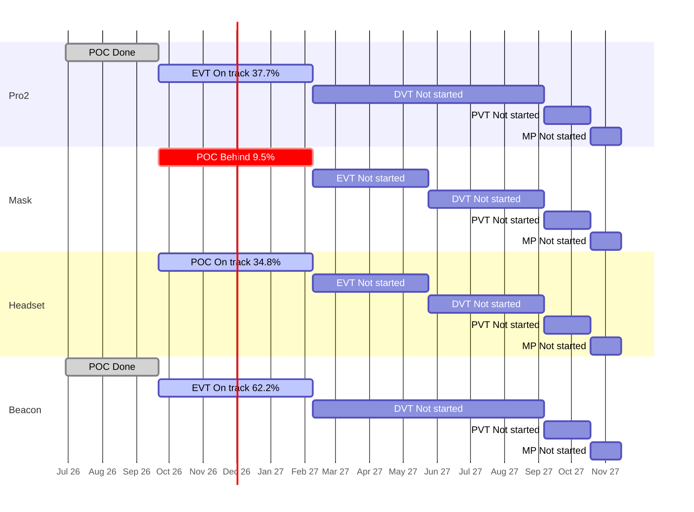

# Portfolio Roll-up — 2026-11-13

Are the four products on course for their stage gates and for the final deadline, the end of mass production (MP) on 2027-11-15? Each product moves through five stages: POC (proof of concept: show the idea can work), EVT (engineering test: does the design meet its specs?), DVT (design test: is the final design ready?), PVT (factory test: can the factory build it?) and MP (mass production). A "gate" is the review at the end of a stage.

**The plan** is the stage schedule in [[reference#Stage schedule (per product)]]. All slip is measured against those planned stage end dates. Jira numbers come from `tools/wiki_jira.py rollup`; risks from team chats and meetings come from each project's `sources` step; direction changes come from Jira comments and files attached to Jira tickets. Rules: [[portfolio/INDEX]]. Previous roll-up: [[portfolio/2026-11-12-rollup]] (one day earlier).

## 1. Headline

- Days to final deadline (2027-11-15): 367
- On track for MP: 3 of 4 (ZenaQuiet-Pro2, ZenaQuiet-Headset, ZenaQuiet-Beacon)
- Worst MP forecast slip: none
- Next gate: 2027-02-08 (87d): ZenaQuiet-Pro2 (EVT), ZenaQuiet-Mask (POC), ZenaQuiet-Headset (POC), ZenaQuiet-Beacon (EVT)

**Same picture as yesterday: three of four products are on track for the final deadline; Mask is not.** This run is one day after the 2026-11-12 roll-up, and Jira barely moved: no tickets were added or removed in any project, and no status changed. The only Jira edits were a renamed Beacon task, a re-titled and newly assigned Headset Story, and new photos on Pro2, Beacon and Mask tickets. The small shifts below come from the calendar: one more day of the stage has passed, so Expected rose from 37.1% to 37.9%.

- **Pro2** is now 0.2 points *below* Expected (37.7% against 37.9%), still On track; its forecast reaches the gate 2 days early (was 4).
- **Beacon** is well ahead (62.2%). **Headset** is On track (34.8%, forecast 7 days early), still mainly because of yesterday's deleted and closed Arc tickets (inferred).
- **Mask** is Behind (9.5%, 28.4 points below Expected).

**Changed since yesterday:**

- Beacon task [BC-141](https://epazz.atlassian.net/browse/BC-141) was re-used as "BEA v0b add speaker" and started (due 17 Nov). The 9 Nov stand-up had said to delete it, so where the masking speaker sits (built into the Beacon, or the separate housing BC-250) is still not decided in writing.
- Headset Story [HS-144](https://epazz.atlassian.net/browse/HS-144) became "Raw Audio Capture and improve beamforming" and went to Nguyen Binh Minh. A Headset comment says noise-cancelling calibration waits until Monday for a crystal to be soldered (HS-2), with no electronics ticket.
- The Research masking speaker forecast moved from 1 Dec to 2 Dec, now 2 working days after the Beacon room test (BC-233, due 30 Nov), because nothing has been ordered and the forecast counts from today.

**Due now:** 14 Pro2 tickets and the three Beacon board layouts are due today (13 Nov), several of them on hold until December parts arrive. They become overdue next week unless they are closed or re-dated.

**Still RED:** Pro2 only because of the uncorrected date on [PRO2-553](https://epazz.atlassian.net/browse/PRO2-553) (due 2028, probably 2027); Mask (behind plan); Research (the ceiling speaker for the Beacon masking test isn't ordered). **Decisions from the CTO visit week are still not in Jira** (chip choice, sound masking on the Beacon, Arc scope); the on-device vs app decision goes to the tech leads the week of 16 Nov.

## 2. Products

| Product | Stage | Gate (days) | Readiness raw / adjusted | Expected | Stage status | Pace forecast for gate | MP outlook | Slip vs schedule | Next stage planned | HIGH / MED | Health |
| --- | --- | --- | --- | --- | --- | --- | --- | --- | --- | --- | --- |
| ZenaQuiet-Pro2 | EVT | 2027-02-08 (87) | 39.3% / 37.7% | 37.9% | On track | 2027-02-06 (-2d) | On track, MP 2027-11-15 | 1 open items past stage end, max +365d | 0.0% | 1 / 41 | RED |
| ZenaQuiet-Mask | POC | 2027-02-08 (87) | 9.5% / 9.5% | 37.9% | Behind | 2028-03-31 (+417d), low confidence | Behind, forecast n/a | none past stage end | n/a | 0 / 30 | RED |
| ZenaQuiet-Headset | POC | 2027-02-08 (87) | 47.8% / 34.8% | 37.9% | On track | 2027-02-01 (-7d) | On track, MP 2027-11-15 | 1 open items past stage end, max +85d | 0.0% | 9 / 16 | AMBER |
| ZenaQuiet-Beacon | EVT | 2027-02-08 (87) | 62.2% / 62.2% | 37.9% | On track | 2026-12-15 (-55d) | On track, MP 2027-11-15 | none past stage end | 0.0% | 0 / 24 | AMBER |

> **What the numbers mean**
> - **Raw:** share of the current stage's Stories marked Done in Jira. Pro2 EVT: 24 of 61 Done = 39.3%.
> - **Adjusted:** Raw, minus Done Stories that don't count as real progress: ones that still have open Subtasks, or were closed before the stage began. Headset POC: 11 Done, but 3 still have open Subtasks, so 8 of 23 = 34.8%. Status and the timeline use this number.
> - **Expected:** share of the stage's planned time already used. All four current stages run 2026-09-21 → 2027-02-08 (140 days); 2026-11-13 is day 53, so 53 ÷ 140 = 37.9%.
> - Adjusted at or above Expected means ahead; 15–25 points below means At risk; more than 25 below, or a confident pace forecast past the gate, means Behind.
> - **Health** in the table is from Jira only. With chats and meetings: Research turns RED (section 6b).

- **Pro2** — 24 of 61 EVT Stories Done, On track (just). No Jira changes and no new comments since yesterday; one new photo on PRO2-556 (not downloaded yet). Last sprint (EVT-1 Sprint 9): 13 of 21 sprint tickets done, but only 4 EVT Stories closed against about 5.3 needed per sprint. 14 open tickets are due today, including test fixtures that comments put on hold until December (PRO2-451 to PRO2-454, PRO2-153 to PRO2-155). Report: [[ZenaQuiet-Pro2/jira/2026-11-13-jira]].
- **Beacon** — 23 of 37 EVT Stories Done, furthest ahead; AMBER. BC-141 now "add speaker" (see headline). The three main-board layouts (BC-220, BC-223, BC-226) are due today and still In Progress; the stand-up said 16 Nov. Masking boards and speaker still not ordered. Report: [[ZenaQuiet-Beacon/jira/2026-11-13-jira]].
- **Headset** — 8 of 23 POC Stories count; On track by the numbers. Board power fault (HS-652) and the crystal rework for noise-cancelling calibration (HS-2) still have no electronics ticket. The Arc re-scope proposal (HS-51) is still unanswered. 433 open items have no owner. Report: [[ZenaQuiet-Headset/jira/2026-11-13-jira]].
- **Mask** — 2 of 21 POC Stories Done; Behind. No ticket changes; new photos on the mock-up tickets MK-42 to MK-44 (fan testing, filters), which still say "Buy …", so whether the parts are bought is unclear. MK-8 has no update since its owner put it on hold until 11 Nov. Report: [[ZenaQuiet-Mask/jira/2026-11-13-jira]].
- **Research** (support) — no Jira changes at all. 16 open, 6 overdue, none linked to a product. Report: [[ZenaQuiet-Research/jira/2026-11-13-jira]].

## 3. Stage timeline

Bars are the planned stage windows. Labels show each stage's status and adjusted readiness.

## 4. Stage detail

### ZenaQuiet-Pro2

| Stage | Planned window | Stories done (adjusted) / total | Expected | Raw | Adjusted | Planned (owner + dated Subtasks) | Status | Slip vs plan |
| --- | --- | --- | --- | --- | --- | --- | --- | --- |
| POC | 2026-06-29 → 2026-09-21 | 18 (16) / 18 | 100.0% | 100.0% | 88.9% | 4/18 | Done | finished 2026-10-07, +16d late |
| EVT | 2026-09-21 → 2027-02-08 | 24 (23) / 61 | 37.9% | 39.3% | 37.7% | 26/61 | On track | forecast -2d |
| DVT | 2027-02-08 → 2027-09-06 | 0 (0) / 9 | 0.0% | 0.0% | 0.0% | 0/9 | Not started | — |
| PVT | 2027-09-06 → 2027-10-18 | 0 (0) / 0 | 0.0% | —% | —% | 0/0 | Not started | — |
| MP | 2027-10-18 → 2027-11-15 | 0 (0) / 0 | 0.0% | —% | —% | 0/0 | Not started | — |

Not counted in adjusted readiness: 1 Done with open Subtasks.

Pace in EVT: 3.04 adjusted Stories/week.
Open EVT Stories with no Subtasks (13): PRO2-423, PRO2-426, PRO2-429, PRO2-430, PRO2-434, PRO2-435, PRO2-436, PRO2-437, PRO2-483, PRO2-484 ….

### ZenaQuiet-Mask

| Stage | Planned window | Stories done (adjusted) / total | Expected | Raw | Adjusted | Planned (owner + dated Subtasks) | Status | Slip vs plan |
| --- | --- | --- | --- | --- | --- | --- | --- | --- |
| POC | 2026-09-21 → 2027-02-08 | 2 (2) / 21 | 37.9% | 9.5% | 9.5% | 1/21 | Behind | forecast +417d (low confidence) |
| EVT | 2027-02-08 → 2027-05-24 | 0 (0) / 0 | 0.0% | —% | —% | 0/0 | Not started | — |
| DVT | 2027-05-24 → 2027-09-06 | 0 (0) / 0 | 0.0% | —% | —% | 0/0 | Not started | — |
| PVT | 2027-09-06 → 2027-10-18 | 0 (0) / 0 | 0.0% | —% | —% | 0/0 | Not started | — |
| MP | 2027-10-18 → 2027-11-15 | 0 (0) / 0 | 0.0% | —% | —% | 0/0 | Not started | — |

Pace in POC: 0.26 adjusted Stories/week (low confidence: needs ≥5 closed and ≥28 days in stage).
Open POC Stories with no owner (15): MK-7, MK-9, MK-12, MK-13, MK-16, MK-17, MK-20, MK-22, MK-23, MK-25 ….
Open POC Stories with no Subtasks (17): MK-7, MK-8, MK-9, MK-11, MK-12, MK-13, MK-16, MK-17, MK-20, MK-22 ….

### ZenaQuiet-Headset

| Stage | Planned window | Stories done (adjusted) / total | Expected | Raw | Adjusted | Planned (owner + dated Subtasks) | Status | Slip vs plan |
| --- | --- | --- | --- | --- | --- | --- | --- | --- |
| POC | 2026-09-21 → 2027-02-08 | 11 (8) / 23 | 37.9% | 47.8% | 34.8% | 11/23 | On track | forecast -7d |
| EVT | 2027-02-08 → 2027-05-24 | 0 (0) / 40 | 0.0% | 0.0% | 0.0% | 0/40 | Not started | — |
| DVT | 2027-05-24 → 2027-09-06 | 0 (0) / 26 | 0.0% | 0.0% | 0.0% | 0/26 | Not started | — |
| PVT | 2027-09-06 → 2027-10-18 | 0 (0) / 8 | 0.0% | 0.0% | 0.0% | 0/8 | Not started | — |
| MP | 2027-10-18 → 2027-11-15 | 0 (0) / 0 | 0.0% | —% | —% | 0/0 | Not started | — |

Not counted in adjusted readiness: 3 Done with open Subtasks.

Pace in POC: 1.06 adjusted Stories/week.
Open POC Stories with no owner (7): HS-48, HS-117, HS-118, HS-161, HS-164, HS-452, HS-457.

### ZenaQuiet-Beacon

| Stage | Planned window | Stories done (adjusted) / total | Expected | Raw | Adjusted | Planned (owner + dated Subtasks) | Status | Slip vs plan |
| --- | --- | --- | --- | --- | --- | --- | --- | --- |
| POC | 2026-06-29 → 2026-09-21 | 21 (20) / 21 | 100.0% | 100.0% | 95.2% | 3/21 | Done | finished 2026-09-14, on time |
| EVT | 2026-09-21 → 2027-02-08 | 23 (23) / 37 | 37.9% | 62.2% | 62.2% | 15/37 | On track | forecast -55d |
| DVT | 2027-02-08 → 2027-09-06 | 0 (0) / 7 | 0.0% | 0.0% | 0.0% | 0/7 | Not started | — |
| PVT | 2027-09-06 → 2027-10-18 | 0 (0) / 0 | 0.0% | —% | —% | 0/0 | Not started | — |
| MP | 2027-10-18 → 2027-11-15 | 0 (0) / 0 | 0.0% | —% | —% | 0/0 | Not started | — |

Pace in EVT: 3.04 adjusted Stories/week.
Open EVT Stories with no Subtasks (3): BC-158, BC-163, BC-233.

## 5. Slip vs schedule and dates moved this week

### ZenaQuiet-Pro2
Open items due after their stage's planned end ([[reference#Stage schedule (per product)]]): 1.
- [PRO2-553](https://epazz.atlassian.net/browse/PRO2-553) (Story, EVT): due 2028-02-08, plan end 2027-02-08 (+365d)
Dates moved since 2026-11-12: 0 of 106 open items (0.0%); 0 now due later.

### ZenaQuiet-Mask
Open items due after their stage's planned end ([[reference#Stage schedule (per product)]]): none.
Dates moved since 2026-11-12: 0 of 37 open items (0.0%); 0 now due later.

### ZenaQuiet-Headset
Open items due after their stage's planned end ([[reference#Stage schedule (per product)]]): 1.
- [HS-1](https://epazz.atlassian.net/browse/HS-1) (Epic, Epic→MP): due 2028-02-08, plan end 2027-11-15 (+85d)
Dates moved since 2026-11-12: 0 of 471 open items (0.0%); 0 now due later.

### ZenaQuiet-Beacon
Open items due after their stage's planned end ([[reference#Stage schedule (per product)]]): none.
Dates moved since 2026-11-12: 1 of 64 open items (1.6%); 0 now due later.

No dates moved since yesterday except Beacon's BC-141 (re-dated to 17 Nov). PRO2-553 (+365 days) is still the likely typo; Headset's Epic HS-1 still ends after the final deadline.

## 6. Cross-product

### 6.1 Shared deadlines

| Product | Stage | Next gate | Days left | Stage status | MP outlook |
| --- | --- | --- | --- | --- | --- |
| Pro2 | EVT | 2027-02-08 | 87 | On track | On track |
| Mask | POC | 2027-02-08 | 87 | Behind (+417d forecast) | Behind |
| Headset | POC | 2027-02-08 | 87 | On track | On track |
| Beacon | EVT | 2027-02-08 | 87 | On track | On track |

All four products face their next gate on 2027-02-08, 87 days away. Mask is forecast to miss it by a wide margin; the others are on track, Pro2 and Headset only narrowly.

### 6.2 Who carries the work

| Person | Pro2 | Mask | Headset | Beacon | Research | Total | Overdue | Due ≤14d |
| --- | --- | --- | --- | --- | --- | --- | --- | --- |
| Nguyen Trung Tin ⚠ | 4 | – | 4 | 43 | – | 51 | 0 | 10 |
| Duy Nguyen ⚠ | 39 | 2 | – | – | – | 41 | 0 | 14 |
| Hung Pham Nguyen | 25 | – | 2 | – | – | 27 | 0 | 12 |
| Nguyen Minh Thien ⚠ | 15 | 1 | – | 9 | – | 25 | 0 | 7 |
| Phi Tuong | 5 | – | 11 | – | – | 16 | 0 | 2 |
| Huỳnh Thái Hòa ⚠ | 1 | 1 | – | 2 | 10 | 14 | 5 | 1 |
| Chico Ly ⚠ | 5 | 1 | 4 | 3 | – | 13 | 0 | 4 |
| Elly Nhi Nguyen | – | 10 | – | – | – | 10 | 0 | 0 |
| Nguyen Manh Tuan | – | – | 10 | – | – | 10 | 0 | 0 |
| Phong.ngoc.nguyen ⚠ | – | 1 | 2 | 6 | – | 9 | 0 | 3 |
| Nguyen Binh Minh ⚠ | 1 | – | 3 | – | 5 | 9 | 1 | 0 |
| KhuongNguyen ⚠ | 4 | 1 | 1 | – | 1 | 7 | 0 | 0 |
| Cang Le | 3 | – | – | – | – | 3 | 0 | 0 |
| Bui Minh Tuan (Steve .Bui) | – | – | 1 | – | – | 1 | 0 | 0 |
| Huynh Minh Tuan | – | – | – | 1 | – | 1 | 0 | 0 |

⚠ = works on 3 or more projects, or holds more than 40 open tickets. Open tickets only (not Done); counts are tickets assigned. Ticket lists per person, and who created the open tickets: Appendix.

Same people, same open counts as yesterday; only the "Due ≤14d" column grew as the two-week window moved. Nguyen Trung Tin carries the most open work (51 tickets, 43 Beacon; 10 now due within two weeks). Duy Nguyen (Pro2 and Mask mechanical) has 14 due within two weeks, Hung Pham Nguyen 12. Huỳnh Thái Hòa still has the most overdue (5, Research office acoustics). Nguyen Binh Minh picked up Headset HS-144.

### 6.3 Work with no owner

| Project | Epic | Story/Task | Subtask | Total |
| --- | --- | --- | --- | --- |
| Pro2 | 2 | 2 | 0 | 4 |
| Mask | 5 | 15 | 0 | 20 |
| Headset | 2 | 64 | 367 | 433 |

Ticket lists: Appendix D of each project report.

Unowned work is still almost all Headset (433 tickets; HS-144 got an owner).

### 6.4 Research items products wait on

Research (snapshot 2026-11-13): 16 open, 0 linked to a product ticket, 16 not linked.

| Key | What | Due | Status | Waiting product |
| --- | --- | --- | --- | --- |
| [RS-4](https://epazz.atlassian.net/browse/RS-4) | Survey about good components for ultrasonic loudspeaker and best layou | 2026-10-23 | overdue 21d | not linked |
| [RS-25](https://epazz.atlassian.net/browse/RS-25) | [POC] Block: Research desk-height screens and partitions to block spee | 2026-10-26 | overdue 18d | not linked |
| [RS-22](https://epazz.atlassian.net/browse/RS-22) | [POC] ANC in the personal headset | 2026-11-02 | overdue 11d | not linked |
| [RS-23](https://epazz.atlassian.net/browse/RS-23) | [POC] Block: Research office layout and seating plan to reduce noise | 2026-11-02 | overdue 11d | not linked |
| [RS-24](https://epazz.atlassian.net/browse/RS-24) | [POC] Measure baseline floor acoustics before treatment | 2026-11-02 | overdue 11d | not linked |
| [RS-1](https://epazz.atlassian.net/browse/RS-1) | Chip eval + decision | 2026-11-06 | overdue 7d | not linked |
| [RS-21](https://epazz.atlassian.net/browse/RS-21) | [POC] Absorb: Research sound-absorbing materials (ceiling tiles, wall  | 2026-11-16 | due in 3d | not linked |

No open Research item links to a product ticket any more (RS-16 and RS-2 are closed), so the follow-up masking speaker test and the chip decision RS-1 aren't tied to the product tickets that wait on them.

## 6b. Risks from team threads

One row per risk, highest impact first; rows describing the same risk in several products are merged. No new source files since yesterday; every cited line was re-checked by the project helpers.

| # | Product | What's at risk | Root cause | What would fix it | Level |
| --- | --- | --- | --- | --- | --- |
| 1 | Research, Beacon | Beacon sound-masking room test ([BC-233](https://epazz.atlassian.net/browse/BC-233), due 30 Nov) slips: the ceiling speaker arrives around 2 Dec at the earliest (1 Dec yesterday), 2 working days late. | Not requested: speaker not ordered at the 9 Nov stand-up, "at least two weeks" to arrive | Order this week; add a Research Story linked to BC-233 and BC-234 | High |
| 2 | Beacon | Room-noise sensing on Beacon hardware (BC-233) starts 42–47 working days late by the default lead times (board around 16–23 Dec); the team expects end of November. | Supplier lead time: masking board 2–3 weeks after the design goes to the vendor; not yet ordered | Confirm the order and a vendor date, then re-date BC-233 | Medium |
| 3 | Mask | Mask voice-dampening tests (MK-11, MK-47) wait on material samples that aren't requested; custom films are estimated at 8–13 weeks. | Not requested: no supplier contacted | Run the leak test on the mock-up first, then send requests for quotation to the local shortlist | Medium |
| 4 | Mask | First mask board ([MK-22](https://epazz.atlassian.net/browse/MK-22)) still has no order or delivery date in Jira (default arrival ~19 Nov); the mock-up MK-43 needs one now (inferred). | Other: ordered outside Jira | Create the board Subtask under MK-22 with dates | Medium |
| 5 | Pro2 | Ultrasonic fixture ([PRO2-453](https://epazz.atlassian.net/browse/PRO2-453)) and the PRO2-150 reflection test start about 13 working days late. | Supplier lead time: transducers ordered around 2 Nov (inferred), no order date recorded | Record order and delivery in PRO2-453; re-date the fixtures | Medium |
| 6 | Pro2, Headset, Mask (Research) | AI chip: "chosen already" and a new board "ordered last week" (stand-up), but no ticket names it; Pro2 redesigns its board for the change while Headset confirmed the i.MX 95; Mask's processor still open. | Open decision not written down | Record the chip, who decided and when in RS-1; update PRO2-461, HS-164, MK-22 | Medium |
| 7 | Pro2, Beacon, Headset | Where Voice Lock enrollment and the AI models run (on the device or in a mobile/web app), and whether one app serves all products ([PRO2-528](https://epazz.atlassian.net/browse/PRO2-528), [HS-178](https://epazz.atlassian.net/browse/HS-178), BC-164). | Open decision: firmware says the i.MX 95 is near its limit; proposal due at the tech-lead meeting week of 16 Nov | Decide at that meeting and record it as a dated Story in each product | Medium |
| 8 | Pro2, Beacon (Research) | Sound masking moved to the Beacon only by word of mouth; built-in speaker (BC-153, and since 12 Nov BC-141 "add speaker") vs separate housing (BC-250) and the level are not recorded. | Open decision recorded verbally | Write the decision into BC-234 with Stories; remove the Pro2 baffle work that no longer applies | Medium |
| 9 | Headset | Headset board power fix (HS-652), the crystal rework that noise-cancelling calibration waits for (HS-2, comment 12 Nov) and the electronics size inputs (HS-130, HS-131, HS-336, HS-337) have no ticket or owner. | Not requested: EE tickets promised on 19 Oct still don't exist | Open an EE Subtask under HS-648 and assign the inputs | Medium |
| 10 | Headset | Arc scope ([HS-51](https://epazz.atlassian.net/browse/HS-51)): reduced 2-mic test proposed 10 Nov, unanswered. | Open decision | Cang Le answers this week; remove out-of-scope Stories | Medium |
| 11 | Pro2, Beacon, Headset, Mask | Mechanical work across products (Pro2 Rev B fixes, Beacon 43 tickets, Headset HS-6, Mask MK-8 on hold). | Capacity: two mechanical engineers, no agreed split | Agree days per product in writing; let ID trim the Beacon mechanical list as agreed on 9 Nov | Medium |
| 12 | Pro2 | Desk V3 (PRO2-437) and EVT-2 V5b (PRO2-556) wait on the version decision; EVT-1 must finish first. | Open decision | Close or re-date PRO2-437 | Medium |
| 13 | Beacon | Beacon scope after EVT, and whether Beacon software also serves the Headset. | Open decision | Record both in Jira | Medium |
| 14 | Mask | 15 unowned mask engineering Stories wait on Industrial Design's component list and a spec. | Other: no spec date | Date the component list and spec; name EE and firmware owners | Medium |

Closed earlier this week (2026-11-12): Headset PCBs delivered; Pro2 hinges and copper plates delivered. Nothing closed since.

*Not placed yet:* `threads/2026-10-19-purchase.md · REQUEST 1` (GPU rental for TSE training, approved, no product named); the Mask Epic MK-48 "Layer 3 — Inbound TSE" looks like Headset work; "When is the chip coming again? … two weeks from now" (stand-up 2026-11-09 [47:35]) names no product (questions below).

## 6c. Direction changes from engineering discussion

One row per change and affected product, High first. Rules: [[portfolio/INDEX]] Section 4b. Rows 1–10 are carried over from 2026-11-12 (their "New" marks refer to that run). Rows 11–12 are new since 2026-11-12.

| # | Change (status) | Product (how matched) | Cost | Time | Technical | Teams | Who decides | Level | Source |
| --- | --- | --- | --- | --- | --- | --- | --- | --- | --- |
| 1 | **New:** Sound masking moved from the Pro to the Beacon (decided, verbally) | Pro2 (named: PRO2-156 closed, PRO2-150 kept for reflection tests); Beacon (named: BC-234) | — | Pro2 baffle work drops; Beacon masking board and speaker must be ordered | built-in vs separate ceiling speaker still open | AC, ME, EE | CTO (as reported by Cang Le) | High | PRO2-156 comment 2026-11-09; stand-up 2026-11-09 [1:03:26] |
| 2 | **New:** AI chip changed; new board ordered; Pro2 board redesign (decided, chip not named) | Pro2 (named: PRO2-458/459/460, PRO2-501 to PRO2-512) | not stated | redesign tasks due 27 Nov; PRO2-397 waits for the chip | i.MX 95 "at its limit" (firmware) | EE, FW | CTO | High | stand-up 2026-11-09 [32:02], [1:08:30], [1:11:57] |
| 3 | **New:** Headset POC board runs Linux on the i.MX 95 module (decided) | Headset (named: HS-649, HS-165 Done) | — | — | conflicts with row 2 if the chip change applies to the Headset too | FW, EE | — | High | HS-649 comment 2026-11-11 |
| 4 | **New:** Pro2 Revision A build review: 26 issues, 5 severe; Revision B on the HG-TE03 hinge and PC/ABS plastic parts (decided / under test) | Pro2 (named: PRO2-424, PRO2-416, PRO2-553) | per-part costs in the attached EBOM | Revision B redesign | issues in attached review files, not in Jira tickets | ME, ID | — | High | PRO2-424, PRO2-416 attachments and comments 2026-11-09 to 11-12 |
| 5 | **New:** Headset noise cancelling: adaptive FxLMS not possible on the current audio chip; offline (calibrated) noise cancelling instead (proposed) | Headset (named: HS-221, HS-2) | — | — | HS-2 plan still says adaptive | FW, AC | — | Medium | HS-221 comment 2026-11-09 |
| 6 | **New:** Arc: stop the passive approach, test only the 2 Arc microphones (proposed) | Headset (named: HS-51) | — | — | HS-79 test missed the passive target | ME, AC | Cang Le | Medium | HS-51 comments 2026-11-09/10 |
| 7 | **New:** Mask voice dampening as a 7-layer stack, sealing the top priority (proposed) | Mask (named: MK-11) | not stated | custom films 8–13 weeks (estimate) | MK-11 criteria ask for 3 layers | ME, AC | — | Medium | MK-11 comment and attachment 2026-11-10 |
| 8 | **New:** Pro2 test fixtures on hold until December, when PCBs arrive (decided) | Pro2 (named: PRO2-433) | — | PRO2-451 to PRO2-454 still dated 13–30 Nov | — | ME | — | Medium | PRO2-433 comment 2026-11-12 |
| 9 | RK3576 proposal and kit request (proposed; possibly superseded by row 2) | Pro2, Headset, Mask (inferred) | not stated | — | Chinese chip vs sourcing rule | EE, FW | CTO | Medium | RS-2, 2026-10-23 |
| 10 | Beacon plastic housing and all-plastic mounts (proposed) | Beacon (named: BC-236, BC-237) | — | — | BC-157 still says anodized aluminium | ME, ID | ID / project owner | Medium | BC-236/237, 2026-11-06 |
| 11 | **New:** Beacon task BC-141 re-used as "BEA v0b add speaker" and started (proposed; stand-up said delete it) | Beacon (named: BC-141 under BC-153) | — | due 17 Nov | built-in speaker vs separate housing BC-250 (Done); board connection open for EE | ID, EE | CTO / project owner | Medium | BC-141 description 2026-11-12; stand-up 2026-11-09 [7:48], [9:42] |
| 12 | **New:** Headset noise-cancelling calibration paused until a crystal is soldered (decided) | Headset (named: HS-2) | — | "pending till Monday" | no EE ticket; HS-2 Epic still To Do | EE, FW | — | Medium | HS-2 comment 2026-11-12 |

**Conflicts (flagged, not resolved):**

- Chip: "changed" (Pro2 stand-up) vs "i.MX 95 confirmed" (Headset HS-165, HS-649) vs RK3576 proposal (RS-2) vs MK-13 "no AI chip on the mask"; RS-1 names nothing.
- Sourcing: [[reference#Sourcing rules]] "No components from China (CTO)" vs the CTO on 2026-10-15 and the RS-2 comment.
- Sound masking: decided verbally for the Beacon; Pro2 kept PRO2-150; Beacon keeps both a built-in speaker (BC-153) and a separate housing (BC-250).
- Beacon board layouts: Jira says 13 Nov (today, still In Progress), the stand-up said 16 Nov.
- Beacon BC-141: the stand-up said delete it; Jira re-used it for the speaker variant on 12 Nov.
- Mask MK-42 to MK-44 still say "Buy …" although photos of those parts were added on 12 Nov.
- Headset: HS-1 now ends after the final deadline (2028-02-08).

## 7. Recommendations

1. **Re-date or close today's due tickets before Monday.** 14 Pro2 tickets (fixtures on hold until December) and the three Beacon layouts (stand-up said 16 Nov) turn overdue otherwise. Owners: Duy Nguyen, Hung Pham Nguyen, Beacon EE.
2. **Write last week's decisions into Jira.** Chip choice (RS-1, PRO2-461, HS-164, MK-22), sound masking on the Beacon and where its speaker sits (BC-234, BC-141, BC-250), Arc scope (HS-51). Owner: Cang Le.
3. **Order the Beacon masking speaker and boards** and record the vendor dates; every day without an order pushes the room test (BC-233, 30 Nov) further. Owners: Nguyen Manh Tuan, Hoa Huynh, Purchasing.
4. **Prepare the on-device vs app decision for the 16 Nov tech-lead meeting**, covering Pro2, Headset and Beacon. Owners: Nguyen Minh Thien, Minh Nguyen, Cang Le.
5. **Give the Headset board fixes an owner:** one EE Subtask under HS-648 for the power fault (HS-652) and the crystal rework (HS-2). Owner: Headset lead.

## 8. Data Gaps & Assumptions

- Snapshots used: `data/<project>/2026-11-13.json` for all four products and Research. Rollup printed no `FLAG:` lines. Comparison is with the 2026-11-12 snapshots (one day earlier), so "this week" changes are small.
- Plan: [[reference#Stage schedule (per product)]]. MP forecast assumes later stages keep their planned length.
- Low confidence: Mask's pace forecast. Headset's readiness rose on 2026-11-12 mainly from deleted tickets and closed "[TO BE REMOVED]" Stories (inferred).
- Health in section 2 is Jira only; with chats and meetings: Pro2 RED (PRO2-553 date), Beacon AMBER, Headset AMBER, Mask RED, Research RED (masking speaker).
- Sources: no new files in `raw/threads/` or `raw/transcripts/`; items were carried over from 2026-11-12 with cited lines re-checked.
- Attachments: the manifest is from 2026-11-12 (1 day old, fresh). Files uploaded after it (Pro2 PRO2-556, Beacon BC-141, Mask MK-42 to MK-44 photos) are not downloaded and weren't read; the earlier findings were reused.
- Sprint reviews: same sprints as yesterday. Beacon and Mask put few tickets in sprints, so their sprint numbers say little.

---

## Appendix. Tickets by person (written by the script; do not edit)

Open tickets only (not Done), assigned and reported, one table per person across all projects. The last column lists the assigned tickets that are past their due date, with the date and how many days late. Unassigned tickets are listed in Appendix D of each project report.

#### Nguyen Trung Tin — 51 open assigned

| Product | Role | Type | Tickets | Overdue (due date, days late) |
| --- | --- | --- | --- | --- |
| Pro2 | Assigned | Story/Task | [PRO2-241](https://epazz.atlassian.net/browse/PRO2-241), [PRO2-433](https://epazz.atlassian.net/browse/PRO2-433), [PRO2-434](https://epazz.atlassian.net/browse/PRO2-434) | — |
| Pro2 | Assigned | Subtask | [PRO2-303](https://epazz.atlassian.net/browse/PRO2-303) | — |
| Headset | Assigned | Epic | [HS-6](https://epazz.atlassian.net/browse/HS-6), [HS-51](https://epazz.atlassian.net/browse/HS-51) | — |
| Headset | Assigned | Story/Task | [HS-13](https://epazz.atlassian.net/browse/HS-13) | — |
| Headset | Assigned | Subtask | [HS-67](https://epazz.atlassian.net/browse/HS-67) | — |
| Headset | Reported | Epic | [HS-6](https://epazz.atlassian.net/browse/HS-6) | — |
| Headset | Reported | Story/Task | [HS-13](https://epazz.atlassian.net/browse/HS-13), [HS-48](https://epazz.atlassian.net/browse/HS-48), [HS-50](https://epazz.atlassian.net/browse/HS-50), [HS-52](https://epazz.atlassian.net/browse/HS-52), [HS-53](https://epazz.atlassian.net/browse/HS-53), [HS-54](https://epazz.atlassian.net/browse/HS-54), [HS-55](https://epazz.atlassian.net/browse/HS-55), [HS-56](https://epazz.atlassian.net/browse/HS-56), [HS-87](https://epazz.atlassian.net/browse/HS-87), [HS-88](https://epazz.atlassian.net/browse/HS-88), [HS-90](https://epazz.atlassian.net/browse/HS-90), [HS-91](https://epazz.atlassian.net/browse/HS-91), [HS-92](https://epazz.atlassian.net/browse/HS-92), [HS-120](https://epazz.atlassian.net/browse/HS-120), [HS-121](https://epazz.atlassian.net/browse/HS-121), [HS-128](https://epazz.atlassian.net/browse/HS-128), [HS-144](https://epazz.atlassian.net/browse/HS-144), [HS-146](https://epazz.atlassian.net/browse/HS-146), [HS-147](https://epazz.atlassian.net/browse/HS-147), [HS-149](https://epazz.atlassian.net/browse/HS-149), [HS-150](https://epazz.atlassian.net/browse/HS-150), [HS-151](https://epazz.atlassian.net/browse/HS-151), [HS-161](https://epazz.atlassian.net/browse/HS-161), [HS-185](https://epazz.atlassian.net/browse/HS-185), [HS-191](https://epazz.atlassian.net/browse/HS-191), [HS-197](https://epazz.atlassian.net/browse/HS-197), [HS-203](https://epazz.atlassian.net/browse/HS-203), [HS-209](https://epazz.atlassian.net/browse/HS-209), [HS-235](https://epazz.atlassian.net/browse/HS-235), [HS-241](https://epazz.atlassian.net/browse/HS-241), [HS-268](https://epazz.atlassian.net/browse/HS-268), [HS-274](https://epazz.atlassian.net/browse/HS-274), [HS-338](https://epazz.atlassian.net/browse/HS-338), [HS-343](https://epazz.atlassian.net/browse/HS-343), [HS-346](https://epazz.atlassian.net/browse/HS-346), [HS-350](https://epazz.atlassian.net/browse/HS-350), [HS-354](https://epazz.atlassian.net/browse/HS-354), [HS-358](https://epazz.atlassian.net/browse/HS-358), [HS-363](https://epazz.atlassian.net/browse/HS-363), [HS-367](https://epazz.atlassian.net/browse/HS-367), [HS-372](https://epazz.atlassian.net/browse/HS-372), [HS-376](https://epazz.atlassian.net/browse/HS-376), [HS-593](https://epazz.atlassian.net/browse/HS-593), [HS-599](https://epazz.atlassian.net/browse/HS-599), [HS-609](https://epazz.atlassian.net/browse/HS-609), [HS-617](https://epazz.atlassian.net/browse/HS-617), [HS-624](https://epazz.atlassian.net/browse/HS-624), [HS-630](https://epazz.atlassian.net/browse/HS-630) | — |
| Beacon | Assigned | Epic | [BC-50](https://epazz.atlassian.net/browse/BC-50) | — |
| Beacon | Assigned | Story/Task | [BC-155](https://epazz.atlassian.net/browse/BC-155), [BC-156](https://epazz.atlassian.net/browse/BC-156), [BC-157](https://epazz.atlassian.net/browse/BC-157), [BC-158](https://epazz.atlassian.net/browse/BC-158), [BC-159](https://epazz.atlassian.net/browse/BC-159), [BC-160](https://epazz.atlassian.net/browse/BC-160), [BC-161](https://epazz.atlassian.net/browse/BC-161), [BC-162](https://epazz.atlassian.net/browse/BC-162), [BC-163](https://epazz.atlassian.net/browse/BC-163) | — |
| Beacon | Assigned | Subtask | [BC-167](https://epazz.atlassian.net/browse/BC-167), [BC-168](https://epazz.atlassian.net/browse/BC-168), [BC-169](https://epazz.atlassian.net/browse/BC-169), [BC-170](https://epazz.atlassian.net/browse/BC-170), [BC-172](https://epazz.atlassian.net/browse/BC-172), [BC-173](https://epazz.atlassian.net/browse/BC-173), [BC-174](https://epazz.atlassian.net/browse/BC-174), [BC-175](https://epazz.atlassian.net/browse/BC-175), [BC-176](https://epazz.atlassian.net/browse/BC-176), [BC-177](https://epazz.atlassian.net/browse/BC-177), [BC-181](https://epazz.atlassian.net/browse/BC-181), [BC-182](https://epazz.atlassian.net/browse/BC-182), [BC-183](https://epazz.atlassian.net/browse/BC-183), [BC-184](https://epazz.atlassian.net/browse/BC-184), [BC-239](https://epazz.atlassian.net/browse/BC-239), [BC-240](https://epazz.atlassian.net/browse/BC-240), [BC-241](https://epazz.atlassian.net/browse/BC-241), [BC-242](https://epazz.atlassian.net/browse/BC-242), [BC-243](https://epazz.atlassian.net/browse/BC-243), [BC-244](https://epazz.atlassian.net/browse/BC-244), [BC-245](https://epazz.atlassian.net/browse/BC-245), [BC-246](https://epazz.atlassian.net/browse/BC-246), [BC-247](https://epazz.atlassian.net/browse/BC-247), [BC-248](https://epazz.atlassian.net/browse/BC-248), [BC-262](https://epazz.atlassian.net/browse/BC-262), [BC-263](https://epazz.atlassian.net/browse/BC-263), [BC-265](https://epazz.atlassian.net/browse/BC-265), [BC-266](https://epazz.atlassian.net/browse/BC-266), [BC-267](https://epazz.atlassian.net/browse/BC-267), [BC-268](https://epazz.atlassian.net/browse/BC-268), [BC-269](https://epazz.atlassian.net/browse/BC-269), [BC-270](https://epazz.atlassian.net/browse/BC-270), [BC-271](https://epazz.atlassian.net/browse/BC-271) | — |
| Beacon | Reported | Subtask | [BC-167](https://epazz.atlassian.net/browse/BC-167), [BC-168](https://epazz.atlassian.net/browse/BC-168), [BC-169](https://epazz.atlassian.net/browse/BC-169), [BC-170](https://epazz.atlassian.net/browse/BC-170), [BC-172](https://epazz.atlassian.net/browse/BC-172), [BC-173](https://epazz.atlassian.net/browse/BC-173), [BC-174](https://epazz.atlassian.net/browse/BC-174), [BC-175](https://epazz.atlassian.net/browse/BC-175), [BC-176](https://epazz.atlassian.net/browse/BC-176), [BC-177](https://epazz.atlassian.net/browse/BC-177), [BC-181](https://epazz.atlassian.net/browse/BC-181), [BC-182](https://epazz.atlassian.net/browse/BC-182), [BC-183](https://epazz.atlassian.net/browse/BC-183), [BC-184](https://epazz.atlassian.net/browse/BC-184), [BC-239](https://epazz.atlassian.net/browse/BC-239), [BC-240](https://epazz.atlassian.net/browse/BC-240), [BC-241](https://epazz.atlassian.net/browse/BC-241), [BC-242](https://epazz.atlassian.net/browse/BC-242), [BC-243](https://epazz.atlassian.net/browse/BC-243), [BC-244](https://epazz.atlassian.net/browse/BC-244), [BC-245](https://epazz.atlassian.net/browse/BC-245), [BC-246](https://epazz.atlassian.net/browse/BC-246), [BC-247](https://epazz.atlassian.net/browse/BC-247), [BC-248](https://epazz.atlassian.net/browse/BC-248), [BC-262](https://epazz.atlassian.net/browse/BC-262), [BC-263](https://epazz.atlassian.net/browse/BC-263), [BC-265](https://epazz.atlassian.net/browse/BC-265), [BC-266](https://epazz.atlassian.net/browse/BC-266), [BC-267](https://epazz.atlassian.net/browse/BC-267), [BC-268](https://epazz.atlassian.net/browse/BC-268), [BC-269](https://epazz.atlassian.net/browse/BC-269), [BC-270](https://epazz.atlassian.net/browse/BC-270), [BC-271](https://epazz.atlassian.net/browse/BC-271) | — |

#### Duy Nguyen — 41 open assigned

| Product | Role | Type | Tickets | Overdue (due date, days late) |
| --- | --- | --- | --- | --- |
| Pro2 | Assigned | Epic | [PRO2-8](https://epazz.atlassian.net/browse/PRO2-8) | — |
| Pro2 | Assigned | Story/Task | [PRO2-22](https://epazz.atlassian.net/browse/PRO2-22), [PRO2-150](https://epazz.atlassian.net/browse/PRO2-150), [PRO2-191](https://epazz.atlassian.net/browse/PRO2-191), [PRO2-193](https://epazz.atlassian.net/browse/PRO2-193), [PRO2-195](https://epazz.atlassian.net/browse/PRO2-195), [PRO2-196](https://epazz.atlassian.net/browse/PRO2-196), [PRO2-197](https://epazz.atlassian.net/browse/PRO2-197), [PRO2-198](https://epazz.atlassian.net/browse/PRO2-198), [PRO2-300](https://epazz.atlassian.net/browse/PRO2-300), [PRO2-416](https://epazz.atlassian.net/browse/PRO2-416), [PRO2-422](https://epazz.atlassian.net/browse/PRO2-422), [PRO2-423](https://epazz.atlassian.net/browse/PRO2-423), [PRO2-424](https://epazz.atlassian.net/browse/PRO2-424), [PRO2-425](https://epazz.atlassian.net/browse/PRO2-425), [PRO2-430](https://epazz.atlassian.net/browse/PRO2-430), [PRO2-437](https://epazz.atlassian.net/browse/PRO2-437), [PRO2-553](https://epazz.atlassian.net/browse/PRO2-553) | — |
| Pro2 | Assigned | Subtask | [PRO2-15](https://epazz.atlassian.net/browse/PRO2-15), [PRO2-16](https://epazz.atlassian.net/browse/PRO2-16), [PRO2-26](https://epazz.atlassian.net/browse/PRO2-26), [PRO2-27](https://epazz.atlassian.net/browse/PRO2-27), [PRO2-28](https://epazz.atlassian.net/browse/PRO2-28), [PRO2-153](https://epazz.atlassian.net/browse/PRO2-153), [PRO2-154](https://epazz.atlassian.net/browse/PRO2-154), [PRO2-155](https://epazz.atlassian.net/browse/PRO2-155), [PRO2-333](https://epazz.atlassian.net/browse/PRO2-333), [PRO2-451](https://epazz.atlassian.net/browse/PRO2-451), [PRO2-452](https://epazz.atlassian.net/browse/PRO2-452), [PRO2-453](https://epazz.atlassian.net/browse/PRO2-453), [PRO2-454](https://epazz.atlassian.net/browse/PRO2-454), [PRO2-541](https://epazz.atlassian.net/browse/PRO2-541), [PRO2-543](https://epazz.atlassian.net/browse/PRO2-543), [PRO2-544](https://epazz.atlassian.net/browse/PRO2-544), [PRO2-545](https://epazz.atlassian.net/browse/PRO2-545), [PRO2-546](https://epazz.atlassian.net/browse/PRO2-546), [PRO2-560](https://epazz.atlassian.net/browse/PRO2-560), [PRO2-566](https://epazz.atlassian.net/browse/PRO2-566), [PRO2-567](https://epazz.atlassian.net/browse/PRO2-567) | — |
| Pro2 | Reported | Story/Task | [PRO2-150](https://epazz.atlassian.net/browse/PRO2-150), [PRO2-191](https://epazz.atlassian.net/browse/PRO2-191), [PRO2-193](https://epazz.atlassian.net/browse/PRO2-193), [PRO2-195](https://epazz.atlassian.net/browse/PRO2-195), [PRO2-196](https://epazz.atlassian.net/browse/PRO2-196), [PRO2-197](https://epazz.atlassian.net/browse/PRO2-197), [PRO2-198](https://epazz.atlassian.net/browse/PRO2-198), [PRO2-199](https://epazz.atlassian.net/browse/PRO2-199), [PRO2-200](https://epazz.atlassian.net/browse/PRO2-200), [PRO2-241](https://epazz.atlassian.net/browse/PRO2-241), [PRO2-416](https://epazz.atlassian.net/browse/PRO2-416) | — |
| Pro2 | Reported | Subtask | [PRO2-15](https://epazz.atlassian.net/browse/PRO2-15), [PRO2-16](https://epazz.atlassian.net/browse/PRO2-16), [PRO2-26](https://epazz.atlassian.net/browse/PRO2-26), [PRO2-27](https://epazz.atlassian.net/browse/PRO2-27), [PRO2-28](https://epazz.atlassian.net/browse/PRO2-28), [PRO2-153](https://epazz.atlassian.net/browse/PRO2-153), [PRO2-154](https://epazz.atlassian.net/browse/PRO2-154), [PRO2-155](https://epazz.atlassian.net/browse/PRO2-155), [PRO2-303](https://epazz.atlassian.net/browse/PRO2-303), [PRO2-318](https://epazz.atlassian.net/browse/PRO2-318), [PRO2-333](https://epazz.atlassian.net/browse/PRO2-333), [PRO2-451](https://epazz.atlassian.net/browse/PRO2-451), [PRO2-452](https://epazz.atlassian.net/browse/PRO2-452), [PRO2-453](https://epazz.atlassian.net/browse/PRO2-453), [PRO2-454](https://epazz.atlassian.net/browse/PRO2-454), [PRO2-541](https://epazz.atlassian.net/browse/PRO2-541), [PRO2-543](https://epazz.atlassian.net/browse/PRO2-543), [PRO2-544](https://epazz.atlassian.net/browse/PRO2-544), [PRO2-545](https://epazz.atlassian.net/browse/PRO2-545), [PRO2-546](https://epazz.atlassian.net/browse/PRO2-546), [PRO2-560](https://epazz.atlassian.net/browse/PRO2-560), [PRO2-566](https://epazz.atlassian.net/browse/PRO2-566), [PRO2-567](https://epazz.atlassian.net/browse/PRO2-567) | — |
| Mask | Assigned | Story/Task | [MK-8](https://epazz.atlassian.net/browse/MK-8), [MK-11](https://epazz.atlassian.net/browse/MK-11) | — |
| Mask | Reported | Epic | [MK-6](https://epazz.atlassian.net/browse/MK-6), [MK-10](https://epazz.atlassian.net/browse/MK-10), [MK-14](https://epazz.atlassian.net/browse/MK-14), [MK-19](https://epazz.atlassian.net/browse/MK-19), [MK-21](https://epazz.atlassian.net/browse/MK-21), [MK-24](https://epazz.atlassian.net/browse/MK-24), [MK-29](https://epazz.atlassian.net/browse/MK-29) | — |
| Mask | Reported | Story/Task | [MK-7](https://epazz.atlassian.net/browse/MK-7), [MK-8](https://epazz.atlassian.net/browse/MK-8), [MK-9](https://epazz.atlassian.net/browse/MK-9), [MK-11](https://epazz.atlassian.net/browse/MK-11), [MK-12](https://epazz.atlassian.net/browse/MK-12), [MK-13](https://epazz.atlassian.net/browse/MK-13), [MK-16](https://epazz.atlassian.net/browse/MK-16), [MK-17](https://epazz.atlassian.net/browse/MK-17), [MK-20](https://epazz.atlassian.net/browse/MK-20), [MK-22](https://epazz.atlassian.net/browse/MK-22), [MK-23](https://epazz.atlassian.net/browse/MK-23), [MK-25](https://epazz.atlassian.net/browse/MK-25), [MK-26](https://epazz.atlassian.net/browse/MK-26), [MK-27](https://epazz.atlassian.net/browse/MK-27), [MK-28](https://epazz.atlassian.net/browse/MK-28), [MK-30](https://epazz.atlassian.net/browse/MK-30), [MK-31](https://epazz.atlassian.net/browse/MK-31) | — |
| Headset | Reported | Subtask | [HS-60](https://epazz.atlassian.net/browse/HS-60), [HS-61](https://epazz.atlassian.net/browse/HS-61), [HS-62](https://epazz.atlassian.net/browse/HS-62), [HS-67](https://epazz.atlassian.net/browse/HS-67), [HS-68](https://epazz.atlassian.net/browse/HS-68), [HS-69](https://epazz.atlassian.net/browse/HS-69), [HS-70](https://epazz.atlassian.net/browse/HS-70), [HS-72](https://epazz.atlassian.net/browse/HS-72), [HS-73](https://epazz.atlassian.net/browse/HS-73), [HS-74](https://epazz.atlassian.net/browse/HS-74), [HS-75](https://epazz.atlassian.net/browse/HS-75), [HS-106](https://epazz.atlassian.net/browse/HS-106), [HS-107](https://epazz.atlassian.net/browse/HS-107), [HS-108](https://epazz.atlassian.net/browse/HS-108), [HS-109](https://epazz.atlassian.net/browse/HS-109), [HS-130](https://epazz.atlassian.net/browse/HS-130), [HS-131](https://epazz.atlassian.net/browse/HS-131), [HS-152](https://epazz.atlassian.net/browse/HS-152), [HS-153](https://epazz.atlassian.net/browse/HS-153), [HS-154](https://epazz.atlassian.net/browse/HS-154), [HS-155](https://epazz.atlassian.net/browse/HS-155), [HS-158](https://epazz.atlassian.net/browse/HS-158), [HS-160](https://epazz.atlassian.net/browse/HS-160), [HS-163](https://epazz.atlassian.net/browse/HS-163), [HS-166](https://epazz.atlassian.net/browse/HS-166), [HS-168](https://epazz.atlassian.net/browse/HS-168), [HS-169](https://epazz.atlassian.net/browse/HS-169), [HS-170](https://epazz.atlassian.net/browse/HS-170), [HS-171](https://epazz.atlassian.net/browse/HS-171), [HS-172](https://epazz.atlassian.net/browse/HS-172), [HS-173](https://epazz.atlassian.net/browse/HS-173), [HS-174](https://epazz.atlassian.net/browse/HS-174), [HS-175](https://epazz.atlassian.net/browse/HS-175), [HS-176](https://epazz.atlassian.net/browse/HS-176), [HS-177](https://epazz.atlassian.net/browse/HS-177), [HS-178](https://epazz.atlassian.net/browse/HS-178), [HS-179](https://epazz.atlassian.net/browse/HS-179), [HS-180](https://epazz.atlassian.net/browse/HS-180), [HS-181](https://epazz.atlassian.net/browse/HS-181), [HS-182](https://epazz.atlassian.net/browse/HS-182), [HS-183](https://epazz.atlassian.net/browse/HS-183), [HS-184](https://epazz.atlassian.net/browse/HS-184), [HS-186](https://epazz.atlassian.net/browse/HS-186), [HS-187](https://epazz.atlassian.net/browse/HS-187), [HS-188](https://epazz.atlassian.net/browse/HS-188), [HS-189](https://epazz.atlassian.net/browse/HS-189), [HS-190](https://epazz.atlassian.net/browse/HS-190), [HS-192](https://epazz.atlassian.net/browse/HS-192), [HS-193](https://epazz.atlassian.net/browse/HS-193), [HS-194](https://epazz.atlassian.net/browse/HS-194), [HS-195](https://epazz.atlassian.net/browse/HS-195), [HS-196](https://epazz.atlassian.net/browse/HS-196), [HS-198](https://epazz.atlassian.net/browse/HS-198), [HS-199](https://epazz.atlassian.net/browse/HS-199), [HS-200](https://epazz.atlassian.net/browse/HS-200), [HS-201](https://epazz.atlassian.net/browse/HS-201), [HS-202](https://epazz.atlassian.net/browse/HS-202), [HS-204](https://epazz.atlassian.net/browse/HS-204), [HS-205](https://epazz.atlassian.net/browse/HS-205), [HS-206](https://epazz.atlassian.net/browse/HS-206), [HS-207](https://epazz.atlassian.net/browse/HS-207), [HS-208](https://epazz.atlassian.net/browse/HS-208), [HS-210](https://epazz.atlassian.net/browse/HS-210), [HS-211](https://epazz.atlassian.net/browse/HS-211), [HS-212](https://epazz.atlassian.net/browse/HS-212), [HS-213](https://epazz.atlassian.net/browse/HS-213), [HS-214](https://epazz.atlassian.net/browse/HS-214), [HS-215](https://epazz.atlassian.net/browse/HS-215), [HS-216](https://epazz.atlassian.net/browse/HS-216), [HS-217](https://epazz.atlassian.net/browse/HS-217), [HS-218](https://epazz.atlassian.net/browse/HS-218), [HS-219](https://epazz.atlassian.net/browse/HS-219), [HS-220](https://epazz.atlassian.net/browse/HS-220), [HS-221](https://epazz.atlassian.net/browse/HS-221), [HS-222](https://epazz.atlassian.net/browse/HS-222), [HS-223](https://epazz.atlassian.net/browse/HS-223), [HS-224](https://epazz.atlassian.net/browse/HS-224), [HS-225](https://epazz.atlassian.net/browse/HS-225), [HS-226](https://epazz.atlassian.net/browse/HS-226), [HS-227](https://epazz.atlassian.net/browse/HS-227), [HS-228](https://epazz.atlassian.net/browse/HS-228), [HS-229](https://epazz.atlassian.net/browse/HS-229), [HS-230](https://epazz.atlassian.net/browse/HS-230), [HS-231](https://epazz.atlassian.net/browse/HS-231), [HS-232](https://epazz.atlassian.net/browse/HS-232), [HS-233](https://epazz.atlassian.net/browse/HS-233), [HS-234](https://epazz.atlassian.net/browse/HS-234), [HS-236](https://epazz.atlassian.net/browse/HS-236), [HS-237](https://epazz.atlassian.net/browse/HS-237), [HS-238](https://epazz.atlassian.net/browse/HS-238), [HS-239](https://epazz.atlassian.net/browse/HS-239), [HS-240](https://epazz.atlassian.net/browse/HS-240), [HS-242](https://epazz.atlassian.net/browse/HS-242), [HS-243](https://epazz.atlassian.net/browse/HS-243), [HS-244](https://epazz.atlassian.net/browse/HS-244), [HS-245](https://epazz.atlassian.net/browse/HS-245), [HS-246](https://epazz.atlassian.net/browse/HS-246), [HS-249](https://epazz.atlassian.net/browse/HS-249), [HS-250](https://epazz.atlassian.net/browse/HS-250), [HS-251](https://epazz.atlassian.net/browse/HS-251), [HS-252](https://epazz.atlassian.net/browse/HS-252), [HS-253](https://epazz.atlassian.net/browse/HS-253), [HS-254](https://epazz.atlassian.net/browse/HS-254), [HS-255](https://epazz.atlassian.net/browse/HS-255), [HS-256](https://epazz.atlassian.net/browse/HS-256), [HS-257](https://epazz.atlassian.net/browse/HS-257), [HS-258](https://epazz.atlassian.net/browse/HS-258), [HS-259](https://epazz.atlassian.net/browse/HS-259), [HS-260](https://epazz.atlassian.net/browse/HS-260), [HS-261](https://epazz.atlassian.net/browse/HS-261), [HS-262](https://epazz.atlassian.net/browse/HS-262), [HS-263](https://epazz.atlassian.net/browse/HS-263), [HS-264](https://epazz.atlassian.net/browse/HS-264), [HS-265](https://epazz.atlassian.net/browse/HS-265), [HS-266](https://epazz.atlassian.net/browse/HS-266), [HS-267](https://epazz.atlassian.net/browse/HS-267), [HS-269](https://epazz.atlassian.net/browse/HS-269), [HS-270](https://epazz.atlassian.net/browse/HS-270), [HS-271](https://epazz.atlassian.net/browse/HS-271), [HS-272](https://epazz.atlassian.net/browse/HS-272), [HS-273](https://epazz.atlassian.net/browse/HS-273), [HS-275](https://epazz.atlassian.net/browse/HS-275), [HS-276](https://epazz.atlassian.net/browse/HS-276), [HS-277](https://epazz.atlassian.net/browse/HS-277), [HS-278](https://epazz.atlassian.net/browse/HS-278), [HS-279](https://epazz.atlassian.net/browse/HS-279), [HS-280](https://epazz.atlassian.net/browse/HS-280), [HS-281](https://epazz.atlassian.net/browse/HS-281), [HS-282](https://epazz.atlassian.net/browse/HS-282), [HS-283](https://epazz.atlassian.net/browse/HS-283), [HS-284](https://epazz.atlassian.net/browse/HS-284), [HS-285](https://epazz.atlassian.net/browse/HS-285), [HS-286](https://epazz.atlassian.net/browse/HS-286), [HS-287](https://epazz.atlassian.net/browse/HS-287), [HS-288](https://epazz.atlassian.net/browse/HS-288), [HS-289](https://epazz.atlassian.net/browse/HS-289), [HS-290](https://epazz.atlassian.net/browse/HS-290), [HS-291](https://epazz.atlassian.net/browse/HS-291), [HS-292](https://epazz.atlassian.net/browse/HS-292), [HS-293](https://epazz.atlassian.net/browse/HS-293), [HS-294](https://epazz.atlassian.net/browse/HS-294), [HS-295](https://epazz.atlassian.net/browse/HS-295), [HS-296](https://epazz.atlassian.net/browse/HS-296), [HS-298](https://epazz.atlassian.net/browse/HS-298), [HS-299](https://epazz.atlassian.net/browse/HS-299), [HS-300](https://epazz.atlassian.net/browse/HS-300), [HS-302](https://epazz.atlassian.net/browse/HS-302), [HS-303](https://epazz.atlassian.net/browse/HS-303), [HS-304](https://epazz.atlassian.net/browse/HS-304), [HS-305](https://epazz.atlassian.net/browse/HS-305), [HS-306](https://epazz.atlassian.net/browse/HS-306), [HS-307](https://epazz.atlassian.net/browse/HS-307), [HS-308](https://epazz.atlassian.net/browse/HS-308), [HS-309](https://epazz.atlassian.net/browse/HS-309), [HS-310](https://epazz.atlassian.net/browse/HS-310), [HS-311](https://epazz.atlassian.net/browse/HS-311), [HS-312](https://epazz.atlassian.net/browse/HS-312), [HS-313](https://epazz.atlassian.net/browse/HS-313), [HS-314](https://epazz.atlassian.net/browse/HS-314), [HS-321](https://epazz.atlassian.net/browse/HS-321), [HS-322](https://epazz.atlassian.net/browse/HS-322), [HS-324](https://epazz.atlassian.net/browse/HS-324), [HS-325](https://epazz.atlassian.net/browse/HS-325), [HS-330](https://epazz.atlassian.net/browse/HS-330), [HS-336](https://epazz.atlassian.net/browse/HS-336), [HS-337](https://epazz.atlassian.net/browse/HS-337), [HS-339](https://epazz.atlassian.net/browse/HS-339), [HS-340](https://epazz.atlassian.net/browse/HS-340), [HS-341](https://epazz.atlassian.net/browse/HS-341), [HS-344](https://epazz.atlassian.net/browse/HS-344), [HS-345](https://epazz.atlassian.net/browse/HS-345), [HS-347](https://epazz.atlassian.net/browse/HS-347), [HS-348](https://epazz.atlassian.net/browse/HS-348), [HS-349](https://epazz.atlassian.net/browse/HS-349), [HS-351](https://epazz.atlassian.net/browse/HS-351), [HS-352](https://epazz.atlassian.net/browse/HS-352), [HS-353](https://epazz.atlassian.net/browse/HS-353), [HS-355](https://epazz.atlassian.net/browse/HS-355), [HS-356](https://epazz.atlassian.net/browse/HS-356), [HS-357](https://epazz.atlassian.net/browse/HS-357), [HS-359](https://epazz.atlassian.net/browse/HS-359), [HS-360](https://epazz.atlassian.net/browse/HS-360), [HS-361](https://epazz.atlassian.net/browse/HS-361), [HS-362](https://epazz.atlassian.net/browse/HS-362), [HS-364](https://epazz.atlassian.net/browse/HS-364), [HS-365](https://epazz.atlassian.net/browse/HS-365), [HS-366](https://epazz.atlassian.net/browse/HS-366), [HS-368](https://epazz.atlassian.net/browse/HS-368), [HS-369](https://epazz.atlassian.net/browse/HS-369), [HS-370](https://epazz.atlassian.net/browse/HS-370), [HS-371](https://epazz.atlassian.net/browse/HS-371), [HS-373](https://epazz.atlassian.net/browse/HS-373), [HS-374](https://epazz.atlassian.net/browse/HS-374), [HS-375](https://epazz.atlassian.net/browse/HS-375), [HS-377](https://epazz.atlassian.net/browse/HS-377), [HS-378](https://epazz.atlassian.net/browse/HS-378), [HS-379](https://epazz.atlassian.net/browse/HS-379), [HS-419](https://epazz.atlassian.net/browse/HS-419), [HS-420](https://epazz.atlassian.net/browse/HS-420), [HS-421](https://epazz.atlassian.net/browse/HS-421), [HS-423](https://epazz.atlassian.net/browse/HS-423), [HS-424](https://epazz.atlassian.net/browse/HS-424), [HS-425](https://epazz.atlassian.net/browse/HS-425), [HS-426](https://epazz.atlassian.net/browse/HS-426), [HS-428](https://epazz.atlassian.net/browse/HS-428), [HS-429](https://epazz.atlassian.net/browse/HS-429), [HS-430](https://epazz.atlassian.net/browse/HS-430), [HS-431](https://epazz.atlassian.net/browse/HS-431), [HS-432](https://epazz.atlassian.net/browse/HS-432), [HS-434](https://epazz.atlassian.net/browse/HS-434), [HS-435](https://epazz.atlassian.net/browse/HS-435), [HS-436](https://epazz.atlassian.net/browse/HS-436), [HS-437](https://epazz.atlassian.net/browse/HS-437), [HS-438](https://epazz.atlassian.net/browse/HS-438), [HS-440](https://epazz.atlassian.net/browse/HS-440), [HS-442](https://epazz.atlassian.net/browse/HS-442), [HS-443](https://epazz.atlassian.net/browse/HS-443), [HS-444](https://epazz.atlassian.net/browse/HS-444), [HS-445](https://epazz.atlassian.net/browse/HS-445), [HS-446](https://epazz.atlassian.net/browse/HS-446), [HS-448](https://epazz.atlassian.net/browse/HS-448), [HS-449](https://epazz.atlassian.net/browse/HS-449), [HS-450](https://epazz.atlassian.net/browse/HS-450), [HS-460](https://epazz.atlassian.net/browse/HS-460), [HS-461](https://epazz.atlassian.net/browse/HS-461), [HS-462](https://epazz.atlassian.net/browse/HS-462), [HS-463](https://epazz.atlassian.net/browse/HS-463), [HS-466](https://epazz.atlassian.net/browse/HS-466), [HS-467](https://epazz.atlassian.net/browse/HS-467), [HS-468](https://epazz.atlassian.net/browse/HS-468), [HS-469](https://epazz.atlassian.net/browse/HS-469), [HS-471](https://epazz.atlassian.net/browse/HS-471), [HS-472](https://epazz.atlassian.net/browse/HS-472), [HS-473](https://epazz.atlassian.net/browse/HS-473), [HS-474](https://epazz.atlassian.net/browse/HS-474), [HS-478](https://epazz.atlassian.net/browse/HS-478), [HS-479](https://epazz.atlassian.net/browse/HS-479), [HS-484](https://epazz.atlassian.net/browse/HS-484), [HS-485](https://epazz.atlassian.net/browse/HS-485), [HS-486](https://epazz.atlassian.net/browse/HS-486), [HS-487](https://epazz.atlassian.net/browse/HS-487), [HS-488](https://epazz.atlassian.net/browse/HS-488), [HS-489](https://epazz.atlassian.net/browse/HS-489), [HS-490](https://epazz.atlassian.net/browse/HS-490), [HS-491](https://epazz.atlassian.net/browse/HS-491), [HS-492](https://epazz.atlassian.net/browse/HS-492), [HS-493](https://epazz.atlassian.net/browse/HS-493), [HS-494](https://epazz.atlassian.net/browse/HS-494), [HS-495](https://epazz.atlassian.net/browse/HS-495), [HS-496](https://epazz.atlassian.net/browse/HS-496), [HS-497](https://epazz.atlassian.net/browse/HS-497), [HS-498](https://epazz.atlassian.net/browse/HS-498), [HS-499](https://epazz.atlassian.net/browse/HS-499), [HS-500](https://epazz.atlassian.net/browse/HS-500), [HS-501](https://epazz.atlassian.net/browse/HS-501), [HS-502](https://epazz.atlassian.net/browse/HS-502), [HS-503](https://epazz.atlassian.net/browse/HS-503), [HS-504](https://epazz.atlassian.net/browse/HS-504), [HS-505](https://epazz.atlassian.net/browse/HS-505), [HS-506](https://epazz.atlassian.net/browse/HS-506), [HS-507](https://epazz.atlassian.net/browse/HS-507), [HS-508](https://epazz.atlassian.net/browse/HS-508), [HS-509](https://epazz.atlassian.net/browse/HS-509), [HS-510](https://epazz.atlassian.net/browse/HS-510), [HS-511](https://epazz.atlassian.net/browse/HS-511), [HS-512](https://epazz.atlassian.net/browse/HS-512), [HS-513](https://epazz.atlassian.net/browse/HS-513), [HS-514](https://epazz.atlassian.net/browse/HS-514), [HS-515](https://epazz.atlassian.net/browse/HS-515), [HS-516](https://epazz.atlassian.net/browse/HS-516), [HS-517](https://epazz.atlassian.net/browse/HS-517), [HS-518](https://epazz.atlassian.net/browse/HS-518), [HS-519](https://epazz.atlassian.net/browse/HS-519), [HS-520](https://epazz.atlassian.net/browse/HS-520), [HS-521](https://epazz.atlassian.net/browse/HS-521), [HS-522](https://epazz.atlassian.net/browse/HS-522), [HS-523](https://epazz.atlassian.net/browse/HS-523), [HS-524](https://epazz.atlassian.net/browse/HS-524), [HS-525](https://epazz.atlassian.net/browse/HS-525), [HS-526](https://epazz.atlassian.net/browse/HS-526), [HS-527](https://epazz.atlassian.net/browse/HS-527), [HS-528](https://epazz.atlassian.net/browse/HS-528), [HS-529](https://epazz.atlassian.net/browse/HS-529), [HS-530](https://epazz.atlassian.net/browse/HS-530), [HS-531](https://epazz.atlassian.net/browse/HS-531), [HS-532](https://epazz.atlassian.net/browse/HS-532), [HS-533](https://epazz.atlassian.net/browse/HS-533), [HS-534](https://epazz.atlassian.net/browse/HS-534), [HS-535](https://epazz.atlassian.net/browse/HS-535), [HS-536](https://epazz.atlassian.net/browse/HS-536), [HS-537](https://epazz.atlassian.net/browse/HS-537), [HS-538](https://epazz.atlassian.net/browse/HS-538), [HS-539](https://epazz.atlassian.net/browse/HS-539), [HS-540](https://epazz.atlassian.net/browse/HS-540), [HS-541](https://epazz.atlassian.net/browse/HS-541), [HS-542](https://epazz.atlassian.net/browse/HS-542), [HS-543](https://epazz.atlassian.net/browse/HS-543), [HS-544](https://epazz.atlassian.net/browse/HS-544), [HS-545](https://epazz.atlassian.net/browse/HS-545), [HS-546](https://epazz.atlassian.net/browse/HS-546), [HS-547](https://epazz.atlassian.net/browse/HS-547), [HS-548](https://epazz.atlassian.net/browse/HS-548), [HS-549](https://epazz.atlassian.net/browse/HS-549), [HS-550](https://epazz.atlassian.net/browse/HS-550), [HS-551](https://epazz.atlassian.net/browse/HS-551), [HS-552](https://epazz.atlassian.net/browse/HS-552), [HS-553](https://epazz.atlassian.net/browse/HS-553), [HS-554](https://epazz.atlassian.net/browse/HS-554), [HS-555](https://epazz.atlassian.net/browse/HS-555), [HS-556](https://epazz.atlassian.net/browse/HS-556), [HS-557](https://epazz.atlassian.net/browse/HS-557), [HS-558](https://epazz.atlassian.net/browse/HS-558), [HS-559](https://epazz.atlassian.net/browse/HS-559), [HS-560](https://epazz.atlassian.net/browse/HS-560), [HS-561](https://epazz.atlassian.net/browse/HS-561), [HS-562](https://epazz.atlassian.net/browse/HS-562), [HS-563](https://epazz.atlassian.net/browse/HS-563), [HS-564](https://epazz.atlassian.net/browse/HS-564), [HS-565](https://epazz.atlassian.net/browse/HS-565), [HS-566](https://epazz.atlassian.net/browse/HS-566), [HS-567](https://epazz.atlassian.net/browse/HS-567), [HS-568](https://epazz.atlassian.net/browse/HS-568), [HS-569](https://epazz.atlassian.net/browse/HS-569), [HS-570](https://epazz.atlassian.net/browse/HS-570), [HS-571](https://epazz.atlassian.net/browse/HS-571), [HS-572](https://epazz.atlassian.net/browse/HS-572), [HS-573](https://epazz.atlassian.net/browse/HS-573), [HS-574](https://epazz.atlassian.net/browse/HS-574), [HS-575](https://epazz.atlassian.net/browse/HS-575), [HS-576](https://epazz.atlassian.net/browse/HS-576), [HS-577](https://epazz.atlassian.net/browse/HS-577), [HS-578](https://epazz.atlassian.net/browse/HS-578), [HS-579](https://epazz.atlassian.net/browse/HS-579), [HS-594](https://epazz.atlassian.net/browse/HS-594), [HS-595](https://epazz.atlassian.net/browse/HS-595), [HS-596](https://epazz.atlassian.net/browse/HS-596), [HS-597](https://epazz.atlassian.net/browse/HS-597), [HS-598](https://epazz.atlassian.net/browse/HS-598), [HS-600](https://epazz.atlassian.net/browse/HS-600), [HS-601](https://epazz.atlassian.net/browse/HS-601), [HS-602](https://epazz.atlassian.net/browse/HS-602), [HS-603](https://epazz.atlassian.net/browse/HS-603), [HS-604](https://epazz.atlassian.net/browse/HS-604), [HS-605](https://epazz.atlassian.net/browse/HS-605), [HS-606](https://epazz.atlassian.net/browse/HS-606), [HS-607](https://epazz.atlassian.net/browse/HS-607), [HS-608](https://epazz.atlassian.net/browse/HS-608), [HS-610](https://epazz.atlassian.net/browse/HS-610), [HS-611](https://epazz.atlassian.net/browse/HS-611), [HS-612](https://epazz.atlassian.net/browse/HS-612), [HS-613](https://epazz.atlassian.net/browse/HS-613), [HS-614](https://epazz.atlassian.net/browse/HS-614), [HS-615](https://epazz.atlassian.net/browse/HS-615), [HS-616](https://epazz.atlassian.net/browse/HS-616), [HS-618](https://epazz.atlassian.net/browse/HS-618), [HS-619](https://epazz.atlassian.net/browse/HS-619), [HS-620](https://epazz.atlassian.net/browse/HS-620), [HS-621](https://epazz.atlassian.net/browse/HS-621), [HS-622](https://epazz.atlassian.net/browse/HS-622), [HS-623](https://epazz.atlassian.net/browse/HS-623), [HS-625](https://epazz.atlassian.net/browse/HS-625), [HS-626](https://epazz.atlassian.net/browse/HS-626), [HS-627](https://epazz.atlassian.net/browse/HS-627), [HS-628](https://epazz.atlassian.net/browse/HS-628), [HS-629](https://epazz.atlassian.net/browse/HS-629), [HS-631](https://epazz.atlassian.net/browse/HS-631), [HS-632](https://epazz.atlassian.net/browse/HS-632), [HS-633](https://epazz.atlassian.net/browse/HS-633), [HS-634](https://epazz.atlassian.net/browse/HS-634), [HS-635](https://epazz.atlassian.net/browse/HS-635), [HS-636](https://epazz.atlassian.net/browse/HS-636), [HS-637](https://epazz.atlassian.net/browse/HS-637), [HS-638](https://epazz.atlassian.net/browse/HS-638), [HS-639](https://epazz.atlassian.net/browse/HS-639) | — |
| Beacon | Reported | Epic | [BC-50](https://epazz.atlassian.net/browse/BC-50) | — |

#### Hung Pham Nguyen — 27 open assigned

| Product | Role | Type | Tickets | Overdue (due date, days late) |
| --- | --- | --- | --- | --- |
| Pro2 | Assigned | Epic | [PRO2-1](https://epazz.atlassian.net/browse/PRO2-1), [PRO2-3](https://epazz.atlassian.net/browse/PRO2-3) | — |
| Pro2 | Assigned | Story/Task | [PRO2-429](https://epazz.atlassian.net/browse/PRO2-429), [PRO2-457](https://epazz.atlassian.net/browse/PRO2-457), [PRO2-458](https://epazz.atlassian.net/browse/PRO2-458), [PRO2-459](https://epazz.atlassian.net/browse/PRO2-459), [PRO2-460](https://epazz.atlassian.net/browse/PRO2-460), [PRO2-461](https://epazz.atlassian.net/browse/PRO2-461), [PRO2-462](https://epazz.atlassian.net/browse/PRO2-462), [PRO2-463](https://epazz.atlassian.net/browse/PRO2-463), [PRO2-464](https://epazz.atlassian.net/browse/PRO2-464), [PRO2-465](https://epazz.atlassian.net/browse/PRO2-465), [PRO2-466](https://epazz.atlassian.net/browse/PRO2-466) | — |
| Pro2 | Assigned | Subtask | [PRO2-501](https://epazz.atlassian.net/browse/PRO2-501), [PRO2-502](https://epazz.atlassian.net/browse/PRO2-502), [PRO2-503](https://epazz.atlassian.net/browse/PRO2-503), [PRO2-504](https://epazz.atlassian.net/browse/PRO2-504), [PRO2-505](https://epazz.atlassian.net/browse/PRO2-505), [PRO2-506](https://epazz.atlassian.net/browse/PRO2-506), [PRO2-507](https://epazz.atlassian.net/browse/PRO2-507), [PRO2-508](https://epazz.atlassian.net/browse/PRO2-508), [PRO2-509](https://epazz.atlassian.net/browse/PRO2-509), [PRO2-510](https://epazz.atlassian.net/browse/PRO2-510), [PRO2-511](https://epazz.atlassian.net/browse/PRO2-511), [PRO2-512](https://epazz.atlassian.net/browse/PRO2-512) | — |
| Pro2 | Reported | Epic | [PRO2-1](https://epazz.atlassian.net/browse/PRO2-1), [PRO2-2](https://epazz.atlassian.net/browse/PRO2-2), [PRO2-3](https://epazz.atlassian.net/browse/PRO2-3), [PRO2-4](https://epazz.atlassian.net/browse/PRO2-4) | — |
| Pro2 | Reported | Story/Task | [PRO2-22](https://epazz.atlassian.net/browse/PRO2-22), [PRO2-299](https://epazz.atlassian.net/browse/PRO2-299), [PRO2-300](https://epazz.atlassian.net/browse/PRO2-300) | — |
| Pro2 | Reported | Subtask | [PRO2-501](https://epazz.atlassian.net/browse/PRO2-501), [PRO2-502](https://epazz.atlassian.net/browse/PRO2-502), [PRO2-503](https://epazz.atlassian.net/browse/PRO2-503), [PRO2-504](https://epazz.atlassian.net/browse/PRO2-504), [PRO2-505](https://epazz.atlassian.net/browse/PRO2-505), [PRO2-506](https://epazz.atlassian.net/browse/PRO2-506), [PRO2-507](https://epazz.atlassian.net/browse/PRO2-507), [PRO2-508](https://epazz.atlassian.net/browse/PRO2-508), [PRO2-509](https://epazz.atlassian.net/browse/PRO2-509), [PRO2-510](https://epazz.atlassian.net/browse/PRO2-510), [PRO2-511](https://epazz.atlassian.net/browse/PRO2-511), [PRO2-512](https://epazz.atlassian.net/browse/PRO2-512) | — |
| Headset | Assigned | Subtask | [HS-60](https://epazz.atlassian.net/browse/HS-60), [HS-61](https://epazz.atlassian.net/browse/HS-61) | — |
| Headset | Reported | Story/Task | [HS-101](https://epazz.atlassian.net/browse/HS-101), [HS-102](https://epazz.atlassian.net/browse/HS-102), [HS-103](https://epazz.atlassian.net/browse/HS-103), [HS-104](https://epazz.atlassian.net/browse/HS-104), [HS-119](https://epazz.atlassian.net/browse/HS-119), [HS-422](https://epazz.atlassian.net/browse/HS-422), [HS-427](https://epazz.atlassian.net/browse/HS-427), [HS-433](https://epazz.atlassian.net/browse/HS-433), [HS-439](https://epazz.atlassian.net/browse/HS-439), [HS-441](https://epazz.atlassian.net/browse/HS-441), [HS-447](https://epazz.atlassian.net/browse/HS-447) | — |

#### Nguyen Minh Thien — 25 open assigned

| Product | Role | Type | Tickets | Overdue (due date, days late) |
| --- | --- | --- | --- | --- |
| Pro2 | Assigned | Epic | [PRO2-449](https://epazz.atlassian.net/browse/PRO2-449), [PRO2-450](https://epazz.atlassian.net/browse/PRO2-450) | — |
| Pro2 | Assigned | Story/Task | [PRO2-483](https://epazz.atlassian.net/browse/PRO2-483), [PRO2-484](https://epazz.atlassian.net/browse/PRO2-484), [PRO2-485](https://epazz.atlassian.net/browse/PRO2-485), [PRO2-487](https://epazz.atlassian.net/browse/PRO2-487), [PRO2-488](https://epazz.atlassian.net/browse/PRO2-488), [PRO2-489](https://epazz.atlassian.net/browse/PRO2-489), [PRO2-490](https://epazz.atlassian.net/browse/PRO2-490), [PRO2-491](https://epazz.atlassian.net/browse/PRO2-491), [PRO2-492](https://epazz.atlassian.net/browse/PRO2-492), [PRO2-493](https://epazz.atlassian.net/browse/PRO2-493), [PRO2-494](https://epazz.atlassian.net/browse/PRO2-494), [PRO2-495](https://epazz.atlassian.net/browse/PRO2-495), [PRO2-496](https://epazz.atlassian.net/browse/PRO2-496) | — |
| Pro2 | Reported | Story/Task | [PRO2-483](https://epazz.atlassian.net/browse/PRO2-483), [PRO2-484](https://epazz.atlassian.net/browse/PRO2-484), [PRO2-485](https://epazz.atlassian.net/browse/PRO2-485), [PRO2-487](https://epazz.atlassian.net/browse/PRO2-487), [PRO2-488](https://epazz.atlassian.net/browse/PRO2-488), [PRO2-489](https://epazz.atlassian.net/browse/PRO2-489), [PRO2-490](https://epazz.atlassian.net/browse/PRO2-490), [PRO2-491](https://epazz.atlassian.net/browse/PRO2-491), [PRO2-492](https://epazz.atlassian.net/browse/PRO2-492), [PRO2-493](https://epazz.atlassian.net/browse/PRO2-493), [PRO2-494](https://epazz.atlassian.net/browse/PRO2-494), [PRO2-495](https://epazz.atlassian.net/browse/PRO2-495), [PRO2-496](https://epazz.atlassian.net/browse/PRO2-496) | — |
| Mask | Assigned | Epic | [MK-32](https://epazz.atlassian.net/browse/MK-32) | — |
| Headset | Reported | Story/Task | [HS-641](https://epazz.atlassian.net/browse/HS-641), [HS-642](https://epazz.atlassian.net/browse/HS-642), [HS-643](https://epazz.atlassian.net/browse/HS-643), [HS-644](https://epazz.atlassian.net/browse/HS-644), [HS-645](https://epazz.atlassian.net/browse/HS-645), [HS-646](https://epazz.atlassian.net/browse/HS-646), [HS-647](https://epazz.atlassian.net/browse/HS-647) | — |
| Beacon | Assigned | Epic | [BC-164](https://epazz.atlassian.net/browse/BC-164), [BC-165](https://epazz.atlassian.net/browse/BC-165) | — |
| Beacon | Assigned | Story/Task | [BC-211](https://epazz.atlassian.net/browse/BC-211), [BC-212](https://epazz.atlassian.net/browse/BC-212), [BC-213](https://epazz.atlassian.net/browse/BC-213), [BC-214](https://epazz.atlassian.net/browse/BC-214), [BC-215](https://epazz.atlassian.net/browse/BC-215), [BC-216](https://epazz.atlassian.net/browse/BC-216), [BC-217](https://epazz.atlassian.net/browse/BC-217) | — |
| Beacon | Reported | Story/Task | [BC-211](https://epazz.atlassian.net/browse/BC-211), [BC-212](https://epazz.atlassian.net/browse/BC-212), [BC-213](https://epazz.atlassian.net/browse/BC-213), [BC-214](https://epazz.atlassian.net/browse/BC-214), [BC-215](https://epazz.atlassian.net/browse/BC-215), [BC-216](https://epazz.atlassian.net/browse/BC-216), [BC-217](https://epazz.atlassian.net/browse/BC-217), [BC-233](https://epazz.atlassian.net/browse/BC-233) | — |

#### Phi Tuong — 16 open assigned

| Product | Role | Type | Tickets | Overdue (due date, days late) |
| --- | --- | --- | --- | --- |
| Pro2 | Assigned | Story/Task | [PRO2-527](https://epazz.atlassian.net/browse/PRO2-527), [PRO2-528](https://epazz.atlassian.net/browse/PRO2-528) | — |
| Pro2 | Assigned | Subtask | [PRO2-537](https://epazz.atlassian.net/browse/PRO2-537), [PRO2-538](https://epazz.atlassian.net/browse/PRO2-538), [PRO2-547](https://epazz.atlassian.net/browse/PRO2-547) | — |
| Pro2 | Reported | Subtask | [PRO2-537](https://epazz.atlassian.net/browse/PRO2-537), [PRO2-538](https://epazz.atlassian.net/browse/PRO2-538), [PRO2-547](https://epazz.atlassian.net/browse/PRO2-547) | — |
| Headset | Assigned | Epic | [HS-640](https://epazz.atlassian.net/browse/HS-640) | — |
| Headset | Assigned | Story/Task | [HS-641](https://epazz.atlassian.net/browse/HS-641), [HS-642](https://epazz.atlassian.net/browse/HS-642), [HS-643](https://epazz.atlassian.net/browse/HS-643), [HS-644](https://epazz.atlassian.net/browse/HS-644), [HS-645](https://epazz.atlassian.net/browse/HS-645), [HS-646](https://epazz.atlassian.net/browse/HS-646), [HS-647](https://epazz.atlassian.net/browse/HS-647), [HS-648](https://epazz.atlassian.net/browse/HS-648) | — |
| Headset | Assigned | Subtask | [HS-166](https://epazz.atlassian.net/browse/HS-166), [HS-652](https://epazz.atlassian.net/browse/HS-652) | — |
| Headset | Reported | Story/Task | [HS-648](https://epazz.atlassian.net/browse/HS-648) | — |
| Headset | Reported | Subtask | [HS-652](https://epazz.atlassian.net/browse/HS-652) | — |

#### Huỳnh Thái Hòa — 14 open assigned, 5 overdue

| Product | Role | Type | Tickets | Overdue (due date, days late) |
| --- | --- | --- | --- | --- |
| Pro2 | Assigned | Story/Task | [PRO2-426](https://epazz.atlassian.net/browse/PRO2-426) | — |
| Mask | Assigned | Epic | [MK-10](https://epazz.atlassian.net/browse/MK-10) | — |
| Beacon | Assigned | Epic | [BC-234](https://epazz.atlassian.net/browse/BC-234) | — |
| Beacon | Assigned | Story/Task | [BC-233](https://epazz.atlassian.net/browse/BC-233) | — |
| Research | Assigned | Epic | [RS-4](https://epazz.atlassian.net/browse/RS-4), [RS-11](https://epazz.atlassian.net/browse/RS-11), [RS-14](https://epazz.atlassian.net/browse/RS-14), [RS-15](https://epazz.atlassian.net/browse/RS-15) | [RS-4](https://epazz.atlassian.net/browse/RS-4) due 2026-10-23 (21d late) |
| Research | Assigned | Story/Task | [RS-19](https://epazz.atlassian.net/browse/RS-19), [RS-21](https://epazz.atlassian.net/browse/RS-21), [RS-22](https://epazz.atlassian.net/browse/RS-22), [RS-23](https://epazz.atlassian.net/browse/RS-23), [RS-24](https://epazz.atlassian.net/browse/RS-24), [RS-25](https://epazz.atlassian.net/browse/RS-25) | [RS-25](https://epazz.atlassian.net/browse/RS-25) due 2026-10-26 (18d late); [RS-22](https://epazz.atlassian.net/browse/RS-22) due 2026-11-02 (11d late); [RS-23](https://epazz.atlassian.net/browse/RS-23) due 2026-11-02 (11d late); [RS-24](https://epazz.atlassian.net/browse/RS-24) due 2026-11-02 (11d late) |
| Research | Reported | Epic | [RS-4](https://epazz.atlassian.net/browse/RS-4) | — |
| Research | Reported | Story/Task | [RS-19](https://epazz.atlassian.net/browse/RS-19) | — |

#### Chico Ly — 13 open assigned

| Product | Role | Type | Tickets | Overdue (due date, days late) |
| --- | --- | --- | --- | --- |
| Pro2 | Assigned | Epic | [PRO2-172](https://epazz.atlassian.net/browse/PRO2-172) | — |
| Pro2 | Assigned | Story/Task | [PRO2-299](https://epazz.atlassian.net/browse/PRO2-299), [PRO2-304](https://epazz.atlassian.net/browse/PRO2-304) | — |
| Pro2 | Assigned | Subtask | [PRO2-318](https://epazz.atlassian.net/browse/PRO2-318), [PRO2-556](https://epazz.atlassian.net/browse/PRO2-556) | — |
| Pro2 | Reported | Epic | [PRO2-172](https://epazz.atlassian.net/browse/PRO2-172) | — |
| Pro2 | Reported | Story/Task | [PRO2-304](https://epazz.atlassian.net/browse/PRO2-304) | — |
| Pro2 | Reported | Subtask | [PRO2-556](https://epazz.atlassian.net/browse/PRO2-556) | — |
| Mask | Assigned | Epic | [MK-1](https://epazz.atlassian.net/browse/MK-1) | — |
| Headset | Assigned | Epic | [HS-4](https://epazz.atlassian.net/browse/HS-4), [HS-142](https://epazz.atlassian.net/browse/HS-142) | — |
| Headset | Assigned | Story/Task | [HS-320](https://epazz.atlassian.net/browse/HS-320) | — |
| Headset | Assigned | Subtask | [HS-330](https://epazz.atlassian.net/browse/HS-330) | — |
| Headset | Reported | Epic | [HS-4](https://epazz.atlassian.net/browse/HS-4), [HS-142](https://epazz.atlassian.net/browse/HS-142) | — |
| Headset | Reported | Story/Task | [HS-117](https://epazz.atlassian.net/browse/HS-117), [HS-118](https://epazz.atlassian.net/browse/HS-118), [HS-320](https://epazz.atlassian.net/browse/HS-320), [HS-323](https://epazz.atlassian.net/browse/HS-323), [HS-326](https://epazz.atlassian.net/browse/HS-326) | — |
| Beacon | Assigned | Epic | [BC-23](https://epazz.atlassian.net/browse/BC-23) | — |
| Beacon | Assigned | Story/Task | [BC-153](https://epazz.atlassian.net/browse/BC-153) | — |
| Beacon | Assigned | Subtask | [BC-141](https://epazz.atlassian.net/browse/BC-141) | — |
| Beacon | Reported | Epic | [BC-23](https://epazz.atlassian.net/browse/BC-23) | — |
| Beacon | Reported | Story/Task | [BC-153](https://epazz.atlassian.net/browse/BC-153) | — |
| Beacon | Reported | Subtask | [BC-141](https://epazz.atlassian.net/browse/BC-141) | — |

#### Elly Nhi Nguyen — 10 open assigned

| Product | Role | Type | Tickets | Overdue (due date, days late) |
| --- | --- | --- | --- | --- |
| Mask | Assigned | Story/Task | [MK-4](https://epazz.atlassian.net/browse/MK-4), [MK-5](https://epazz.atlassian.net/browse/MK-5) | — |
| Mask | Assigned | Subtask | [MK-36](https://epazz.atlassian.net/browse/MK-36), [MK-37](https://epazz.atlassian.net/browse/MK-37), [MK-42](https://epazz.atlassian.net/browse/MK-42), [MK-43](https://epazz.atlassian.net/browse/MK-43), [MK-44](https://epazz.atlassian.net/browse/MK-44), [MK-45](https://epazz.atlassian.net/browse/MK-45), [MK-46](https://epazz.atlassian.net/browse/MK-46), [MK-47](https://epazz.atlassian.net/browse/MK-47) | — |
| Mask | Reported | Subtask | [MK-42](https://epazz.atlassian.net/browse/MK-42), [MK-43](https://epazz.atlassian.net/browse/MK-43), [MK-44](https://epazz.atlassian.net/browse/MK-44), [MK-45](https://epazz.atlassian.net/browse/MK-45), [MK-46](https://epazz.atlassian.net/browse/MK-46), [MK-47](https://epazz.atlassian.net/browse/MK-47) | — |

#### Nguyen Manh Tuan — 10 open assigned

| Product | Role | Type | Tickets | Overdue (due date, days late) |
| --- | --- | --- | --- | --- |
| Headset | Assigned | Story/Task | [HS-101](https://epazz.atlassian.net/browse/HS-101), [HS-102](https://epazz.atlassian.net/browse/HS-102), [HS-103](https://epazz.atlassian.net/browse/HS-103), [HS-104](https://epazz.atlassian.net/browse/HS-104), [HS-422](https://epazz.atlassian.net/browse/HS-422), [HS-427](https://epazz.atlassian.net/browse/HS-427), [HS-433](https://epazz.atlassian.net/browse/HS-433), [HS-439](https://epazz.atlassian.net/browse/HS-439), [HS-441](https://epazz.atlassian.net/browse/HS-441), [HS-447](https://epazz.atlassian.net/browse/HS-447) | — |

#### Phong.ngoc.nguyen — 9 open assigned

| Product | Role | Type | Tickets | Overdue (due date, days late) |
| --- | --- | --- | --- | --- |
| Mask | Assigned | Epic | [MK-21](https://epazz.atlassian.net/browse/MK-21) | — |
| Headset | Assigned | Epic | [HS-3](https://epazz.atlassian.net/browse/HS-3) | — |
| Headset | Assigned | Subtask | [HS-302](https://epazz.atlassian.net/browse/HS-302) | — |
| Headset | Reported | Epic | [HS-451](https://epazz.atlassian.net/browse/HS-451) | — |
| Headset | Reported | Story/Task | [HS-452](https://epazz.atlassian.net/browse/HS-452), [HS-457](https://epazz.atlassian.net/browse/HS-457), [HS-459](https://epazz.atlassian.net/browse/HS-459), [HS-464](https://epazz.atlassian.net/browse/HS-464), [HS-465](https://epazz.atlassian.net/browse/HS-465), [HS-470](https://epazz.atlassian.net/browse/HS-470), [HS-475](https://epazz.atlassian.net/browse/HS-475), [HS-476](https://epazz.atlassian.net/browse/HS-476), [HS-477](https://epazz.atlassian.net/browse/HS-477), [HS-480](https://epazz.atlassian.net/browse/HS-480), [HS-481](https://epazz.atlassian.net/browse/HS-481), [HS-482](https://epazz.atlassian.net/browse/HS-482), [HS-483](https://epazz.atlassian.net/browse/HS-483) | — |
| Beacon | Assigned | Story/Task | [BC-188](https://epazz.atlassian.net/browse/BC-188), [BC-189](https://epazz.atlassian.net/browse/BC-189), [BC-190](https://epazz.atlassian.net/browse/BC-190) | — |
| Beacon | Assigned | Subtask | [BC-220](https://epazz.atlassian.net/browse/BC-220), [BC-223](https://epazz.atlassian.net/browse/BC-223), [BC-226](https://epazz.atlassian.net/browse/BC-226) | — |
| Beacon | Reported | Subtask | [BC-220](https://epazz.atlassian.net/browse/BC-220), [BC-223](https://epazz.atlassian.net/browse/BC-223), [BC-226](https://epazz.atlassian.net/browse/BC-226) | — |

#### Nguyen Binh Minh — 9 open assigned, 1 overdue

| Product | Role | Type | Tickets | Overdue (due date, days late) |
| --- | --- | --- | --- | --- |
| Pro2 | Assigned | Subtask | [PRO2-397](https://epazz.atlassian.net/browse/PRO2-397) | — |
| Headset | Assigned | Epic | [HS-2](https://epazz.atlassian.net/browse/HS-2) | — |
| Headset | Assigned | Story/Task | [HS-144](https://epazz.atlassian.net/browse/HS-144) | — |
| Headset | Assigned | Subtask | [HS-219](https://epazz.atlassian.net/browse/HS-219) | — |
| Research | Assigned | Epic | [RS-1](https://epazz.atlassian.net/browse/RS-1), [RS-7](https://epazz.atlassian.net/browse/RS-7), [RS-8](https://epazz.atlassian.net/browse/RS-8), [RS-9](https://epazz.atlassian.net/browse/RS-9), [RS-10](https://epazz.atlassian.net/browse/RS-10) | [RS-1](https://epazz.atlassian.net/browse/RS-1) due 2026-11-06 (7d late) |
| Research | Reported | Epic | [RS-1](https://epazz.atlassian.net/browse/RS-1) | — |

#### KhuongNguyen — 7 open assigned

| Product | Role | Type | Tickets | Overdue (due date, days late) |
| --- | --- | --- | --- | --- |
| Pro2 | Assigned | Story/Task | [PRO2-526](https://epazz.atlassian.net/browse/PRO2-526) | — |
| Pro2 | Assigned | Subtask | [PRO2-532](https://epazz.atlassian.net/browse/PRO2-532), [PRO2-533](https://epazz.atlassian.net/browse/PRO2-533), [PRO2-548](https://epazz.atlassian.net/browse/PRO2-548) | — |
| Pro2 | Reported | Story/Task | [PRO2-526](https://epazz.atlassian.net/browse/PRO2-526), [PRO2-527](https://epazz.atlassian.net/browse/PRO2-527), [PRO2-528](https://epazz.atlassian.net/browse/PRO2-528) | — |
| Pro2 | Reported | Subtask | [PRO2-532](https://epazz.atlassian.net/browse/PRO2-532), [PRO2-533](https://epazz.atlassian.net/browse/PRO2-533), [PRO2-548](https://epazz.atlassian.net/browse/PRO2-548) | — |
| Mask | Assigned | Epic | [MK-48](https://epazz.atlassian.net/browse/MK-48) | — |
| Headset | Assigned | Epic | [HS-1](https://epazz.atlassian.net/browse/HS-1) | — |
| Research | Assigned | Epic | [RS-20](https://epazz.atlassian.net/browse/RS-20) | — |

#### Cang Le — 3 open assigned

| Product | Role | Type | Tickets | Overdue (due date, days late) |
| --- | --- | --- | --- | --- |
| Pro2 | Assigned | Epic | [PRO2-2](https://epazz.atlassian.net/browse/PRO2-2) | — |
| Pro2 | Assigned | Story/Task | [PRO2-435](https://epazz.atlassian.net/browse/PRO2-435), [PRO2-436](https://epazz.atlassian.net/browse/PRO2-436) | — |
| Pro2 | Reported | Epic | [PRO2-8](https://epazz.atlassian.net/browse/PRO2-8), [PRO2-449](https://epazz.atlassian.net/browse/PRO2-449), [PRO2-450](https://epazz.atlassian.net/browse/PRO2-450), [PRO2-555](https://epazz.atlassian.net/browse/PRO2-555) | — |
| Pro2 | Reported | Story/Task | [PRO2-422](https://epazz.atlassian.net/browse/PRO2-422), [PRO2-423](https://epazz.atlassian.net/browse/PRO2-423), [PRO2-424](https://epazz.atlassian.net/browse/PRO2-424), [PRO2-425](https://epazz.atlassian.net/browse/PRO2-425), [PRO2-426](https://epazz.atlassian.net/browse/PRO2-426), [PRO2-429](https://epazz.atlassian.net/browse/PRO2-429), [PRO2-430](https://epazz.atlassian.net/browse/PRO2-430), [PRO2-433](https://epazz.atlassian.net/browse/PRO2-433), [PRO2-434](https://epazz.atlassian.net/browse/PRO2-434), [PRO2-435](https://epazz.atlassian.net/browse/PRO2-435), [PRO2-436](https://epazz.atlassian.net/browse/PRO2-436), [PRO2-437](https://epazz.atlassian.net/browse/PRO2-437), [PRO2-457](https://epazz.atlassian.net/browse/PRO2-457), [PRO2-458](https://epazz.atlassian.net/browse/PRO2-458), [PRO2-459](https://epazz.atlassian.net/browse/PRO2-459), [PRO2-460](https://epazz.atlassian.net/browse/PRO2-460), [PRO2-461](https://epazz.atlassian.net/browse/PRO2-461), [PRO2-462](https://epazz.atlassian.net/browse/PRO2-462), [PRO2-463](https://epazz.atlassian.net/browse/PRO2-463), [PRO2-464](https://epazz.atlassian.net/browse/PRO2-464), [PRO2-465](https://epazz.atlassian.net/browse/PRO2-465), [PRO2-466](https://epazz.atlassian.net/browse/PRO2-466), [PRO2-553](https://epazz.atlassian.net/browse/PRO2-553) | — |
| Pro2 | Reported | Subtask | [PRO2-397](https://epazz.atlassian.net/browse/PRO2-397) | — |
| Mask | Reported | Epic | [MK-1](https://epazz.atlassian.net/browse/MK-1), [MK-32](https://epazz.atlassian.net/browse/MK-32), [MK-48](https://epazz.atlassian.net/browse/MK-48) | — |
| Mask | Reported | Story/Task | [MK-4](https://epazz.atlassian.net/browse/MK-4), [MK-5](https://epazz.atlassian.net/browse/MK-5) | — |
| Mask | Reported | Subtask | [MK-36](https://epazz.atlassian.net/browse/MK-36), [MK-37](https://epazz.atlassian.net/browse/MK-37) | — |
| Headset | Reported | Epic | [HS-1](https://epazz.atlassian.net/browse/HS-1), [HS-2](https://epazz.atlassian.net/browse/HS-2), [HS-3](https://epazz.atlassian.net/browse/HS-3), [HS-51](https://epazz.atlassian.net/browse/HS-51), [HS-640](https://epazz.atlassian.net/browse/HS-640) | — |
| Headset | Reported | Story/Task | [HS-164](https://epazz.atlassian.net/browse/HS-164) | — |
| Beacon | Reported | Epic | [BC-164](https://epazz.atlassian.net/browse/BC-164), [BC-165](https://epazz.atlassian.net/browse/BC-165), [BC-234](https://epazz.atlassian.net/browse/BC-234) | — |
| Beacon | Reported | Story/Task | [BC-155](https://epazz.atlassian.net/browse/BC-155), [BC-156](https://epazz.atlassian.net/browse/BC-156), [BC-157](https://epazz.atlassian.net/browse/BC-157), [BC-158](https://epazz.atlassian.net/browse/BC-158), [BC-159](https://epazz.atlassian.net/browse/BC-159), [BC-160](https://epazz.atlassian.net/browse/BC-160), [BC-161](https://epazz.atlassian.net/browse/BC-161), [BC-162](https://epazz.atlassian.net/browse/BC-162), [BC-163](https://epazz.atlassian.net/browse/BC-163), [BC-188](https://epazz.atlassian.net/browse/BC-188), [BC-189](https://epazz.atlassian.net/browse/BC-189), [BC-190](https://epazz.atlassian.net/browse/BC-190) | — |
| Research | Reported | Epic | [RS-7](https://epazz.atlassian.net/browse/RS-7), [RS-8](https://epazz.atlassian.net/browse/RS-8), [RS-9](https://epazz.atlassian.net/browse/RS-9), [RS-10](https://epazz.atlassian.net/browse/RS-10), [RS-11](https://epazz.atlassian.net/browse/RS-11), [RS-14](https://epazz.atlassian.net/browse/RS-14), [RS-15](https://epazz.atlassian.net/browse/RS-15), [RS-20](https://epazz.atlassian.net/browse/RS-20) | — |
| Research | Reported | Story/Task | [RS-21](https://epazz.atlassian.net/browse/RS-21), [RS-22](https://epazz.atlassian.net/browse/RS-22), [RS-23](https://epazz.atlassian.net/browse/RS-23), [RS-24](https://epazz.atlassian.net/browse/RS-24), [RS-25](https://epazz.atlassian.net/browse/RS-25) | — |

#### Bui Minh Tuan (Steve .Bui) — 1 open assigned

| Product | Role | Type | Tickets | Overdue (due date, days late) |
| --- | --- | --- | --- | --- |
| Headset | Assigned | Story/Task | [HS-326](https://epazz.atlassian.net/browse/HS-326) | — |

#### Huynh Minh Tuan — 1 open assigned

| Product | Role | Type | Tickets | Overdue (due date, days late) |
| --- | --- | --- | --- | --- |
| Beacon | Assigned | Epic | [BC-38](https://epazz.atlassian.net/browse/BC-38) | — |

#### CaoTienDat — 0 open assigned

| Product | Role | Type | Tickets | Overdue (due date, days late) |
| --- | --- | --- | --- | --- |
| Beacon | Reported | Epic | [BC-38](https://epazz.atlassian.net/browse/BC-38) | — |

#### Thang Pham — 0 open assigned

| Product | Role | Type | Tickets | Overdue (due date, days late) |
| --- | --- | --- | --- | --- |
| Headset | Reported | Epic | [HS-47](https://epazz.atlassian.net/browse/HS-47) | — |
